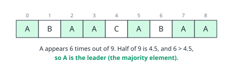
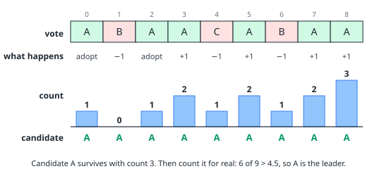

# Module: Leader Algorithm & Boyer-Moore Voting (Majority Element)

The Leader (or **Majority Element**) problem asks: given a sequence, find the single value that appears in **more than half** of the positions—or determine that no such element exists.

## Before you start
<!-- bite: 3efccd61-b387-4d0e-8ecf-5af0016ecc40 -->

- You can scan an array and maintain a running value — [[01-loops-and-what-they-cost|loops and what they cost]].
- You know what a hash map would cost here — [[03-hash-maps|hash maps]].

**After this lesson you will be able to:**

1. Implement **Boyer–Moore voting** in $O(n)$ time and $O(1)$ space.
2. Explain the cancellation argument that makes it work.
3. Say why the **verification pass is not optional**, and demonstrate what happens without it.
4. Generalise it to elements appearing more than $n/3$ times.

**Study route:** read 1–5, attempt the prediction in section 4, then run the lab. Block 3 shows the algorithm confidently returning a non-answer.

---

## What the leader problem is
<!-- bite: 22f2c3d9-81b5-42c7-b4d8-9c5b9a99afc3 -->

The leader of a list is the value that fills more than half of it.

Welcome to the **Leader Algorithm** module.

This problem is a masterclass in progressive algorithmic thinking. We'll walk through three genuinely different solutions, each teaching a distinct idea rather than being a minor tweak of the last.

## 1. Real-World Motivation & Physical Metaphors
<!-- bite: 33a400df-9314-46fd-a4df-3ebaf8b27d82 -->

Imagine a **National Election with Proportional Voting**:



## 1. Where the leader problem shows up
<!-- bite: 98f10b31-c36a-4663-b840-34fcff5b5454 -->

Here are three places where finding a majority matters.

1. **Distributed Systems Consensus**: In fault-tolerant systems like **Apache Raft**, servers identify a "leader" node that receives votes from the majority of the cluster.
2. **Data Stream Majority Detection**: Finding the most common network packet type in a high-throughput data stream without buffering all packets.
3. **Sensor Fusion**: Identifying the "consensus" sensor reading among multiple sensors where the majority is expected to agree.

> [!KEY-INSIGHT]
> A sequence can have **at most one leader**. If two values each appeared more than half the time, their combined count would exceed 100% of the array length—impossible!

---

## 2. Plain-English Terminology & Concept Table
<!-- bite: fa49c3ed-1076-4f9b-941f-c359f480f6ed -->

| Term | Plain-English Definition | Analogy |
| :--- | :--- | :--- |
| **Leader / Majority Element** | A value appearing **strictly more than $\lfloor N/2 \rfloor$** times in the sequence. | An election candidate winning over 50% of votes. |
| **Majority Threshold** | The count that must be exceeded: $\lfloor N/2 \rfloor$. | The 50% vote threshold. |
| **Boyer-Moore Cancellation** | Pairing opposing values and canceling them out; the survivor is the candidate. | In a voting contest, matching each "Against" vote with a "For" vote and discarding both. |

---

## 3. Technical Deep Dive: Three Solutions (Naive → Optimal)
<!-- bite: b2b3bbf4-714a-40e9-963e-ba9807ba7e66 -->

### Approach 1: Brute Force ($O(n^2)$) — Check Every Candidate

For every candidate value in the array, scan the entire array to count its occurrences:

```python
def leader_brute_force(A: list) -> int:
    """O(n²) brute force: re-scans array for every candidate element."""
    n = len(A)
    for candidate in A:
        count = sum(1 for x in A if x == candidate)
        if count > n // 2:
            return candidate
    return -1  # No leader exists
```

**Why it's slow**: For each of the $N$ candidates, we scan all $N$ elements → $O(N^2)$ total.

---

## 3. Approach 2: sort first, then check the middle, $O(n \log n)$
<!-- bite: ace9d16f-83b8-4da2-b3e9-28978c9b3588 -->

The second approach sorts the list and looks at the middle.

After sorting, all identical values become adjacent. If a leader exists, it **must** occupy the middle index `A[n // 2]` of the sorted array, because there are not enough other elements to push it out:

```python
def leader_sort(A: list) -> int:
    """O(n log n): Sort array, check the mandatory middle position."""
    n = len(A)
    sorted_A = sorted(A)  # Avoids mutating original input
    candidate = sorted_A[n // 2]
    count = sum(1 for x in A if x == candidate)
    return candidate if count > n // 2 else -1
```

**Why this works**: A leader occupying more than $N/2$ positions must be present at the middle index when values are packed together by sorting.

---

## 3. Approach 3: Boyer-Moore voting, $O(n)$ time and $O(1)$ space
<!-- bite: 59cb94de-5900-4ed1-9f24-195fff8efdfb -->

The third approach finds the leader in one pass, with almost no extra memory.

> [!KEY-INSIGHT]
> **The Core Insight**: If you remove any pair of two *different* values from the sequence, the leader remains the leader of what's left. A matched pair contains at most one leader occurrence—so the leader's proportion only grows.

Simulate the "remove mismatched pairs" process using just a running count:

## 3. Boyer-Moore voting: the code
<!-- bite: 6df62589-5f7e-4b8a-a9b3-9b39aa7bf1ed -->

Here is the voting method as code.

```python
def leader_boyer_moore(A: list) -> int:
    """O(n) time, O(1) space: Boyer-Moore Voting Algorithm."""
    # Phase 1: Find the candidate via pairwise cancellation
    candidate = None
    count = 0
    
    for value in A:
        if count == 0:
            candidate = value  # Start fresh with this value
            count = 1
        elif value == candidate:
            count += 1         # Same value: reinforce the candidate
        else:
            count -= 1         # Different value: cancel one occurrence
            
    # Phase 2: Verify the candidate is a true majority (MANDATORY!)
    # Boyer-Moore finds a candidate even when NO leader exists!
    if candidate is None:
        return -1
        
    actual_count = sum(1 for x in A if x == candidate)
    return candidate if actual_count > len(A) // 2 else -1
```

## 3. Boyer-Moore voting, step by step
<!-- bite: 12dfc6ca-39ae-4a79-84b3-91a62ab25fd9 -->

Here is the vote count traced on nine votes.

**Step-by-step visualization** on `[A, B, A, A, C, A, B, A, A]`:


---

## 4. Algorithm Comparison
<!-- bite: d786265f-ffe4-4c04-bc61-a29edc2488be -->

| Approach | Time | Space | Key Idea |
| :--- | :--- | :--- | :--- |
| **Brute Force** | $O(n^2)$ | $O(1)$ | Re-scan array for every candidate. |
| **Sort + Check Middle** | $O(n \log n)$ | $O(1)$ | Leader must land at sorted midpoint. |
| **Boyer-Moore Voting** | **$O(n)$** | **$O(1)$** | Pairwise cancellation; survivor = candidate. |

---

## Implementation — complete runnable example
<!-- bite: 7473c78e-d9f3-463e-8f62-f8906cc8042e -->

**Runnable example:** save as `leader.py` in any empty directory and run `python3 leader.py`. Standard library only; writes no files.

```python
"""Boyer-Moore voting: the candidate, the proof idea, and the mandatory check."""
import random
from collections import Counter


def boyer_moore(xs):
    """Returns a CANDIDATE. It is only the majority if it survives verification."""
    candidate, count = None, 0
    for v in xs:
        if count == 0:
            candidate, count = v, 1
        elif v == candidate:
            count += 1
        else:
            count -= 1
    return candidate


def majority(xs):
    """The complete algorithm: candidate, then verify."""
    if not xs:
        return None
    c = boyer_moore(xs)
    return c if xs.count(c) > len(xs) // 2 else None


def majority_hashmap(xs):
    """The obvious O(n) time, O(n) space version, as an oracle."""
    if not xs:
        return None
    v, n = Counter(xs).most_common(1)[0]
    return v if n > len(xs) // 2 else None


def majority_n3(xs):
    """At most two elements can appear more than n/3 times."""
    c1 = c2 = None
    n1 = n2 = 0
    for v in xs:
        if v == c1:
            n1 += 1
        elif v == c2:
            n2 += 1
        elif n1 == 0:
            c1, n1 = v, 1
        elif n2 == 0:
            c2, n2 = v, 1
        else:
            n1 -= 1
            n2 -= 1
    return sorted(c for c in {c1, c2} if c is not None and xs.count(c) > len(xs) // 3)


def trace(xs):
    rows = []
    candidate, count = None, 0
    for v in xs:
        if count == 0:
            candidate, count = v, 1
            why = "count was 0, adopt"
        elif v == candidate:
            count += 1
            why = "matches, +1"
        else:
            count -= 1
            why = "differs, -1"
        rows.append((v, candidate, count, why))
    return rows


if __name__ == "__main__":
    print("Block 1 - the cancellation, step by step")
    xs = [2, 2, 1, 1, 1, 2, 2]
    print(f"  input {xs}  (2 appears 4 times of 7, so it IS the majority)")
    print("     saw   candidate   count   reason")
    for v, c, n, why in trace(xs):
        print(f"      {v}       {c}         {n}     {why}")
    assert majority(xs) == 2
    print("  the idea: pair each majority element with a different one and discard")
    print("  both. A true majority has more than half, so it cannot be exhausted -")
    print("  whatever survives the pairing must be it.")

    print()
    print("Block 2 - correctness against a hash-map oracle")
    rng = random.Random(20260910)
    for _ in range(2000):
        n = rng.randint(0, 30)
        pool = [rng.randint(0, 4) for _ in range(n)]
        if rng.random() < 0.5 and n:                      # half the time, force a majority
            v = rng.randint(0, 4)
            for i in range(n // 2 + 1):
                pool[i] = v
            rng.shuffle(pool)
        assert majority(pool) == majority_hashmap(pool), pool
    print("  2,000 random arrays: agrees with the hash-map version every time")

    print()
    print("Block 3 - WITHOUT the verification pass, it lies")
    no_majority = [1, 2, 3, 4, 5]
    cand = boyer_moore(no_majority)
    print(f"  input {no_majority} - no element appears more than {len(no_majority)//2} times")
    print(f"    raw candidate: {cand}   <- looks like an answer")
    print(f"    with verification: {majority(no_majority)}")
    assert cand is not None and majority(no_majority) is None
    print("  the voting phase ALWAYS returns something. It only promises that IF a")
    print("  majority exists, it is the candidate. It promises nothing otherwise.")
    print("  Skipping the count is the single most common way to get this wrong.")

    print()
    print("  more cases where the raw candidate is not a majority:")
    for arr in ([1, 2, 3], [1, 1, 2, 2], [7, 8, 8, 7, 9]):
        print(f"    {str(arr):16} candidate {boyer_moore(arr)}   majority {majority(arr)}")
    assert majority([1, 1, 2, 2]) is None

    print()
    print("Block 4 - space, compared")
    big = [rng.randint(0, 100) for _ in range(100000)]
    for i in range(60000):
        big[i] = 42
    rng.shuffle(big)
    print(f"  100,000 elements, 42 appears {big.count(42):,} times")
    print(f"    boyer-moore: {majority(big)}   extra space: 2 variables")
    print(f"    hash map:    {majority_hashmap(big)}   extra space: one entry per distinct value")
    assert majority(big) == majority_hashmap(big) == 42
    print(f"  the hash map would hold {len(set(big))} entries; voting holds 2.")
    print("  That is the whole point: O(1) space on a single pass, so it works on a")
    print("  stream you cannot store.")

    print()
    print("Block 5 - the n/3 generalisation")
    for arr in ([1, 1, 1, 3, 3, 2, 2, 2], [1, 2], [3, 3, 4], [1, 1, 2, 2, 3, 3]):
        got = majority_n3(arr)
        expect = sorted(v for v, c in Counter(arr).items() if c > len(arr) // 3)
        print(f"  {str(arr):26} > n/3: {str(got):12} expected {expect}")
        assert got == expect
    print("  at most 2 elements can exceed n/3, so 2 candidates and 2 counters suffice.")
    print("  In general, at most k-1 elements can exceed n/k - the same trick scales.")

    print()
    print("leader: passed")
```

## Implementation: what it prints
<!-- bite: 27f81e7d-c67f-4a05-a3b1-92e7379a6c41 -->

Here is what the lab prints when you run it.

Expected output:

```text
Block 1 - the cancellation, step by step
  input [2, 2, 1, 1, 1, 2, 2]  (2 appears 4 times of 7, so it IS the majority)
     saw   candidate   count   reason
      2       2         1     count was 0, adopt
      2       2         2     matches, +1
      1       2         1     differs, -1
      1       2         0     differs, -1
      1       1         1     count was 0, adopt
      2       1         0     differs, -1
      2       2         1     count was 0, adopt
  the idea: pair each majority element with a different one and discard
  both. A true majority has more than half, so it cannot be exhausted -
  whatever survives the pairing must be it.

Block 2 - correctness against a hash-map oracle
  2,000 random arrays: agrees with the hash-map version every time

Block 3 - WITHOUT the verification pass, it lies
  input [1, 2, 3, 4, 5] - no element appears more than 2 times
    raw candidate: 5   <- looks like an answer
    with verification: None
  the voting phase ALWAYS returns something. It only promises that IF a
  majority exists, it is the candidate. It promises nothing otherwise.
  Skipping the count is the single most common way to get this wrong.

  more cases where the raw candidate is not a majority:
    [1, 2, 3]        candidate 3   majority None
    [1, 1, 2, 2]     candidate 1   majority None
    [7, 8, 8, 7, 9]  candidate 9   majority None

Block 4 - space, compared
  100,000 elements, 42 appears 60,393 times
    boyer-moore: 42   extra space: 2 variables
    hash map:    42   extra space: one entry per distinct value
  the hash map would hold 101 entries; voting holds 2.
  That is the whole point: O(1) space on a single pass, so it works on a
  stream you cannot store.

Block 5 - the n/3 generalisation
  [1, 1, 1, 3, 3, 2, 2, 2]   > n/3: [1, 2]       expected [1, 2]
  [1, 2]                     > n/3: [1, 2]       expected [1, 2]
  [3, 3, 4]                  > n/3: [3]          expected [3]
  [1, 1, 2, 2, 3, 3]         > n/3: []           expected []
  at most 2 elements can exceed n/3, so 2 candidates and 2 counters suffice.
  In general, at most k-1 elements can exceed n/k - the same trick scales.

leader: passed
```

Block 3 is the trap. The voting phase always returns *something*, and that something is meaningless unless a majority actually exists.

## 5. Common Pitfalls & Traps
<!-- bite: a16c6906-03bb-4284-b45b-82979248aa38 -->

1. **Skipping the Verification Pass**: Boyer-Moore **always produces a candidate** even when no majority element exists! The second pass confirming `count > n // 2` is **not optional**.
2. **Confusing Leader with Mode**: A "leader" requires *strict majority* (> 50%). The most common element ("mode") might appear only 30% of the time.
3. **Integer vs. General Values**: Boyer-Moore works for any comparable type, not just integers.

---

## Check your understanding
<!-- bite: 8d53870b-9dc7-442e-94b0-199f2f473b85 -->

Try each one before you open the answer.

1. <!-- q: exact id="7899563a" answer="6" -->
   A leader is a value that appears in more than half of the positions. In an array of length 10, at least how many times must the leader appear?

   <details><summary>Answer</summary>

   6, because it must be strictly more than 10 ÷ 2 = 5.

   </details>

2. <!-- q: mcq id="78d3fb89" -->
   After sorting, why must a leader sit at index n // 2?

   - [ ] Because sorting puts the most common value first
   - [x] It fills more than half the positions, so its block of equal values must cover the middle
   - [ ] Because n // 2 is always the median value
   - [ ] It does not have to

   <details><summary>Answer</summary>

   The other values together take fewer than half the positions, which is not enough room to push the leader's block past the middle, on either side.

   </details>

3. <!-- q: mcq id="176bda9b" -->
   Why does Boyer–Moore voting need a second pass to count the candidate?

   - [ ] Because the first pass may miss the leader when one exists
   - [x] Because if there is no leader, the first pass still leaves some survivor, which must be checked
   - [ ] To sort the array
   - [ ] To find the index of the leader

   <details><summary>Answer</summary>

   Cancellation always produces a candidate. If a leader exists it is that candidate; if not, the survivor is just whoever won by chance. Counting it confirms or rejects it.

   </details>

4. <!-- q: mcq id="57c371f2" -->
   What idea makes Boyer–Moore voting correct?

   - [x] Removing a pair of two different values never stops the leader from being the leader of what is left
   - [ ] The leader is always the first element
   - [ ] The leader is always the largest value
   - [ ] Pairs of equal values cancel out

   <details><summary>Answer</summary>

   Each removed pair contains at most one copy of the leader, so the leader still holds more than half of the rest. The running count simulates removing such pairs in O(n) time and O(1) space.

   </details>

5. <!-- q: open id="bcc26957" -->
   Compare the three leader solutions (brute force, sorting, Boyer–Moore) on time and space.

   <details><summary>Answer</summary>

   Brute force counts every candidate: O(n²) time, O(1) space. Sorting and checking the middle: O(n log n) time, plus O(n) space if you sort a copy. Boyer–Moore: one cancelling pass and one counting pass, O(n) time and O(1) space.

   </details>

## Check your understanding: worked problems
<!-- bite: cb04c67c-630b-4705-917e-51c779d1b85e -->

Work each one out on paper first, then type your answer.

1. <!-- q: gap id="41bc8bc7" answers="4;5;4" -->
   Fill in the gaps. Boyer–Moore voting runs on [4, 7, 4, 4, 2, 4, 7, 4]. The candidate after the first pass is ___. It appears ___ times, so the leader is ___ (or −1 if none).

   <details><summary>Answer</summary>

   The count goes 1, 0, 1, 2, 1, 2, 1, 2 with candidate 4. 4 appears 5 times, more than 8 // 2 = 4, so 4 is the leader.

   </details>

2. <!-- q: gap id="566907c6" answers="2;-1|−1|none" -->
   Fill in the gaps. Boyer–Moore voting runs on [3, 3, 1, 1, 1, 2, 2]. The candidate after the first pass is ___, and after the counting pass the function returns ___.

   <details><summary>Answer</summary>

   The candidate is 2: the 3s and 1s cancel down, and 2 is the last one standing. But 2 appears only twice in 7, so there is no leader and the answer is −1. This is why the second pass exists.

   </details>

3. <!-- q: gap id="6f8d9b62" answers="2;2;-1|−1|none" -->
   Fill in the gaps. The sorting method sorts [1, 2, 3, 1, 2, 3, 1] into [1, 1, 1, 2, 2, 3, 3] and checks the value at index 7 // 2. That value is ___, it appears ___ times, and so the method returns ___.

   <details><summary>Answer</summary>

   Index 3 holds 2, which appears only twice, not more than 3 times, so the result is −1. The most common value, 1, appears 3 times out of 7, which is not a majority either.

   </details>

## Practice — independent task
<!-- bite: a207552e-a6a2-415d-a326-a5ec04c62265 -->

Implement `heavy_hitters(stream, k)` — every element appearing more than $n/k$ times, in one pass and $O(k)$ space.

1. Generalise the two-candidate version: keep $k-1$ candidates with counts. On a new element, increment if present; else take an empty slot; else decrement **all** counters and drop any that reach zero. This is the Misra–Gries algorithm.
2. Prove to yourself that $k-1$ slots suffice, by arguing about how much "weight" each decrement removes. State the argument in a comment.
3. Verification is again mandatory: a second pass counting only the surviving candidates.

## Practice: test it, then use it as a sketch
<!-- bite: de7c6739-9318-4dfe-88b3-2e8235330b43 -->

Then test your version and try it with only one pass.

4. Test against a `Counter` oracle on many random streams with varying $k$ and skew.
5. **Then use it as a sketch.** Run it *without* the second pass on a stream you cannot re-read, and measure the error: for each reported candidate, how far is its counter from the true count? There is a known bound — the counter underestimates by at most $n/k$. Confirm it empirically and report the worst case you saw.

**Edge cases:** $k = 2$ (plain majority); $k > n$; an empty stream; every element distinct; a stream where exactly $k-1$ elements qualify.

**Done when:** your two-pass version matches the oracle on every test, and your one-pass error is within the $n/k$ bound across at least a thousand random streams.

## Before moving on
<!-- bite: 0ec818dc-8e6d-4061-9c21-297b7b78b2a3 -->

You can implement voting, explain the cancellation, and say why verification is mandatory.

**Recap:** Boyer–Moore finds a **candidate** in $O(n)$ time and $O(1)$ space by pairing off unequal elements; a true majority survives because it has more than half the elements; the algorithm always returns something, so **you must verify with a second count**; at most $k-1$ elements can exceed $n/k$, which is what makes the generalisation work with $k-1$ counters.

**Next:** [[10-max-slice-algorithms|Max Slice]] — another one-pass array algorithm with a running value.

## Related Modules
<!-- bite: cd88f0ea-68df-4cf3-a422-9527cca821be -->
- [[01-when-greedy-works|Greedy Algorithms]] — Boyer-Moore is a greedy approach
- [[05-sorting/index|Sorting Algorithms]] — $O(n \log n)$ sort-based solution
