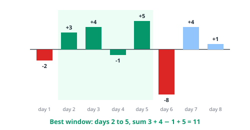
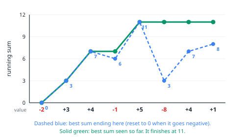

# Module: Maximum Slice Problem — Kadane's Algorithm

Welcome to the **Maximum Slice** module. The problem: given a sequence of integers (which may include negative numbers), find the **contiguous subarray (slice)** with the largest possible sum.

This is one of the most elegant problems in computer science, illustrating how a **dynamic programming insight** can slash a naïve $O(n^3)$ solution all the way down to a single-pass $O(n)$ algorithm.

---

## Before you start
<!-- bite: 2a1ff399-9444-4267-affc-19f82c6685a6 -->

- You can reason about prefix sums — [[04-patterns/01-prefix-sum|prefix sum]].
- You know what $O(n^2)$ and $O(n)$ mean in practice — [[01-growth-and-asymptotic-notation|complexity analysis]].

**After this lesson you will be able to:**

1. Implement **Kadane's algorithm** in one pass and explain its single decision.
2. Handle the **all-negative** case correctly — the edge case most implementations get wrong.
3. Return the slice **indices**, not just the sum.
4. Explain why Kadane's is simultaneously a greedy algorithm and a dynamic program.

**Study route:** read 1–5, attempt the prediction in section 4, then run the lab. Block 3 is the edge case.

---

## 1. Real-World Motivation & Physical Metaphors
<!-- bite: 9ab5e843-c5d3-46de-9306-3e6ce8878e90 -->

Imagine you're a **Stock Day Trader** analyzing daily profit/loss figures:



The best window is days 2 through 5: $3 + 4 + (-1) + 5 = 11$. Notice it carries the −1, because the +5 after it more than pays for it.

You want to find the contiguous window of days that maximizes your cumulative profit.

### Real-World Applications:
1. **Financial Analysis**: Finding the optimal holding window for a stock position.
2. **Signal Processing**: Isolating the highest-amplitude segment of a noisy signal.
3. **Genomics**: Identifying the highest-density gene sequence region in a DNA strand.

---

## 2. Plain-English Terminology & Concept Table
<!-- bite: 70035779-f406-4386-8f1c-d4576e916ab1 -->

| Term | Plain-English Definition | Analogy |
| :--- | :--- | :--- |
| **Subarray / Slice** | A contiguous block of elements within the array. | A date range window on a calendar. |
| **`max_ending_here`** | The maximum sum achievable by any subarray that ends exactly at the current position. | Best P&L for any trade window ending today. |
| **`max_so_far`** | The global running maximum found across all positions so far. | The best trade window discovered at any point in history. |
| **Kadane's Algorithm** | A linear-time DP algorithm maintaining the best suffix subarray sum at each step. | Day-by-day profit tracking with automatic "cut your losses" reset. |

---

## 3. Three Solutions: Naïve → Optimal
<!-- bite: d8a8c70e-efdf-47cb-9e3b-aafce54e961c -->

### Approach 1: Brute Force ($O(n^3)$)

Check every possible slice `[p, q]` and sum each from scratch:

```python
def max_slice_brute(A: list) -> int:
    """O(n³): Checks every possible subarray and recomputes its sum."""
    n = len(A)
    result = 0
    for p in range(n):
        for q in range(p, n):
            result = max(result, sum(A[p:q + 1]))  # O(n) inner sum
    return result
```

**Why slow**: $O(n^2)$ possible subarrays, each summed in $O(n)$ → **$O(n^3)$ total**.

---

### Approach 2: Running Sum ($O(n^2)$)

Maintain a running sum for a fixed starting index `p`. When we move `q` forward by one, we extend the running sum by one addition instead of recomputing from scratch:

```python
def max_slice_quadratic(A: list) -> int:
    """O(n²): Eliminates redundant re-summing with a running total."""
    n = len(A)
    result = 0
    for p in range(n):
        running_sum = 0
        for q in range(p, n):
            running_sum += A[q]     # O(1) extension instead of O(n) re-sum
            result = max(result, running_sum)
    return result
```

---

### Approach 3: Kadane's Algorithm ($O(n)$, $O(1)$ Space)

> [!KEY-INSIGHT]
> **The Recurrence**: The best subarray ending at position $i$ is either:
> 1. The best subarray ending at position $i-1$, extended by one element (`max_ending_here + A[i]`), OR
> 2. Start a brand new subarray at position $i$ alone (`A[i]`)
> 
> In other words: **if carrying the negative baggage of a prior run makes things worse than starting fresh, cut and restart.**

```python
def max_slice_kadane(A: list) -> int:
    """O(n) time, O(1) space: Kadane's Algorithm."""
    max_ending_here = 0  # Best sum for subarrays ending AT current index
    max_so_far = 0       # Best sum found ANYWHERE so far
    
    for value in A:
        # Either extend the previous best suffix, or reset to 0 (empty slice)
        max_ending_here = max(0, max_ending_here + value)
        max_so_far = max(max_so_far, max_ending_here)
        
    return max_so_far
```

**Walkthrough on `[-2, 3, 4, -1, 5, -8, 4, 1]`:**


The `max(0, ...)` is the key: by resetting to 0, we allow starting a completely new subarray from the next element, which is equivalent to "allowing the empty slice" as a baseline.

---

## 4. Why Kadane's is Dynamic Programming
<!-- bite: 7907555e-98df-4fcd-b913-a2b712815f28 -->

Kadane's algorithm is a minimal, single-variable form of **Dynamic Programming**:

| DP Characteristic | Kadane's Algorithm |
| :--- | :--- |
| **Subproblem definition** | `max_ending_here[i]` = best subarray sum ending at index `i`. |
| **Recurrence relation** | `max_ending_here[i] = max(0, max_ending_here[i-1] + A[i])` |
| **Optimal substructure** | Global answer built from optimal answers to smaller problems. |
| **Space optimization** | Only the immediately previous subproblem value is ever needed → $O(1)$ space. |

---

## 5. Complexity Summary
<!-- bite: 5905bb4e-8bac-4537-a379-3d3992cef465 -->

| Approach | Time | Space | Key Idea |
| :--- | :--- | :--- | :--- |
| **Brute Force** | $O(n^3)$ | $O(1)$ | Re-sum every subarray from scratch. |
| **Running Sum** | $O(n^2)$ | $O(1)$ | Extend running sum instead of re-summing. |
| **Kadane's Algorithm** | **$O(n)$** | **$O(1)$** | DP recurrence: extend or reset. |

---

## Implementation — complete runnable example
<!-- bite: 631b70f1-ab07-4e1c-a5d0-93e2e832e139 -->

**Runnable example:** save as `max_slice.py` in any empty directory and run `python3 max_slice.py`. Standard library only; writes no files.

```python
"""Kadane's algorithm: one pass, one decision, and the edge case that breaks it."""
import random


def brute_force(xs):
    """Every slice, exhaustively. O(n^2) - the oracle."""
    if not xs:
        return None, None, None
    best = float("-inf")
    bi = bj = 0
    for i in range(len(xs)):
        total = 0
        for j in range(i, len(xs)):
            total += xs[j]
            if total > best:
                best, bi, bj = total, i, j
    return best, bi, bj


def kadane_broken(xs):
    """The version you will find in half the tutorials. It has a bug."""
    best = 0                                   # BUG: assumes the answer is never negative
    current = 0
    for v in xs:
        current = max(0, current + v)
        best = max(best, current)
    return best


def kadane(xs):
    """Correct for all inputs, including all-negative. Returns (sum, start, end)."""
    if not xs:
        return None, None, None
    best = current = xs[0]
    bi = bj = ci = 0
    for j in range(1, len(xs)):
        v = xs[j]
        # THE decision: extend the running slice, or start fresh here?
        if current + v >= v:
            current = current + v
        else:
            current, ci = v, j
        if current > best:
            best, bi, bj = current, ci, j
    return best, bi, bj


def max_slice_prefix(xs):
    """The same answer via prefix sums: best[j] = prefix[j] - min prefix before j."""
    if not xs:
        return None
    best = float("-inf")
    running = 0
    min_prefix = 0
    for j, v in enumerate(xs):
        running += v
        if j == 0:
            best = v
            min_prefix = min(0, running)
            continue
        best = max(best, running - min_prefix)
        min_prefix = min(min_prefix, running)
    return best


if __name__ == "__main__":
    print("Block 1 - the running decision, traced")
    xs = [-2, 1, -3, 4, -1, 2, 1, -5, 4]
    print(f"  input {xs}")
    print("     j   value   extend?   current   best")
    best = current = xs[0]
    for j in range(1, len(xs)):
        v = xs[j]
        extend = current + v >= v
        current = current + v if extend else v
        best = max(best, current)
        print(f"    {j:2}   {v:5}   {str(extend):7}   {current:7}   {best:4}")
    total, i, j = kadane(xs)
    print(f"  answer {total} from index {i} to {j}: {xs[i:j+1]}")
    assert (total, i, j) == (6, 3, 6)

    print()
    print("Block 2 - checked against exhaustive search")
    rng = random.Random(20260910)
    for _ in range(3000):
        n = rng.randint(1, 25)
        arr = [rng.randint(-15, 15) for _ in range(n)]
        k_sum, ki, kj = kadane(arr)
        b_sum, _, _ = brute_force(arr)
        assert k_sum == b_sum, (arr, k_sum, b_sum)
        assert sum(arr[ki:kj + 1]) == k_sum, "the returned indices must produce the sum"
    print("  3,000 random arrays: sum matches brute force, and the indices are valid")

    print()
    print("Block 3 - the all-negative case, where the common version fails")
    cases = [[-2, -3, -1, -5], [-7], [-1, -1], [3, -1, 2], [0, -1]]
    print("     input             correct   'max(0, ...)' version")
    for arr in cases:
        good, _, _ = kadane(arr)
        bad = kadane_broken(arr)
        flag = "" if good == bad else "   <-- WRONG"
        print(f"   {str(arr):18} {good:8}   {bad:19}{flag}")
    assert kadane([-2, -3, -1, -5])[0] == -1
    assert kadane_broken([-2, -3, -1, -5]) == 0
    print("  the broken version returns 0 by choosing the EMPTY slice.")
    print("  Whether that is right depends on the problem statement: if a slice must")
    print("  be non-empty, 0 is wrong and the answer is the largest single element.")
    print("  Read the constraints - this is a specification question, not a bug in")
    print("  Kadane's, and it is the most common way this problem is failed.")

    print()
    print("Block 4 - the same answer, three ways")
    for arr in ([-2, 1, -3, 4, -1, 2, 1, -5, 4], [1, 2, 3], [-5, -2, -8]):
        k, _, _ = kadane(arr)
        b, _, _ = brute_force(arr)
        p = max_slice_prefix(arr)
        print(f"  {str(arr):32} kadane {k:4}  brute {b:4}  prefix-sum {p:4}")
        assert k == b == p
    print("  the prefix-sum view: the best slice ending at j is prefix[j] minus the")
    print("  SMALLEST prefix before j - so track the running minimum instead of an array.")
    print("  Kadane's is that idea with the bookkeeping folded away.")

    print()
    print("Block 5 - why it is greedy AND dynamic programming")
    print("   DP framing:     best_ending_here[j] = max(xs[j], best_ending_here[j-1] + xs[j])")
    print("                   answer = max over j")
    print("   greedy framing: if the running total is not helping, abandon it")
    print("   they are the same rule. The DP table has one row and each entry depends")
    print("   only on the previous, so it collapses to a single variable - which is")
    print("   what makes it O(1) space.")
    n = 200000
    big = [rng.randint(-50, 50) for _ in range(n)]
    total, i, j = kadane(big)
    print(f"  {n:,} elements: best slice sum {total:,} spanning indices {i:,}..{j:,}")
    assert sum(big[i:j + 1]) == total
    print("  one pass, two variables, no allocation")

    print()
    print("max_slice: passed")
```

Expected output:

```text
Block 1 - the running decision, traced
  input [-2, 1, -3, 4, -1, 2, 1, -5, 4]
     j   value   extend?   current   best
     1       1   False           1      1
     2      -3   True           -2      1
     3       4   False           4      4
     4      -1   True            3      4
     5       2   True            5      5
     6       1   True            6      6
     7      -5   True            1      6
     8       4   True            5      6
  answer 6 from index 3 to 6: [4, -1, 2, 1]

Block 2 - checked against exhaustive search
  3,000 random arrays: sum matches brute force, and the indices are valid

Block 3 - the all-negative case, where the common version fails
     input             correct   'max(0, ...)' version
   [-2, -3, -1, -5]         -1                     0   <-- WRONG
   [-7]                     -7                     0   <-- WRONG
   [-1, -1]                 -1                     0   <-- WRONG
   [3, -1, 2]                4                     4
   [0, -1]                   0                     0
  the broken version returns 0 by choosing the EMPTY slice.
  Whether that is right depends on the problem statement: if a slice must
  be non-empty, 0 is wrong and the answer is the largest single element.
  Read the constraints - this is a specification question, not a bug in
  Kadane's, and it is the most common way this problem is failed.

Block 4 - the same answer, three ways
  [-2, 1, -3, 4, -1, 2, 1, -5, 4]  kadane    6  brute    6  prefix-sum    6
  [1, 2, 3]                        kadane    6  brute    6  prefix-sum    6
  [-5, -2, -8]                     kadane   -2  brute   -2  prefix-sum   -2
  the prefix-sum view: the best slice ending at j is prefix[j] minus the
  SMALLEST prefix before j - so track the running minimum instead of an array.
  Kadane's is that idea with the bookkeeping folded away.

Block 5 - why it is greedy AND dynamic programming
   DP framing:     best_ending_here[j] = max(xs[j], best_ending_here[j-1] + xs[j])
                   answer = max over j
   greedy framing: if the running total is not helping, abandon it
   they are the same rule. The DP table has one row and each entry depends
   only on the previous, so it collapses to a single variable - which is
   what makes it O(1) space.
  200,000 elements: best slice sum 18,620 spanning indices 44,619..190,562
  one pass, two variables, no allocation

max_slice: passed
```

Block 3 is the one that matters. `max(0, ...)` silently answers a *different question* — "the best slice, or the empty one" — and whether that is correct depends entirely on the problem statement.

## Check your understanding
<!-- bite: e5453507-2d3a-4deb-946d-2c8c17f80a22 -->

Try each one before you open the answer.

1. <!-- q: mcq id="27935321" -->
   Kadane's algorithm sets `max_ending_here = max(0, max_ending_here + value)`. Why reset to 0 rather than to the current value?

   - [ ] Because 0 is faster to store
   - [x] Because this version allows the empty slice (sum 0) as an answer, and 0 means "start fresh from the next element"
   - [ ] Because negative numbers are not allowed
   - [ ] It makes no difference to the answer

   <details><summary>Answer</summary>

   A running sum below 0 can only hurt whatever comes next, so dropping it and starting over is never worse. If the problem forbids an empty slice, reset to the current value instead.

   </details>

2. <!-- q: mcq id="740cace2" -->
   What does `max_ending_here` mean as a dynamic-programming state?

   - [ ] The best slice anywhere in the array
   - [x] The best sum of a slice that ends exactly at the current position
   - [ ] The sum of all elements so far
   - [ ] The start index of the best slice

   <details><summary>Answer</summary>

   Each value is computed from the one before it: extend the previous best slice, or start fresh. `max_so_far` keeps the best of these over every position.

   </details>

3. <!-- q: exact id="f744ab41" answer="0" -->
   Kadane's algorithm with the `max(0, …)` reset runs on [−5, −3, −8, −1]. What does it return?

   <details><summary>Answer</summary>

   0, the empty slice. Every element is negative, so max_ending_here resets to 0 at every step. If at least one element must be taken, the answer would be −1.

   </details>

4. <!-- q: gap id="2c38d69b" answers="O(n³)|n³|n^3;O(n²)|n²|n^2;O(n)|n" -->
   Fill in the gaps. Summing every slice from scratch is ___. Keeping a running sum for each start is ___. Kadane's algorithm is ___.

   <details><summary>Answer</summary>

   O(n³), O(n²), O(n). Each step removes repeated work: the running sum avoids re-adding, and Kadane's avoids trying every start.

   </details>

5. <!-- q: open id="b818149c" -->
   In one sentence each, what are the two choices Kadane's algorithm makes at every element, and why is that enough?

   <details><summary>Answer</summary>

   Either extend the best slice ending at the previous element by this one, or start a new slice here (or empty). Any slice ending here is one of those two, so the best one is the better of the two, and the best overall is the best over all ending positions.

   </details>

## Check your understanding: worked problems
<!-- bite: 7275ff37-ab3d-45d0-8947-f8ac0e4c1ace -->

Work each one out on paper first, then type your answer.

1. <!-- q: gap id="3ee62334" answers="4;0;3;2;4;0;6;4;6" -->
   Fill in the gaps. Kadane's algorithm (`max_ending_here = max(0, max_ending_here + value)`) runs on [4, −6, 3, −1, 2, −5, 6, −2]. The max_ending_here values are ___, ___, ___, ___, ___, ___, ___, ___, and the maximum slice sum is ___.

   <details><summary>Answer</summary>

   4, 0, 3, 2, 4, 0, 6, 4, and the answer is 6 (the slice [6]). The slice [3, −1, 2] also reaches 4 but not 6.

   </details>

2. <!-- q: exact id="e7b2525a" answer="3" -->
   What is the maximum sum of a contiguous slice of [1, −3, 2, 1, −1]?

   <details><summary>Answer</summary>

   3, from the slice [2, 1]. Kadane's running values are 1, 0, 2, 3, 2.

   </details>

3. <!-- q: exact id="79768545" answer="7" -->
   A share's prices on consecutive days are [7, 1, 5, 3, 6, 4, 8, 2]. Turn them into daily changes (each price minus the day before) and find the maximum slice sum of the changes. What is it?

   <details><summary>Answer</summary>

   7. The changes are [−6, 4, −2, 3, −2, 4, −6], and the best slice is 4 − 2 + 3 − 2 + 4 = 7: buy at 1, sell at 8.

   </details>

## Practice — independent task
<!-- bite: 6e832884-b05b-4021-a737-9d8ed51a8308 -->

Extend Kadane's to the **maximum sum rectangle** in a 2-D grid.

1. Fix a pair of rows, top and bottom. Collapse the columns between them into a 1-D array of column sums, then run Kadane's on it. The best rectangle for that row pair is the best slice of that array.
2. Repeat over all $O(R^2)$ row pairs. Total cost $O(R^2 C)$.
3. Return the rectangle's **coordinates** as well as its sum, and verify by summing the region directly.
4. Check against a brute force over all $O(R^2C^2)$ rectangles on grids up to $6\times6$.
5. **Then optimise the collapse.** Recomputing column sums for each row pair is $O(RC)$ per pair, giving $O(R^3C)$. Maintain a running column-sum array as the bottom row advances instead, restoring $O(R^2C)$. Measure the difference at $R = C = 120$ and report the ratio.

**Edge cases:** an all-negative grid (the same specification question as block 3 — decide and document); a single row; a single column; a $1\times1$ grid.

**Done when:** your coordinates reproduce the reported sum, brute force agrees on every small grid, and your step-5 optimisation shows the speed-up you predicted.

## Before moving on
<!-- bite: 4b4b03c2-0d4a-476b-bea7-3159dd477679 -->

You can implement Kadane's, return indices, handle all-negative input, and explain the DP/greedy duality.

**Recap:** at each element, either extend the running slice or start fresh — whichever is larger; $O(n)$ time, $O(1)$ space; initialise with `xs[0]`, **not** 0, unless the empty slice is explicitly allowed; return indices by tracking where the current slice started; equivalently, the best slice ending at $j$ is $\text{prefix}[j]$ minus the smallest earlier prefix.

**Next:** [[11-bit-manipulation|Bit Manipulation]], or back to [[index|the algorithms index]].

## Related Modules
<!-- bite: 5794a926-af4e-4a4a-8d63-027cf488aa8f -->
- [[01-growth-and-asymptotic-notation|Algorithms & Complexity Analysis]] — Recurrence derivation and notation
- [[05-sorting/index|Sorting Algorithms]] — $O(n \log n)$ sort-first approaches
