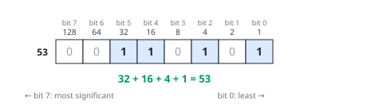
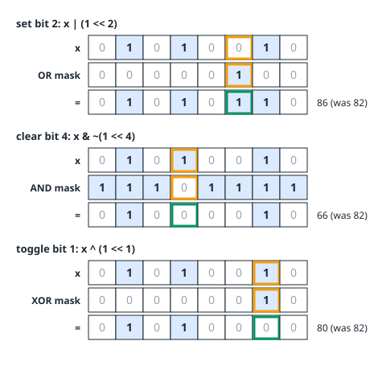
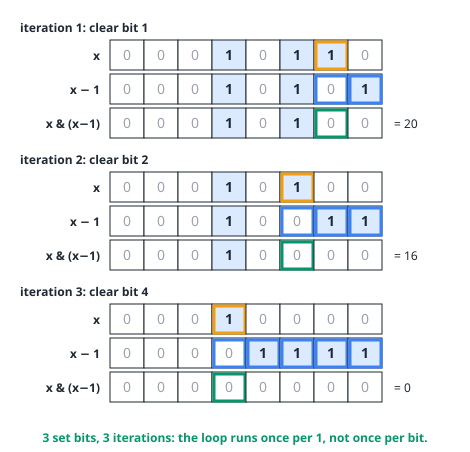

# Module: Bit Manipulation (Binary Operations & Space Optimization)

Welcome to the **Bit Manipulation** module. Every integer in a computer is stored as a sequence of binary digits (bits)—zeros and ones. Bit manipulation operates *directly* on those binary digits using special bitwise operators, bypassing the usual arithmetic layer entirely.

Mastering bit manipulation lets you solve problems with **$O(1)$ space** that would otherwise need hash sets or extra arrays, and unlocks powerful tricks for parity checking, power-of-two detection, and encoding subsets.

---

## Before you start
<!-- bite: dafbb222-41c7-4fc8-908d-e6a95b72e183 -->

- You know binary and hexadecimal — [[01-core/01-numbers/01-number-bases/02-binary|binary]], [[01-core/01-numbers/01-number-bases/04-hexadecimal|hexadecimal]].
- You know how integers are represented, including two's complement — [[computer-architecture/02-data-representation|data representation]].

**After this lesson you will be able to:**

1. Use the standard operators — AND, OR, XOR, NOT, shifts — and say what each one is *for*.
2. Apply the common idioms: test, set, clear and toggle a bit; isolate the lowest set bit; count set bits.
3. Use **XOR's self-inverse property** to solve problems that otherwise need extra space.
4. Enumerate all subsets of a set with a **bitmask**, and say when that is and is not feasible.

**Study route:** read 1–5, attempt the prediction in section 4, then run the lab.

---

## 1. Real-World Motivation & Physical Metaphors
<!-- bite: 6cfd38a6-8d99-4bc1-96d0-79ccf3df7105 -->

Think of an 8-bit integer as a **row of 8 light switches**:



- **Turning on switch 2 (OR)**: Sets bit 2 to 1, regardless of its current state.
- **Turning off switch 2 (AND NOT)**: Forces bit 2 to 0.
- **Flipping switch 2 (XOR)**: Toggles bit 2 between 0 and 1.

### Real-World Applications:
1. **Network Subnet Masks**: `IP & MASK` extracts the network address portion using bitwise AND.
2. **Permission Systems (Linux chmod)**: File permissions are stored as 3-bit groups (read=4, write=2, execute=1) operated on with OR, AND, XOR.
3. **Game Engine State Flags**: Storing 32 independent boolean game states in a single 32-bit integer.
4. **Cryptography**: XOR-based stream ciphers and hash functions.

---

## 2. Plain-English Terminology & Concept Table
<!-- bite: b9089f3b-8098-4431-8fd4-7529f552d812 -->

| Operator | Symbol | Behavior | Example (4-bit) |
| :--- | :--- | :--- | :--- |
| **AND** | `&` | Output 1 only if **both** inputs are 1. | `1100 & 1010 = 1000` |
| **OR** | `\|` | Output 1 if **either** input is 1. | `1100 \| 1010 = 1110` |
| **XOR** | `^` | Output 1 only if inputs **differ**. | `1100 ^ 1010 = 0110` |
| **NOT** | `~` | **Flips** every bit (two's complement: `~x = -x - 1`). | `~0101 = 1010` |
| **Left Shift** | `<<` | Shift bits left, fill 0s on right → **multiplies by $2^n$**. | `0011 << 2 = 1100` |
| **Right Shift** | `>>` | Shift bits right, discard low bits → **divides by $2^n$ (floor)**. | `1100 >> 1 = 0110` |

---

## 3. XOR — The Core Workhorse
<!-- bite: 86deeda1-51be-4a80-a18d-c0f35520f71d -->

XOR has three properties that drive most interview bit tricks:

```text
x ^ 0 = x          (XOR with 0 is identity — no change)
x ^ x = 0          (XOR with self cancels to 0)
XOR is commutative & associative  (order doesn't matter)
```

**The Consequence**: XOR the entire array → every value that appears an **even number of times cancels to 0**, leaving only the odd-count survivor:

```python
# Find the single non-duplicate element in O(n) time, O(1) space
def single_number(nums: list) -> int:
    result = 0
    for n in nums:
        result ^= n
    return result

# Example: [4, 1, 2, 1, 2]
# 4 ^ 1 ^ 2 ^ 1 ^ 2 = 4 ^ (1^1) ^ (2^2) = 4 ^ 0 ^ 0 = 4 ✓
```

---

## 4. The Essential Bit Manipulation Idioms
<!-- bite: 6a42c053-a0a6-418a-a677-98202894cff8 -->

```python
# 1. Check if bit i is set (nonzero = True)
(x >> i) & 1       # Shift i right, then check lowest bit

# 2. Set bit i to 1
x | (1 << i)       # Create mask with only bit i set, OR it in

# 3. Clear bit i to 0
x & ~(1 << i)      # Create mask with bit i cleared, AND it in

# 4. Toggle (flip) bit i
x ^ (1 << i)       # XOR with mask flips only bit i

# 5. Check if x is even or odd
x & 1              # 0 = even, 1 = odd

# 6. Check if x is a power of two (exactly ONE bit set)
x > 0 and (x & (x - 1)) == 0

# 7. Clear the LOWEST set bit (Brian Kernighan's trick)
x & (x - 1)       # Subtracting 1 flips lowest set bit and all below it; AND erases them

# 8. Isolate the LOWEST set bit only
x & (-x)           # All other bits zeroed out
```

## Seeing the idioms bit by bit

Here are idioms 2, 3 and 4 on x = 01010010 (82). Each one builds a mask with `1 << i` and combines it with x. The orange box is the bit being targeted; the green box is the result. OR turns it on, AND with the flipped mask turns it off, and XOR flips it. Every other bit passes through untouched.



---

## 5. Deep Dive: Brian Kernighan's Bit Count
<!-- bite: 7e93112c-8807-4cfb-9c49-181acf45ff6b -->

> [!KEY-INSIGHT]
> **`x & (x - 1)` always clears exactly the lowest set bit**.
>
> When you subtract 1 from `x`, the lowest set bit flips to 0 and all bits below it flip to 1. ANDing with the original `x` then clears that bit and all below it in one operation.

```python
def count_set_bits(x: int) -> int:
    """O(number of set bits) — Brian Kernighan's Algorithm."""
    count = 0
    while x:
        x &= (x - 1)  # Clear lowest set bit each iteration
        count += 1
    return count

# Example: x = 12 = 1100₂
# Iteration 1: 1100 & 1011 = 1000  (cleared bit 2)
# Iteration 2: 1000 & 0111 = 0000  (cleared bit 3)
# count = 2 ✓ (12 has two set bits)
```

## Seeing Kernighan's loop

Here is the loop on 22 (00010110). In each round, x − 1 flips the lowest 1 and every 0 below it (blue boxes). ANDing with x keeps only the bits both share, so that lowest 1 disappears (green box). Three 1s, three rounds.



---

## 6. Time & Space Complexity
<!-- bite: e3793c27-faf5-4c1e-a911-54b64a070d68 -->

| Technique | Time | Space | Benefit |
| :--- | :--- | :--- | :--- |
| **Any single bit operation** | $O(1)$ | $O(1)$ | Direct hardware instruction. |
| **Brian Kernighan bit count** | $O(k)$ where $k$ = set bits | $O(1)$ | Faster than looping all 32 bits. |
| **XOR single-number trick** | $O(n)$ | **$O(1)$** | Eliminates need for hash set. |
| **Bitmask DP (subset enumeration)** | $O(2^n \cdot n)$ | $O(2^n)$ | Encodes all subsets of ≤20 elements in integers. |

---

## Implementation — complete runnable example
<!-- bite: e6b694b0-d81d-436a-b7b9-4b7d259f34b9 -->

**Runnable example:** save as `bits.py` in any empty directory and run `python3 bits.py`. Standard library only; writes no files.

```python
"""Bit operations: the idioms, why they work, and where they are used."""
import random


def b(n, width=8):
    return format(n & ((1 << width) - 1), f"0{width}b")


def test_bit(x, i):    return (x >> i) & 1
def set_bit(x, i):     return x | (1 << i)
def clear_bit(x, i):   return x & ~(1 << i)
def toggle_bit(x, i):  return x ^ (1 << i)
def lowest_set(x):     return x & -x
def clear_lowest(x):   return x & (x - 1)


def count_bits_naive(x, c):
    n = 0
    while x:
        c[0] += 1
        n += x & 1
        x >>= 1
    return n


def count_bits_kernighan(x, c):
    """Loops once per SET bit, not once per bit position."""
    n = 0
    while x:
        c[0] += 1
        x = clear_lowest(x)
        n += 1
    return n


def single_number(xs):
    """Every value appears twice except one. XOR cancels the pairs."""
    out = 0
    for v in xs:
        out ^= v
    return out


def two_singles(xs):
    """Two values appear once. Split by a bit where they differ."""
    all_xor = 0
    for v in xs:
        all_xor ^= v
    bit = lowest_set(all_xor)          # a bit where the two answers differ
    a = c = 0
    for v in xs:
        if v & bit:
            a ^= v
        else:
            c ^= v
    return tuple(sorted((a, c)))


def subsets(items):
    """Each integer from 0 to 2^n - 1 IS a subset: bit i means 'include items[i]'."""
    out = []
    for mask in range(1 << len(items)):
        out.append([items[i] for i in range(len(items)) if mask >> i & 1])
    return out


if __name__ == "__main__":
    print("Block 1 - the four single-bit idioms")
    x = 0b0101_0010
    print(f"  x        = {b(x)}  ({x})")
    for i in (1, 4):
        print(f"    bit {i}: test={test_bit(x,i)}  set={b(set_bit(x,i))}"
              f"  clear={b(clear_bit(x,i))}  toggle={b(toggle_bit(x,i))}")
    assert test_bit(x, 1) == 1 and test_bit(x, 2) == 0
    assert set_bit(x, 2) == x | 4 and clear_bit(x, 1) == x & ~2
    print("  each is a mask (1 << i) combined with the right operator:")
    print("    OR sets, AND-with-NOT clears, XOR toggles, shift-and-AND tests")

    print()
    print("Block 2 - the lowest set bit, and why x & -x works")
    for v in (0b1011_0000, 0b0000_1000, 0b0000_0001):
        print(f"  x = {b(v)}   -x = {b(-v)}   x & -x = {b(lowest_set(v))}"
              f"   x & (x-1) = {b(clear_lowest(v))}")
    assert lowest_set(0b10110000) == 0b10000
    assert clear_lowest(0b10110000) == 0b10100000
    print("  in two's complement, -x is ~x + 1, which flips every bit ABOVE the")
    print("  lowest set bit and leaves that bit set - so the AND isolates exactly it.")
    print("  x & (x-1) does the opposite: it CLEARS the lowest set bit.")

    print()
    print("Block 3 - counting bits: Kernighan's loop runs once per SET bit")
    print("        value           bits set   naive iterations   Kernighan iterations")
    for v in (0b1111_1111, 0b1000_0000, 0xFFFFFFFF, 1 << 40):
        cn, ck = [0], [0]
        n1 = count_bits_naive(v, cn)
        n2 = count_bits_kernighan(v, ck)
        assert n1 == n2 == bin(v).count("1")
        print(f"   {v:>18,}   {n1:8}   {cn[0]:16}   {ck[0]:20}")
    c = [0]
    count_bits_kernighan(1 << 40, c)
    assert c[0] == 1
    print("  a single high bit costs Kernighan ONE iteration and the naive loop 41.")
    print("  Python has int.bit_count() now; the idiom still matters in C and in")
    print("  understanding what the hardware POPCNT instruction replaced.")

    print()
    print("Block 4 - XOR's self-inverse property does real work")
    print(f"  a ^ a = 0 and a ^ 0 = a, so XOR cancels pairs and order does not matter")
    xs = [4, 1, 2, 1, 2]
    print(f"    {xs} -> the unpaired value is {single_number(xs)}")
    assert single_number(xs) == 4
    rng = random.Random(20260910)
    for _ in range(500):
        pairs = [rng.randint(0, 1000) for _ in range(rng.randint(0, 20))]
        odd = rng.randint(2000, 3000)
        arr = pairs + pairs + [odd]
        rng.shuffle(arr)
        assert single_number(arr) == odd
    print("  500 random arrays: always finds the unpaired value, O(1) space")

    xs2 = [1, 2, 1, 3, 2, 5]
    print(f"    two unpaired: {xs2} -> {two_singles(xs2)}")
    assert two_singles(xs2) == (3, 5)
    print("  with TWO singles, XOR everything to get a^b, take any bit where they")
    print("  differ, and split the array on that bit - each half now has one single.")

    print()
    print("  the classic swap-without-a-temp, and why not to use it:")
    a, bb = 3, 7
    a ^= bb; bb ^= a; a ^= bb
    print(f"    3, 7 -> {a}, {bb}")
    assert (a, bb) == (7, 3)
    print("    it fails when both operands are the SAME variable (x ^= x zeroes it),")
    print("    and modern compilers emit better code for a plain temporary. A curiosity.")

    print()
    print("Block 5 - bitmasks enumerate subsets")
    items = ["a", "b", "c"]
    print(f"  items {items}: {1 << len(items)} subsets")
    for mask in range(1 << len(items)):
        sel = [items[i] for i in range(len(items)) if mask >> i & 1]
        print(f"    mask {b(mask, 3)} -> {sel}")
    assert len(subsets(items)) == 8
    assert sorted(map(len, subsets(list(range(4))))) == [0,1,1,1,1,2,2,2,2,2,2,3,3,3,3,4]
    print("  every integer below 2^n IS a subset - bit i means 'include item i'.")
    print("     n=20 -> 1,048,576 subsets: fine")
    print("     n=40 -> over a trillion: not fine. Bitmask enumeration is O(2^n),")
    print("  so it is a technique for n <= about 20-25, and never a general answer.")

    print()
    print("bits: passed")
```

Expected output:

```text
Block 1 - the four single-bit idioms
  x        = 01010010  (82)
    bit 1: test=1  set=01010010  clear=01010000  toggle=01010000
    bit 4: test=1  set=01010010  clear=01000010  toggle=01000010
  each is a mask (1 << i) combined with the right operator:
    OR sets, AND-with-NOT clears, XOR toggles, shift-and-AND tests

Block 2 - the lowest set bit, and why x & -x works
  x = 10110000   -x = 01010000   x & -x = 00010000   x & (x-1) = 10100000
  x = 00001000   -x = 11111000   x & -x = 00001000   x & (x-1) = 00000000
  x = 00000001   -x = 11111111   x & -x = 00000001   x & (x-1) = 00000000
  in two's complement, -x is ~x + 1, which flips every bit ABOVE the
  lowest set bit and leaves that bit set - so the AND isolates exactly it.
  x & (x-1) does the opposite: it CLEARS the lowest set bit.

Block 3 - counting bits: Kernighan's loop runs once per SET bit
        value           bits set   naive iterations   Kernighan iterations
                  255          8                  8                      8
                  128          1                  8                      1
        4,294,967,295         32                 32                     32
    1,099,511,627,776          1                 41                      1
  a single high bit costs Kernighan ONE iteration and the naive loop 41.
  Python has int.bit_count() now; the idiom still matters in C and in
  understanding what the hardware POPCNT instruction replaced.

Block 4 - XOR's self-inverse property does real work
  a ^ a = 0 and a ^ 0 = a, so XOR cancels pairs and order does not matter
    [4, 1, 2, 1, 2] -> the unpaired value is 4
  500 random arrays: always finds the unpaired value, O(1) space
    two unpaired: [1, 2, 1, 3, 2, 5] -> (3, 5)
  with TWO singles, XOR everything to get a^b, take any bit where they
  differ, and split the array on that bit - each half now has one single.

  the classic swap-without-a-temp, and why not to use it:
    3, 7 -> 7, 3
    it fails when both operands are the SAME variable (x ^= x zeroes it),
    and modern compilers emit better code for a plain temporary. A curiosity.

Block 5 - bitmasks enumerate subsets
  items ['a', 'b', 'c']: 8 subsets
    mask 000 -> []
    mask 001 -> ['a']
    mask 010 -> ['b']
    mask 011 -> ['a', 'b']
    mask 100 -> ['c']
    mask 101 -> ['a', 'c']
    mask 110 -> ['b', 'c']
    mask 111 -> ['a', 'b', 'c']
  every integer below 2^n IS a subset - bit i means 'include item i'.
     n=20 -> 1,048,576 subsets: fine
     n=40 -> over a trillion: not fine. Bitmask enumeration is O(2^n),
  so it is a technique for n <= about 20-25, and never a general answer.

bits: passed
```

Block 4 is the one with real reach: XOR's self-inverse property turns "find the unpaired element" into a single pass with two variables.

## 7. Common Pitfalls & Traps
<!-- bite: 16e9527e-fd9c-40de-8b1c-a8c7bcfe97de -->

1. **Operator Precedence Trap**: Bitwise operators bind **looser** than `==` and `+`. Always parenthesize:
   - **Wrong**: `x & 1 == 0` (evaluates as `x & (1 == 0)` = `x & False` = 0)
   - **Correct**: `(x & 1) == 0`
2. **Python Arbitrary Precision**: Python integers have unlimited bit width with no natural 32-bit overflow. Problems requiring 32-bit behavior (like "Reverse Bits") need explicit `& 0xFFFFFFFF` masking.
3. **`~x` is `-x - 1` in Two's Complement**: In Python, `~5 = -6`, not `2` (which you might expect in 4-bit arithmetic).
4. **XOR only works for odd-count uniqueness**: If the "unique" element appears 3 times (not just once) among elements appearing 2 times, plain XOR won't isolate it. You need bit-count-mod-3 tricks.

---

## Check your understanding
<!-- bite: 761d526f-4a26-46ab-a7a3-14a86c1cc19f -->

Try each one before you open the answer.

1. <!-- q: gap id="436bd9e0" answers="x|itself;0|zero" -->
   Fill in the gaps. XOR has two key rules: x ^ 0 = ___ and x ^ x = ___.

   <details><summary>Answer</summary>

   x and 0. Together with order not mattering, they mean that XOR-ing a whole array cancels every value that appears an even number of times.

   </details>

2. <!-- q: mcq id="9556cbc4" -->
   Which three lines swap a and b using only XOR, with no temporary variable?

   - [x] `a = a ^ b`, then `b = a ^ b`, then `a = a ^ b`
   - [ ] `a = a ^ b`, then `a = a ^ b`, then `b = a ^ b`
   - [ ] `b = a ^ b`, then `b = a ^ b`, then `a = a ^ b`
   - [ ] `a = a ^ a`, then `b = b ^ b`, then `a = a ^ b`

   <details><summary>Answer</summary>

   After the first line a holds a⊕b. The second gives b = (a⊕b)⊕b = original a. The third gives a = (a⊕b)⊕a = original b.

   </details>

3. <!-- q: mcq id="5e1fdafc" -->
   Why does `x & (x - 1)` clear exactly the lowest set bit of x?

   - [x] Subtracting 1 turns the lowest 1 into 0 and every bit below it into 1; AND with x clears all of those
   - [ ] Subtracting 1 always clears the highest bit
   - [ ] AND with any smaller number clears one bit
   - [ ] It only works for even numbers

   <details><summary>Answer</summary>

   The bits below the lowest 1 were 0 in x, so the AND keeps them 0; the lowest 1 becomes 0; higher bits are unchanged. This is the step in Brian Kernighan's bit count.

   </details>

4. <!-- q: mcq id="24cc517b" -->
   Which test checks whether x is a power of two?

   - [ ] `x & 1 == 0`
   - [x] `x > 0 and (x & (x - 1)) == 0`
   - [ ] `x ^ (x - 1) == 0`
   - [ ] `(x >> 1) & 1 == 1`

   <details><summary>Answer</summary>

   A power of two has exactly one set bit, so clearing the lowest one leaves 0. The `x > 0` check rules out 0, which would also pass the second part.

   </details>

5. <!-- q: open id="be4de8ed" -->
   Why is Brian Kernighan's bit count faster than checking all 32 bits one by one?

   <details><summary>Answer</summary>

   Each loop clears one set bit with `x &= x - 1`, so it runs once per 1-bit, not once per bit position. A number with 3 set bits takes 3 steps, whatever its width.

   </details>

## Check your understanding: worked problems
<!-- bite: cdde4c06-c1ec-4daf-93c6-9bc516d76af2 -->

Work each one out on paper first, then type your answer.

1. <!-- q: exact id="c3a0278e" answer="5" -->
   Every value in [7, 3, 5, 3, 7] appears twice except one. What does XOR-ing all of them together give?

   <details><summary>Answer</summary>

   5. The pairs cancel: 7 ^ 7 = 0 and 3 ^ 3 = 0, leaving 0 ^ 5 = 5.

   </details>

2. <!-- q: gap id="ee280b11" answers="40;4" -->
   Fill in the gaps. x = 44, which is 101100 in binary. Then `x & (x - 1)` = ___ and `x & (-x)` = ___.

   <details><summary>Answer</summary>

   40 (101000): the lowest set bit, worth 4, is cleared. 4 (000100): `x & -x` keeps only that lowest set bit.

   </details>

3. <!-- q: gap id="5f4f0427" answers="23;18;30;1" -->
   Fill in the gaps. x = 22, which is 10110 in binary. `x | (1 << 0)` = ___, `x & ~(1 << 2)` = ___, `x ^ (1 << 3)` = ___, and `(x >> 4) & 1` = ___.

   <details><summary>Answer</summary>

   Setting bit 0 gives 10111 = 23. Clearing bit 2 gives 10010 = 18. Toggling bit 3 gives 11110 = 30. Bit 4 is 1.

   </details>

4. <!-- q: exact id="e64aeb56" answer="5" -->
   Brian Kernighan's loop (`while x: x &= x - 1; count += 1`) runs on x = 182, which is 10110110 in binary. How many times does the loop body run?

   <details><summary>Answer</summary>

   5, one for each set bit: 10110110 has five 1s.

   </details>

## Practice — independent task
<!-- bite: fba3724c-fed9-4cff-be49-411467510ac3 -->

Implement `subset_sum_bitmask(nums, target)` and then improve it with **meet in the middle**.

1. Enumerate all $2^n$ subsets with a bitmask, and report which sum to `target`. Measure where this becomes too slow on your machine and report the $n$.
2. Now split `nums` in half. Enumerate the $2^{n/2}$ subset sums of each half separately, sort one, and for each sum in the other binary-search for the complement. Total $O(2^{n/2} \cdot n)$.
3. Verify both give the same answers for $n$ up to 20.
4. **Report the real gain.** At $n = 40$, the naive version needs $2^{40} \approx 10^{12}$ operations; meet-in-the-middle needs about $2^{20} \approx 10^6$. Confirm the second actually runs, and state the ratio.
5. Then use bitmask DP on a different problem: the **travelling salesman** for $n \le 15$ cities, with state `(mask of visited cities, current city)`. Report the state count and explain why $n = 20$ is already out of reach.

**Edge cases:** an empty `nums`; `target = 0` (the empty subset); negative numbers (does your binary search still work?); duplicate values.

**Done when:** both subset-sum versions agree up to $n = 20$, meet-in-the-middle runs at $n = 40$, and you can state the TSP state count for $n = 15$ and $n = 20$.

## Before moving on
<!-- bite: 845b089f-9e39-425f-93ec-454d2794c498 -->

You can use all the single-bit idioms, explain `x & -x`, apply XOR cancellation, and enumerate subsets with masks.

**Recap:** `1 << i` is the mask; OR sets, AND-with-NOT clears, XOR toggles, shift-and-AND tests; `x & -x` isolates the lowest set bit and `x & (x-1)` clears it, which makes Kernighan's count run once per **set** bit; `a ^ a = 0` and `a ^ 0 = a`, so XOR cancels pairs regardless of order; an integer below $2^n$ is a subset, making bitmask enumeration natural but $O(2^n)$ — good to about $n = 20$.

**Next:** [[12-math-and-geometry|Math and Geometry]], or back to [[index|the algorithms index]].

## Related Modules
<!-- bite: d39993b4-f7de-43b6-ad1c-5c7f91d376f3 -->
- [[08-number-theory-basics|Number Theory Basics]] — Arithmetic cousin (GCD, primality, modular arithmetic)
- [[01-growth-and-asymptotic-notation|Algorithms & Complexity Analysis]] — Space vs. time tradeoffs
