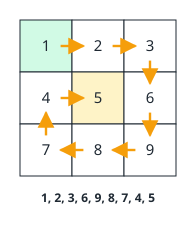
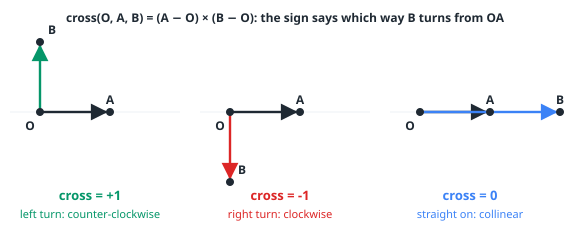
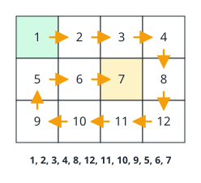

# Module: Math & Geometry (In-Place Grids & Number Tricks)

Welcome to the **Math & Geometry** module. This module covers problems where the solution hinges on **direct number manipulation or precise grid coordinate reasoning**, often in-place and with arithmetic tricks that eliminate the need for extra memory.

These problems test whether you understand *how computation works*, not just which data structure to reach for.

---

## Before you start
<!-- bite: 3849aa9d-735d-40fb-b0a9-47cf8ecd44ff -->

- You can index a 2-D array and reason about rows and columns — [[01-arrays|arrays]].
- Helpful: [[03-geometry-trigonometry/03-coordinate-geometry/01-coordinate-geometry|coordinate geometry]] for the geometric parts.

**After this lesson you will be able to:**

1. Rotate a matrix **in place**, and explain the transpose-then-reverse decomposition.
2. Traverse a matrix in spiral order with boundaries that cannot go wrong.
3. Use the **cross product sign** to decide orientation, and build a convex hull from it.
4. Avoid floating point in geometry problems where exact integer arithmetic will do.

**Study route:** read 1–5, attempt the prediction in section 4, then run the lab. Block 4 is the one that will save you a debugging session.

---

## 1. Real-World Motivation & Physical Metaphors
<!-- bite: c7d535c6-990d-4337-b59c-de8f66d7415b -->

These techniques power real production systems:

- **Image Processing**: Rotating a photo, applying a blur filter, or zeroing out corrupted pixel regions in-place without allocating a second image buffer.
- **Game Engines**: Scanning a grid in a spiral order to render tiles from center outward. Simulating physics with fast exponentiation.
- **Data Compression & Encryption**: Fast modular exponentiation (`x^n mod m`) powers RSA public-key cryptography and digital signatures.

---

## 2. Plain-English Terminology & Concept Table
<!-- bite: 2a7168cb-fa63-49ea-8434-1aea42746404 -->

| Term | Plain-English Definition | Analogy |
| :--- | :--- | :--- |
| **In-Place** | Transforming data directly inside the input structure with $O(1)$ extra space (no copy array). | Rearranging books on a shelf without needing a second shelf. |
| **Transposition** | Swapping matrix element `[i][j]` with `[j][i]` across the main diagonal. | Reflecting a chessboard across its diagonal. |
| **Binary Exponentiation** | Computing $x^n$ in $O(\log n)$ by repeatedly squaring instead of multiplying $n$ times. | Folding paper repeatedly (halving problems). |
| **Cycle Detection (Floyd's)** | Using slow/fast pointers on a sequence to detect whether it loops. | Two runners on a circular track—the faster one laps the slower. |

---

## 3. In-Place Matrix Manipulation
<!-- bite: e5bb6a4d-9245-4f9a-8ccb-75ccee8d981a -->

### 3.1 Rotate Image (90° Clockwise, In-Place)

**Key Insight**: A 90° clockwise rotation = **Transpose** (swap across main diagonal) **then Reverse each row**.

```python
def rotate_matrix(matrix: list) -> None:
    """Rotates an n×n matrix 90° clockwise IN-PLACE."""
    n = len(matrix)
    
    # Step 1: Transpose - swap matrix[i][j] with matrix[j][i]
    for i in range(n):
        for j in range(i + 1, n):  # Only above the diagonal (avoid double-swap)
            matrix[i][j], matrix[j][i] = matrix[j][i], matrix[i][j]
    
    # Step 2: Reverse each row
    for row in matrix:
        row.reverse()
```

**Visualization**:


---

### 3.2 Set Matrix Zeroes (O(1) Space Trick)

**Problem**: If any cell `matrix[i][j] == 0`, set its entire row and column to zero.

**Naïve approach**: Store zero-row and zero-column indices in separate arrays → $O(m + n)$ space.

**O(1) Space Trick**: Use the **first row and first column of the matrix itself** as the marker arrays, with two extra booleans for the first row/column's own zero status.

```python
def set_matrix_zeroes(matrix: list) -> None:
    """Sets rows and columns to zero IN-PLACE using O(1) extra space."""
    m, n = len(matrix), len(matrix[0])
    
    # Track whether the first row/column themselves contain zeros
    first_row_has_zero = any(matrix[0][j] == 0 for j in range(n))
    first_col_has_zero = any(matrix[i][0] == 0 for i in range(m))
    
    # Use first row & column as markers for the rest of the matrix
    for i in range(1, m):
        for j in range(1, n):
            if matrix[i][j] == 0:
                matrix[i][0] = 0   # Mark row i
                matrix[0][j] = 0   # Mark column j
    
    # Apply zeros based on markers (rows and columns, excluding first)
    for i in range(1, m):
        for j in range(1, n):
            if matrix[i][0] == 0 or matrix[0][j] == 0:
                matrix[i][j] = 0
    
    # Handle first row and first column separately
    if first_row_has_zero:
        for j in range(n): matrix[0][j] = 0
    if first_col_has_zero:
        for i in range(m): matrix[i][0] = 0
```

---

### 3.3 Spiral Matrix (Shrinking Boundary Walk)

**Strategy**: Maintain four shrinking boundaries (`top`, `bottom`, `left`, `right`). Peel off one edge per direction in rotation, moving each boundary inward after processing:

```python
def spiral_order(matrix: list) -> list:
    """Returns all elements of a matrix in spiral (clockwise) order."""
    result = []
    top, bottom = 0, len(matrix) - 1
    left, right = 0, len(matrix[0]) - 1
    
    while top <= bottom and left <= right:
        # → Right (top row, left to right)
        for col in range(left, right + 1):
            result.append(matrix[top][col])
        top += 1
        
        # ↓ Down (right column, top to bottom)
        for row in range(top, bottom + 1):
            result.append(matrix[row][right])
        right -= 1
        
        # ← Left (bottom row, right to left) — only if rows remain
        if top <= bottom:
            for col in range(right, left - 1, -1):
                result.append(matrix[bottom][col])
            bottom -= 1
        
        # ↑ Up (left column, bottom to top) — only if columns remain
        if left <= right:
            for row in range(bottom, top - 1, -1):
                result.append(matrix[row][left])
            left += 1
    
    return result
```

## Seeing the spiral walk

Here is `spiral_order` on the 3 × 3 matrix 1 to 9. It walks right along the top row, down the right column, left along the bottom, up the left column, and then the boundaries close in and it finishes at the centre.



---

## 4. Number Tricks
<!-- bite: a3bedfb9-bea4-4bda-8829-0b0cb1841a02 -->

### 4.1 Fast Power (`Pow(x, n)`) — Binary Exponentiation

**Naïve**: Multiply `x` by itself `n` times → $O(n)$.
**Smart**: $x^n = (x^2)^{n/2}$ when $n$ is even — halving the exponent each step → $O(\log n)$:

```python
def my_pow(x: float, n: int) -> float:
    """O(log n) fast exponentiation by squaring."""
    if n < 0:
        x, n = 1 / x, -n  # Handle negative exponents
    
    result = 1.0
    while n:
        if n & 1:       # If current lowest bit is set, multiply in current x
            result *= x
        x *= x          # Square the base (x^1 → x^2 → x^4 → x^8...)
        n >>= 1         # Drop the lowest bit (shift right)
    return result
```

This leverages [[11-bit-manipulation|bit manipulation]] directly—iterating through the binary digits of the exponent.

### 4.2 Happy Number — Cycle Detection via Floyd's Algorithm

A number is "happy" if repeated replacement with the sum-of-squared-digits eventually reaches 1. Otherwise, it cycles forever.

```python
def is_happy(n: int) -> bool:
    """Detects Happy Number cycle using Floyd's fast/slow pointer algorithm."""
    def digit_square_sum(x):
        total = 0
        while x:
            x, digit = divmod(x, 10)
            total += digit ** 2
        return total
    
    slow, fast = n, digit_square_sum(n)
    while fast != 1 and slow != fast:
        slow = digit_square_sum(slow)
        fast = digit_square_sum(digit_square_sum(fast))
    return fast == 1
```

This treats the sequence of digit-square-sums as a **linked list**. Floyd's cycle detection detects loops with $O(1)$ space instead of a hash set.

---

## 5. Complexity Summary
<!-- bite: 0b10abaa-06b2-4392-9460-9df8d9423df8 -->

| Problem | Naïve Approach | Optimized Trick | Optimized Complexity |
| :--- | :--- | :--- | :--- |
| **Rotate Matrix** | $O(n^2)$ space (copy grid) | Transpose + reverse rows | **$O(1)$ space** |
| **Set Matrix Zeroes** | $O(m+n)$ space (marker arrays) | Reuse first row/col as markers | **$O(1)$ space** |
| **Pow(x, n)** | $O(n)$ (multiply n times) | Binary exponentiation | **$O(\log n)$** |
| **Happy Number** | $O(k)$ space (hash set of seen) | Floyd's slow/fast pointers | **$O(1)$ space** |

---

## Implementation — complete runnable example
<!-- bite: 122bb04f-c5df-4ca8-8887-826afd479366 -->

**Runnable example:** save as `math_geometry.py` in any empty directory and run `python3 math_geometry.py`. Standard library only; writes no files.

```python
"""Matrix transforms, spiral order, and integer-exact geometry."""
from fractions import Fraction


def rotate_in_place(m):
    """90 degrees clockwise = transpose, then reverse each row."""
    n = len(m)
    for i in range(n):
        for j in range(i + 1, n):
            m[i][j], m[j][i] = m[j][i], m[i][j]      # transpose across the diagonal
    for row in m:
        row.reverse()
    return m


def rotate_copy(m):
    """The same rotation built fresh, as an oracle."""
    n = len(m)
    return [[m[n - 1 - j][i] for j in range(n)] for i in range(n)]


def spiral(m):
    """Four shrinking boundaries. The guards matter for non-square input."""
    if not m or not m[0]:
        return []
    top, bottom, left, right = 0, len(m) - 1, 0, len(m[0]) - 1
    out = []
    while top <= bottom and left <= right:
        for c in range(left, right + 1):
            out.append(m[top][c])
        top += 1
        for r in range(top, bottom + 1):
            out.append(m[r][right])
        right -= 1
        if top <= bottom:                            # guard: the row may be used up
            for c in range(right, left - 1, -1):
                out.append(m[bottom][c])
            bottom -= 1
        if left <= right:                            # guard: the column may be used up
            for r in range(bottom, top - 1, -1):
                out.append(m[r][left])
            left += 1
    return out


def cross(o, a, b):
    """Sign of the cross product of OA and OB. Exact for integer inputs."""
    return (a[0] - o[0]) * (b[1] - o[1]) - (a[1] - o[1]) * (b[0] - o[0])


def orientation(o, a, b):
    c = cross(o, a, b)
    return "counter-clockwise" if c > 0 else ("clockwise" if c < 0 else "collinear")


def convex_hull(points):
    """Andrew's monotone chain. Uses only cross products - no floats anywhere."""
    pts = sorted(set(points))
    if len(pts) <= 2:
        return pts
    lower = []
    for p in pts:
        while len(lower) >= 2 and cross(lower[-2], lower[-1], p) <= 0:
            lower.pop()
        lower.append(p)
    upper = []
    for p in reversed(pts):
        while len(upper) >= 2 and cross(upper[-2], upper[-1], p) <= 0:
            upper.pop()
        upper.append(p)
    return lower[:-1] + upper[:-1]


def polygon_area_x2(pts):
    """TWICE the area, by the shoelace formula. Always an integer for integer points."""
    n = len(pts)
    return abs(sum(pts[i][0] * pts[(i + 1) % n][1] - pts[(i + 1) % n][0] * pts[i][1]
                   for i in range(n)))


def segments_intersect(p1, p2, p3, p4):
    d1, d2 = cross(p3, p4, p1), cross(p3, p4, p2)
    d3, d4 = cross(p1, p2, p3), cross(p1, p2, p4)
    if ((d1 > 0) != (d2 > 0)) and ((d3 > 0) != (d4 > 0)):
        return True
    return False


if __name__ == "__main__":
    print("Block 1 - rotate a matrix in place")
    m = [[1, 2, 3], [4, 5, 6], [7, 8, 9]]
    expect = rotate_copy([row[:] for row in m])
    print("  before          after")
    got = rotate_in_place([row[:] for row in m])
    for a, bb in zip(m, got):
        print(f"    {a}      {bb}")
    assert got == expect
    print("  transpose swaps across the main diagonal; reversing each row then")
    print("  completes the 90-degree clockwise turn. Two passes, no extra matrix.")
    four = [row[:] for row in m]
    for _ in range(4):
        rotate_in_place(four)
    assert four == m
    print("  rotating four times returns the original, as it must")

    print()
    print("Block 2 - spiral order, including non-square grids")
    grids = [[[1, 2, 3], [4, 5, 6], [7, 8, 9]],
             [[1, 2, 3, 4]],
             [[1], [2], [3]],
             [[1, 2], [3, 4], [5, 6]]]
    for g in grids:
        out = spiral(g)
        print(f"  {str(g):34} -> {out}")
        assert sorted(out) == sorted(v for row in g for v in row)
        assert len(out) == sum(len(r) for r in g)
    assert spiral(grids[0]) == [1, 2, 3, 6, 9, 8, 7, 4, 5]
    print("  every element appears exactly once. The two `if` guards are what")
    print("  prevent a single leftover row or column being emitted twice.")

    print()
    print("Block 3 - orientation from the cross product sign")
    o = (0, 0)
    for a, bb in [((1, 0), (0, 1)), ((1, 0), (0, -1)), ((1, 0), (2, 0))]:
        print(f"  O={o} A={a} B={bb}: cross={cross(o,a,bb):3}  {orientation(o,a,bb)}")
    assert orientation((0, 0), (1, 0), (0, 1)) == "counter-clockwise"
    assert orientation((0, 0), (1, 0), (2, 0)) == "collinear"
    print("  positive means B is to the LEFT of OA, negative to the right, zero")
    print("  means all three are in a line. Three cases from one integer's sign.")

    print()
    print("Block 4 - why integer arithmetic beats floats in geometry")
    a, bb, c = (0, 0), (1, 3), (2, 6)             # exactly collinear
    print(f"  points {a}, {bb}, {c} are exactly collinear")
    print(f"    cross product (integers): {cross(a, bb, c)}  -> {orientation(a,bb,c)}")
    slope1 = (bb[1] - a[1]) / (bb[0] - a[0])
    slope2 = (c[1] - bb[1]) / (c[0] - bb[0])
    print(f"    slopes compared as floats: {slope1} vs {slope2} -> equal: {slope1 == slope2}")
    # at 1e17 the '+1' and '+2' fall below a float64 ulp (which is 64 here),
    # so both slopes round to exactly 3.0 - yet the points are NOT collinear
    tricky = [(0, 0), (10 ** 17, 3 * 10 ** 17 + 1), (2 * 10 ** 17, 6 * 10 ** 17 + 3)]
    s1 = (tricky[1][1] - tricky[0][1]) / (tricky[1][0] - tricky[0][0])
    s2 = (tricky[2][1] - tricky[1][1]) / (tricky[2][0] - tricky[1][0])
    print(f"  now with large coordinates {tricky}:")
    print(f"    cross product: {cross(*tricky)}  -> {orientation(*tricky)}")
    print(f"    float slopes:  {s1!r} vs {s2!r} -> equal: {s1 == s2}")
    assert cross(*tricky) != 0, "these are NOT collinear"
    assert s1 == s2, "but the floats say they are"
    print("  the floats claim collinear and the exact arithmetic says otherwise.")
    print("  Cross products of integer coordinates are EXACT; slopes involve division")
    print("  and lose it. Never divide in a geometry predicate if you can avoid it.")

    print()
    print("Block 5 - convex hull and exact areas, all integer")
    pts = [(0, 0), (1, 1), (2, 2), (2, 0), (0, 2), (1, 0), (3, 1)]
    hull = convex_hull(pts)
    print(f"  points {pts}")
    print(f"  hull   {hull}")
    assert (1, 1) not in hull and (0, 0) in hull
    print("  interior and collinear points are excluded, as they should be")
    area2 = polygon_area_x2(hull)
    print(f"  twice the hull area = {area2} (an exact integer), so area = {Fraction(area2,2)}")
    assert isinstance(area2, int)
    print()
    print(f"  segments (0,0)-(2,2) and (0,2)-(2,0) intersect: "
          f"{segments_intersect((0,0),(2,2),(0,2),(2,0))}")
    print(f"  segments (0,0)-(1,1) and (2,2)-(3,3) intersect: "
          f"{segments_intersect((0,0),(1,1),(2,2),(3,3))}")
    assert segments_intersect((0, 0), (2, 2), (0, 2), (2, 0))
    assert not segments_intersect((0, 0), (1, 1), (2, 2), (3, 3))
    print("  every predicate here is a sign test on an integer - no epsilon needed")

    print()
    print("math_geometry: passed")
```

Expected output:

```text
Block 1 - rotate a matrix in place
  before          after
    [1, 2, 3]      [7, 4, 1]
    [4, 5, 6]      [8, 5, 2]
    [7, 8, 9]      [9, 6, 3]
  transpose swaps across the main diagonal; reversing each row then
  completes the 90-degree clockwise turn. Two passes, no extra matrix.
  rotating four times returns the original, as it must

Block 2 - spiral order, including non-square grids
  [[1, 2, 3], [4, 5, 6], [7, 8, 9]]  -> [1, 2, 3, 6, 9, 8, 7, 4, 5]
  [[1, 2, 3, 4]]                     -> [1, 2, 3, 4]
  [[1], [2], [3]]                    -> [1, 2, 3]
  [[1, 2], [3, 4], [5, 6]]           -> [1, 2, 4, 6, 5, 3]
  every element appears exactly once. The two `if` guards are what
  prevent a single leftover row or column being emitted twice.

Block 3 - orientation from the cross product sign
  O=(0, 0) A=(1, 0) B=(0, 1): cross=  1  counter-clockwise
  O=(0, 0) A=(1, 0) B=(0, -1): cross= -1  clockwise
  O=(0, 0) A=(1, 0) B=(2, 0): cross=  0  collinear
  positive means B is to the LEFT of OA, negative to the right, zero
  means all three are in a line. Three cases from one integer's sign.

Block 4 - why integer arithmetic beats floats in geometry
  points (0, 0), (1, 3), (2, 6) are exactly collinear
    cross product (integers): 0  -> collinear
    slopes compared as floats: 3.0 vs 3.0 -> equal: True
  now with large coordinates [(0, 0), (100000000000000000, 300000000000000001), (200000000000000000, 600000000000000003)]:
    cross product: 100000000000000000  -> counter-clockwise
    float slopes:  3.0 vs 3.0 -> equal: True
  the floats claim collinear and the exact arithmetic says otherwise.
  Cross products of integer coordinates are EXACT; slopes involve division
  and lose it. Never divide in a geometry predicate if you can avoid it.

Block 5 - convex hull and exact areas, all integer
  points [(0, 0), (1, 1), (2, 2), (2, 0), (0, 2), (1, 0), (3, 1)]
  hull   [(0, 0), (2, 0), (3, 1), (2, 2), (0, 2)]
  interior and collinear points are excluded, as they should be
  twice the hull area = 10 (an exact integer), so area = 5

  segments (0,0)-(2,2) and (0,2)-(2,0) intersect: True
  segments (0,0)-(1,1) and (2,2)-(3,3) intersect: False
  every predicate here is a sign test on an integer - no epsilon needed

math_geometry: passed
```

Block 4 is worth the whole lesson. Three points with large integer coordinates are **not** collinear, and comparing their slopes as floats says they are. Cross products of integers are exact; division is not.

## Seeing the cross product sign

The lab's `cross(o, a, b)` tells you which way B lies from the line O → A, using only integer arithmetic. Positive means B is to the left (a counter-clockwise turn), negative means to the right (clockwise), and zero means all three points are on one line. The convex hull is built from nothing but this test.



## 6. Common Pitfalls & Traps
<!-- bite: 2c8f8e6d-3fe7-48eb-80d5-a2c22af0da7a -->

1. **Transpose Before Reverse (not after)**: For 90° CW rotation—transpose first, then reverse rows. Doing it in the wrong order gives a 90° CCW rotation.
2. **Spiral Off-By-One**: When only a single row or column remains, the left/right bottom/top boundary checks prevent double-visiting that row/column.
3. **Negative Exponent in `Pow`**: Always handle `n < 0` explicitly by taking the reciprocal of `x` and making `n` positive before the main loop.
4. **Integer Overflow in `Pow`**: In fixed-width languages (Java, C++), intermediate `x * x` can overflow 64-bit integers for large inputs.

---

## Check your understanding
<!-- bite: 5aa98111-96bd-424b-ab38-3ecdaac779d6 -->

Try each one before you open the answer.

1. <!-- q: gap id="0bc61923" answers="transpose|transpose it;reverse each row|reverse the rows|reverse every row" -->
   Fill in the gaps. To rotate an n × n matrix 90° clockwise in place, first ___ it (swap matrix[i][j] with matrix[j][i]), then ___.

   <details><summary>Answer</summary>

   Transpose, then reverse each row. Both steps work in place, so no second matrix is needed.

   </details>

2. <!-- q: mcq id="3d2130fc" -->
   Why does binary exponentiation compute xⁿ in O(log n) multiplications?

   - [ ] It uses a lookup table
   - [x] It squares the base and halves the exponent each step, so it walks the binary digits of n
   - [ ] It multiplies by x only when n is even
   - [ ] It only works for small n

   <details><summary>Answer</summary>

   xⁿ = (x²)^(n/2). There are about log₂ n binary digits in n, and each costs at most two multiplications.

   </details>

3. <!-- q: mcq id="ba1137c4" -->
   In Set Matrix Zeroes with O(1) space, why are the first row and first column zeroed last?

   - [x] They hold the markers for the other rows and columns; zeroing them early destroys that information
   - [ ] They are always zero anyway
   - [ ] To save time
   - [ ] Because the matrix is square

   <details><summary>Answer</summary>

   The first row and column are used as the marker arrays. Two separate booleans remember whether they had zeros of their own, and they are handled at the end.

   </details>

4. <!-- q: mcq id="1bc2af91" -->
   The happy-number check uses Floyd's fast and slow pointers instead of a set of seen numbers. What does that gain?

   - [ ] It finds happy numbers in O(1) time
   - [x] It detects a cycle in O(1) extra space
   - [ ] It avoids computing digit squares
   - [ ] It works only for prime numbers

   <details><summary>Answer</summary>

   The sequence of digit-square sums behaves like a linked list. If the fast pointer meets the slow one without reaching 1, there is a cycle, and no memory of past values is needed.

   </details>

5. <!-- q: open id="5d9bbf6a" -->
   In the spiral-order walk, why are the "go left" and "go up" steps guarded by `if top <= bottom` and `if left <= right`?

   <details><summary>Answer</summary>

   After the top row and right column are taken, the boundaries may have crossed, for example when a single row or column is left. Without the checks, the walk would read the same cells a second time.

   </details>

## Check your understanding: worked problems
<!-- bite: 66cc59cb-3df6-4855-8553-579f23bd7224 -->

Work each one out on paper first, then type your answer.

1. <!-- q: gap id="3c7d7292" answers="13;9;5;1" -->
   Fill in the gaps. Rotate this matrix 90° clockwise (transpose, then reverse each row):

   | 1 | 2 | 3 | 4 |
   |---|---|---|---|
   | 5 | 6 | 7 | 8 |
   | 9 | 10 | 11 | 12 |
   | 13 | 14 | 15 | 16 |

   The new first row is ___, ___, ___, ___.

   <details><summary>Answer</summary>

   13, 9, 5, 1. The old first column, read from bottom to top, becomes the new first row.

   </details>

2. <!-- q: exact id="5ccafd35" answer="1,2,3,6,9,12,11,10,7,4,5,8" accept="1 2 3 6 9 12 11 10 7 4 5 8|[1,2,3,6,9,12,11,10,7,4,5,8]" -->
   Give the spiral (clockwise) order of this 4 × 3 matrix, as numbers separated by commas:

   | 1 | 2 | 3 |
   |---|---|---|
   | 4 | 5 | 6 |
   | 7 | 8 | 9 |
   | 10 | 11 | 12 |

   <details><summary>Answer</summary>

   1, 2, 3, 6, 9, 12, 11, 10, 7, 4, 5, 8. Top row, right column down, bottom row back, left column up, then the inner column 5, 8.

   </details>

3. <!-- q: exact id="782b53e0" answer="3" -->
   Binary exponentiation computes 3¹³. 13 is 1101 in binary. How many times does the loop multiply the current base into the result (the `if n & 1` branch)?

   <details><summary>Answer</summary>

   3, once for each 1-bit in 1101: 3¹³ = 3⁸ × 3⁴ × 3¹. The loop runs 4 times in all (one per binary digit), and the answer is 1,594,323.

   </details>

4. <!-- q: gap id="a2f838a1" answers="82;68;100;1" -->
   Fill in the gaps. A happy number reaches 1 by repeatedly replacing it with the sum of the squares of its digits. Starting from 19: 19 → ___ → ___ → ___ → ___.

   <details><summary>Answer</summary>

   1² + 9² = 82, 8² + 2² = 68, 6² + 8² = 100, 1² + 0 + 0 = 1. So 19 is happy.

   </details>

5. <!-- q: sketch id="ddf098a3" -->
   Draw this 3 × 4 matrix (3 rows, 4 columns) and draw the path `spiral_order` takes through it as arrows from cell to cell. Then write out the order.

   | 1 | 2 | 3 | 4 |
   |---|---|---|---|
   | 5 | 6 | 7 | 8 |
   | 9 | 10 | 11 | 12 |

   <details><summary>Answer</summary>

   

   What to check:
   - The first pass goes right along the whole top row: 1, 2, 3, 4.
   - It goes down the right column (8, 12), then left along the bottom (11, 10, 9).
   - Going up the left column only reaches 5, because the top row is already used.
   - The inner row is walked right: 6, 7. Every number appears exactly once.

   </details>

## Practice — independent task
<!-- bite: eb4815c6-9dd2-49ce-8fa1-9dab24fa55f3 -->

Implement `closest_pair(points)` — the two closest points, in $O(n\log n)$ by divide and conquer.

1. Start with the $O(n^2)$ brute force as an oracle.
2. Sort by $x$, split at the median, solve both halves recursively, then check the strip within $d$ of the dividing line — where $d$ is the better of the two halves' answers.
3. **The strip is the subtle part.** Sorting it by $y$ and comparing each point to only the next 7 is what keeps it linear. Explain in a comment why 7 suffices — the argument is geometric and worth being able to state.
4. Verify against brute force on hundreds of random point sets, including duplicates and collinear points.
5. **Keep it exact.** Compare *squared* distances throughout, so integer inputs never touch a float. Show a case where comparing actual distances with `math.sqrt` gives a different answer than comparing squares, and explain which one you trust.

**Edge cases:** fewer than two points; two identical points (distance 0); all points on a vertical line; all points identical.

**Done when:** your result matches brute force on every test, your $O(n\log n)$ version beats brute force measurably at $n = 10^4$, and your step-3 explanation is in your own words.

## Before moving on
<!-- bite: 22ac01d9-0841-4e3b-97a4-701aa4cfa276 -->

You can rotate and traverse matrices, use the cross product for orientation, and keep geometry exact.

**Recap:** rotate 90° clockwise = **transpose then reverse rows**, in place; spiral order needs four shrinking boundaries and two guards against re-emitting a used row or column; the **sign** of the cross product gives orientation — positive is counter-clockwise, zero is collinear; cross products of integer coordinates are exact while slopes are not, so avoid division in geometric predicates; the shoelace formula gives twice the area as an exact integer.

**Where next:** back to [[index|the algorithms index]] — this is the last note in the folder.

## Related Modules
<!-- bite: 365c293c-85cb-4f8b-8584-10b2bdb1971e -->
- [[11-bit-manipulation|Bit Manipulation]] — Binary exponentiation uses bit-shift operators
- [[08-number-theory-basics|Number Theory Basics]] — Integer arithmetic techniques
