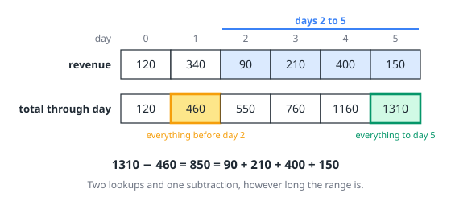
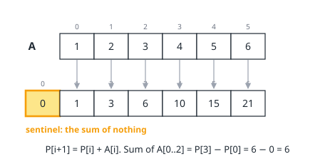
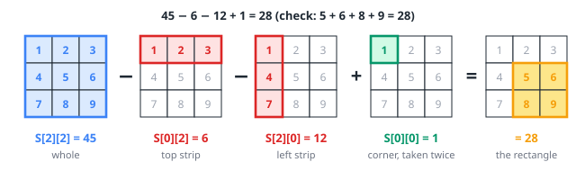

# Pattern: Prefix Sum

Preprocess an [[01-arrays|array]] once so that any range-sum query afterward is O(1) instead of O(n).

## Before you start
<!-- bite: ed4bd44c-0aed-4fd8-9652-24f2269d3499 -->

- You can index an array and reason about its memory layout. See [[01-arrays|arrays]] if needed.
- You know what a hash map is and that lookups are O(1) on average. See [[03-hash-maps|hash maps]] for the variant below.
- You can read Big-O notation. See [[01-growth-and-asymptotic-notation|algorithms and complexity]].

**What you will be able to do after this lesson:**

1. Explain why preprocessing an array once turns every later range query from O(n) into O(1).
2. Build a prefix-sum array with a sentinel and query any range without an off-by-one.
3. Extend the idea to two dimensions with a summed-area table.
4. Recognise the hash-map variant, and say why a sliding window cannot replace it when values may be negative.

**Study route:** read the motivation and mechanism, run the lab, then attempt the independent task before opening the answers.

## What prefix sum is
<!-- bite: 5efa232b-10f6-4dc6-9cec-b9d3139ce192 -->

Prefix sum is a pattern where you add up an array once, keeping a running total at every position, so that later questions about any range are fast. The trade is a single O(n) pass and O(n) extra space up front, paid once, to make every query after that nearly free.

## The idea in one sentence
<!-- bite: d22b1dd5-4f5a-4af1-9996-b1d353521d70 -->

**A bank statement doesn't store "how much did I spend in June" — it stores the running balance after every transaction, and you get June by subtracting the balance on 1 June from the balance on 30 June.** That subtraction *is* the prefix-sum pattern. Everything below is that one move, applied in different costumes.

## A concrete example: the analytics dashboard
<!-- bite: 90037402-5f25-4242-8fa4-d4c726f2027d -->

Say you're building the revenue dashboard for a shop. You have three years of daily revenue — about 1,100 numbers:

```text
day:      0    1    2    3    4    5   ...
revenue: 120  340   90  210  400  150  ...
```

The dashboard has a date-range picker. A user asks: *"How much did we make from day 2 to day 5?"* The obvious answer is to loop from day 2 to day 5 and add. That's fine — once.

## The dashboard example: many questions, not one
<!-- bite: 95610a06-3da8-4140-b0f6-fcb7a0e295eb -->

The trouble starts when the same kind of question is asked again and again.

But a real dashboard doesn't ask once. It asks:

- "Revenue this week" — one range
- "Same week last year" — another range
- "Month to date", "last month", "quarter to date", "same quarter last year" — six more
- ...times 12 widgets on the page, times every user who loads it, times every time someone drags the date slider

Each of those is a fresh loop over up to 1,100 numbers. Drag the slider and you're re-adding the same numbers hundreds of times a second. The work is O(days) **per query**, and the queries are the thing you have a lot of.

## The dashboard example: store the running total
<!-- bite: cc876f1f-3563-40d6-966d-6ce9770edf88 -->

The fix is to add everything up once, when the page loads, and keep the running total at every day.

So do the summing **once**, at load, and store the running total:



## The dashboard example: one subtraction per range
<!-- bite: cfa200dd-fa41-4b7b-ba19-2fc1fd8f9f7d -->

With the running totals stored, any date range is answered by subtracting two of them.

Now "day 2 through day 5" is:

```text
total through day 5  =  1310     (everything from day 0 to day 5)
total through day 1  =   460     (everything before day 2)
                        ------
revenue for days 2-5 =   850     90 + 210 + 400 + 150 -> 850 ✓
```

**Two array lookups and a subtraction.** It doesn't matter whether the range is 4 days or 4 years — the cost is identical. Everything before day 2 got counted into both totals, so subtracting cancels it out exactly, and what survives is precisely the slice you asked for.

That's the whole pattern: *don't store the answers to the ranges, store the totals up to each point, and subtract.*

## Definitions and terminology
<!-- bite: 44dd5c68-f58f-41c0-9c49-cb48a9ce54f6 -->

| Term | Plain-English definition | Example / analogy |
| :--- | :--- | :--- |
| **Prefix sum** | The running total of everything up to a point | A bank balance after each transaction |
| **Sentinel** | A leading `0` meaning "nothing so far", so index 0 needs no special case | The opening balance |
| **Range query** | "What is the total between these two positions?" | Revenue for days 2–5 |
| **Preprocessing** | Work done once up front so later queries are cheap | Building the statement |
| **Summed-area table** | The 2-D version: totals from the origin to each cell | — |
| **Inclusion–exclusion** | Subtracting overlapping regions, then adding back what was removed twice | — |
| **Scan** | The same operation's name in parallel computing | — |

## Where this actually shows up
<!-- bite: 1311f318-a9b2-4f3b-a6ba-d9bbbd156b2c -->

Not just interview problems — this is load-bearing infrastructure in a few places:

- **SQL and analytics.** `SUM(revenue) OVER (ORDER BY date)` is a prefix sum, computed by the database. Cumulative/running-total columns, cohort charts, and burndown charts are all prefix sums. Time-series databases pre-materialise these rollups so range queries don't touch raw rows.
- **Image processing — the summed-area table (a.k.a. integral image).** The 2-D version, below. It lets you compute the sum of pixels inside *any* rectangle in constant time regardless of the rectangle's size. Box blur uses it; so did the Viola–Jones face detector, which is why real-time face detection was possible on 2001-era hardware.
## Where this shows up: random picks, GPUs and rate limits
<!-- bite: a5d28d39-d610-46c6-bc30-e5e447e5f5ad -->

Three more places use the same running-total idea.

- **Weighted random selection.** Given items with weights `[5, 1, 3, 1]`, take the prefix sums `[5, 6, 9, 10]`, pick a random number in `[0, 10)`, and [[01-linear-and-binary-search|binary search]] for where it lands. Each item is chosen in proportion to its weight, in O(log n). This is how ad servers pick a bid, how loot tables work in games, and how weighted A/B bucketing gets done.
- **Parallel and GPU computing**, where it's called **scan**. Despite looking hopelessly sequential (each total depends on the one before it), it parallelises in O(log n) depth — and it's the primitive underneath stream compaction, radix sort, and parallel memory allocation. See [[gpu-and-parallel-computing/04-parallel-patterns|parallel patterns]] for why that's surprising.
- **Rate limiting and scheduling** — "how many requests in the last N seconds", "is this booking window free" — anything phrased as *aggregate over a contiguous span* of a fixed timeline.

## How it works
<!-- bite: dfe51001-b64f-42ef-8059-b6c704a406d4 -->

Build an array `P` where `P[i]` = the sum of everything before index `i`. Padding with a leading `0` (a sentinel) is worth doing — it makes `P[0]` mean "nothing so far" and kills the `i == 0` special case:



## How it works: building and querying in code
<!-- bite: e5e14613-fade-45ed-b00f-480c659446ef -->

Here is the same idea written as two small Python functions.

Each entry is the previous entry plus one element, so building it is a single pass:

```python
def build_prefix_sums(nums):
    prefix = [0] * (len(nums) + 1)   # prefix[0] = 0 sentinel avoids the i==0 special case
    for i, num in enumerate(nums):
        prefix[i + 1] = prefix[i] + num
    return prefix

def range_sum(prefix, i, j):          # sum of nums[i..j] inclusive
    return prefix[j + 1] - prefix[i]
```

With the sentinel, `range_sum(P, 0, 2)` = `P[3] - P[0]` = `6 - 0` = 6 — no branch needed for a range that starts at the beginning.

## The 2-D version: summed-area tables
<!-- bite: baa8e70b-71d3-4be8-856f-501976eb4fa7 -->

Same trick on a grid. `S[r][c]` = sum of the whole rectangle from the top-left corner down to `(r, c)`. Building it reuses the three neighbours already computed:

```python
S[r][c] = grid[r][c] + S[r-1][c] + S[r][c-1] - S[r-1][c-1]
#                      ^ above     ^ left      ^ added twice, subtract once
```

And any rectangle `(r1,c1)..(r2,c2)` comes out in four lookups by inclusion–exclusion:

```text
sum = S[r2][c2] - S[r1-1][c2] - S[r2][c1-1] + S[r1-1][c1-1]
```

The `+ S[r1-1][c1-1]` is there because the top-left block got subtracted twice — once by each of the two strips. Constant time for a 3×3 window or a 3000×3000 one, which is exactly why image filters use it.

## Seeing the four lookups
<!-- bite: f79b7e60-cf64-4e90-8158-36ced68402a6 -->
Here is the rectangle from (1, 1) to (2, 2) in the grid 1 to 9. Follow the panels left to right: take the whole block, remove the two strips, then add back the corner that both strips removed.



## The hash-map variant — the one that trips people up
<!-- bite: d6e1e380-786b-48a4-b3a5-9ada6a026a95 -->

Plain prefix sums answer *"what's the sum of this range I'm naming?"* The harder question is the reverse: *"is there **any** range summing to k?"* — that's **Subarray Sum Equals K** (LeetCode #560), and the mechanical trick is worth internalising because it recurs constantly.

Rearrange the definition. A subarray ending at `j` sums to `k` when:

```text
prefix[j] - prefix[i] == k      ->      prefix[i] == prefix[j] - k
```

## The hash-map variant: the code
<!-- bite: 285b2122-7e25-4d19-854f-d4c2c3f1c538 -->

The rearranged formula turns the search into a hash-map lookup, and the code is short.

So while sweeping, at each position you already know `prefix[j]` and `k`. The question "does a valid subarray end here?" becomes **"have I seen the prefix sum `prefix[j] - k` before, and how many times?"** — a hash-map lookup, not a search.

```python
def subarray_sum(nums, k):
    seen = {0: 1}          # the empty prefix, so subarrays starting at index 0 count
    running = 0
    count = 0
    for num in nums:
        running += num
        count += seen.get(running - k, 0)   # every earlier prefix that closes a k-sum here
        seen[running] = seen.get(running, 0) + 1
    return count
```

The array of prefix sums became a **[[03-hash-maps|hash map]] of prefix sum → how many times seen**, because you no longer care *where* the prefixes were, only that they existed. O(n) time, one pass.

## The hash-map variant: two re-skins
<!-- bite: 595dcbd7-e765-4300-9468-3638fcec8901 -->

The same move solves other problems once you change what you count.

Two common re-skins of the same move:

- **Contiguous Array** — longest subarray with equal 0s and 1s. Count each `0` as `-1`, and "equal counts" becomes "sum is zero", which becomes "this prefix sum has appeared before". Store the *first* index each prefix sum was seen at, and the distance between the two sightings is a valid subarray.
- **Subarray sums divisible by k** — store `running % k` instead of `running`. Two positions with the same remainder bracket a subarray divisible by `k`.

The general shape: **transform the elements so the property you want becomes "sum is 0" or "sums are equal", then let the hash map find repeats.**

## Complexity
<!-- bite: 3519a140-13e4-4012-a4bd-78c230956547 -->

O(n) to build, O(1) per query — versus O(n) per query if you sum the range directly every time. For q queries, that's O(n + q) total instead of O(n·q). Space is O(n) for the prefix array, though the streaming variants above keep only a running scalar plus a map.

## Gotchas
<!-- bite: 863793ad-d691-4a1a-a521-fc5849b63eb9 -->

- **Inclusive vs exclusive off-by-ones** are the number-one bug here. Pick the sentinel-padded convention (`P[i]` = sum of everything *before* `i`) and stay in it; mixing conventions mid-problem is how `range_sum` quietly returns a number one element too big.
- **Prefix sums only work for invertible operations.** Sum, XOR, and count are invertible — you can subtract off the part you don't want. **Max and min are not**: knowing `max(A[0..5])` and `max(A[0..1])` tells you nothing about `max(A[2..5])`. That's why range-max needs a sparse table or segment tree instead, and why [[014-trapping-rain-water|Trapping Rain Water]] builds *directional* prefix/suffix maxima arrays and reads them, rather than subtracting.
## Gotchas: updates, overflow and one-off queries
<!-- bite: a5da75b7-bc23-47ab-86ed-0a276daf0704 -->

Three more traps show up when the data changes, grows large, or is only asked about once.

- **The array has to be static.** One update to `nums[i]` invalidates every prefix sum from `i` onward. If updates are frequent, you want a Fenwick tree (binary indexed tree) or segment tree — O(log n) for both update and query — rather than an O(n) rebuild each time.
- **Overflow** in fixed-width languages: the prefix sums grow to the total of the whole array, which can exceed `int` even when every element is small. Use a 64-bit type.
- **Reaching for it with only one query to answer.** Preprocessing costs O(n); a single range sum also costs O(n). It only pays when the cost is amortised over many queries.

## Implementation — complete runnable example
<!-- bite: 1a77ab3b-4b14-44ac-a78c-61729f128124 -->

**Runnable example:** save as `prefix_sum_lab.py` and run `python3 prefix_sum_lab.py`. Standard library only; writes no files. Every result is checked against a brute-force computation.

```python
def build_prefix(values):
    """P[i] = sum of everything BEFORE index i. The leading 0 is a sentinel
    that removes the i == 0 special case from every query."""
    prefix = [0]
    for v in values:
        prefix.append(prefix[-1] + v)
    return prefix

def range_sum(prefix, lo, hi):
    """Sum of values[lo..hi] inclusive -- two lookups and a subtraction."""
    return prefix[hi + 1] - prefix[lo]

def build_prefix_2d(grid):
    """Summed-area table: S[r][c] = sum of the rectangle from (0,0) to (r-1,c-1)."""
    rows, cols = len(grid), len(grid[0])
    s = [[0] * (cols + 1) for _ in range(rows + 1)]
    for r in range(rows):
        for c in range(cols):
            s[r+1][c+1] = (grid[r][c] + s[r][c+1] + s[r+1][c] - s[r][c])
    return s

def rect_sum(s, r1, c1, r2, c2):
    """Inclusion-exclusion: whole - top - left + the corner counted twice."""
    return s[r2+1][c2+1] - s[r1][c2+1] - s[r2+1][c1] + s[r1][c1]

def subarrays_summing_to(values, target):
    """The hash-map variant. Counts subarrays whose sum is exactly `target`.

    If prefix[j] - prefix[i] == target, then prefix[i] == prefix[j] - target,
    so count how many earlier prefixes had that value."""
    seen, running, count = {0: 1}, 0, 0
    for v in values:
        running += v
        count += seen.get(running - target, 0)
        seen[running] = seen.get(running, 0) + 1
    return count

if __name__ == "__main__":
    revenue = [120, 340, 90, 210, 400, 150]
    prefix = build_prefix(revenue)
    print(f"revenue: {revenue}")
    print(f"prefix:  {prefix}   <- one longer, leading sentinel")
    print()
    print("range queries, each O(1) regardless of width:")
    for lo, hi in [(2, 5), (0, 0), (0, 5), (3, 3)]:
        got = range_sum(prefix, lo, hi)
        want = sum(revenue[lo:hi+1])
        print(f"  days {lo}..{hi}: {got:5d}   (brute force {want})")
        assert got == want

    print()
    print("2D summed-area table:")
    grid = [[1, 2, 3],
            [4, 5, 6],
            [7, 8, 9]]
    s = build_prefix_2d(grid)
    for r1, c1, r2, c2 in [(0, 0, 2, 2), (1, 1, 2, 2), (0, 1, 1, 2)]:
        got = rect_sum(s, r1, c1, r2, c2)
        want = sum(grid[r][c] for r in range(r1, r2+1) for c in range(c1, c2+1))
        print(f"  rect ({r1},{c1})..({r2},{c2}) = {got:3d}   (brute force {want})")
        assert got == want

    print()
    print("hash-map variant -- subarrays summing to a target:")
    for values, target in [([1, 1, 1], 2), ([1, 2, 3], 3), ([3, 4, 7, 2, -3, 1, 4, 2], 7)]:
        got = subarrays_summing_to(values, target)
        want = sum(1 for i in range(len(values)) for j in range(i, len(values))
                   if sum(values[i:j+1]) == target)
        print(f"  {str(values):32s} target {target}: {got} subarrays  (brute force {want})")
        assert got == want

    print()
    print("  note the negative number in the last case -- the hash-map variant")
    print("  handles it, but a sliding window would NOT: it assumes growing the")
    print("  window only increases the sum, which negatives break.")
    print()
    print("prefix_sum_lab: passed")
```

## Prefix sum lab: what it prints
<!-- bite: e00eaef5-98ee-4532-a2e4-0189bc21eeca -->

When you run the lab, this is what it prints.

Expected output:

```text
revenue: [120, 340, 90, 210, 400, 150]
prefix:  [0, 120, 460, 550, 760, 1160, 1310]   <- one longer, leading sentinel

range queries, each O(1) regardless of width:
  days 2..5:   850   (brute force 850)
  days 0..0:   120   (brute force 120)
  days 0..5:  1310   (brute force 1310)
  days 3..3:   210   (brute force 210)

2D summed-area table:
  rect (0,0)..(2,2) =  45   (brute force 45)
  rect (1,1)..(2,2) =  28   (brute force 28)
  rect (0,1)..(1,2) =  16   (brute force 16)

hash-map variant -- subarrays summing to a target:
  [1, 1, 1]                        target 2: 2 subarrays  (brute force 2)
  [1, 2, 3]                        target 3: 2 subarrays  (brute force 2)
  [3, 4, 7, 2, -3, 1, 4, 2]        target 7: 4 subarrays  (brute force 4)

  note the negative number in the last case -- the hash-map variant
  handles it, but a sliding window would NOT: it assumes growing the
  window only increases the sum, which negatives break.

prefix_sum_lab: passed
```

## Check your understanding
<!-- bite: 8397baa5-790a-45a6-84f6-5a6726fe0b15 -->

Try each one before you open the answer.

1. <!-- q: mcq id="1ea09dff" -->
   A prefix-sum array P is built with a leading 0, so P[i] is the sum of everything before index i. Why add that leading 0?

   - [ ] It makes the array the same length as the input
   - [x] It means "the sum of nothing so far", so a range starting at index 0 needs no special case
   - [ ] It stops the sums from overflowing
   - [ ] It marks the end of the array

   <details><summary>Answer</summary>

   The leading 0 is a sentinel for the empty prefix. A range starting at index 0 is then P[j+1] − P[0], with no `if lo == 0` branch.

   </details>

2. <!-- q: gap id="be85181f" answers="j+1|j + 1;i" -->
   Fill in the gaps. P has a leading 0, so P[i] is the sum of everything before index i. The sum of nums[i..j], both ends included, is P[___] − P[___].

   <details><summary>Answer</summary>

   P[j+1] − P[i]. P[j+1] holds everything up to and including j, and P[i] holds everything before i, so subtracting leaves exactly i..j.

   </details>

3. <!-- q: mcq id="b8caf77f" -->
   Which range questions can a prefix array answer by subtracting two entries? Choose all that apply.

   - [x] Sum of a range
   - [x] XOR of a range
   - [x] Count of even numbers in a range
   - [ ] Maximum of a range

   <details><summary>Answer</summary>

   Sum, XOR and count can be undone, so you can take away the part you don't want. Max cannot: knowing the max of A[0..5] and of A[0..1] tells you nothing about A[2..5].

   </details>

4. <!-- q: mcq id="d26f19bd" -->
   Your array gets thousands of single-element updates between range-sum queries. What should you use instead of a plain prefix array?

   - [ ] Rebuild the prefix array after every update
   - [x] A Fenwick tree or segment tree, with O(log n) updates and queries
   - [ ] A sliding window
   - [ ] A hash map of prefix sums

   <details><summary>Answer</summary>

   One update to nums[i] changes every prefix sum from i onwards, so a rebuild costs O(n). A Fenwick or segment tree handles both updates and queries in O(log n).

   </details>

5. <!-- q: open id="e19d97d1" -->
   You want to count the subarrays of [3, 4, −3, 2, 7] that sum to exactly 7. Why does the prefix-sum-plus-hash-map method work here when a sliding window would not?

   <details><summary>Answer</summary>

   A sliding window assumes that growing the window can only raise the sum, so shrinking from the left is the right move when you overshoot. The −3 breaks that: the sum can fall as the window grows, and the window can skip valid answers. The hash-map method only asks "have I seen the prefix sum running − k before?", which makes no assumption about signs.

   </details>

## Check your understanding: worked problems
<!-- bite: d8b664fd-911d-4300-8b5d-d69632bd483c -->

Work each one out on paper first, then type your answer.

1. <!-- q: gap id="2ea1deae" answers="0;4;6;13;14;17" -->
   Fill in the gaps. Build the prefix-sum array, with a leading 0, for nums = [4, 2, 7, 1, 3].

   P = [___, ___, ___, ___, ___, ___]

   <details><summary>Answer</summary>

   [0, 4, 6, 13, 14, 17]. Each entry is the one before it plus the next number: 0, 0+4, 4+2, 6+7, 13+1, 14+3.

   </details>

2. <!-- q: exact id="c3ff8c58" answer="10" -->
   nums = [4, 2, 7, 1, 3] and its prefix array (with a leading 0) is P = [0, 4, 6, 13, 14, 17]. Use P to find the sum of nums[1..3], both ends included.

   <details><summary>Answer</summary>

   10. P[4] − P[1] = 14 − 4 = 10, and 2 + 7 + 1 = 10 checks it.

   </details>

3. <!-- q: exact id="d7e8f3ee" answer="17" -->
   A grid and its summed-area table S are shown below. S[r][c] is the sum of the rectangle from (0, 0) to (r, c), both included.

   | grid | col 0 | col 1 | col 2 |
   | --- | --- | --- | --- |
   | row 0 | 2 | 0 | 1 |
   | row 1 | 3 | 4 | 2 |
   | row 2 | 1 | 5 | 6 |

   | S | col 0 | col 1 | col 2 |
   | --- | --- | --- | --- |
   | row 0 | 2 | 2 | 3 |
   | row 1 | 5 | 9 | 12 |
   | row 2 | 6 | 15 | 24 |

   Using four lookups in S, what is the sum of the rectangle from (1, 1) to (2, 2)?

   <details><summary>Answer</summary>

   17. S[2][2] − S[0][2] − S[2][0] + S[0][0] = 24 − 3 − 6 + 2 = 17. The corner S[0][0] is added back because both strips removed it. Check: 4 + 2 + 5 + 6 = 17.

   </details>

4. <!-- q: exact id="304eef1b" answer="7" -->
   How many subarrays (runs of neighbouring elements) of [1, 2, 1, −1, 3, 0] sum to exactly 3? Use the prefix-sum-plus-hash-map method.

   <details><summary>Answer</summary>

   7. They are [1, 2], [1, 2, 1, −1], [2, 1], [1, −1, 3], [1, −1, 3, 0], [3] and [3, 0]. At each step the method adds how many earlier prefix sums equal running − 3.

   </details>

## Practice problems
<!-- bite: 4860a6ee-5d30-44a1-98d4-add9e5e21cac -->

**In the [[dsa/neetcode-150/index|NeetCode 150]]** — solved and written up here:

1. [[007-product-of-array-except-self|Product of Array Except Self]] (LeetCode #238) — the multiplicative sibling: prefix products from the left, suffix products from the right, meet at each index.
2. [[014-trapping-rain-water|Trapping Rain Water]] (LeetCode #42) — prefix/suffix *maxima* instead of sums. Same "combine information from both directions" shape, and a good illustration of the non-invertibility gotcha above.
3. [[122-maximum-subarray|Maximum Subarray]] (LeetCode #53) — Kadane's algorithm is prefix-sum reasoning in disguise: the best subarray ending at `j` is `prefix[j]` minus the smallest prefix before it, so track the running minimum instead of an array.
4. [[015-best-time-to-buy-and-sell-stock|Best Time to Buy and Sell Stock]] (LeetCode #121) — literally "current value minus the smallest prefix value seen so far"; the same running-minimum move as #3.

## Practice problems: outside the NeetCode 150
<!-- bite: 6cc92ed7-0138-4f31-aa35-8424b9f356fc -->

These four come straight from LeetCode.

**Not in the NeetCode 150** — worth doing on LeetCode directly, since they drill the core pattern more squarely than anything in the 150 does:

5. Range Sum Query - Immutable (#303) — the pattern in its purest form; if the dashboard example above made sense, this is that problem.
6. Subarray Sum Equals K (#560) — the hash-map variant, written out above. Do this one.
7. Contiguous Array (#525) — the `0 → -1` re-skin.
8. Range Sum Query 2D - Immutable (#304) — summed-area tables, the version image filters actually use.

## Before moving on
<!-- bite: a423f556-0bf7-4e93-a36d-fe70de543960 -->

You are done with this pattern when you can, closed-book:

- [ ] Explain why the sentinel exists and what breaks without it.
- [ ] Build a prefix array and answer a range query with no off-by-one.
- [ ] Derive the inclusion–exclusion formula for the 2-D case.
- [ ] Explain why the hash-map variant handles negatives and a sliding window does not.

**Recap:** Prefix sums trade one O(n) preprocessing pass and O(n) space for O(1) range queries thereafter. Each entry stores the total up to that point, so subtracting two entries cancels everything before the range and leaves exactly the slice you asked for. The 2-D form uses inclusion–exclusion; the hash-map form counts subarrays with a given sum and, unlike a sliding window, works with negative values.

**Next:** [[02-two-pointers|two-pointers]] — the other pattern built on preprocessing a sequence, this time by sorting it so two indices can converge.

## Related
<!-- bite: a8a3bfb4-df7f-4f04-b2f6-87aee8ad6078 -->
- [[01-arrays|arrays]] — the underlying structure and why contiguous storage makes the O(1) lookup real
- [[03-hash-maps|hash maps]] — what the prefix array becomes in the "find a subarray summing to k" variant
- [[03-sliding-window|sliding-window]] — the other main tool for contiguous-subarray questions; prefer it when the array has no negatives and you need a window, prefer prefix sums when you need arbitrary ranges or the values can be negative
- [[10-max-slice-algorithms|max-slice algorithms]] — Kadane and friends, where the running-prefix idea gets its own family
- [[gpu-and-parallel-computing/04-parallel-patterns|parallel patterns]] — prefix sum as *scan*, and why it parallelises despite looking sequential
- [[01-growth-and-asymptotic-notation|algorithms]]

## About this lesson
<!-- bite: 49626bdf-5050-478c-a847-1971ddd238a0 -->

**Level:** Beginner. **Covers:** A university-level introduction to the prefix-sum pattern: what it is, why it exists, how it works, and how to implement it independently.
