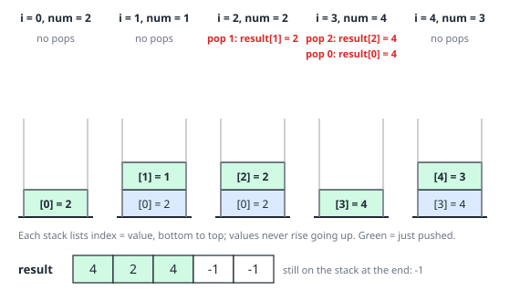

# Pattern: Monotonic Stack

A monotonic stack is a stack that is kept in order, always rising or always falling, by removing items that break the order before adding a new one. It quickly answers questions like "what is the next bigger number to the right of each one?". A weather app working out how many days until a warmer day is a classic example.

## Before you start
<!-- bite: 6721dac7-7037-4c32-8d30-92c4438f2b5a -->

- You should understand stacks. See [[05-stacks-and-queues|stacks and queues]] if needed.
- You should understand arrays and basic loops. See [[01-arrays|arrays]] if needed.

**What you will be able to do after this lesson:**

1. Define the monotonic stack pattern and explain why it turns "for each element, find the next greater/smaller element" from O(n²) brute-force scan into O(n).
2. Implement a monotonic stack to find next greater elements for every position.
3. Apply the pattern to related problems like daily temperatures and largest rectangle in histogram.
4. Explain the amortized O(n) analysis despite nested-looking loops.

**Study route:** read the motivation and mechanism first, trace the worked example by hand, then attempt the independent task before looking at the hints.

---

## 1. Why this pattern exists (real-world motivation)
<!-- bite: a10cb267-49ea-40db-b733-a9e19afba5cd -->

Imagine you're building a stock trading application and you need to know, for each stock price in a timeline, when the next higher price will occur. The naive approach is to check every future price for each current price: for each element, scan forward to find the first element that's larger. That's O(n²) — for 1,000 prices, that's 500,000 comparisons.

The monotonic stack pattern solves this: maintain a stack that's strictly increasing or decreasing from bottom to top, by popping off anything that would break that order before pushing a new element. It turns "for each element, find the next greater/smaller element" from an O(n²) brute-force scan into O(n).

---

## 2. Definitions and terminology
<!-- bite: 2c8fabb6-e0b7-4467-93de-2837d99ae28f -->

| Term                     | Plain-English definition                                                                                             | Example / analogy                                                                     |
| ------------------------ | -------------------------------------------------------------------------------------------------------------------- | ------------------------------------------------------------------------------------- |
| **Monotonic stack**      | A stack that's kept strictly increasing or strictly decreasing from bottom to top                                    | A stack of plates where each plate is smaller than the one below it                   |
| **Next greater element** | For each element, the first element to its right that's larger                                                       | For price 5, the next greater element might be 8                                      |
| **Amortized O(1)**       | The average cost per operation across a long sequence of calls, even though some individual operations are expensive | Resizing a dynamic array: most pushes are O(1), but resizing is O(n) — amortized O(1) |
| **Stack invariant**      | The rule that the stack maintains (increasing or decreasing)                                                         | In a monotonic increasing stack, each new element must be larger than the top         |

---

## 3. How it works — step by step
<!-- bite: 83562773-6d5b-4481-b2e2-89372e4bb9ee -->

Walk the array once. For each new element, pop everything off the stack that's smaller than it (those elements just found their "next greater element" — the current one) — then push the current element.

```python
def next_greater_elements(nums):
    result = [-1] * len(nums)
    stack = []                      # holds indices, kept in decreasing value order
    for i, num in enumerate(nums):
        while stack and nums[stack[-1]] < num:
            result[stack.pop()] = num   # current num is the "next greater" for stack.pop()
        stack.append(i)
    return result
```

**Concrete example:** `nums = [2, 1, 2, 4, 3]`

```text
i=0 num=2  stack=[]        -> push -> stack=[0]

i=1 num=1  stack=[0]        -> 2 not < 1, push -> stack=[0,1]

i=2 num=2  stack=[0,1]      -> nums[1]=1 < 2, pop, result[1]=2
                             -> nums[0]=2 not < 2, push -> stack=[0,2]

i=3 num=4  stack=[0,2]      -> nums[2]=2 < 4, pop, result[2]=4
                             -> nums[0]=2 < 4, pop, result[0]=4
                             -> push -> stack=[3]

i=4 num=3  stack=[3]        -> nums[3]=4 not < 3, push -> stack=[3,4]

result = [4, 2, 4, -1, -1]
```

## Seeing the stack at each step
<!-- bite: 2d99ce53-4808-49ad-8fb0-f20b21d5913d -->
Each column is the stack after one step of the trace above, for nums = [2, 1, 2, 4, 3]. Look at the red lines: every pop fills in one answer, and the values on the stack never rise from bottom to top.



---

## 4. Why it's O(n) despite the nested while loop
<!-- bite: bf4ef7d7-8626-4558-b3b4-28bedb4c8dc2 -->

Every index gets pushed onto the stack exactly once and popped at most once across the _entire_ run — so the total number of push/pop operations is bounded by 2n, not n². Same amortized argument as [[02-dynamic-arrays|dynamic array resizing]]: the loop looks nested, but the total work across the whole run is linear.

---

## 5. Implementation — complete runnable example
<!-- bite: b08fdd24-4a36-4b6d-8e82-0e5be72098e6 -->

**Runnable example:** save as `monotonic_stack_lab.py` and run `python3 monotonic_stack_lab.py`. It uses only Python's standard library and creates no external files.

```python
from typing import List


def next_greater_elements(nums: List[int]) -> List[int]:
    """Find the next greater element for each position."""
    result = [-1] * len(nums)
    stack = []  # holds indices, kept in decreasing value order

    for i, num in enumerate(nums):
        # Pop elements smaller than current num
        while stack and nums[stack[-1]] < num:
            result[stack.pop()] = num
        stack.append(i)

    return result


def daily_temperatures(temperatures: List[int]) -> List[int]:
    """For each day, how many days until a warmer temperature."""
    result = [0] * len(temperatures)
    stack = []  # holds indices, kept in increasing temperature order

    for i, temp in enumerate(temperatures):
        # Pop days with temperature higher than current
        while stack and temperatures[stack[-1]] < temp:
            prev_day = stack.pop()
            result[prev_day] = i - prev_day
        stack.append(i)

    return result


def largest_rectangle_area(heights: List[int]) -> int:
    """Find the largest rectangle in a histogram."""
    # Add sentinel 0 at the end to force all remaining bars to be popped
    heights.append(0)
    stack = []  # holds indices, kept in increasing height order
    max_area = 0

    for i, height in enumerate(heights):
        # Pop bars higher than current, calculating area with them as height
        while stack and heights[stack[-1]] > height:
            h = heights[stack.pop()]
            left = stack[-1] if stack else -1
            width = i - left - 1
            max_area = max(max_area, h * width)
        stack.append(i)

    heights.pop()  # remove sentinel
    return max_area


if __name__ == "__main__":
    # Test case 1: next greater elements
    nums1 = [2, 1, 2, 4, 3]
    result1 = next_greater_elements(nums1)
    print(f"Test 1 - next greater elements:")
    print(f"nums={nums1} -> {result1}")
    assert result1 == [4, 2, 4, -1, -1], f"Expected [4, 2, 4, -1, -1], got {result1}"

    # Test case 2: daily temperatures
    temps2 = [73, 74, 75, 71, 69, 72, 76, 73]
    result2 = daily_temperatures(temps2)
    print(f"\nTest 2 - daily temperatures:")
    print(f"temps={temps2} -> {result2}")
    expected2 = [1, 1, 4, 2, 1, 1, 0, 0]
    assert result2 == expected2, f"Expected {expected2}, got {result2}"

    # Test case 3: largest rectangle in histogram
    heights3 = [2, 1, 5, 6, 2, 3]
    result3 = largest_rectangle_area(heights3)
    print(f"\nTest 3 - largest rectangle area:")
    print(f"heights={heights3} -> {result3}")
    assert result3 == 10, f"Expected 10, got {result3}"

    print("\nmonotonic_stack_lab: passed")
```

Expected output:

```text
Test 1 - next greater elements:
nums=[2, 1, 2, 4, 3] -> [4, 2, 4, -1, -1]

Test 2 - daily temperatures:
temps=[73, 74, 75, 71, 69, 72, 76, 73] -> [1, 1, 4, 2, 1, 1, 0, 0]

Test 3 - largest rectangle area:
heights=[2, 1, 5, 6, 2, 3] -> 10

monotonic_stack_lab: passed
```

---

## 6. Related patterns and extensions
<!-- bite: 15cff87e-5f89-4838-a0dc-fa9e69d79fd1 -->

### Monotonic queue (for sliding window maximum)

```python
def sliding_window_maximum(nums, k):
    from collections import deque
    dq = deque()  # stores indices, values decreasing
    result = []

    for i, num in enumerate(nums):
        # Remove indices out of window
        while dq and dq[0] < i - k + 1:
            dq.popleft()
        # Remove indices with values <= current
        while dq and nums[dq[-1]] <= num:
            dq.pop()
        dq.append(i)
        if i >= k - 1:
            result.append(nums[dq[0]])

    return result
```

### Monotonic stack for previous smaller element

```python
def previous_smaller_elements(nums):
    result = [-1] * len(nums)
    stack = []  # holds indices, kept in increasing value order

    for i, num in enumerate(nums):
        while stack and nums[stack[-1]] >= num:
            stack.pop()
        result[i] = stack[-1] if stack else -1
        stack.append(i)

    return result
```

---

## 7. Tradeoffs and limitations
<!-- bite: 34760047-f7df-40b7-9bc7-4422642eaec3 -->

- **Only works for "next greater/smaller" problems.** The pattern is specifically designed for finding the next element that satisfies a monotonic condition.
- **Stack can grow large.** In the worst case (strictly increasing array), the stack contains all indices, using O(n) space.
- **Understanding the invariant is key.** The stack must maintain a specific order (increasing or decreasing) for the algorithm to work correctly.

---

## Check your understanding
<!-- bite: 33ff95e2-16d6-4a64-8908-3e0e5a26e31a -->

Try each one before you open the answer.

1. <!-- q: mcq id="f08f6e27" -->
   In the next-greater-element code, what does the stack hold?

   - [ ] The answers found so far
   - [x] Indices of elements still waiting for a greater element, with their values decreasing from bottom to top
   - [ ] Every element in sorted order
   - [ ] Only the largest element seen

   <details><summary>Answer</summary>

   Indices still waiting for their answer. Storing indices lets you write result[index] when the answer turns up.

   </details>

2. <!-- q: mcq id="734f2ad5" -->
   For next greater element, a new number arrives. What happens to the stack?

   - [x] Pop every index whose value is smaller than the new number, recording the new number as their answer, then push the new index
   - [ ] Push the new index, then pop the top
   - [ ] Pop everything, then push
   - [ ] Push only if the new number is smaller than everything

   <details><summary>Answer</summary>

   Every smaller value waiting on the stack has just found its next greater element, so it is popped and answered. Then the new index waits its turn.

   </details>

3. <!-- q: exact id="86d2b052" answer="8" -->
   An array has 8 elements. Across the whole next-greater-element run, what is the most pops the stack can ever do?

   <details><summary>Answer</summary>

   8. Each index is pushed once and can be popped at most once, so the total work is at most 2n operations: O(n).

   </details>

4. <!-- q: mcq id="3a73e811" -->
   The largest-rectangle-in-a-histogram code appends a bar of height 0 at the end. Why?

   - [ ] To make the array length even
   - [x] It is lower than every bar, so it forces all bars left on the stack to be popped and measured
   - [ ] It stands for the empty rectangle
   - [ ] To stop an index error at the start

   <details><summary>Answer</summary>

   A 0 bar pops everything still on the stack, so every bar gets its rectangle measured before the loop ends.

   </details>

5. <!-- q: open id="242314e2" -->
   The monotonic stack has a while loop inside a for loop, yet it runs in O(n). Explain why.

   <details><summary>Answer</summary>

   Count the work per element, not per loop. Each index is pushed exactly once and popped at most once over the whole run. So all the while-loop pops together add up to at most n, and the total is at most 2n operations.

   </details>

## Check your understanding: worked problems
<!-- bite: 68211332-2423-4c25-a85d-cf69876dbf91 -->

Work each one out on paper first, then type your answer.

1. <!-- q: gap id="2536bf62" answers="8;8;-1;4;-1;-1" -->
   Fill in the gaps. Find the next greater element for each value of nums = [5, 3, 8, 1, 4, 2], using −1 when there is none. The answers are [___, ___, ___, ___, ___, ___].

   <details><summary>Answer</summary>

   [8, 8, −1, 4, −1, −1]. 8 pops both 3 and 5. 4 pops 1. Nothing to the right beats 8, 4 or 2.

   </details>

2. <!-- q: gap id="98d07e17" answers="8;4;2" -->
   Fill in the gaps. Run next greater element on nums = [5, 3, 8, 1, 4, 2]. When the loop ends, the values of the indices left on the stack, bottom to top, are ___, ___, ___.

   <details><summary>Answer</summary>

   8, 4, 2. These are the values with no greater element to their right, and they are in decreasing order, as the stack rule demands.

   </details>

3. <!-- q: gap id="1c138aad" answers="1;3;2;1;0;0" -->
   Fill in the gaps. Daily temperatures: temps = [30, 32, 31, 29, 35, 33]. For each day, how many days until a warmer day (0 if none)? [___, ___, ___, ___, ___, ___]

   <details><summary>Answer</summary>

   [1, 3, 2, 1, 0, 0]. 32 waits until 35 three days later; 31 waits two days; 29 waits one. Nothing after 35 or 33 is warmer.

   </details>

4. <!-- q: exact id="74b9f1d9" answer="8" -->
   A histogram has bar heights [3, 1, 4, 4, 2, 5], each bar 1 unit wide. What is the area of the largest rectangle that fits inside it?

   <details><summary>Answer</summary>

   8. Two ways give 8: the two 4s side by side (4 × 2), or height 2 across the last four bars (2 × 4).

   </details>

## 9. Practice — independent task
<!-- bite: 79e520b5-29f0-461d-9fa1-55624077e009 -->

**Task:** Implement a function `daily_temperatures(temperatures)` that returns an array where each element is the number of days until a warmer temperature. Use the monotonic stack pattern. Test it with the following cases:

- `temperatures = [73, 74, 75, 71, 69, 72, 76, 73]` → expected `[1, 1, 4, 2, 1, 1, 0, 0]`
- `temperatures = [30, 40, 50, 60]` → expected `[1, 1, 1, 0]`

**Done when:** your function returns the correct results for both test cases.

---

## Practice problems
<!-- bite: 064c7b15-55f2-419b-96a7-d76ba2426cd5 -->

**In the [[dsa/neetcode-150/index|NeetCode 150]]** — solved and written up here:

1. [[025-daily-temperatures|Daily Temperatures]] (LeetCode #739) — the canonical next-greater-element problem.
2. [[027-largest-rectangle-in-histogram|Largest Rectangle in Histogram]] (LeetCode #84) — the hardest classic; the stack finds each bar's left and right limits.
3. [[026-car-fleet|Car Fleet]] (LeetCode #853) — sort by position, then a monotonic stack of arrival times.
4. [[020-sliding-window-maximum|Sliding Window Maximum]] (LeetCode #239) — a monotonic deque — the same invariant, with removal from both ends.
5. [[022-min-stack|Min Stack]] (LeetCode #155) — not monotonic, but the same idea of storing a running extreme alongside each entry.

**Not in the NeetCode 150** — worth doing on LeetCode directly, since the 150 jumps straight to the hard cases; these are the pattern with nothing else attached:

6. Next Greater Element I (#496) — the pattern with the indexing stripped away — start here.
7. Next Greater Element II (#503) — the circular version: walk the array twice.
8. Online Stock Span (#901) — next-greater from the left, computed as elements arrive.
9. Maximal Rectangle (#85) — #84 applied to every row of a matrix.
10. Next Greater Node In Linked List (#1019) — the same pattern with no random access.

## Before moving on
<!-- bite: 6a4a439f-b16e-45c8-899e-96c6e89642f1 -->

You are done with this pattern when you can, closed-book:

- [ ] Explain what invariant the stack maintains and why popping is safe.
- [ ] Trace next-greater-element on `[2,1,2,4,3]` by hand.
- [ ] Implement next-greater-element independently, handling elements with no answer.
- [ ] Explain why this is O(n) when each element can be pushed and popped.

**Recap:** A monotonic stack keeps its contents sorted, popping anything the new element makes irrelevant. When a bigger value arrives, every smaller value beneath it has found its answer and can be discarded — so each element is pushed once and popped once, giving O(n) for a problem that looks quadratic.

**Next:** [[07-top-k-elements|top-k-elements]] — another structure that deliberately discards what cannot matter, this time a heap keeping only the k best.

## 10. Related
<!-- bite: 80dc2559-8bfd-403e-ae00-6899c4aaa486 -->

- [[01-growth-and-asymptotic-notation|algorithms]] — where the amortized analysis comes from
- [[01-arrays|arrays]] — the underlying data structure
- [[05-stacks-and-queues|stacks and queues]] — the stack data structure
- [[06-monotonic-stack|monotonic-stack]] — this note

---

## 11. Further reading
<!-- bite: 965d7a24-9ae5-4c27-b3da-ac0cb6b0492c -->

The pattern appears in many contexts beyond LeetCode:

- **Stock trading algorithms:** Finding optimal buy/sell points
- **Weather forecasting:** Analyzing temperature trends
- **Financial modeling:** Calculating risk metrics over sliding windows
- **Computer graphics:** Histogram-based image processing

The core idea — maintaining a monotonic structure to efficiently find next/previous elements — is a fundamental algorithmic technique that appears whenever you need to find the next element that satisfies a monotonic condition.

## About this lesson
<!-- bite: e870c3cf-cf7d-4bb0-b71d-b475b14a97f8 -->

**Level:** Intermediate. **Covers:** A university-level introduction to the monotonic stack pattern: what it is, why it exists, how it works, and how to implement it independently.
