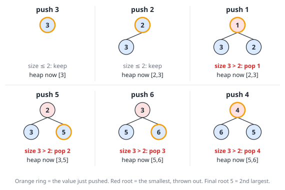
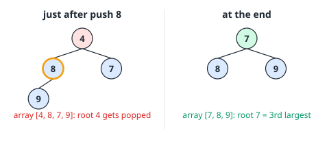

# Pattern: Top 'K' Elements

The top K elements pattern is a way of finding the K biggest, smallest or most common items in a collection without sorting the whole thing. It uses a heap, a structure that always keeps the smallest or largest item at the top. A music app showing your top 5 songs of the year is this problem.

## Before you start
<!-- bite: 36d6bf9c-d0b3-4862-9a25-d34653c53791 -->

- You should understand heaps. See [[07-heaps|heaps]] if needed.
- You should understand arrays and basic loops. See [[01-arrays|arrays]] if needed.

**What you will be able to do after this lesson:**

1. Define the top-k elements pattern and explain why it turns "fully sort the array" into a cheaper operation.
2. Implement finding the k largest/smallest elements using a heap.
3. Apply the pattern to related problems like k most frequent elements and k closest points.
4. Explain why the heap approach is more efficient than sorting when k << n.

**Study route:** read the motivation and mechanism first, trace the worked example by hand, then attempt the independent task before looking at the hints.

---

## 1. Why this pattern exists (real-world motivation)
<!-- bite: 0ce1a9f4-9843-48c1-bfae-2e54f0e6a090 -->

Imagine you're building a recommendation system and you need to find the top 10 most popular items from a list of 1 million items. You could sort the entire list by popularity and take the first 10: that's O(n log n) time and O(n) space.

But you only need the top 10, not the entire sorted list. You can do better: maintain a collection of the 10 largest items seen so far. As you process each item, if it's larger than the smallest item in your collection, replace the smallest with it. This is O(n log k) time and O(k) space — much cheaper when k is much smaller than n.

This is the top-k elements pattern: find the k largest (or smallest) elements in a collection without fully sorting it. A heap is the tool that makes this cheaper than sorting everything just to look at the top k of it.

---

## 2. Definitions and terminology
<!-- bite: 18ffec1c-e71c-419b-b9f8-07920244dd8c -->

| Term               | Plain-English definition                                                          | Example / analogy                                               |
| ------------------ | --------------------------------------------------------------------------------- | --------------------------------------------------------------- |
| **Top-k elements** | The k largest (or smallest) elements in a collection                              | The top 10 most popular products                                |
| **Heap**           | A complete binary tree with a heap property (parent smaller/larger than children) | A priority queue where the highest priority item is at the root |
| **Min-heap**       | Every parent is smaller than its children; smallest element at root               | A to-do list where the most urgent task is at the top           |
| **Max-heap**       | Every parent is larger than its children; largest element at root                 | A priority queue where the most important task is at the top    |

---

## 3. How it works — step by step
<!-- bite: 1a8b616a-649d-4cc7-bccd-5fe20dfa8ccb -->

To find the **k largest** elements, counterintuitively use a **min-heap** of size k: keep the k largest seen so far in the heap, and the smallest of those k sits at the root — so if a new element beats the root, it's bigger than the current worst of your top-k, and should replace it.

```python
def kth_largest(nums, k):
    heap = []
    for num in nums:
        heapq.heappush(heap, num)
        if len(heap) > k:
            heapq.heappop(heap)      # discard the current smallest of the top-k so far
    return heap[0]                   # root of the min-heap = k-th largest overall
```

**Concrete example:** `nums = [3, 2, 1, 5, 6, 4], k = 2`

Each panel shows the heap as a tree right after one push. When it holds more than 2 values, the root (the smallest) is popped.



To find the **k smallest** elements, use a **max-heap** of size k:

```python
def kth_smallest(nums, k):
    heap = []
    for num in nums:
        heapq.heappush(heap, -num)   # negate to simulate max-heap
        if len(heap) > k:
            heapq.heappop(heap)      # discard the current largest of the top-k so far
    return -heap[0]                 # root of the max-heap = k-th smallest overall
```

---

## 4. Implementation — complete runnable example
<!-- bite: 18c0a31b-09cc-494e-ab1f-4e34045c0141 -->

**Runnable example:** save as `top_k_elements_lab.py` and run `python3 top_k_elements_lab.py`. It uses only Python's standard library and creates no external files.

```python
import heapq
from typing import List


def kth_largest(nums: List[int], k: int) -> int:
    """Find the k-th largest element in an array."""
    heap = []
    for num in nums:
        heapq.heappush(heap, num)
        if len(heap) > k:
            heapq.heappop(heap)      # discard the current smallest of the top-k so far
    return heap[0]                   # root of the min-heap = k-th largest overall


def kth_smallest(nums: List[int], k: int) -> int:
    """Find the k-th smallest element in an array."""
    heap = []
    for num in nums:
        heapq.heappush(heap, -num)   # negate to simulate max-heap
        if len(heap) > k:
            heapq.heappop(heap)      # discard the current largest of the top-k so far
    return -heap[0]                 # root of the max-heap = k-th smallest overall


def top_k_frequent(nums: List[int], k: int) -> List[int]:
    """Find the k most frequent elements."""
    # Count frequencies
    freq = {}
    for num in nums:
        freq[num] = freq.get(num, 0) + 1

    # Use min-heap of size k
    heap = []
    for num, count in freq.items():
        heapq.heappush(heap, (count, num))
        if len(heap) > k:
            heapq.heappop(heap)      # discard the least frequent

    # Extract elements, most frequent first
    return [num for count, num in sorted(heap, reverse=True)]


def k_closest_points(points: List[List[int]], k: int) -> List[List[int]]:
    """Find the k closest points to the origin (0, 0)."""
    # Calculate squared distances
    def distance_sq(point):
        return point[0] ** 2 + point[1] ** 2

    # Use min-heap of size k
    heap = []
    for point in points:
        dist = distance_sq(point)
        heapq.heappush(heap, (-dist, point))   # negate: max-heap by distance
        if len(heap) > k:
            heapq.heappop(heap)      # root is the farthest so far -> discard it

    # Extract points from heap
    return [point for neg_dist, point in heap]


if __name__ == "__main__":
    # Test case 1: kth largest
    nums1 = [3, 2, 1, 5, 6, 4]
    k1 = 2
    result1 = kth_largest(nums1, k1)
    print(f"Test 1 - kth largest:")
    print(f"nums={nums1}, k={k1} -> {result1}")
    assert result1 == 5, f"Expected 5, got {result1}"

    # Test case 2: kth smallest
    nums2 = [3, 2, 1, 5, 6, 4]
    k2 = 2
    result2 = kth_smallest(nums2, k2)
    print(f"\nTest 2 - kth smallest:")
    print(f"nums={nums2}, k={k2} -> {result2}")
    assert result2 == 2, f"Expected 2, got {result2}"

    # Test case 3: top k frequent
    nums3 = [1, 1, 1, 2, 2, 3]
    k3 = 2
    result3 = top_k_frequent(nums3, k3)
    print(f"\nTest 3 - top k frequent:")
    print(f"nums={nums3}, k={k3} -> {result3}")
    expected3 = [1, 2]
    assert set(result3) == set(expected3), f"Expected {expected3}, got {result3}"

    # Test case 4: k closest points
    points4 = [[1, 3], [3, 4], [2, -1]]
    k4 = 2
    result4 = k_closest_points(points4, k4)
    print(f"\nTest 4 - k closest points:")
    print(f"points={points4}, k={k4} -> {result4}")
    expected4 = [[1, 3], [2, -1]]
    assert sorted(result4) == sorted(expected4), f"Expected {expected4}, got {result4}"

    print("\ntop_k_elements_lab: passed")
```

Expected output:

```text
Test 1 - kth largest:
nums=[3, 2, 1, 5, 6, 4], k=2 -> 5

Test 2 - kth smallest:
nums=[3, 2, 1, 5, 6, 4], k=2 -> 2

Test 3 - top k frequent:
nums=[1, 1, 1, 2, 2, 3], k=2 -> [1, 2]

Test 4 - k closest points:
points=[[1, 3], [3, 4], [2, -1]], k=2 -> [[1, 3], [2, -1]]

top_k_elements_lab: passed
```

---

## 5. Related patterns and extensions
<!-- bite: 2360bb11-84d2-4965-a3eb-b13200be2985 -->

### Quickselect algorithm

A variation that finds the k-th smallest element in expected O(n) time:

```python
def quickselect(nums, k):
    def select(left, right, k_smallest):
        if left == right:
            return nums[left]

        pivot_index = partition(left, right, left)
        if k_smallest == pivot_index:
            return nums[k_smallest]
        elif k_smallest < pivot_index:
            return select(left, pivot_index - 1, k_smallest)
        else:
            return select(pivot_index + 1, right, k_smallest)

    def partition(left, right, pivot_index):
        pivot_value = nums[pivot_index]
        # Move pivot to end
        nums[pivot_index], nums[right] = nums[right], nums[pivot_index]

        store_index = left
        for i in range(left, right):
            if nums[i] < pivot_value:
                nums[store_index], nums[i] = nums[i], nums[store_index]
                store_index += 1

        # Move pivot to its final place
        nums[right], nums[store_index] = nums[store_index], nums[right]
        return store_index

    return select(0, len(nums) - 1, k - 1)
```

### Median of medians

An improvement to Quickselect that guarantees O(n) worst-case time:

```python
def median_of_medians(nums, k):
    # Find median of groups of 5, then recursively find median of medians
    # Use as pivot for Quickselect
    pass  # Implementation omitted for brevity
```

---

## 6. Complexity
<!-- bite: b2740ed5-3ffc-4b7f-8252-0f4ba503daac -->

O(n log k) — n insertions/removals, each O(log k) because the heap never grows past size k. This beats sorting the whole array (O(n log n)) whenever k is meaningfully smaller than n.

---

## 7. Tradeoffs and limitations
<!-- bite: 9c93d725-a020-4419-8853-072bcc9dfe87 -->

- **Heap overhead.** Using a heap adds overhead compared to simple array operations, but the log k factor is usually small.
- **Not suitable for very large k.** When k is close to n, sorting might be more efficient due to better cache locality.
- **Requires additional data structures.** For frequency counting, you need a hash map to count occurrences first.

---

## Check your understanding
<!-- bite: b7e1141f-3e7c-4f24-b660-55340dbdb801 -->

Try each one before you open the answer.

1. <!-- q: mcq id="678daccf" -->
   You want the k largest numbers from a long stream. Which heap do you keep, and how big?

   - [ ] A max-heap holding every number
   - [x] A min-heap of size k
   - [ ] A max-heap of size k
   - [ ] A min-heap holding every number

   <details><summary>Answer</summary>

   A min-heap of size k. Its root is the smallest of your current top k, the one to throw out when something bigger arrives.

   </details>

2. <!-- q: mcq id="ef5e0474" -->
   What is the time to find the k largest of n numbers with a size-k heap?

   - [ ] O(n)
   - [x] O(n log k)
   - [ ] O(n log n)
   - [ ] O(k log n)

   <details><summary>Answer</summary>

   O(n log k). Each of the n numbers costs one push and maybe one pop, and the heap never grows past k.

   </details>

3. <!-- q: mcq id="628fdf69" -->
   Python's heapq only gives a min-heap. How can a kth_smallest function get max-heap behaviour from it?

   - [ ] It sorts the heap after each push
   - [x] It pushes −num, so the largest number has the smallest key
   - [ ] It pops twice each time
   - [ ] It uses heapq.nlargest

   <details><summary>Answer</summary>

   It negates the values. The biggest real number becomes the smallest key, so it sits at the root, and you negate it back when reading.

   </details>

4. <!-- q: gap id="08168c01" answers="count|frequency;hash map|dict|dictionary|counter" -->
   Fill in the gaps. For "k most frequent elements", you first ___ each value using a ___, then keep a size-k min-heap of (count, value) pairs.

   <details><summary>Answer</summary>

   Count each value with a hash map. The heap then works on the counts instead of the raw values.

   </details>

5. <!-- q: open id="e28e8aef" -->
   Why is a min-heap, not a max-heap, the right tool for keeping the k largest values seen so far?

   <details><summary>Answer</summary>

   The question each new value asks is "do I beat the weakest of the current top k?". A min-heap keeps that weakest one at the root, so you can check it in O(1) and replace it in O(log k). A max-heap would put the strongest at the root, which is the one you never want to remove.

   </details>

## Check your understanding: worked problems
<!-- bite: e38d9446-d186-451f-8d84-93cfcf25b382 -->

Work each one out on paper first, then type your answer.

1. <!-- q: exact id="58a2306f" answer="10" -->
   Use a size-3 min-heap to find the 3rd largest number in [7, 10, 4, 3, 20, 15]. What is at the root at the end?

   <details><summary>Answer</summary>

   10. The heap ends holding 10, 15 and 20, the three largest, and its root is the smallest of them.

   </details>

2. <!-- q: gap id="73dc1e32" answers="10;15;20" -->
   Fill in the gaps. Push each of [7, 10, 4, 3, 20, 15] into a min-heap, popping the smallest whenever the size goes above 3. At the end the heap holds, smallest first, ___, ___, ___.

   <details><summary>Answer</summary>

   10, 15, 20. 7, 4 and 3 are each pushed out once three bigger values have arrived.

   </details>

3. <!-- q: gap id="6d521af4" answers="6;4" -->
   Fill in the gaps. nums = [4, 4, 1, 6, 6, 6, 2, 4, 6, 1] and k = 2. The two most frequent values, most frequent first, are ___ and ___.

   <details><summary>Answer</summary>

   6 (4 times) and 4 (3 times). 1 appears twice and 2 once, so they are popped out of the size-2 heap.

   </details>

4. <!-- q: mcq id="6056884c" -->
   Which two points are closest to the origin (0, 0)? Compare squared distances x² + y². Choose all that apply.

   - [x] (3, 3)
   - [ ] (5, −1)
   - [ ] (−2, 4)
   - [x] (1, 1)

   <details><summary>Answer</summary>

   (1, 1) with 2 and (3, 3) with 18. (−2, 4) gives 20 and (5, −1) gives 26. No square root is needed, because squaring keeps the order.

   </details>

5. <!-- q: sketch id="14fa3a8e" -->
   You keep the 3 largest of nums = [9, 4, 7, 1, 8, 2] with a min-heap of size 3, using heappush and then heappop whenever the size goes over 3. On paper, draw the heap as a tree twice: right after 8 is pushed (before the pop), and at the very end.

   <details><summary>Answer</summary>

   

   What to check:
   - Before 8 arrives the heap holds 4, 7 and 9 (1 was pushed and popped straight away).
   - After pushing 8 there are four values and the smallest, 4, sits at the root.
   - Every parent is smaller than its children.
   - The final root is 7, the 3rd largest of the six numbers.

   </details>

## 9. Practice — independent task
<!-- bite: 121bc2d4-12f6-4325-a954-91a62ff5d636 -->

**Task:** Implement a function `k_most_frequent(nums, k)` that returns the k most frequent elements in the array. Use the top-k elements pattern. Test it with the following cases:

- `nums = [1, 1, 1, 2, 2, 3]` → expected `[1, 2]` (1 appears 3 times, 2 appears 2 times)
- `nums = [1]` → expected `[1]`

**Done when:** your function returns the correct most frequent elements for both test cases.

---

## Practice problems
<!-- bite: bdc60702-6067-4d69-a914-9ef6d0631a89 -->

**In the [[dsa/neetcode-150/index|NeetCode 150]]** — solved and written up here:

1. [[005-top-k-frequent-elements|Top K Frequent Elements]] (LeetCode #347) — count, then heap — though bucket sort beats the heap here, which is worth seeing.
2. [[067-kth-largest-element-in-an-array|Kth Largest Element in an Array]] (LeetCode #215) — the size-$k$ heap versus Quickselect trade discussed above.
3. [[066-k-closest-points-to-origin|K Closest Points to Origin]] (LeetCode #973) — the problem the lab's `k_closest_points` implements.
4. [[064-kth-largest-element-in-a-stream|Kth Largest Element in a Stream]] (LeetCode #703) — where a heap is genuinely necessary, since the data arrives over time.
5. [[065-last-stone-weight|Last Stone Weight]] (LeetCode #1046) — a max-heap with nothing else going on.
6. [[068-task-scheduler|Task Scheduler]] (LeetCode #621) — max-heap by count, plus a cooldown queue.
7. [[070-find-median-from-data-stream|Find Median from Data Stream]] (LeetCode #295) — two heaps facing each other; the standard extension.

**Not in the NeetCode 150** — worth doing on LeetCode directly, since they vary the comparator, which is where most heap bugs live:

8. Top K Frequent Words (#692) — #347 with a tie-break that makes the comparator interesting.
9. Reorganize String (#767) — greedy by frequency, driven by a max-heap.
10. Kth Smallest Element in a Sorted Matrix (#378) — heap over rows, or binary search on the answer.
11. Minimum Cost to Connect Sticks (#1167) — repeatedly merge the two smallest.

## Before moving on
<!-- bite: da6de9c5-4c7c-4077-90ef-ea5b0cea35f8 -->

You are done with this pattern when you can, closed-book:

- [ ] Explain why a min-heap of size k finds the k *largest*, which feels backwards.
- [ ] State the complexity and compare it with sorting the whole input.
- [ ] Implement top-k independently using a heap rather than a sort.
- [ ] Say when sorting is actually the better choice.

**Recap:** Maintaining a heap of size k gives the top k in O(n log k) rather than O(n log n) for a full sort. For the k largest you use a *min*-heap, so the smallest of your current best is at the top and cheapest to evict. The win only matters when k is much smaller than n; otherwise sort.

**Next:** [[08-overlapping-intervals|overlapping-intervals]] — a pattern where sorting *is* the right first move, and the whole problem collapses to one linear pass afterwards.

## 10. Related
<!-- bite: 0a3dd4e2-606a-4714-b0e7-30bf1428a371 -->

- [[01-trees|trees]] — the heap data structure
- [[05-sorting/index|sorting]] — the O(n log n) alternative this pattern beats when k << n
- [[03-hash-maps|hash maps]] — used for frequency counting
- [[01-growth-and-asymptotic-notation|algorithms]] — where the O(n log k) vs O(n log n) comparison comes from
- [[07-top-k-elements|top-k-elements]] — this note

---

## 11. Further reading
<!-- bite: 8e5d8d87-292b-4bb6-bada-59137d2f3e49 -->

The pattern appears in many contexts beyond LeetCode:

- **Search engines:** Finding top k search results
- **Recommendation systems:** Finding top k recommended items
- **Network routing:** Finding top k shortest paths
- **Database systems:** Finding top k query results

The core idea — maintaining a collection of the k best elements seen so far — is a fundamental algorithmic technique that appears whenever you need to find the top k elements without sorting the entire collection.

## About this lesson
<!-- bite: 2490e3a8-7347-4570-8230-60b2574d233d -->

**Level:** Intermediate. **Covers:** A university-level introduction to the top-k elements pattern: what it is, why it exists, how it works, and how to implement it independently.
