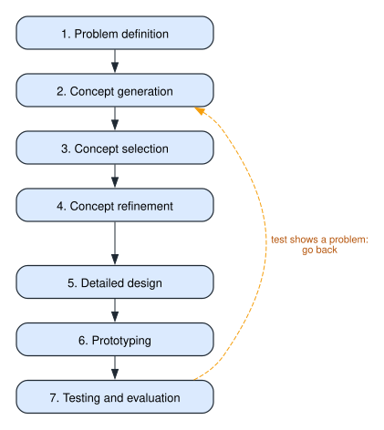

# The Design Process

The design process is a systematic and iterative approach to engineering design and prototyping, made of seven phases.

## Before you start
<!-- bite: 4df02d84-dfe8-4f68-ad54-afd6f7a59b77 -->

You should know what engineering design and prototyping are ([[engineering-design-and-prototyping/01-introduction-to-engineering-design-and-prototyping|lesson 01]]).

After this lesson you will be able to:

1. name the seven phases of the design process in order, with what you do in each;
2. give the input, output and decision-making criteria of each phase;
3. explain how creativity, innovation and user needs help the process.

## What the design process is
<!-- bite: f8db29b7-f1a1-43e6-856f-fec77921219c -->

Remember the challenges from lesson 1: ill-defined problems, too many concepts, conflicting requirements, testing in real conditions. The design process is how engineers deal with them one step at a time.

The design process is a systematic and iterative approach to engineering design and prototyping. **Systematic** means you follow the steps in order, so nothing is skipped. **Iterative** means you can go back to an earlier phase when testing shows a problem.

It has seven phases, and the rest of this course takes them one by one.

## The seven phases
<!-- bite: 6ae1e711-9353-4446-abac-21d2b193f9ac -->

| # | Phase | What you do |
| --- | --- | --- |
| 1 | Problem definition | Identify and analyse the design problem and its context, and define the objectives, requirements, constraints and criteria for success |
| 2 | Concept generation | Generate multiple design concepts that satisfy the problem definition |
| 3 | Concept selection | Select the best design concept that meets the criteria for success |
| 4 | Concept refinement | Refine the selected design concept |
| 5 | Detailed design | Detail the concept by specifying the dimensions, materials, components, interfaces and functions of the system |
| 6 | Prototyping | Create physical or virtual models of the design solution |
| 7 | Testing and evaluation | Test and evaluate the design solution |

## The methods used in each phase
<!-- bite: 7269f39b-6900-465a-a910-727b1aaf4c94 -->

Each phase has its own tools. Don't worry about the names yet; each one gets explained in its own lesson.

| # | Phase | Methods |
| --- | --- | --- |
| 1 | Problem definition | User research, benchmarking, mind mapping, SCAMPER |
| 2 | Concept generation | Brainstorming, morphological analysis, TRIZ, SCAMPER |
| 3 | Concept selection | Pugh matrix, Kano model, decision matrix, AHP |
| 4 | Concept refinement | Functional decomposition, design structure matrix, QFD |
| 5 | Detailed design | Drawings and specifications |
| 6 | Prototyping | 3D printing, CAD, simulation |
| 7 | Testing and evaluation | Experiments, surveys, interviews |

## The process is a loop, not a line
<!-- bite: e4073cb0-b6cb-41f4-9ef1-d05a3b2b79b4 -->

Here are the seven phases as a picture. Look at the dashed arrow: when testing shows a problem, you go back to an earlier phase and come forward again.

That arrow is what "iterative" means. Each trip around makes the design better.

## Inputs, outputs and decisions: phases 1 to 4
<!-- bite: 93b5c4d1-0514-4cc5-b232-879c34f089fe -->

An exam can ask what goes into each phase, what comes out, and how you decide you're done. The output of one phase is the input of the next. The example is a student study desk stand, which lessons 34 and 35 build in full.

| Phase | Input | Output | Decision-making criteria | Example |
| --- | --- | --- | --- | --- |
| Problem definition | A need, user research, benchmarking | Objectives, requirements, constraints, criteria for success | Is the problem clear, complete and agreed by stakeholders? | Reduce strain, hold 4 textbooks, cost under ₦20,000 |
| Concept generation | The problem definition | Many diverse concepts | Do the concepts satisfy the problem definition? Is there enough variety? | Foldable stand with drawers, rotating book stand, standing desk converter |
| Concept selection | The concepts and criteria for success | One chosen concept | Weighted score against criteria such as cost, ergonomics, sustainability | Decision matrix picks Concept B (44) |
| Concept refinement | The chosen concept | Improved concept with subfunctions and interactions clear | Does it meet customer needs and have no bottlenecks? | Adjustable height notches, magnetic strips |

## Inputs, outputs and decisions: phases 5 to 7
<!-- bite: 3dae3338-8579-4392-bf73-fce631da8e1e -->

The same table for the last three phases:

| Phase | Input | Output | Decision-making criteria | Example |
| --- | --- | --- | --- | --- |
| Detailed design | The refined concept | Dimensions, materials, components, interfaces, functions | Meets specifications, standards, cost and manufacturability | Bamboo, hinges, M4 screws, safe edges |
| Prototyping | The detailed design | A physical or virtual model | Is it feasible, functional and usable? | Cardboard model, then 3D printed or CNC cut |
| Testing and evaluation | The prototype | Test data and a decision to release or redesign | Success criteria met? Safe? Users satisfied? | 20% less neck strain, high survey rating |

See how testing's output is "release or redesign"? Redesign is the dashed arrow from the picture.

## Creativity, innovation and user needs
<!-- bite: a1e0b7eb-9e1f-4849-af26-83694400b0c1 -->

The steps alone don't make a good design. Three things run through all of them:

- **Creativity** is the ability to generate novel and useful ideas that solve problems or meet needs.
- **Innovation** is the process of implementing creative ideas into practical and valuable solutions.
- **User needs** are the desires, expectations and requirements of the potential users or customers of the design solution.

Creativity makes the ideas, innovation turns them into something real, and user needs keep both pointed at the right target.

## How they help, phase by phase
<!-- bite: b4ff5585-0ac1-4e20-8d35-4ee86489eadf -->

They all help engineers to:

1. Identify and define the design problem and its context from different perspectives and sources of information.
2. Generate and select among diverse and original design concepts that address the problem and its context effectively and efficiently.
3. Refine and detail the design concept to meet the specifications and standards of the system and the user needs.
4. Prototype and test the design solution to ensure its feasibility, functionality and usability for the intended users and stakeholders.
5. Improve the design solution by incorporating feedback and suggestions from the users and stakeholders.

Each point follows the phases in order: define, generate and select, refine and detail, prototype and test, improve. Before we go into phase 1, the next lesson looks at some famous products that went through this whole journey.

## Common pitfalls
<!-- bite: dcada66f-54e7-414f-bae7-b417f5d370f8 -->

1. **Treating the process as a straight line.** It is iterative. Testing can send you back to any earlier phase.
2. **Mixing up selection and refinement.** Selection *picks* one concept from many. Refinement *improves* the one you picked.
3. **Mixing up creativity and innovation.** Creativity is having the idea. Innovation is turning it into a practical, valuable product.

## Check your understanding
<!-- bite: d36d0915-4ab7-4f2b-b7f5-9a2cf5f35194 -->

Try each one before you open the answer.

1. <!-- q: exact id="4d81c2fa" answer="7" accept="seven" -->
   How many phases does the design process have?

   

Answer

   Seven: problem definition, concept generation, concept selection, concept refinement, detailed design, prototyping, and testing and evaluation.

   

2. <!-- q: mcq id="b06e93d7" -->
   A team has five sketches of a new kettle and uses a scoring table to pick one. Which phase are they in?

   - [ ] Concept generation
   - [x] Concept selection
   - [ ] Concept refinement
   - [ ] Detailed design

   

Answer

   Concept selection: picking the best concept against the criteria for success.

   

3. <!-- q: mcq id="71fa0c3e" -->
   A team specifies that a chair's legs are 450 mm long, made of 25 mm steel tube, joined with M6 bolts. Which phase is this?

   - [ ] Concept refinement
   - [x] Detailed design
   - [ ] Prototyping

   

Answer

   Detailed design: specifying the dimensions, materials, components, interfaces and functions.

   

4. <!-- q: gap id="c2e95b40" answers="creativity;innovation" -->
   Fill in the gaps. ___ is the ability to generate novel and useful ideas. ___ is the process of implementing those ideas into practical and valuable solutions.

   

Answer

   Creativity, then innovation.

   

5. <!-- q: open id="8a3d07b6" -->
   What does it mean that the design process is iterative? Give an example.

   

Answer

   It means you can go back to an earlier phase when testing shows a problem, then come forward again. For example, if a prototype bag's strap tears in testing, the team goes back to detailed design to pick a stronger material, or even back to concept generation.

   

6. <!-- q: open id="e5b2f9a1" -->
   For the prototyping phase, give its input, its output and one decision-making criterion.

   

Answer

   Input: the detailed design. Output: a physical or virtual model. Criterion: is it feasible, functional and usable?

   

## Before moving on
<!-- bite: be7e44f1-8214-4eea-b42e-337bf31792a1 -->

You can list the seven phases in order, say what goes in and comes out of each, and explain why the process is iterative. **Next:** [[engineering-design-and-prototyping/03-case-studies|03 — Case Studies]]: five famous products, and how to describe one in an exam.

## Related
<!-- bite: fb3bf554-7da3-4115-96a6-e2cc20a85d85 -->

- [[engineering-design-and-prototyping/index|Engineering design and prototyping map]]
- [[systems-engineering/03-the-lifecycle-and-the-v-model|The Lifecycle and the V-Model]]: the systems engineering view of the same journey.

## About this lesson
<!-- bite: 9f211dd6-c02c-415f-aec5-d2983feafb48 -->

**Level:** Beginner. **Covers:** the seven phases of the design process and their methods, the process as an iterative loop, each phase's inputs, outputs and decision-making criteria, and creativity, innovation and user needs.

**Where it sits:** lesson 02 of 36, in part 1 (the big picture).

**Source:** the author's own SSG 532 notes (lecture 1). The inputs and outputs tables were written for the exam and are not in the lecture notes.
