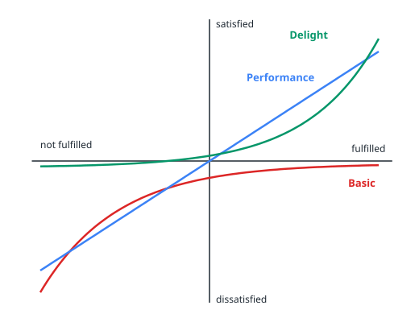

# Concept Selection 2: The Kano Model

The Kano model is a concept selection method that sorts user needs by how they make users feel.

## Before you start
<!-- bite: 5042a59b-573c-4af3-892b-1aa76902cc23 -->

You should know what concept selection is and how the Pugh matrix works ([[engineering-design-and-prototyping/11-concept-selection-1|Concept Selection 1]]).

After this lesson you will be able to:

1. sort user needs into basic, performance and delight;
2. draw the Kano graph and say what each line means;
3. use the Kano model to choose between concepts.

## What the Kano model is
<!-- bite: 6d912946-a392-4553-b85f-a19312836460 -->

The Pugh matrix compared concepts on criteria. But it never asked how the *user feels*. Some features people barely notice until they're missing. Others make people fall in love with a product. The Kano model is about that difference.

It focuses on understanding user needs and emotions, to predict how satisfied users will be with different features or design choices. It classifies user needs into three categories (basic, performance and delight) and plots the design concepts on a graph showing the relationship between user satisfaction and the fulfilment of the user needs.

## Steps of the Kano model
<!-- bite: 9440d09d-1942-41c1-9148-b869ac4b7048 -->

1. Identify user needs (through research).
2. Categorise the needs into basic, performance and delight.
3. Plot the design concepts. The x-axis is the level of fulfilment of each user need, and the y-axis is user satisfaction.
4. Analyse the graph.
5. Make informed decisions.

The three categories are the heart of it, so let's take them one at a time, on the lecture's example: an app for booking appointments.

## The three kinds of user needs
<!-- bite: cc425c4c-2dc4-4b3f-9c5a-afb148d04cfd -->

1. **Basic needs**: their absence causes dissatisfaction, but their presence doesn't necessarily delight users. For the booking app: showing available appointment times. Nobody praises an app for showing the times, but if it didn't, they'd delete it.
2. **Performance needs**: satisfaction increases as their level of fulfilment increases. For the booking app: faster loading times. The faster it loads, the happier people are.
3. **Delight needs**: unexpected features that surprise users, exceed their expectations and create emotional attachment. For the booking app: suggesting appointments from past preferences. Nobody asked for it, but once they see it, they love the app.

## The Kano graph
<!-- bite: 4f6c70f8-a522-400a-ae56-fae87bd76daa -->

Steps 3 and 4 put the needs on a graph. Fulfilment runs left to right, satisfaction runs bottom to top.

- **Basic needs give a flat line** (red): missing them makes users very dissatisfied, but fulfilling them only brings satisfaction up to neutral. It flattens out and never goes above.
- **Performance needs give a rising line** (blue): more is better, steadily.
- **Delight needs give a sharp jump** (green): missing them costs nothing (nobody expected them), but having them makes satisfaction shoot up.

## Making the decision
<!-- bite: c92504b9-3f6b-4bb7-b8db-995858d0d6a0 -->

Step 5: choose concepts that fulfil both basic and performance needs while prioritising those with delight features.

So the order is:

1. First, every basic need must be met. A concept missing a basic need is out, no matter how delightful.
2. Then, do well on performance needs.
3. Then, among the concepts left, prefer the one with delight features.

**Benefits:**

1. Emphasises user emotions.
2. Prioritises features effectively.
3. Identifies opportunities for innovation.

The Kano model is a framework, not a rigid formula. Use it as a guide to understand user preferences. When you need hard numbers instead, you use the decision matrix and AHP, in the next lesson.

## A note on delight over time
<!-- bite: cef5aefc-8876-4275-be98-1e7414db3ea5 -->

One thing worth knowing: needs move. A delight feature becomes a performance need, then a basic need, as people get used to it. A camera on a phone was a delight once. Now a phone without one would be a dissatisfier, so it's basic.

That's why the iPhone case study's "future" says new features every year: yesterday's delight is today's basic.

## Common pitfalls
<!-- bite: be370bc5-e34d-40ed-9619-d1db4cf018f9 -->

1. **Choosing the most delightful concept first.** Basic needs come first. Delight can't save a product that misses a basic need.
2. **Drawing the basic line going above neutral.** Fulfilling a basic need only removes dissatisfaction; it doesn't make anyone happy.
3. **Treating Kano as a formula.** It's a framework for understanding preferences, not a scoring table.

## Check your understanding
<!-- bite: f66b9315-9d10-408c-8147-ace37dcaeb4f -->

Try each one before you open the answer.

1. <!-- q: mcq id="2d6f8b01" -->
   For a car, which kind of need are working brakes?

   - [x] Basic
   - [ ] Performance
   - [ ] Delight

   

Answer

   Basic. Without them, people are very dissatisfied; having them doesn't delight anyone.

   

2. <!-- q: mcq id="9b4e1c7a" -->
   For an electric car, every extra 50 km of range makes buyers a bit happier. What kind of need is range?

   - [ ] Basic
   - [x] Performance
   - [ ] Delight

   

Answer

   Performance: satisfaction increases as fulfilment increases.

   

3. <!-- q: mcq id="e0a3d752" -->
   A hotel leaves a handwritten welcome note with the guest's favourite snack, which it learned from their last visit. What kind of need does this meet?

   - [ ] Basic
   - [ ] Performance
   - [x] Delight

   

Answer

   Delight: unexpected, exceeds expectations, creates emotional attachment.

   

4. <!-- q: mcq id="47c9f2e6" -->
   Concept A has a delight feature but misses one basic need. Concept B meets every basic need and does well on performance, with no delight feature. Which does the Kano model choose?

   - [ ] Concept A
   - [x] Concept B

   

Answer

   Concept B. Basic and performance needs come first; delight only decides between concepts that already meet them.

   

5. <!-- q: sketch id="b81e3f04" -->
   On paper, draw the Kano graph: label both axes and draw the lines for basic, performance and delight needs.

   

Answer

   

   What to check:

   - The x-axis is fulfilment of the need, the y-axis is user satisfaction.
   - Basic rises from very dissatisfied but flattens out at neutral, never above.
   - Performance is a straight rising line through the middle.
   - Delight is flat near neutral, then jumps up sharply when fulfilled.

   

## Before moving on
<!-- bite: 57aefc42-28bb-4e0b-9dc6-7b74256d7a19 -->

You can sort needs into basic, performance and delight, draw the Kano graph, and use it to pick a concept. **Next:** [[engineering-design-and-prototyping/13-concept-selection-3|13 — Concept Selection 3: The Decision Matrix and AHP]]: scoring ideas with numbers and weights.

## Related
<!-- bite: 82f29195-81e6-4932-b097-9513d89ce620 -->

- [[engineering-design-and-prototyping/index|Engineering design and prototyping map]]

## About this lesson
<!-- bite: db25f206-7d00-4a6c-95a1-5815657c533a -->

**Level:** Beginner. **Covers:** the Kano model's steps, basic, performance and delight needs, the Kano graph, how to decide with it, and how needs move over time.

**Where it sits:** lesson 12 of 36, in part 4 (choosing and shaping an idea).

**Source:** the author's own SSG 532 notes (lecture 3). The note on needs moving over time and the car and hotel examples were added.
