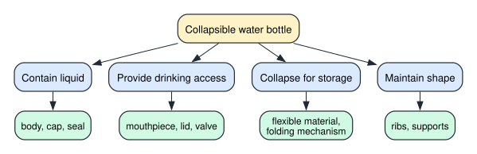

# Concept Refinement

Concept refinement is the fourth phase of engineering design: improving and optimising the selected concept by adding more details and specifications to the system.

## Before you start
<!-- bite: 717607d0-8b6a-48a2-a9b6-6ca9d0b7b36f -->

You should know how a concept is selected ([[engineering-design-and-prototyping/13-concept-selection-3|Concept Selection 3]]).

After this lesson you will be able to:

1. name the four skills used to refine a concept;
2. use functional decomposition, a design structure matrix (DSM) and quality function deployment (QFD);
3. combine all three to find and fix the weak point in a design.

## What concept refinement is
<!-- bite: 889cc1f4-b7da-4ca9-9003-8d3a74eed093 -->

We've picked our concept. But it's still rough: "a collapsible water bottle" is an idea, not a product. Refinement is basically improving and optimising the design concept by adding more details and specifications to the system.

To do that, apply and combine these skills:

1. **Functional analysis**: identify and describe the functions and subfunctions of the system and their relationships and dependencies.
2. **Structural analysis**: identify and describe the components and subcomponents of the system and their relationships and dependencies.
3. **Integration**: combine and coordinate the functions and components of the system to achieve the desired performance and outcomes.
4. **Optimisation**: maximise or minimise the objectives and criteria of the system.

## The three methods, in order
<!-- bite: abd5189a-51bd-4071-b068-605b1cd38c1f -->

To refine, use these methods in order:

1. **Functional decomposition**: breaking down the overall function of the design into smaller, more manageable subfunctions. This helps identify key components, interactions and areas for improvement.
2. **Design structure matrix (DSM)**: a visual representation of how different elements of a design interact with each other. It identifies dependencies, potential bottlenecks and chances for modularisation.
3. **Quality function deployment (QFD)**: translates customer needs and expectations into specific design requirements, and makes sure design changes align with customer needs and priorities.

Decomposition asks *what does it do?* DSM asks *what depends on what?* QFD asks *what does the customer care about?* Let's run all three on the lecture's example: a collapsible water bottle.

## 1. Functional decomposition of the bottle
<!-- bite: b850607c-8f54-4398-80ef-55fd4d723000 -->

The bottle's overall job splits into four subfunctions, and each subfunction is done by some parts:

- **Contain liquid**: body, cap, seal.
- **Provide drinking access**: mouthpiece, lid, valve.
- **Collapse for storage**: flexible material, folding mechanism.
- **Maintain shape**: ribs, supports.

Already something stands out: the folding mechanism is complex and prone to failure.

## 2. Design structure matrix of the bottle
<!-- bite: 88c6ad3d-6a04-4f34-91c8-531ad8520505 -->

A DSM lists the parts both down the side and across the top. A mark means "these two interact".

| | Body | Cap | Valve | Mouthpiece | Folding mechanism | Ribs |
| --- | --- | --- | --- | --- | --- | --- |
| **Body** | | X | | | X | X |
| **Cap** | X | | | | | |
| **Valve** | | | | X | | |
| **Mouthpiece** | | | X | | | |
| **Folding mechanism** | X | | | | | X |
| **Ribs** | X | | | | X | |

What it shows: body and cap must fit together; valve and mouthpiece control flow; the folding mechanism and structural elements (ribs) must keep shape while collapsing. The folding mechanism touches the most other parts, so a change there ripples out.

## 3. QFD for the bottle
<!-- bite: aa584409-decc-4a53-b4f3-fbaa55c7dd2e -->

QFD takes what customers said and turns it into priorities for the design:

| Customer need | Priority | Design requirement it becomes |
| --- | --- | --- |
| Leakproof design | High | A tight seal between body and cap, tested under pressure |
| Easy-to-clean materials | Medium | Smooth food-safe silicone, wide opening |
| Attractive design | Low | Colour options |

Customers also care about durability and ease of use.

## Putting it together
<!-- bite: 42559f44-b4a4-4e84-9725-a25f9c9bd111 -->

Now combine what each method showed:

- Decomposition shows the folding mechanism is complex and prone to failure.
- The DSM shows it interacts with the structural elements.
- QFD shows customers care about durability and ease of use.

So: redesign the folding mechanism to be simpler and more robust, while protecting structural integrity.

## Using the three methods together
<!-- bite: 94d5f0f4-f611-40a6-acd4-e9913db18092 -->

The bottle shows the general pattern for using them together:

1. Start with functional decomposition.
2. Create a DSM.
3. Identify potential improvements (simplify, modularise or enhance).
4. Apply QFD.
5. Iterate and refine.

After refinement, the concept is ready to be detailed. But before we draw it up, there's a question every design must answer: what makes a design *good*? That's the next three lessons.

## Common pitfalls
<!-- bite: 8916c052-d195-431f-be1c-20a811b85c20 -->

1. **Mixing up functional and structural analysis.** Functional is about what it *does* (contain liquid). Structural is about what it's *made of* (body, cap, seal).
2. **Using a DSM when nothing interacts.** If there are no bottlenecks, you can skip it and say why. Lesson 35 does exactly that for the study desk.
3. **Forgetting the customer.** QFD keeps refinement pointed at what the customer actually values, not at what's interesting to engineer.

## Check your understanding
<!-- bite: 930503cb-2e18-444b-aff5-6dbffc829e5f -->

Try each one before you open the answer.

1. <!-- q: mcq id="7d2c4b90" -->
   An engineer breaks "make toast" into "hold bread", "heat bread", "time the heating" and "eject toast". Which method is this?

   - [x] Functional decomposition
   - [ ] Design structure matrix
   - [ ] Quality function deployment

   

Answer

   Functional decomposition: breaking the overall function into smaller subfunctions.

   

2. <!-- q: mcq id="2a9e5f13" -->
   A table shows that a phone's battery interacts with the processor, the case and the charging port. Which method is this?

   - [ ] Functional decomposition
   - [x] Design structure matrix
   - [ ] Quality function deployment

   

Answer

   A design structure matrix: it shows how elements of the design interact and depend on each other.

   

3. <!-- q: mcq id="c5f80e27" -->
   Customers of a hand drill say "it must not tire my wrist". The team turns this into "total mass under 1.5 kg, grip angle 15°". Which method is this?

   - [ ] Functional decomposition
   - [ ] Design structure matrix
   - [x] Quality function deployment

   

Answer

   QFD: translating customer needs into specific design requirements.

   

4. <!-- q: gap id="e8b13d64" answers="functional analysis;structural analysis;integration;optimisation|optimization" -->
   Fill in the gaps. The four skills for refining a concept are ___, ___, ___ and ___.

   

Answer

   Functional analysis, structural analysis, integration and optimisation.

   

5. <!-- q: open id="1f7a6c38" -->
   In what order should functional decomposition, DSM and QFD be used together, and why?

   

Answer

   (1) Functional decomposition, to see the subfunctions and parts. (2) DSM, to see how those parts interact and where the bottlenecks are. (3) Identify improvements (simplify, modularise or enhance). (4) QFD, to check the changes line up with what customers value. (5) Iterate. Each step needs the one before: you can't map interactions before you know the parts.

   

## Before moving on
<!-- bite: 7cbe31ca-2b8d-4c5e-b5c5-7143a901e3fe -->

You can name the four refinement skills and use functional decomposition, DSM and QFD together to find a design's weak point. **Next:** [[engineering-design-and-prototyping/15-the-house-of-quality|15 — The House of Quality]]: the chart that ranks what to engineer by what customers care about.

## Related
<!-- bite: bdfb04b2-80be-4272-80ee-4dbb2d197783 -->

- [[engineering-design-and-prototyping/index|Engineering design and prototyping map]]
- [[engineering-design-and-prototyping/15-the-house-of-quality|The House of Quality]]: QFD in full, with the bottle's numbers.
- [[systems-engineering/04-architecture-and-interfaces|Architecture and Interfaces]]: breaking a system into parts and defining how they connect.

## About this lesson
<!-- bite: 71500d7b-6e98-43f4-b1e2-6125e03c9ca2 -->

**Level:** Beginner. **Covers:** the four refinement skills, functional decomposition, the design structure matrix, quality function deployment, and the lecture's collapsible water bottle example.

**Where it sits:** lesson 14 of 36, in part 4 (choosing and shaping an idea).

**Source:** the author's own SSG 532 notes (lecture 3). The DSM and QFD tables were built from the lecture's descriptions of the bottle.
