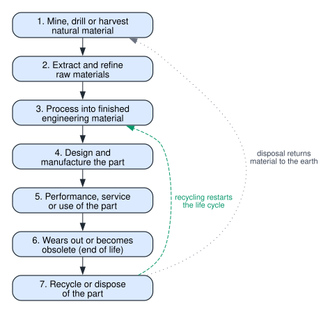

# Considerations of Good Design 2: Total Life Cycle

The total life cycle of a component starts with an idea of a need and ends with the retirement or dumping of the product.

## Before you start
<!-- bite: 305a9e95-ef72-4d15-82c5-a9f3078f7d16 -->

You should know the performance requirements ([[engineering-design-and-prototyping/13-considerations-of-good-design-1|Considerations of Good Design 1]]).

After this lesson you will be able to:

1. list the seven phases of the total life cycle in order;
2. explain the sustainable material life cycle and its limitations;
3. explain the four total life cycle design considerations: material selection, material and energy conservation, durability and recycling.

## What the total life cycle is
<!-- bite: 8dc0850c-e4e1-4077-92b2-91c19f0d1572 -->

The last lesson ended on life cycle cost: a product's story doesn't stop at the factory gate. This lesson follows the whole story.

The total life cycle (TLC) of a component starts with an idea of a need and ends with the retirement or dumping of the product. Think of an aluminium drink can. Before it was a can, it was a rock in the ground. After you drink from it, it goes somewhere too. A good designer thinks about all of that, not just the part in the middle.

## The seven phases of the total life cycle
<!-- bite: 9e1647ee-e99c-455e-a36a-4726b5cdfe26 -->

1. Mining, drilling or harvesting of natural material (e.g. mineral, oil, cotton).
2. Extract and refine raw materials (e.g. coal, iron ore, sand, wood).
3. Processing into finished engineering material (e.g. aluminium sheets, alloys, plastics).
4. Designing and manufacturing of the part.
5. Performance, service or use of the part.
6. Wears out, becomes obsolete (end of life).
7. Recycle or dispose of the part (returns the material to the earth).

## Seeing the life cycle as a loop
<!-- bite: 075064fc-b127-43ce-8e7d-21035ba437dc -->

Here are the seven phases as a picture. Look at the two arrows coming out of phase 7: recycling feeds material back into processing, and disposal returns it to the earth.

For the drink can: bauxite is mined (1), refined into alumina and aluminium (2), rolled into sheet (3), pressed into a can (4), filled and drunk (5), emptied (6), then recycled into a new can or thrown away (7).

## Sustainable material life cycle
<!-- bite: e11a45b4-96fd-4843-b38e-f2fb50a09f19 -->

A sustainable material life cycle is a combination of the natural (biological) life cycle and the industrial (product) life cycle.

Today the industrial product life cycle is considered bad, while the biological one is good. In nature, nothing is waste: a fallen leaf feeds the soil. In industry, a lot ends up as poison in the ground.

So the idea is to redesign things so they don't poison the environment. That needs a comprehensive analysis of the material life cycle, including the product's impact on the environment and all living things.

## Limitations of the sustainable material life cycle
<!-- bite: 2412a670-3ad7-4d76-87b6-ef32a897be21 -->

1. Switching from conventional materials to lightweight eco-friendly materials needs a change of the whole set-up and tools.
2. Switching involves huge investment and money.

Even so, for a better future we need design sustainability, because what we use is borrowed from future generations.

## Total life cycle design considerations
<!-- bite: 3009aef1-2eec-4095-80fd-22936b39473d -->

So how does a designer act on all this? Total life cycle design considerations are:

1. Material selection.
2. Material and energy conservation.
3. Durability.
4. Recycling.

Let's take them one by one.

## 1. Material selection
<!-- bite: 1b76f511-2d14-43c2-9d4e-96241140568e -->

A good design requires good material selection. The first step is the assessment of the service conditions (remember those from lesson 13: temperature, humidity, corrosion, dust, vibration).

Then selection depends on:

- the properties of the material,
- the manufacturing process to be used,
- the service conditions,
- the service-time performance.

Material properties to consider: static yield strength, fatigue, creep, toughness, ductility and corrosion resistance.

## The material properties, in plain words
<!-- bite: 830651ed-0bcd-4f45-8e03-406ed70b3508 -->

Those six properties come up again in lesson 17, so here's what each one means:

1. **Static yield strength**: the load at which the material starts to bend permanently.
2. **Fatigue**: weakening from a load applied again and again, like bending a paper clip back and forth until it snaps.
3. **Creep**: slow stretching under a steady load over a long time, especially when hot.
4. **Toughness**: how much energy it can absorb before breaking, so it doesn't shatter on impact.
5. **Ductility**: how much it can stretch or bend before breaking.
6. **Corrosion resistance**: how well it resists rust and chemical attack.

## 2, 3 and 4: conservation, durability and recycling
<!-- bite: 8d4f12aa-a543-4054-bb38-d38978578924 -->

**2. Material conservation.** A good design must conform to material and energy conservation along with environmental protection, which also reduces material and energy cost.

**3. Durability.** A good design permits maximum durability at minimum cost. Durability is the amount of useful life before retirement of the product.

**4. Recycling.** A good design allows recycling of waste material, which restarts the total life cycle of the material. Example: aluminium beverage cans used for cold drinks must be recyclable from the early stage of design.

That's the design's life on Earth. But a design also lives among people and laws, and that's the third group of considerations, in the next lesson.

## Common pitfalls
<!-- bite: e4ace58a-159e-4475-9822-1f29879535d9 -->

1. **Starting the life cycle at manufacturing.** It starts at mining, drilling or harvesting natural material.
2. **Leaving recycling to the end.** Whether a product can be recycled is decided at the design stage, as the drink can shows.
3. **Choosing a material before assessing service conditions.** The service conditions come first.

## Check your understanding
<!-- bite: 35962b5d-acbc-41be-bc22-a114a4e8484f -->

Try each one before you open the answer.

1. <!-- q: mcq id="4e2b8d70" -->
   Cotton is picked from a farm to make a T-shirt. Which phase of the total life cycle is this?

   - [x] 1. Mining, drilling or harvesting of natural material
   - [ ] 2. Extract and refine raw materials
   - [ ] 4. Designing and manufacturing of the part

   

Answer

   Phase 1: harvesting natural material.

   

2. <!-- q: mcq id="b93c1f05" -->
   An old laptop stops getting software updates and the owner stops using it. Which phase is this?

   - [ ] 5. Performance, service or use
   - [x] 6. Wears out, becomes obsolete
   - [ ] 7. Recycle or dispose

   

Answer

   Phase 6: it has become obsolete, the end of its life.

   

3. <!-- q: gap id="0c7e5a29" answers="material selection;conservation|material and energy conservation;durability;recycling" -->
   Fill in the gaps. The four total life cycle design considerations are ___, material and energy ___, ___ and ___.

   

Answer

   Material selection, material and energy conservation, durability and recycling.

   

4. <!-- q: mcq id="d64f0b8e" -->
   A steel bridge cable carries traffic loads that rise and fall thousands of times a day. Which material property matters most for this?

   - [ ] Creep
   - [x] Fatigue
   - [ ] Ductility

   

Answer

   Fatigue: weakening from a load applied again and again.

   

5. <!-- q: open id="72a9e3c1" -->
   Give the two limitations of the sustainable material life cycle, and explain why we should still pursue it.

   

Answer

   (1) Switching from conventional materials to eco-friendly ones needs a change of the whole set-up and tools. (2) Switching involves huge investment and money. We should still pursue it because what we use is borrowed from future generations, so design sustainability is needed for a better future.

   

## Before moving on
<!-- bite: c178ea6c-0fb0-4259-b4e9-b1625dbad67a -->

You can list the seven phases of the total life cycle, explain the sustainable material life cycle, and explain the four life cycle design considerations. **Next:** [[engineering-design-and-prototyping/15-considerations-of-good-design-3|Considerations of Good Design 3: Regulatory and Social Issues]]: the rules and the people a design must answer to.

## Related
<!-- bite: afd4340b-51d3-41cd-bb4d-d4c9a0076c1c -->

- [[engineering-design-and-prototyping/index|Engineering design and prototyping map]]
- [[continuum-mechanics/index|Continuum Mechanics]]: the physics behind strength, fatigue and creep.

## About this lesson
<!-- bite: 9945bd27-3bd0-43a6-a27a-609efb3e00a9 -->

**Level:** Beginner. **Covers:** the seven phases of the total life cycle, the sustainable material life cycle and its limits, and material selection, material conservation, durability and recycling.

**Where it sits:** lesson 14 of 21, part 2 of 3 on considerations of good design.

**Source:** the author's own SSG 532 notes (lecture 4). The drink can walk-through and the plain meanings of the six material properties were added.
