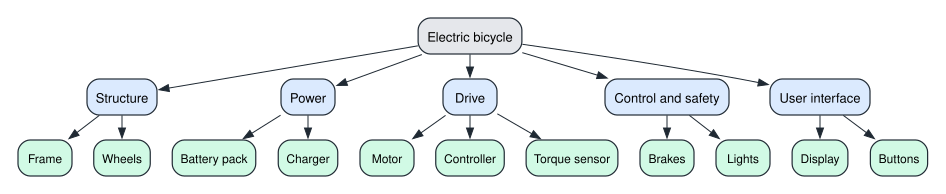

# System Architecture and MBSE

A system architecture is a product's subsystems, which part does which job, and how the parts connect.

## Before you start
<!-- bite: a2f1a590-1d7e-4057-93e3-b94436780e6e -->

You should know functional decomposition and the design structure matrix ([[engineering-design-and-prototyping/14-concept-refinement|14 — Concept Refinement]]) and how needs become engineering requirements ([[engineering-design-and-prototyping/15-the-house-of-quality|15 — The House of Quality]]).

After this lesson you will be able to:

1. tell a functional architecture from a physical one, and map functions to components;
2. identify a product's interfaces and say what an interface control document is for;
3. explain what MBSE and SysML are, and why teams use a model instead of documents.

## What a system architecture is
<!-- bite: f65f8678-720c-4b16-8aed-05219b49f98e -->

Lesson 14 broke a water bottle's job into functions. Real products have more parts: an electric bicycle has a frame, wheels, a motor, a battery, a controller, brakes, lights and a display, designed by different people who must all fit together.

A **system architecture** is the high-level structure of a product: the **subsystems** it is made of, **which subsystem performs which function**, and **how they connect**. It is decided before the detailed design (lessons 20 to 24), because once each team starts drawing parts, changing the structure gets expensive. This lesson builds the e-bike's architecture, then shows how MBSE keeps it under control.

## Functional and physical architecture
<!-- bite: 7409e6c7-0be0-4fba-9511-bf039d6cb6e7 -->

There are two views of the same product.

1. **Functional architecture:** what the product must do, broken into functions. Carry the rider, provide power, assist pedalling, stop, show information.
2. **Physical architecture:** what the product is made of, broken into subsystems and components. Frame, drive unit, battery pack, brakes, controller, display.

The key step is **allocation**: assigning each function to the physical part that performs it.

| Function | Allocated to |
| --- | --- |
| Carry the rider | Frame and wheels |
| Store energy | Battery pack |
| Assist pedalling | Motor and controller |
| Sense pedalling effort | Torque sensor |
| Stop the bike | Brakes |
| Show speed and charge | Display |

## The e-bike as a tree
<!-- bite: 877a5103-178b-448f-8c88-40c5601285c6 -->

Drawn as a tree, the e-bike's physical architecture looks like this.

## Interfaces
<!-- bite: d6fce569-7165-439a-b132-8e5a0c789043 -->

An **interface** is where two subsystems meet and must agree. There are four kinds:

1. **Mechanical:** the battery bolts to the frame with four M5 bolts at set positions.
2. **Electrical:** the battery supplies 36 V to the controller through a named connector.
3. **Data:** the torque sensor sends a signal the controller can read.
4. **Energy or material:** heat from the motor must flow out somewhere; water must not get in.

Most integration problems happen at interfaces: the battery team and the frame team each did their part correctly, but nobody agreed the bolt spacing. So teams write an **interface control document (ICD)** that fixes each interface's details, and nobody changes it without agreement from both sides.

## Modular and integral architecture
<!-- bite: 5272b472-1cb4-4ed5-91c3-51ef65aa5d26 -->

1. **Modular:** each function lives in its own subsystem, with simple, standard interfaces. The battery slides out and can be swapped or upgraded. Easier to repair, upgrade and make in variants.
2. **Integral:** functions are shared across parts, tightly joined. A battery moulded into the frame. Lighter, neater, often cheaper at volume, but harder to change.

The DSM from lesson 14 helps here: parts that depend heavily on each other belong in the same module.

## MBSE: a model instead of documents
<!-- bite: 0046d726-4c5a-457e-9d9b-d68341fe07b0 -->

On a big project the architecture, requirements and interfaces live in dozens of documents and spreadsheets that drift out of step: the requirement says 36 V, the drawing says 48 V, and nobody notices.

**Model-based systems engineering (MBSE)** replaces those separate documents with one connected **system model**, the single source of truth. Requirements, functions, parts and interfaces are elements in the model, linked to each other. Change the battery voltage once and every diagram, table and link that uses it updates, and the tool can show what else is affected.

## SysML and its main diagrams
<!-- bite: 3489c916-c30c-467d-9f64-ca9d406a2383 -->

The usual language for the model is **SysML** (Systems Modeling Language), drawn in tools such as Cameo, Capella or Enterprise Architect. Its main diagrams:

1. **Requirement diagram:** the requirements and how they link to design elements.
2. **Block definition diagram:** the parts and their structure, like the e-bike tree.
3. **Internal block diagram:** how the parts connect, through their interfaces.
4. **Activity diagram:** the functions and the flow between them.
5. **State machine diagram:** the modes, such as off, standby, assisting and charging.

## Is MBSE worth it?
<!-- bite: 52fc3868-77a2-4531-b2cf-b9ac13b4165a -->

MBSE pays off on complex products with many teams, long lives and strict safety rules: aircraft, cars, satellites, medical devices. It costs training, tools and discipline. For a student project or a simple product, a clear architecture tree, a function-allocation table and an interface list in a spreadsheet give most of the benefit.

## Common pitfalls
<!-- bite: 0838c020-7ba5-43f7-ad5f-19c78f1b4dcc -->

1. **Jumping into detailed design without an architecture.** Teams then discover at assembly that parts don't connect.
2. **Leaving a function unallocated.** Every function must belong to some part, or nobody designs it.
3. **Informal interfaces.** Write them down and control them.
4. **Thinking MBSE is just drawing diagrams.** The value is the links between the elements, not the pictures.

The architecture says what the product is made of. Before detailing each part, the next lessons ask what makes any design good: performance, its whole life cycle, and the rules and people it must answer to.

## Check your understanding
<!-- bite: 5b47acff-bb5f-43a8-ab7c-65fb9541eb19 -->

Try each one before you open the answer.

1. <!-- q: mcq id="936203e1" -->
   For a robot vacuum cleaner, which of these belong to the functional architecture rather than the physical one?

   - [x] Detect obstacles
   - [ ] Bumper with switches
   - [x] Collect dust
   - [ ] Brush motor

   

Answer

   "Detect obstacles" and "collect dust" are functions: what it must do. The bumper and the brush motor are physical parts, which the functions are allocated to.

   

2. <!-- q: mcq id="cf2dee51" -->
   An e-bike's battery fits the frame perfectly, but its connector doesn't match the controller's. What kind of interface failed?

   - [ ] Mechanical
   - [x] Electrical
   - [ ] Data
   - [ ] Energy

   

Answer

   Electrical: how power passes between subsystems, including the connector. An interface control document agreed by both teams would have fixed it.

   

3. <!-- q: gap id="46689cf3" answers="allocation|function allocation" -->
   Assigning each function of the product to the physical part that performs it is called ___.

   

Answer

   Allocation. Every function must be allocated, or nobody designs it.

   

4. <!-- q: open id="63f2ccec" -->
   A phone maker is deciding between a removable battery and one glued inside. Explain which is the modular choice and which the integral one, with one advantage of each.

   

Answer

   The removable battery is modular: a separate subsystem with a simple interface, so users can replace it and it's easier to repair. The glued battery is integral: tightly joined to the body, which allows a thinner, lighter, water-resistant phone, but makes repair harder.

   

5. <!-- q: open id="218a1ed3" -->
   What problem does MBSE solve that a set of separate documents doesn't?

   

Answer

   Separate documents drift out of step: one says 36 V, another 48 V, and nobody notices. MBSE keeps requirements, functions, parts and interfaces as linked elements in one model, the single source of truth, so a change is made once, everything that uses it updates, and the tool shows what the change affects.

   

6. <!-- q: mcq id="5faece69" -->
   Which SysML diagram would show an e-bike moving between off, standby, assisting and charging?

   - [ ] Block definition diagram
   - [ ] Requirement diagram
   - [x] State machine diagram
   - [ ] Internal block diagram

   

Answer

   A state machine diagram shows the modes and what moves the system between them.

   

## Before moving on
<!-- bite: cff26248-5a4e-4a1a-b901-77d7fe8a7c1f -->

You can build a functional and physical architecture, allocate functions, list interfaces and explain MBSE. **Next:** [[engineering-design-and-prototyping/17-considerations-of-good-design-1|17 — Considerations of Good Design 1: Performance and Functional Issues]]: the seven things a design must perform on, from function to cost.

## Related
<!-- bite: e5ba0920-fd32-4c6b-b067-e0ad2037b13e -->

- [[engineering-design-and-prototyping/index|Engineering design and prototyping map]]
- [[systems-engineering/04-architecture-and-interfaces|Architecture and Interfaces]]: coupling, N² diagrams and interface control documents in depth.
- [[systems-engineering/07-mbse-and-modelling|MBSE and Modelling]]: SysML, SysML v2 and digital twins.

## About this lesson
<!-- bite: fbc117b9-5c9b-4021-b43e-abe031505081 -->

**Level:** Intermediate. **Covers:** functional and physical architecture, allocation, the four kinds of interface and the ICD, modular and integral architecture, MBSE and the main SysML diagrams.

**Where it sits:** lesson 16 of 36, in part 4 (choosing and shaping an idea).

**Source:** written from general systems engineering knowledge, because the SSG 532 lecture notes stop at functional decomposition and the DSM; system architecture and MBSE are on the official course outline. The diagram comes from `scripts/diagrams/engineering_design.py`.
