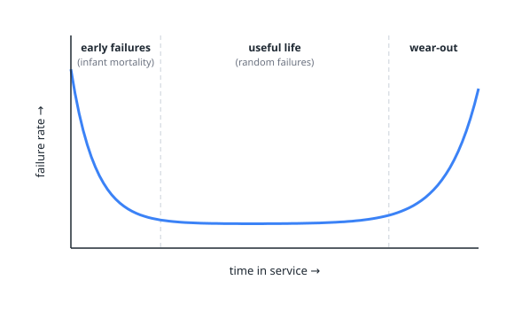

# Reliability

Reliability is the probability that a product does its job, under stated conditions, for a stated length of time, and designers can calculate it and design it in.

## Before you start
<!-- bite: 644a08ed-6144-4433-a98a-c53f8be1159c -->

You should know FMEA ([[engineering-design-and-prototyping/27-failure-mode-and-effects-analysis|27 — Failure Mode and Effects Analysis]]) and the factor of safety ([[engineering-design-and-prototyping/23-factor-of-safety|23 — Factor of Safety]]).

After this lesson you will be able to:

1. define reliability, failure rate, MTBF, MTTF, MTTR and availability;
2. describe the bathtub curve and what causes failures in each part of it;
3. calculate the reliability of parts in series and in parallel, and name ways to design reliability in.

## What reliability is
<!-- bite: 815a25bf-3347-4235-88f9-f5c7e7ed664c -->

FMEA (lesson 27) asked *how* a product could fail. Reliability asks *how likely* it is to keep working, and for how long.

**Reliability** is the probability that a product performs its intended function, under stated conditions, for a stated period of time. All four parts matter. "The pump is reliable" means nothing; "the pump has a 95% chance of running for 2 years of 8 hours a day at 30 °C without failing" is a reliability you can design to and test.

## The key measures
<!-- bite: 336e312a-e35f-4017-be5c-7a53b1e26760 -->

1. **Failure rate (λ):** This is how often failures happen, such as 0.0005 failures per hour.
2. **MTBF, mean time between failures:** This is the average running time between failures of a product that is **repaired**, such as a generator. With a constant failure rate, MTBF = 1/λ, so λ = 0.0005 per hour gives an MTBF of 2,000 hours.
3. **MTTF, mean time to failure:** This is the average life of a product that is **not repaired** but replaced, such as a light bulb.
4. **MTTR, mean time to repair:** This is the average time to fix it once it has failed.
5. **Availability:** This is the fraction of time it is working: $A = \dfrac{MTBF}{MTBF + MTTR}$. A generator with an MTBF of 1,000 hours and an MTTR of 10 hours is available 1,000 ÷ 1,010 ≈ **99.0%** of the time.

## Reliability over time
<!-- bite: 5938804c-dc7b-45d7-9200-ad36c56adfee -->

When the failure rate is constant, the chance of surviving to time t falls exponentially:

$$R(t) = e^{-\lambda t} = e^{-t/MTBF}$$

With an MTBF of 2,000 hours, the chance of running 500 hours without failing is $e^{-500/2000} = e^{-0.25} \approx 0.78$.

A trap worth knowing: an MTBF of 2,000 hours does **not** mean it will last 2,000 hours. The chance of reaching the MTBF is only $e^{-1} \approx 37\%$.

## The bathtub curve
<!-- bite: b9c0c1f0-3daf-4087-a5bf-0e9d85f0506a -->

Over a product's whole life the failure rate isn't constant. Plotted against time, it makes the shape of a bathtub.

## The three regions of the curve
<!-- bite: 88d5c44e-b514-4d6a-8de8-a60adc6eff1c -->

Each region has its own cause, and its own fix.

1. **Early failures (infant mortality):** a high but falling rate, from manufacturing defects such as a bad solder joint. Fixed by quality control, inspection and **burn-in**: running products for a while before shipping, so weak ones fail in the factory.
2. **Useful life:** a low, roughly constant rate of random failures. This is where $R(t) = e^{-\lambda t}$ applies.
3. **Wear-out:** a rising rate as parts wear, corrode and fatigue. Fixed by planned maintenance and replacing parts before they reach this stage.

## Parts in series
<!-- bite: e101bf3a-f956-432f-ad4c-e3f0a1d6cae7 -->

If a product works only when **every** part works, the parts are in **series**, and their reliabilities multiply:

$$R_{system} = R_1 \times R_2 \times R_3 \times \ldots$$

A pump with a motor (0.95), a seal (0.90) and a controller (0.98) has $R = 0.95 \times 0.90 \times 0.98 \approx 0.84$. The system is less reliable than its weakest part. **Every part you add in series lowers reliability,** which is one more reason the DFMA principle (lesson 21) says to use fewer parts.

## Parts in parallel: redundancy
<!-- bite: 55d09b5d-a33b-4bbd-b0b6-6051f3a0af5d -->

If the product works as long as **at least one** of several parts works, they are in **parallel**. It fails only if all of them fail:

$$R_{system} = 1 - (1 - R_1)(1 - R_2)\ldots$$

Two pumps of reliability 0.90 each, either able to do the job: $R = 1 - 0.1 \times 0.1 = 0.99$. This is **redundancy**: a spare that takes over. Aircraft have several hydraulic systems for exactly this reason. Its cost is weight, money and space, so it is used where failure is serious.

## Designing reliability in
<!-- bite: 167aae08-5658-4b8e-a6a2-658531efcdfa -->

1. **Simplify:** fewer parts in series.
2. **Derate:** run parts well below their rating, such as a capacitor rated 50 V used at 25 V. Like a factor of safety (lesson 23), it trades size for life.
3. **Add redundancy** where failure is dangerous or expensive.
4. **Choose proven parts** with known failure rates.
5. **Protect from the environment:** heat, water, vibration and dust shorten lives.
6. **Design for maintenance:** easy access to parts that wear.
7. **Test:** life tests and accelerated tests (lesson 30) give real failure data.

## Common pitfalls
<!-- bite: 597e9cc1-525c-4a1a-beaa-b37762cee998 -->

1. **Reading MTBF as a guaranteed life.** Only about 37% survive to the MTBF.
2. **Multiplying parallel reliabilities.** In parallel you multiply the *unreliabilities* (1 − R), then subtract from 1.
3. **Leaving out the conditions.** Reliability always means "under stated conditions, for a stated time".
4. **Redundant parts that share a weakness.** Two pumps on the same power supply both stop when it fails.

Reliability is about whether a product keeps working. Next lesson asks a different question: when it does fail, or is misused, does anyone get hurt? That is safety and risk.

## Check your understanding
<!-- bite: ae8497e5-7e4e-466d-85a9-cf4557d8440b -->

Try each one before you open the answer.

1. <!-- q: exact id="f7bbd0b4" answer="0.818731" sigfigs="2" -->
   A component has a constant failure rate and an MTBF of 5,000 hours. What is the probability it runs 1,000 hours without failing?

   

Answer

   About 0.82: $R = e^{-1000/5000} = e^{-0.2}$.

   

2. <!-- q: exact id="ee918515" answer="0.960596" sigfigs="3" -->
   A device works only if all four of its parts work, and each part has a reliability of 0.99. What is the device's reliability?

   

Answer

   About 0.961: in series, multiply: $0.99^4$. Four quite reliable parts already lose almost 4%.

   

3. <!-- q: exact id="ec1a0c8a" answer="0.96" accept="96%" -->
   A building has two water pumps, and either one alone can supply it. Each has a reliability of 0.80. What is the reliability of the water supply?

   

Answer

   0.96: in parallel, $R = 1 - (1 - 0.8)(1 - 0.8) = 1 - 0.04$.

   

4. <!-- q: exact id="a20d685f" answer="0.980392" sigfigs="3" -->
   A machine has an MTBF of 400 hours and an MTTR of 8 hours. What is its availability?

   

Answer

   About 0.980: 400 ÷ (400 + 8).

   

5. <!-- q: mcq id="f3d04251" -->
   Many new laptops from one batch fail in their first week, then the failures stop. Which part of the bathtub curve is this, and what fixes it?

   - [x] Early failures; better quality control and burn-in
   - [ ] Useful life; redundancy
   - [ ] Wear-out; planned replacement
   - [ ] Random failures; nothing can be done

   

Answer

   Infant mortality, from manufacturing defects. Quality control and burn-in catch the weak units before customers get them.

   

6. <!-- q: open id="91ec8f3d" -->
   A supplier says its fan has an MTBF of 50,000 hours, so it will last 50,000 hours. What is wrong with that claim?

   

Answer

   MTBF is an average, not a guaranteed life. With a constant failure rate, the chance of a fan reaching 50,000 hours is only $e^{-1} \approx 37\%$, so most fail before then. The figure also only holds under the stated conditions, and ignores wear-out late in life.

   

## Before moving on
<!-- bite: 6bf46647-c26b-4e47-bf3a-584cfd45c680 -->

You can define the reliability measures, read the bathtub curve, calculate series and parallel reliability and name ways to design reliability in. **Next:** [[engineering-design-and-prototyping/29-safety-and-risk|29 — Safety and Risk]]: finding how a product could hurt someone, and removing the danger in the right order.

## Related
<!-- bite: 64de91f8-3a3c-4d36-bac6-a1edc0ab9ef2 -->

- [[engineering-design-and-prototyping/index|Engineering design and prototyping map]]
- [[systems-engineering/08-risk-and-failure-analysis|Risk and Failure Analysis]] in systems engineering.

## About this lesson
<!-- bite: 4989344f-641a-4e9d-8d98-f216778d0aa3 -->

**Level:** Intermediate. **Covers:** reliability, failure rate, MTBF, MTTF, MTTR, availability, the exponential reliability formula, the bathtub curve, series and parallel systems, and designing for reliability.

**Where it sits:** lesson 28 of 36, in part 8 (making it safe and proving it works).

**Source:** written from general reliability engineering knowledge, because the SSG 532 lecture notes cover FMEA but not reliability itself; it is on the official course outline. The worked numbers and the diagram come from `scripts/diagrams/engineering_design.py`.
