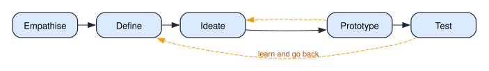

# Design Thinking

Design thinking is a five-stage way of solving problems that starts with understanding the people you're designing for: empathise, define, ideate, prototype and test.

## Before you start
<!-- bite: 85bac825-3208-4aa8-8cba-f75fdcaf6a69 -->

You should know the seven phases of the design process ([[engineering-design-and-prototyping/02-the-design-process|lesson 02]]) and the study desk example ([[engineering-design-and-prototyping/34-study-desk-1|lessons 34]] and [[engineering-design-and-prototyping/35-study-desk-2|35]]).

After this lesson you will be able to:

1. name the five stages of design thinking and say what happens in each;
2. map them onto the seven phases of the engineering design process;
3. explain what design thinking adds, and what the engineering process adds.

## What design thinking is
<!-- bite: b1480c67-d45f-4868-aaf9-fff25a6c391e -->

This whole course has used one process: seven phases, from problem definition to testing. But open another book, or join a product team, and you'll probably hear about **design thinking** instead. It's not a different subject. It's another way of describing the same journey, with the weight on different parts.

Design thinking is a way of solving problems that puts the people you're designing for at the centre. It has five stages:

1. Empathise
2. Define
3. Ideate
4. Prototype
5. Test

## The five stages
<!-- bite: 985800df-5af8-4eb4-9131-c1dbdbec5e41 -->

1. **Empathise**: understand the users deeply: watch them, talk to them, try their life. Not "what do they say they want?" but "what do they actually struggle with, and how do they feel?"
2. **Define**: turn what you learned into a clear problem statement, written from the user's side: "students need a way to read without bending their necks, because their laptops sit flat on low desks."
3. **Ideate**: generate as many ideas as you can, without judging (brainstorming, SCAMPER, all of lessons 8 to 10), then pick the most promising.
4. **Prototype**: build quick, cheap versions of the ideas, often very rough, just good enough to show a user.
5. **Test**: put the prototypes in front of real users, watch what happens, and learn.

## It's a loop too
<!-- bite: 5fcb6d05-3efa-4f80-8d93-69b464d7b866 -->

Like the seven-phase process, design thinking isn't a straight line. Testing often sends you back to define the problem better, and a prototype often sparks new ideas.

The dashed arrows are the same idea as the dashed arrow in lesson 2: learn, go back, come forward again.

## How it maps onto the seven phases
<!-- bite: e656bfef-b335-4afa-91a1-1bf0681e2919 -->

| Design thinking | Engineering design process |
| --- | --- |
| Empathise | Problem definition: user research |
| Define | Problem definition: objectives, requirements, constraints, criteria for success |
| Ideate | Concept generation and concept selection |
| (not a separate stage) | Concept refinement and detailed design |
| Prototype | Prototyping |
| Test | Testing and evaluation |

The two line up almost exactly, except for one row.

## What each one adds
<!-- bite: 199bcc4e-8edd-4a69-b180-9e02a090b019 -->

Look at the row with no design thinking stage: concept refinement and detailed design.

- **Design thinking is strong at the start.** It spends more time with users and feelings (remember the Kano model's delight needs), and it prototypes early and cheaply, often with paper and cardboard before any engineering.
- **The engineering process is strong at the end.** It adds the steps that turn a good idea into something a factory can make safely: functional decomposition, dimensions, materials, tolerances, factors of safety, standards, FMEA.

A phone app can go from design thinking straight to code. A bridge or a screw jack can't skip the detailed engineering. That's why engineering courses teach the seven phases, and why good engineers borrow design thinking's habit of starting with the user.

## The study desk, as design thinking
<!-- bite: 26ae8f52-bb17-4f87-b657-9de62421c49e -->

Here's the study desk again, told the design thinking way:

1. **Empathise**: sit with students reading in a hostel room. Notice the bent necks, the laptop on a pile of books, the pens rolling off the desk.
2. **Define**: "Students need their laptop and notes at eye level and their stationery in one place, without spending much or carrying anything heavy."
3. **Ideate**: brainstorming, TRIZ and SCAMPER give the foldable stand, the rotating book stand and the standing desk converter; the decision matrix picks the stand.
4. **Prototype**: the cardboard model.
5. **Test**: students use it for a week; measure neck strain and satisfaction.

Same project, same results. Design thinking just tells it from the student's side.

## Common pitfalls
<!-- bite: 8819ceeb-f1e3-4194-8e41-ffca31dea77e -->

1. **Thinking design thinking replaces engineering.** It has no stage for detailed design; an engineered product still needs one.
2. **Skipping empathise.** Jumping to ideas without understanding users is the most common mistake, and the stage design thinking exists to stop.
3. **Mixing up empathise and define.** Empathise is gathering understanding. Define is writing the problem statement from it.

## Check your understanding
<!-- bite: ca6db1f1-0bd2-4402-9f55-ec7c9c8170ba -->

Try each one before you open the answer.

1. <!-- q: gap id="8e2b5f04" answers="empathise|empathize;define;ideate;prototype;test" -->
   Fill in the gaps. The five stages of design thinking are ___, ___, ___, ___ and ___.

   

Answer

   Empathise, define, ideate, prototype and test.

   

2. <!-- q: mcq id="c61a9d38" -->
   A designer spends a day in a hospital ward watching how nurses use a medicine trolley. Which design thinking stage is this?

   - [x] Empathise
   - [ ] Define
   - [ ] Test

   

Answer

   Empathise: understanding the users by watching them in their real setting.

   

3. <!-- q: mcq id="2d07f6e5" -->
   Which phase of the engineering design process has no separate stage in design thinking?

   - [ ] Problem definition
   - [ ] Concept generation
   - [x] Detailed design
   - [ ] Testing and evaluation

   

Answer

   Detailed design (and concept refinement): specifying dimensions, materials, components and so on. Design thinking doesn't have a stage for it.

   

4. <!-- q: mcq id="7b4e1a92" -->
   "Market traders need a way to keep vegetables fresh for two more days without electricity, because they lose a lot of stock in the heat." Which stage produces a statement like this?

   - [ ] Empathise
   - [x] Define
   - [ ] Ideate

   

Answer

   Define: turning what was learned about users into a clear problem statement.

   

5. <!-- q: open id="f39c0d61" -->
   Compare design thinking with the seven-phase engineering design process. What does each one do well?

   

Answer

   They follow the same journey and both are iterative. Design thinking is strong at the start: it spends more time understanding users and their feelings, and prototypes early and cheaply. The engineering design process is strong at the end: it adds concept refinement and detailed design (dimensions, materials, standards, safety) that turn an idea into something that can be manufactured safely. Good engineers use both.

   

## Before moving on
<!-- bite: 1c6432c4-d768-420e-b34c-eb25bfca3871 -->

You can name the five stages of design thinking, map them onto the seven phases, and explain what each approach adds. That's the end of the extension lessons. **Next:** the [[engineering-design-and-prototyping/ssg-532-question-bank|SSG 532 question bank]], to practise on the real exam.

## Related
<!-- bite: 300df4a2-b36b-4f06-ba77-bce750bbbe7c -->

- [[engineering-design-and-prototyping/index|Engineering design and prototyping map]]

## About this lesson
<!-- bite: 8565c167-3bc8-4f18-b005-842acfbf3563 -->

**Level:** Beginner. **Covers:** the five stages of design thinking, how they map onto the seven-phase design process, what each approach adds, and the study desk told as design thinking.

**Where it sits:** lesson 36 of 36, in part 10 (the whole process on one problem).

**Source:** written from general engineering knowledge; it is not in the SSG 532 lecture notes.
