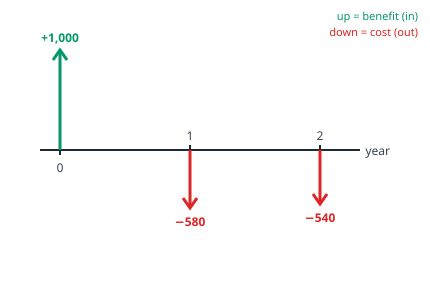
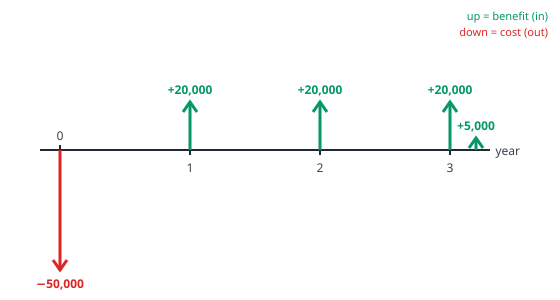

# Time Value of Money 1: Why Money Has Time Value

The time value of money is the idea that a naira today is worth more than a naira in the future, so money at different times can't be added up directly.

## Before you start
<!-- bite: 2fe39fdf-cbee-48ed-b208-532232b626e1 -->

You should have read [[engineering-economics/03-cost-concepts-2|Cost Concepts 2]].

After this lesson you will be able to:

1. give the four reasons a naira today is worth more than a naira in the future;
2. define present value, future value, discounting, compounding and cash flow;
3. draw a cash flow diagram for a simple loan, following the conventions.

## What the time value of money is
<!-- bite: 6276757f-3724-4143-987e-bb9317500d4d -->

Costs and benefits in a project happen at different times, so you cannot add them up directly. Time value of money gives you the rules to bring them to the same point in time first. Everything after this lesson depends on it.

**Core idea:** a naira today is worth more than a naira in the future. It is like "a bird in the hand is worth ten in the bush".

If someone offers you ₦100,000 today or ₦100,000 in one year, you'd take it today, no long thing. This lesson explains why, and the next one puts numbers on how much more it's worth.

## Four reasons money has time value
<!-- bite: 5d698c69-7c15-43e7-9c67-9cff61519900 -->

1. **Interest:** money today can be invested to earn a return.
2. **Inflation:** prices rise, so the same naira buys less later.
3. **Opportunity cost:** money locked in one project cannot be used elsewhere.
4. **Risk:** future cash flows are uncertain, while what you hold today is certain.

So the value of money depends on time. Interest is simply the rent paid for using someone's money.

Notice opportunity cost from lesson 02 showing up again. Each of the four reasons gets its own lessons later: interest in lessons 05 to 08, inflation in 09 and 10, risk in 22 to 25.

## Key terms
<!-- bite: c5aeff19-cda0-4509-9baf-8e2f40dc8189 -->

1. **Present value (PV or P):** This is what a future sum is worth today.
2. **Future value (FV or F):** This is what a present sum will grow to when invested.
3. **Discounting:** This is converting future cash flows to present value. You move money *back* in time.
4. **Compounding:** This is projecting present money into the future. You move money *forward* in time.
5. **Cash flows:** These are the series of inflows (benefits) and outflows (costs) over time.

## The cash flows in a project
<!-- bite: f5f46a33-13d7-484d-9f05-f7f2c2cc3c00 -->

A project's money movements fall into these groups:

- **First cost:** the cost to build or buy and install.
- **Operations and maintenance (O&M):** yearly costs like power, labour and minor repairs.
- **Salvage value:** what you get when you sell the equipment at the end.
- **Revenues:** yearly receipts from sales.
- **Overhaul:** a big expense during the asset's life.

To see all of these at a glance, engineers draw them on a time line.

## The cash flow diagram
<!-- bite: 6d8eb3e8-1074-4c4b-bd06-7bd82b279db0 -->

A **cash flow diagram** draws a project's cash flows on a time line. Rules:

- Draw a horizontal line divided into periods. A downward arrow is a cost, an upward arrow is a benefit, drawn to scale.
- The end of period t is the same point as the start of period t+1.
- Rent, lease and insurance are usually start-of-period flows. O&M, salvage, revenue and overhaul are end-of-period flows.
- Time 0 is your choice (when you analyse, when funding is approved, or when construction starts).
- One person's outflow is another person's inflow.
- Show two cash flows in the same year separately, so each links back to the problem statement.

## Example: a two-year loan
<!-- bite: 9137439d-df92-4a4a-a373-1dc7b4d888d4 -->

You borrow ₦1,000 at 8%. At the end of year 1 you repay half the principal plus interest, and at the end of year 2 the other half plus interest.

| Year | Cash flow |
| --- | --- |
| 0 | +1,000 |
| 1 | −580 (500 principal + 80 interest) |
| 2 | −540 (500 principal + 40 interest) |

The interest falls in year 2 because you only owe ₦500 by then: 8% of 500 is 40.

## Drawing the loan
<!-- bite: 7b1b6c45-3700-451e-bdc2-a4c0ab8783ff -->

Here is the same loan as a cash flow diagram, from the borrower's side. The ₦1,000 you receive is an upward arrow at time 0. Each repayment is a downward arrow at the end of its year.

From the bank's side every arrow flips: one person's outflow is another person's inflow.

## Common pitfalls
<!-- bite: b25c7a1f-8692-4fbf-90ef-0d2b75b4424d -->

1. **Adding money from different years.** ₦1,000 now and ₦1,120 in two years can't be added as if they were the same kind of naira. Bring them to one time first.
2. **Arrow direction.** Down is a cost, up is a benefit, and it depends on whose side you're drawing.
3. **Putting a yearly O&M cost at the start of the year.** Unless the question says otherwise, O&M, revenue and salvage sit at the end of the period.

We know *why* money has time value. Next lesson, interest tells us *how much*: simple interest, compound interest, and what it means for two sums to be equivalent.

## Check your understanding
<!-- bite: 7edd26f9-1334-4744-bba5-64ede3b17a56 -->

Try each one before you open the answer.

1. <!-- q: mcq id="a2ac4af6" -->
   Which of these is NOT one of the four reasons a naira today is worth more than a naira in the future?

   - [ ] Interest
   - [ ] Inflation
   - [ ] Risk
   - [x] Depreciation

   

Answer

   Depreciation. The four reasons are interest, inflation, opportunity cost and risk.

   

2. <!-- q: gap id="6e38e159" answers="discounting;compounding" -->
   Fill in the gaps. Converting future cash flows to present value is called ___. Projecting present money into the future is called ___.

   

Answer

   Discounting moves money back to the present. Compounding moves it forward into the future.

   

3. <!-- q: exact id="1b13256e" answer="-1200" accept="1200|-₦1,200|₦1,200|-1,200|1,200" -->
   You borrow ₦2,000 at 10%. At the end of year 1 you repay half the principal plus that year's interest. What is your cash flow at the end of year 1, in naira, as a signed number from your side?

   

Answer

   −1,200: 1,000 of principal plus 10% of 2,000 = 200 interest. It is an outflow for you, so it is negative.

   

4. <!-- q: exact id="ef1f6725" answer="-1100" accept="1100|-1,100|1,100" -->
   You borrow ₦2,000 at 10%. You repay half the principal plus interest at the end of year 1, and the other half plus interest at the end of year 2. What is your cash flow at the end of year 2, in naira, as a signed number from your side?

   

Answer

   −1,100: the last 1,000 of principal plus 10% of the 1,000 still owed = 100 interest.

   

5. <!-- q: sketch id="5308a1b7" -->
   A machine costs ₦50,000 at time 0, earns ₦20,000 at the end of each of years 1 to 3, and is sold for ₦5,000 at the end of year 3. Draw its cash flow diagram from the owner's side.

   

Answer

   

   What to check:
   - a horizontal time line marked 0, 1, 2, 3;
   - one downward arrow of 50,000 at time 0 (a cost);
   - upward arrows of 20,000 at the ends of years 1, 2 and 3;
   - the 5,000 salvage drawn as its own upward arrow at year 3, not added to the 20,000.

   

6. <!-- q: open id="78f8cef6" -->
   Why can't you add up a project's costs and benefits directly when they happen in different years?

   

Answer

   Because a naira at one time is not worth the same as a naira at another. Money today can earn interest, inflation reduces what money buys later, money locked in one project has an opportunity cost, and future cash flows are uncertain. So the cash flows must first be brought to the same point in time (discounted or compounded) before they can be added or compared.

   

## Before moving on
<!-- bite: 1f798ed2-768a-4e8d-903f-83dfc7cf6634 -->

You can explain why money has time value, use the key terms, and draw a cash flow diagram. **Next:** [[engineering-economics/05-time-value-of-money-2|Time Value of Money 2]]: simple interest, compound interest and equivalence.

## Related
<!-- bite: e6856c9c-b9bd-4f67-af4d-bdde3935837b -->

- [[engineering-economics/index|Engineering economics map]]

## About this lesson
<!-- bite: 0e8337bb-ccea-4125-8c9e-1197d96c110c -->

**Level:** Beginner. **Covers:** the core idea of time value, its four reasons, the key terms, the kinds of project cash flow, the cash flow diagram conventions and the two-year loan example.

**Where it sits:** lesson 04 of 38, part 1 of 2 on the time value of money.

**Source:** the author's own GEG 501 note, section 3. The diagrams come from `scripts/diagrams/engineering_economics.py`.
