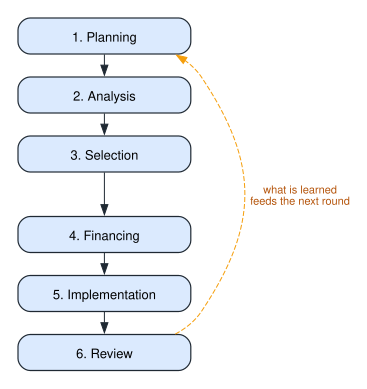

# Capital Budgeting 1: Why It Matters and Its Six Phases

Capital budgeting is how a firm decides whether to spend a large sum on a long-term project, from the first idea to reviewing how the project turned out.

## Before you start
<!-- bite: a1e8dfe4-f828-4137-bf7a-b46bcc4f0619 -->

You should know the comparison methods from part 3, ending with [[engineering-economics/14-comparing-alternatives-4|Comparing Alternatives 4]].

After this lesson you will be able to:

1. explain why capital investment decisions matter and why they are difficult;
2. classify capital investments by form, impact and purpose;
3. describe the six phases of capital budgeting and the three levels of decision.

## What capital budgeting is
<!-- bite: ade72adb-cca4-4770-a1df-b7841671d1f5 -->

Everything so far (cost, time value, comparing alternatives, depreciation, risk) comes together when a firm decides whether to spend a large sum on a project. This part is the big picture, from Chandra's chapter in your ECN 471 material.

The **capital budgeting (capital expenditure) decision** is the firm's long-term investment decision. Building a new plant, buying a fleet of trucks, launching a product line: each is a capital budgeting decision.

## Why capital investment decisions matter
<!-- bite: 9f4142ce-e849-48ec-86a7-1ddffe9e160a -->

- **Long-term effects:** the results last many years and shape the firm's character.
- **Irreversibility:** the market for used or custom equipment is poor, so a wrong decision often cannot be undone without a big loss.
- **Substantial outlays:** an integrated steel plant costs thousands of millions, and costs rise with advanced technology.

Think of Ajaokuta Steel: a huge outlay, decades long, and very hard to reverse. That's what's at stake in capital budgeting.

## Why they are difficult
<!-- bite: 4514e132-f185-44a0-abe6-5508eeff809a -->

1. **Measurement problems:** costs and benefits are hard to identify, especially when the project affects other products or has intangible effects such as worker morale.
2. **Uncertainty:** the benefits extend far into the future.
3. **Temporal spread:** costs and benefits spread over 10 to 20 years for industry and 20 to 50 years for infrastructure, which makes discount rates and equivalence harder.

Each difficulty points back to a part of the course: measurement to cost estimation (part 5), uncertainty to risk (part 6), temporal spread to the time value of money (part 2).

## Types of capital investment
<!-- bite: 30e52ae2-b8e4-472b-9d4d-b104fe9d6900 -->

- **By form:** physical (land, plant, machinery), monetary (deposits, bonds, shares) or intangible (R&D, training, market development).
- **By impact:** strategic (changes the firm's direction, such as entering a new product line) or tactical (carries out the current strategy, such as replacing an old machine).
- **By purpose:** mandatory (needed to meet law, such as pollution control), replacement, expansion, diversification, research and development, and miscellaneous.

## Six phases of capital budgeting
<!-- bite: 0e2162f0-5d8d-4d4f-b417-c0cd371910e6 -->

The phases generally follow one another, but there are feedback loops, so the process repeats.

## Phases 1 to 3: planning, analysis and selection
<!-- bite: f508046e-fe77-4037-8079-8c65e6d0b4ed -->

1. **Planning:** set the broad investment strategy, generate project ideas and screen them. A quick preliminary analysis asks if the idea is worth a full study.
2. **Analysis:** a detailed study of the market, technical, financial, economic and ecological sides (lesson 36).
3. **Selection:** choose projects using criteria such as NPV and IRR (part 3).

## Phases 4 to 6: financing, implementation and review
<!-- bite: 70e9387a-bb4a-4d21-b9e2-65648f29fda5 -->

4. **Financing:** arrange the money.
5. **Implementation:** project and engineering design, negotiation and contracting, construction, training, and plant commissioning. Delays cause cost overruns (lesson 19). Helpful steps: formulate the project well, assign responsibility to project managers, and use network techniques (PERT and CPM) for planning and control.
6. **Review:** compare actual with expected performance. It tests the assumptions, builds a log of experience, suggests corrective action, shows judgement bias and encourages caution.

Review is where the loop closes: what you learn about your estimates makes the next round of planning better.

## Levels of decision
<!-- bite: 01719888-e87e-4a98-8b04-80376cbd75bb -->

Not every capital decision goes to the board.

1. **Operating:** lower management, routine, small, short term. Example: minor office equipment.
2. **Administrative:** middle management, semi-structured. Example: balancing equipment.
3. **Strategic:** top management, unstructured, major, long term. Example: a diversification project.

Phase 2, analysis, is the heart of it. The next lesson opens it up into its five facets.

## Check your understanding
<!-- bite: 738305f2-0616-40e6-9eb0-3231f06ec953 -->

Try each one before you open the answer.

1. <!-- q: mcq id="323658d8" -->
   Why is irreversibility a reason capital investment decisions matter?

   - [ ] Because projects always make a loss
   - [x] Because the market for used or custom equipment is poor, so a wrong decision often can't be undone without a big loss
   - [ ] Because the government must approve every project
   - [ ] Because depreciation can't be reversed

   

Answer

   The market for used or custom equipment is poor. Once a plant is built, selling it off rarely recovers its cost.

   

2. <!-- q: mcq id="df9fde2a" -->
   A cement company must install filters to meet new pollution laws. What type of investment is this, by purpose?

   - [x] Mandatory
   - [ ] Expansion
   - [ ] Diversification
   - [ ] Research and development

   

Answer

   Mandatory: needed to meet the law, such as pollution control.

   

3. <!-- q: mcq id="72693229" -->
   A bank decides to start selling insurance, a business it has never been in. By impact, what kind of investment is this?

   - [x] Strategic
   - [ ] Tactical

   

Answer

   Strategic: it changes the firm's direction, like entering a new product line. Replacing an old machine would be tactical.

   

4. <!-- q: gap id="9d4152c0" answers="planning;analysis;selection;financing;implementation;review" -->
   Fill in the gaps with the six phases of capital budgeting in order: ___, ___, ___, ___, ___, ___.

   

Answer

   Planning, analysis, selection, financing, implementation, review.

   

5. <!-- q: mcq id="8c070065" -->
   In which phase does a firm compare a project's actual performance with what was expected?

   - [ ] Analysis
   - [ ] Selection
   - [ ] Implementation
   - [x] Review

   

Answer

   Review. It tests the assumptions, builds a log of experience, suggests corrective action and shows judgement bias.

   

6. <!-- q: open id="04020a93" -->
   Give the three reasons capital investment decisions are difficult.

   

Answer

   1. Measurement problems: costs and benefits are hard to identify, especially when the project affects other products or has intangible effects like worker morale.
   2. Uncertainty: the benefits stretch far into the future.
   3. Temporal spread: costs and benefits spread over 10 to 20 years for industry and 20 to 50 for infrastructure, which makes choosing discount rates and working out equivalence harder.

   

## Before moving on
<!-- bite: f5663eca-682d-4b41-aeec-9afb56e5635f -->

You can explain why capital decisions matter and why they're hard, classify investments, and describe the six phases and three levels of decision. **Next:** [[engineering-economics/36-capital-budgeting-2|Capital Budgeting 2]]: the five facets of project analysis and the objective.

## Related
<!-- bite: 1bf740ed-3d3b-4afe-9678-777582ce7288 -->

- [[engineering-economics/index|Engineering economics map]]

## About this lesson
<!-- bite: 44400c3e-3d02-447e-b1e2-c7573501cd49 -->

**Level:** Beginner. **Covers:** why capital investment decisions matter, why they are difficult, the types of capital investment, the six phases of capital budgeting and the levels of decision.

**Where it sits:** lesson 35 of 38, part 1 of 2 on capital budgeting, and the start of part 9.

**Source:** the author's own GEG 501 note, section 13 (Chandra's capital budgeting chapter in the ECN 471 material). The diagram comes from `scripts/diagrams/engineering_economics.py`.
