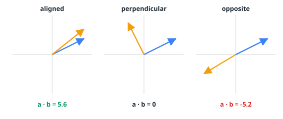

# Dot Product

The dot product multiplies two vectors pair by pair and adds the results.

## What the dot product is
<!-- bite: 7372d249-b499-4cc3-8127-307f279b5c63 -->

The dot product of two vectors multiplies corresponding elements and sums the results: `[a,b,c] · [d,e,f] = a*d + b*e + c*f`. Mechanically it's one line of arithmetic; conceptually it's the single most-repeated operation in ML, because it measures **how much two vectors point in the same direction**.

Next: the computation, then what the number means.

## The computation
<!-- bite: 07e55561-6a1e-4b5f-ab1d-7ac6784f5dde -->

```python
import numpy as np
a = np.array([1, 2, 3])
b = np.array([4, 5, 6])
np.dot(a, b)   # 1*4 + 2*5 + 3*6 = 32
```

## What it means
<!-- bite: bcc421cb-5b1e-4076-b365-44baf7f5d092 -->

A large positive dot product means the two [[01-vectors|vectors]] are strongly aligned (pointing in similar directions); near zero means they're roughly unrelated (perpendicular, in the geometric sense); negative means they point in opposing directions. This is why "similarity" between two embeddings — two pieces of text, two images, a search query and a document — is usually computed as a dot product (or its length-normalized cousin, **cosine similarity**, which divides out each vector's magnitude so only the angle between them matters, not their raw scale).

```text
similar meaning        -> embeddings point similar directions -> large dot product
unrelated meaning       -> embeddings roughly perpendicular    -> dot product near zero
opposite meaning/intent -> embeddings point opposite directions -> negative dot product
```

## Seeing the three cases
<!-- bite: a8b1ec14-b437-4426-a21d-44e9204c761d -->

Same blue vector each time. Turn the orange one to point the same way, at right angles, or the opposite way, and the dot product goes from large and positive, to zero, to negative.



## Where this shows up in practice
<!-- bite: 1f421f8e-977f-4417-bf55-89056c655af4 -->

- **Semantic search / RAG** — comparing a query's embedding against every document's embedding via dot product to find the closest matches (see [[ai-engineering/03-the-model-landscape|other-model-types]] for embeddings more broadly).
- **Attention in transformers** — an LLM computing how much every token should influence every other token is, mechanically, a large batch of dot products between token vectors (see [[ai-engineering/02-how-llms-work/index|llms]]).
- **A single neuron's computation** — a layer's output for one unit is the dot product of the incoming vector with that unit's row of weights, plus a bias term — the building block that [[04-matrix-multiplication|matrix-multiplication]] batches across an entire layer at once.

## Gotchas
<!-- bite: 5166df00-c41d-48e0-b5d0-9d6b8f4d0da1 -->

- Raw dot product conflates **direction** and **magnitude** — two vectors can point in nearly the same direction but have very different dot products just because one has a larger magnitude. When you specifically want "how similar in meaning," cosine similarity (dot product divided by both vectors' magnitudes) is usually the more honest measure; raw dot product is used when magnitude is itself meaningful (e.g. some attention formulations).
- Dot product is only defined between vectors of the **same length** — a shape mismatch here is a common bug when embeddings from two different models (with different output dimensions) get compared directly.

## Check your understanding
<!-- bite: f4a26f26-6685-4c6d-aa93-1a5722869e65 -->

Try each one before you open the answer.

1. <!-- q: exact id="fe7e7195" answer="32" -->
   What is the dot product of `[1, 2, 3]` and `[4, 5, 6]`?

   <details><summary>Answer</summary>

   32. Multiply pair by pair and add: 1×4 + 2×5 + 3×6 = 4 + 10 + 18 = 32.

   </details>

2. <!-- q: mcq id="6cef4b0b" -->
   Two embeddings have a dot product near zero. What does that usually mean?

   - [ ] They mean the same thing
   - [x] They are roughly unrelated (close to perpendicular)
   - [ ] They mean opposite things

   <details><summary>Answer</summary>

   Roughly unrelated. Large and positive means aligned, near zero means unrelated, and negative means they point in opposite directions.

   </details>

3. <!-- q: gap id="b7b135e2" answers="cosine similarity|cosine" -->
   Fill in the gap. To compare only the direction of two vectors, we divide the dot product by both vectors' lengths. That measure is called ___.

   <details><summary>Answer</summary>

   Cosine similarity. It removes the effect of length, so only the angle between the vectors matters.

   </details>

4. <!-- q: mcq id="95c1f5ea" -->
   Where does the dot product show up in practice? Choose all that apply.

   - [x] Semantic search: comparing a query's embedding with each document's
   - [x] Attention in transformers
   - [x] One neuron's output: incoming vector · its weights, plus a bias
   - [ ] Deciding how many layers a network should have

   <details><summary>Answer</summary>

   The first three. Search, attention and a single neuron's computation are all dot products. The number of layers is a design choice, not a dot product.

   </details>

5. <!-- q: open id="573e6da1" -->
   Why can the raw dot product be misleading when you want to know how similar two meanings are?

   <details><summary>Answer</summary>

   It mixes direction and length. Two vectors can point almost the same way, but if one is much longer, its dot product with anything gets bigger. Cosine similarity divides out the lengths so only the direction counts.

   </details>

## Check your understanding: worked problems
<!-- bite: 353bfcb5-96e5-4796-8450-1d13c8f15004 -->

Work each one out on paper first, then type your answer.

1. <!-- q: exact id="0c3f6727" answer="2" -->
   What is `[2, -1, 3] · [4, 0, -2]`?

   <details><summary>Answer</summary>

   2. 2×4 + (−1)×0 + 3×(−2) = 8 + 0 − 6 = 2.

   </details>

2. <!-- q: exact id="a1b07761" answer="0" accept="zero" -->
   What is `[1, 2] · [-2, 1]`? What does the answer tell you about the two vectors?

   <details><summary>Answer</summary>

   0. 1×(−2) + 2×1 = 0, so the two vectors are perpendicular: unrelated in direction.

   </details>

3. <!-- q: exact id="126fcf76" answer="0.707106781187" accept="1/√2|1/sqrt(2)" sigfigs="2" -->
   What is the cosine similarity of `[1, 0]` and `[1, 1]`? (Dot product ÷ the product of the two lengths.)

   <details><summary>Answer</summary>

   About 0.71. The dot product is 1, the lengths are 1 and √2, so 1/√2 ≈ 0.707. The angle between them is 45°.

   </details>

## Related
<!-- bite: bc3aba98-86b6-44a0-a9f7-c35f26757cf7 -->
- [[01-vectors|vectors]]
- [[04-matrix-multiplication|matrix-multiplication]]
