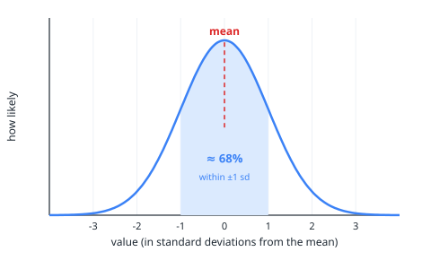

# Probability Distributions

A probability distribution says how likely each possible outcome is.

## What a probability distribution is
<!-- bite: ca9765d7-3c16-4df3-9f7f-0b46fb99b283 -->

A probability distribution assigns a likelihood to every possible outcome of some random process. Almost nothing a model outputs is a single certain answer — it's a distribution over possibilities — so this is the vocabulary for talking about that precisely.

Next: the normal distribution, the one you will meet most.

## The normal (Gaussian) distribution
<!-- bite: f4275417-94f0-4e78-807a-e3b86b3099e1 -->

The one that shows up constantly in ML — the familiar bell curve, where outcomes cluster around a mean and become rarer the further out you go.

Model weights are frequently **initialized** by sampling from a normal distribution before training even starts (see [[04-optimization|optimization]]) — starting from small random values distributed this way, rather than all zeros or an arbitrary pattern, turns out to make training behave far better in practice. Many statistical assumptions baked into ML methods (errors being roughly normal, for instance) trace back to this distribution's convenient mathematical properties.

## Discrete vs continuous distributions
<!-- bite: 7e2839a8-c5b3-4924-8874-572e052ecddd -->

- **Discrete**: outcomes are countable/distinct — the result of a dice roll, which of several classes an image belongs to. A model's classification output ("80% cat, 15% dog, 5% other") is a discrete probability distribution over class labels.
- **Continuous**: outcomes form a continuum — a person's height, a predicted house price. The normal distribution above is a continuous distribution.

This distinction matters directly for what a model's final layer looks like: a classifier's output layer is built to produce a discrete distribution over classes (summing to 1), while a regression model's output is a single continuous value, sometimes accompanied by an estimate of uncertainty around it.

## Where distributions show up in an LLM specifically
<!-- bite: e42a897e-d5e3-448e-a954-8f58f2a41b2f -->

Every token an LLM generates comes from a probability distribution over its entire vocabulary — given everything so far, the model computes how likely each possible next token is. A **sampling strategy** then picks one: greedy (always the most likely), top-k (sample from the k most likely), or temperature-based (a setting that flattens or sharpens the distribution before sampling). This is why the same prompt can produce different output across runs, and why "temperature" changes how random vs. predictable a model's output feels — it's literally reshaping this distribution before a token gets drawn from it (see [[ai-engineering/02-how-llms-work/index|llms]] for the generation mechanism this plugs into).

## Gotchas
<!-- bite: 12c473a9-f8f4-4e02-8bcf-cfdfc6f3fb79 -->

- A model reporting a confidence score is reporting where its *own* output distribution places its mass — that's a genuinely different thing from the model being right that percentage of the time in reality (see the calibration gotcha in [[02-expectation-and-variance|expectation-and-variance]] / [[ai-engineering/02-how-llms-work/index|llms]]).
- "Randomness" in model output isn't arbitrary — it's structured sampling from a specific, learned distribution, which is why adjusting temperature/sampling settings has a predictable effect rather than just turning noise up or down uniformly.

## Check your understanding
<!-- bite: bbca1c67-58b9-4f73-a2ad-1d69d140a413 -->

Try each one before you open the answer.

1. <!-- q: mcq id="8c12ed2f" -->
   A classifier outputs "80% cat, 15% dog, 5% other". What kind of distribution is that?

   - [x] Discrete
   - [ ] Continuous

   

Answer

   Discrete. The outcomes are separate class labels you can count, and the probabilities sum to 1.

   

2. <!-- q: exact id="d4d2afc5" answer="1" accept="one|100%|1.0" -->
   A classifier's output layer gives a probability for every class. What do all those probabilities add up to?

   

Answer

   1. A discrete distribution spreads all of the probability across the possible classes.

   

3. <!-- q: gap id="cf89b7a0" answers="normal|gaussian" -->
   Fill in the gap. Model weights are often initialized by sampling small random values from the bell-shaped ___ distribution.

   

Answer

   Normal (also called Gaussian). Starting from small random values like this makes training behave far better than starting from all zeros.

   

4. <!-- q: mcq id="6fef81a2" -->
   Why can the same prompt give different answers from an LLM on different runs?

   - [ ] The model's weights change after every answer
   - [x] Each token is sampled from a probability distribution over the vocabulary
   - [ ] The model reads the internet again each time

   

Answer

   Each next token is drawn from a distribution. Temperature and top-k reshape that distribution before a token is picked, which is why they change how random the output feels.

   

5. <!-- q: open id="576f9b20" -->
   A model says it is "90% confident". Why doesn't that mean it is right 90% of the time?

   

Answer

   The 90% is where the model's own output distribution puts its probability. Whether it is actually right that often in the real world is a separate question, called calibration. A model can be confidently wrong.

   

## Related
<!-- bite: 0f71475f-79a7-4c4e-b6b9-01fd282e9ef8 -->
- [[02-expectation-and-variance|expectation-and-variance]]
- [[03-bayes-theorem|bayes-theorem]]
- [[ai-engineering/02-how-llms-work/index|llms]]
