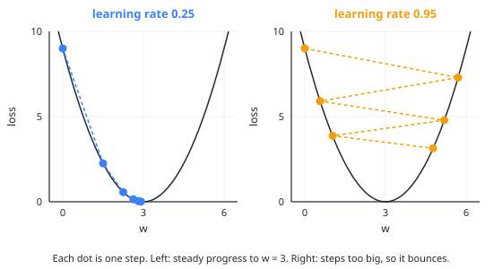

# Optimization for AI/ML

Optimization is how a model's numbers get adjusted during training.

## What optimization is
<!-- bite: 8d55c7bc-fd7d-4439-bf3b-4f3c8943fa47 -->

Optimization is the piece that actually connects [[machine-learning/00-foundations/03-mathematics/01-linear-algebra/index|linear algebra]] (how a model is represented), [[machine-learning/00-foundations/03-mathematics/02-calculus/index|calculus]] (how to compute which direction reduces error), and [[machine-learning/00-foundations/03-mathematics/03-probability-and-statistics/index|probability and statistics]] (how error/loss is defined) into an actual training loop. If [[machine-learning/00-foundations/02-what-is-a-model|what-is-a-model]] describes "a big adjustable function," optimization is the description of *how the adjusting happens*.

Next: the loss function (what "wrong" means), then gradient descent (how to get less wrong).

## The loss function — defining "wrong"
<!-- bite: 73b4a140-ad29-4d8d-9fe8-38bcfde03d6e -->

Before you can improve a model, you need a single number that measures how wrong its current output is — the **loss** (or cost). Simple example for predicting a number: squared error, `(prediction - actual)²`. For classification, it's typically cross-entropy loss (see [[machine-learning/00-foundations/03-mathematics/03-probability-and-statistics/index|probability and statistics]]). Whatever the specific formula, the training process only ever does one thing: try to make this number smaller.

## Gradient descent — the core algorithm
<!-- bite: 88c14522-fd38-452c-85d5-48c59867d517 -->

1. Compute the loss for the current parameters.
2. Compute the gradient of the loss with respect to every parameter — i.e. "if I nudge this parameter slightly, does the loss go up or down, and how fast" (this is where [[03-chain-rule|the chain rule / backpropagation]] does its work).
3. Nudge every parameter a small step in the direction that *decreases* the loss (opposite the gradient).
4. Repeat, using new batches of data, until the loss stops meaningfully improving.

## Gradient descent in code
<!-- bite: 68629a61-0d55-49bd-a13a-05e96bba6f63 -->

Here are the same four steps as a loop, and a picture of what the loop does to the loss.

```python
# conceptual, not a real framework's API
for step in range(num_steps):
    predictions = model(inputs, params)
    loss = loss_function(predictions, targets)
    gradients = compute_gradients(loss, params)     # backpropagation
    params = params - learning_rate * gradients      # the actual "learning" step
```

```text
loss
 ^
 |  \
 |   \
 |    \___
 |        \___
 |            \________  <- gradient descent walks downhill, step by step
 +-----------------------> parameter value
```

## Seeing the learning rate at work
<!-- bite: 45c37e89-401c-4f7a-888b-b824a34a6d44 -->

Both panels run gradient descent on the same loss, L = (w − 3)², starting from w = 0. On the left the learning rate is 0.25, and each step walks further down towards the minimum at w = 3. On the right it is 0.95, so each step jumps right over the minimum and the dots bounce from side to side.



## Learning rate — the size of each step
<!-- bite: 7cfe69b1-166d-4597-8af3-aede681c6799 -->

The learning rate controls how big a step each update takes. Too large, and updates overshoot the minimum, bouncing around or diverging entirely (loss gets worse, not better). Too small, and training crawls, taking an impractically long time to converge, or gets stuck in a shallow dip that a bigger step would have escaped. Picking (and often dynamically adjusting) the learning rate is one of the most impactful, least glamorous parts of getting a model to train well.

## Batches — why training doesn't use the whole dataset every step
<!-- bite: 2d56a35c-e602-4472-aa2b-ed92b57190ed -->

Computing the exact gradient over an entire dataset before each update is accurate but slow, especially with millions of examples. Instead, training almost always uses **mini-batches** — a small random subset of the data — to estimate the gradient at each step. This is **stochastic gradient descent (SGD)**: noisier gradient estimates, but many more update steps per unit of time, which in practice converges faster and can even help escape shallow local minima (the noise itself acts like a small kick).

## Local minima and why training isn't guaranteed to find "the best" model
<!-- bite: 4e53f41d-b27c-4a8a-a3a3-fb1b1ccd1ce6 -->

Gradient descent only guarantees it'll walk downhill — it has no way of knowing whether it's approaching the best possible minimum (global) or has settled into a worse but locally flat spot (local minimum) or a flat saddle region. In practice, for the huge, high-dimensional parameter spaces of deep learning, this turns out to matter less than the simple 2D picture above suggests — most local minima found in practice are "good enough," which is more an empirical observation about deep networks than a guarantee.

## Common optimizer variants you'll see named
<!-- bite: 6e7c1f2e-e0d3-4a1e-be00-e88c9ea962df -->

Plain gradient descent is rarely used directly in practice — variants that adapt the step size per parameter and incorporate momentum (carrying some of the previous step's direction forward, to smooth out noisy updates) train faster and more reliably. **Adam** is the most commonly used default across deep learning today; **SGD with momentum** is still used, particularly in some computer vision training setups. Knowing these names exist and roughly why they help (adaptive step sizes, momentum smoothing) is enough at this level — the derivations are a deeper rabbit hole than needed here.

## Gotchas
<!-- bite: d9b871a4-4469-418c-a70d-8db6201d24fc -->

- A loss that's decreasing on training data but flat or rising on held-out validation data is the numeric signature of overfitting (see [[machine-learning/00-foundations/02-what-is-a-model|what-is-a-model]]) — optimization is happily doing its job of reducing training loss, which isn't the same as the model actually getting better.
- Learning rate is usually the single highest-leverage setting to tune when a model trains badly — "loss is exploding to NaN" is very often "learning rate too high," and "loss barely moves" is very often "learning rate too low."

## Check your understanding
<!-- bite: fd2a793d-3acf-4a74-86cf-cf66a3548791 -->

Try each one before you open the answer.

1. <!-- q: exact id="1a974861" answer="4" accept="four" -->
   A model predicts 7 and the actual value is 5. What is the squared error loss?

   <details><summary>Answer</summary>

   4. (7 − 5)² = 2² = 4.

   </details>

2. <!-- q: mcq id="85bb564e" -->
   The loss shoots up to NaN after a few steps. What is the most likely cause?

   - [x] The learning rate is too high
   - [ ] The learning rate is too low
   - [ ] The batch size is too small

   <details><summary>Answer</summary>

   Learning rate too high. The steps overshoot the minimum and the loss blows up. A loss that barely moves usually means the learning rate is too low.

   </details>

3. <!-- q: gap id="bd98bca5" answers="mini-batches|mini-batch|minibatches|batches;stochastic" -->
   Fill in the gaps. Instead of the whole dataset, each step estimates the gradient from small random subsets called ___. This is ___ gradient descent (SGD).

   <details><summary>Answer</summary>

   Mini-batches, then stochastic. The gradient estimates are noisier, but you get many more steps per unit of time, and the noise can help you escape shallow dips.

   </details>

4. <!-- q: mcq id="61a8b654" -->
   Which optimizer is the most common default in deep learning today?

   - [ ] Plain gradient descent
   - [x] Adam
   - [ ] Bayes

   <details><summary>Answer</summary>

   Adam. It adapts the step size for each parameter and uses momentum. SGD with momentum is still used in some computer vision setups.

   </details>

5. <!-- q: open id="f334e060" -->
   Training loss keeps going down, but validation loss is flat or rising. What is happening, and why isn't the optimizer "wrong"?

   <details><summary>Answer</summary>

   The model is overfitting. The optimizer is doing its job, which is to reduce training loss, but that is no longer making the model better on new data. It is memorizing the training set.

   </details>

## Check your understanding: worked problems
<!-- bite: 8ced2d4f-8b3f-45a4-970e-f00196708274 -->

Work each one out on paper first, then type your answer.

1. <!-- q: exact id="2d4654cd" answer="3" -->
   A weight is w = 4, its gradient is 2, and the learning rate is 0.5. What is w after one gradient descent step?

   <details><summary>Answer</summary>

   3. w − lr × gradient = 4 − 0.5 × 2 = 3.

   </details>

2. <!-- q: exact id="39e9cae6" answer="2.5" accept="5/2" -->
   The model predicts [3, 5] and the targets are [2, 7]. What is the mean squared error?

   <details><summary>Answer</summary>

   2.5. The squared errors are (3 − 2)² = 1 and (5 − 7)² = 4, and their mean is 5/2 = 2.5.

   </details>

3. <!-- q: exact id="8a265070" answer="200" -->
   You train on 50,000 examples with a mini-batch size of 250. How many update steps are in one epoch?

   <details><summary>Answer</summary>

   200. 50,000 ÷ 250 = 200 batches, and each batch is one step.

   </details>

4. <!-- q: points id="529163b3" xmin="-1" xmax="6" ymin="0" ymax="10" step="1" snap="0.25" answer="0,9 1.5,2.25 2.25,0.5625" labels="step 0,step 1,step 2" tolerance="0.2" -->
   The loss is L = (w − 3)², the learning rate is 0.25, and you start at w = 0. Place the first three points (w, L) that gradient descent visits.

   <details><summary>Answer</summary>

   The gradient is 2(w − 3). Step 0: (0, 9). Step 1: w = 0 − 0.25 × (−6) = 1.5, so (1.5, 2.25). Step 2: w = 1.5 − 0.25 × (−3) = 2.25, so (2.25, 0.5625). Each step closes half the remaining gap to the minimum at w = 3.

   </details>

## Related
<!-- bite: 9d4f37b1-4c90-435e-879b-c8800ddec41e -->
- [[machine-learning/00-foundations/03-mathematics/02-calculus/index|calculus]] — where gradients come from
- [[machine-learning/00-foundations/03-mathematics/03-probability-and-statistics/index|probability and statistics]] — where loss functions come from
- [[machine-learning/00-foundations/02-what-is-a-model|what-is-a-model]]
