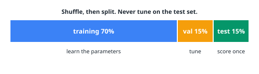

# Train / Validation / Test Splits

Splitting data means keeping some of it aside so you can test the model honestly.

## What splitting data is
<!-- bite: 5f5acddb-c308-4f95-8883-a7f7a080ff12 -->

A model's whole point is to perform well on data it hasn't seen (see [[machine-learning/00-foundations/02-what-is-a-model|generalization]]) — so evaluating it on the same data it trained on tells you almost nothing useful. Splitting data into separate, non-overlapping sets is how you get an honest read on whether a model actually generalizes.

Next: the three sets and what each one is for.

## The three sets and what each is for
<!-- bite: 9ecbe432-940f-43ac-aaca-a4c5f6f70247 -->

- **Training set** — what the model actually learns from; parameters get updated based on this data (see [[04-optimization|optimization]]).
- **Validation set** — used *during* development to make decisions: which hyperparameters to use, when to stop training, which of several model variants to keep. The model never trains on this directly, but you *do* make choices based on it — which means it gets a little "used up" as a fair test the more decisions you make against it.
- **Test set** — touched exactly once, at the very end, to report a final, honest performance number. If you tune anything based on test-set performance, it stops being a fair test — it's effectively become a second validation set, whether or not that's the intention.

## Seeing the split
<!-- bite: 5dc14239-f643-4779-868a-3f5875be04fa -->

The common 70/15/15 split, with the job of each part underneath.



## Making the three sets in code
<!-- bite: c5c62fc6-8069-46d8-bec1-25a9a560e6e9 -->

`train_test_split` splits twice: once to set the training data apart, then again to cut the rest into validation and test.

```python
from sklearn.model_selection import train_test_split

X_train, X_temp, y_train, y_temp = train_test_split(X, y, test_size=0.3, random_state=42)
X_val, X_test, y_val, y_test = train_test_split(X_temp, y_temp, test_size=0.5, random_state=42)
# common ratio: 70% train, 15% validation, 15% test
```

## Why the split needs to be random (usually)
<!-- bite: dddf61bf-1d05-4a4d-8caa-c0ab6373cd38 -->

A dataset sorted by some incidental order (by date, by category) that gets split by simply taking the first 70% as training risks the training set looking systematically different from the rest — shuffling before splitting (what `train_test_split` does by default) avoids that. The exception is genuinely time-ordered data (see below), where a random shuffle is actually the wrong choice.

## Time series — why random splitting can be wrong
<!-- bite: fbdebfb7-ae98-4755-9a94-5b8d0028887a -->

If the data has a time dimension and the model is meant to predict the future from the past, a random split can leak future information into training (the model implicitly "sees" patterns from data chronologically after the point it's meant to predict). The correct split for this case is chronological: train on earlier data, validate/test on strictly later data, matching how the model will actually be used in practice.

```python
# chronological split, not random, for time-dependent data
cutoff_train = "2024-01-01"
cutoff_val = "2024-06-01"
train = df[df["date"] < cutoff_train]
val = df[(df["date"] >= cutoff_train) & (df["date"] < cutoff_val)]
test = df[df["date"] >= cutoff_val]
```

## Cross-validation — squeezing more out of limited data
<!-- bite: 7e232db1-e5af-4507-b88e-8b0c7a17b3be -->

With a small dataset, a single validation split wastes data and can give a noisy, split-dependent estimate of performance. **K-fold cross-validation** splits the training data into k chunks, trains k times, each time holding out a different chunk as validation, then averages the results — giving a more stable performance estimate at the cost of k times the training compute. Common for smaller, classic-ML-scale datasets; less common for large deep learning models where a single training run is already expensive.

## Fit the scaler on the training set only
<!-- bite: e51b50b6-67ea-4288-8089-e47f85dae3ef -->

We keep part of the data (for example 20%) aside as a test set, and train only on the rest. This lets us check how the model does on data it has never seen, which is how we catch overfitting (see [[machine-learning/04-model-evaluation/04-overfitting-and-regularization|overfitting]] and [[machine-learning/04-model-evaluation/05-validation-and-tuning|cross-validation]]). One important rule: work out the scaling numbers (the mean, the minimum and so on) from the training set only, then apply them to the test set. If the test data helps decide the scaling, the model gets a hidden peek at the test set.

```python
from sklearn.model_selection import train_test_split
from sklearn.preprocessing import StandardScaler

X_train, X_test, y_train, y_test = train_test_split(X, y, test_size=0.2, random_state=0)
scaler = StandardScaler().fit(X_train)   # learn the mean and spread from training data only
X_train_scaled = scaler.transform(X_train)
X_test_scaled = scaler.transform(X_test)
```

## Gotchas
<!-- bite: afb41356-6154-4d55-9de2-87bf1b735918 -->

- **Data leakage** — any information from validation/test data influencing training (fitting a scaler on the whole dataset before splitting, duplicate rows split across train and test, features that implicitly encode the target) inflates reported performance in a way that won't hold up on genuinely new data. This is one of the most common, hardest-to-notice mistakes in applied ML — see the same concern raised in [[01-missing-data-and-cleaning|missing-data-and-cleaning]] and [[02-feature-engineering-and-scaling|feature-engineering-and-scaling]].
- Repeatedly tuning against the same validation set across many iterations can cause a model to indirectly overfit to that validation set, even without ever training on it directly — a large gap between validation performance and true test/production performance is the usual symptom.
- Reusing the test set more than once (checking it, adjusting something, checking again) quietly turns it into another validation set — the final reported number stops being an honest, one-shot estimate.

## Check your understanding
<!-- bite: d551dd45-692f-4bd3-9520-2af0f6884298 -->

Try each one before you open the answer.

1. <!-- q: mcq id="52f857bb" -->
   Which set do you use to pick hyperparameters and decide when to stop training?

   - [ ] Training set
   - [x] Validation set
   - [ ] Test set

   <details><summary>Answer</summary>

   The validation set. The training set is for learning the parameters, and the test set is used once at the very end for the final honest score.

   </details>

2. <!-- q: exact id="334c4345" answer="150" -->
   You have 1000 rows and split them 70% train, 15% validation, 15% test. How many rows are in the test set?

   <details><summary>Answer</summary>

   150. 15% of 1000 is 150.

   </details>

3. <!-- q: mcq id="e7d818d5" -->
   You are predicting next month's sales from past sales. How should you split the data?

   - [ ] Randomly shuffle, then split
   - [x] By time: train on earlier dates, validate and test on strictly later ones

   <details><summary>Answer</summary>

   By time. A random split lets the model see the future during training, which won't happen when it's actually used.

   </details>

4. <!-- q: gap id="8e5f87fe" answers="cross-validation|cross validation|k-fold cross-validation|k-fold" -->
   Fill in the gap. On a small dataset, k-fold ___ trains k times, each time holding out a different chunk for validation, then averages the results.

   <details><summary>Answer</summary>

   Cross-validation. It gives a more stable estimate than one split, at the cost of k times the training.

   </details>

5. <!-- q: open id="821ebe13" -->
   You check the test score, change something, and check the test score again. Why is that a problem?

   <details><summary>Answer</summary>

   Each time you adjust something based on the test score, the test set influences the model. It quietly becomes another validation set, and the final number is no longer an honest one-shot estimate of performance on new data.

   </details>

## Related
<!-- bite: 56c9b983-21f0-4e80-a45f-929f979c8d7b -->
- [[01-missing-data-and-cleaning|missing-data-and-cleaning]]
- [[02-feature-engineering-and-scaling|feature-engineering-and-scaling]]
- [[machine-learning/04-model-evaluation/04-overfitting-and-regularization|overfitting-and-regularization]]
