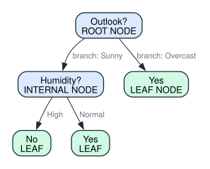

# Decision Trees 1: The Tree, Entropy and Information Gain

A decision tree makes a decision by asking questions about the features, one after another.

## Before you start
<!-- bite: f448c51b-02eb-4bf7-a2f4-198f48d40e39 -->

You should know what classification is ([[machine-learning/01-foundations-of-ml/01-what-is-ml-and-types|What ML Is]]). You need logarithms in base 2: log₂(0.5) = −1, and your calculator does the rest.

After this lesson you will be able to:

- name the parts of a decision tree;
- say what ID3, C4.5 and CART use to choose a split;
- calculate entropy and information gain for one attribute.

## What a decision tree is
<!-- bite: b4f01f74-84a9-4d80-9b09-b7d74478cb9b -->

A decision tree is a non-parametric supervised learning algorithm, which is utilized for both classification and regression tasks. It has a hierarchical tree structure which consists of a root node, branches, internal nodes and leaf nodes. They learn a hierarchy of if/else questions leading to a decision.

KNN makes decisions using distance. A decision tree uses a different idea: it asks questions about the features, one after the other.

Next: the parts of a tree, then how it chooses which question to ask first.

## Parts of a decision tree
<!-- bite: aa548a9d-5174-48b4-97fa-39c57d49c168 -->

The tree branches out into different possibilities based on features in the data:

1. **Root Node**: Starting point representing the whole dataset.
2. **Branches**: Lines connecting nodes showing the flow from one decision to another.
3. **Internal Node**: Points where decisions are made based on data features.
4. **Leaf Node**: Endpoints of the tree where the final decision or prediction is made. It is also known as a terminal node.

Here are the four parts on a small tree:

## Types of Decision Trees
<!-- bite: a6a5b6a9-3e9d-4056-af41-bafa115c8ce5 -->

| Type | How it works |
| --- | --- |
| **ID3** (Iterative Dichotomizer 3) | This algorithm leverages entropy and information gain as metrics to evaluate candidate splits. **(This is the one we will be using for now)** |
| **C4.5** | It can use information gain or gain ratio to evaluate split points within the decision trees. |
| **CART** (Classification and Regression Trees) | This algorithm typically utilizes Gini impurity to identify the ideal attributes to split on. |

> **Note:** Gini Impurity measures how often a randomly chosen data point is misclassified. When evaluating Gini Impurity, a lower value is more ideal.

## How to Choose the Best Attribute at Each Node
<!-- bite: 2a4ebcef-0c47-496f-a894-8e45afce9ab4 -->

There are multiple ways to select the best attribute at each node:

- Entropy and Information Gain
- Gini Impurity

When building a decision tree, the big question is: which attribute should we ask about first? Entropy and information gain help us answer this.

## Entropy
<!-- bite: 6de61aa5-6eb6-445c-9ab4-fe80b75e7e66 -->

**Entropy** is a concept that stems from information theory which measures the impurity of the sample values. Mathematically represented as:

$$
Entropy(S) = -\sum_{c} P_c \log_2 (P_c)
$$

where:

- **S** – The data set that entropy is calculated
- **C** – represents the classes in set S
- **P\_c** – The proportion of data points that belong to class C to the number of total data in set, S

## What entropy values mean
<!-- bite: ed27cf31-8a6d-4bf5-99bc-b51b7b67358f -->

The entropy formula gives a number. Here is how to read it.

> **Note:** If P\_c = 1 or 0, the entropy = 0. If P\_c = 0.5, the value of entropy is the highest possible entropy you can get for that set.

> **Note:** Entropy values can fall between 0 and 1 (when there are two classes). If all samples in data set, S, belong to one class, then entropy will equal zero (0). To select the best feature to split on and find the optimal decision tree, the attribute with the smallest amount of entropy should be used. This means the smallest entropy left after the split, which is the same as the highest information gain.

## Information gain
<!-- bite: 8cdddcd1-6ba3-4c4e-95af-2f97446f0556 -->

**Information Gain** is the difference in entropy before and after a split on a given attribute.

> **Note:** The attribute with the highest information gain will produce the best split as it's doing the best job at classifying the training data according to its target classification.

## The information gain formula
<!-- bite: 0ce30787-aedd-478e-8d67-8a3b1e814fa9 -->

Mathematical representation:

$$
IG(S, a) = Entropy(S) - \sum_{v} \frac{|S_v|}{|S|} Entropy(S_v)
$$

where:

- **a** – specific attribute or class label
- **S** – the data set (all the data before the split)
- **S\_v** – the part of S that has value v for attribute a
- **|S\_v|/|S|** – The proportion of values in S\_v, to the number of values in the data set S

## Check your understanding
<!-- bite: ed352f81-72af-4ed9-bff2-b55c880c3556 -->

Try each one before you open the answer.

1. <!-- q: gap id="46be0cfe" answers="1|one;0|zero" -->
   Fill in the gaps. A set with 4 Yes and 4 No has entropy ___. A set with 8 Yes and 0 No has entropy ___.

   

Answer

   4 Yes and 4 No: P = 0.5 for each class, so entropy is 1, the highest for two classes. 8 Yes and 0 No: the set is pure, so entropy is 0.

   

2. <!-- q: exact id="c64236d5" answer="0.5" accept="1/2" tolerance="0.001" -->
   A set S has entropy 1. An attribute splits it into two halves, each with entropy 0.5. What is the information gain?

   

Answer

   IG = 1 − [(½ × 0.5) + (½ × 0.5)] = 1 − 0.5 = 0.5.

   

3. <!-- q: mcq id="dad93b27" -->
   Which decision tree algorithm uses Gini impurity?

   - [ ] ID3
   - [ ] C4.5
   - [x] CART

   

Answer

   CART (Classification and Regression Trees). ID3 uses entropy and information gain; C4.5 uses information gain or gain ratio.

   

4. <!-- q: mcq id="066f54b7" -->
   Where in a decision tree is the final decision or prediction made?

   - [ ] Root node
   - [ ] Internal node
   - [x] Leaf node

   

Answer

   The leaf node, also called a terminal node. The root node stands for the whole dataset, and internal nodes are where decisions on features are made.

   

5. <!-- q: open id="d7173c82" -->
   At a node, why do we split on the attribute with the highest information gain?

   

Answer

   Information gain is how much the entropy drops after the split. The highest gain leaves the smallest entropy, so the groups after the split are the purest. That attribute does the best job of separating the classes.

   

## Check your understanding: worked problems
<!-- bite: 3d3a7950-baaf-48cd-ab00-70783e4304b2 -->

Work each one out on paper first, then type your answer.

1. <!-- q: exact id="c0ae3f93" answer="0.811278124459" sigfigs="2" -->
   A set has 3 Yes and 1 No. What is its entropy?

   

Answer

   About 0.81. −[(3/4) log₂(3/4) + (1/4) log₂(1/4)] = 0.311 + 0.5 = 0.811.

   

2. <!-- q: exact id="d4ac2789" answer="0.954434002925" sigfigs="2" -->
   A set has 5 Yes and 3 No. What is its entropy?

   

Answer

   About 0.95. −[(5/8) log₂(5/8) + (3/8) log₂(3/8)] ≈ 0.954. Close to 1, because the classes are fairly evenly mixed.

   

3. <!-- q: exact id="9000ca6c" answer="1" accept="one" -->
   A set of 4 Yes and 4 No is split into one group of 4 Yes and one group of 4 No. What is the information gain?

   

Answer

   1. The entropy before is 1, and both groups after are pure (entropy 0), so IG = 1 − 0 = 1, the most possible for two classes.

   

## Before moving on
<!-- bite: 6aa6b979-14d5-47c2-a8d4-4cf74d18e5f3 -->

A decision tree is a hierarchy of if/else questions. Entropy measures how mixed a set is, and information gain is how much the entropy drops after a split. The attribute with the highest information gain is the best split.

**Next:** [[machine-learning/03-classical-ml/06-decision-trees-2|Decision Trees 2]]. Now we use these two formulas to build a whole tree by hand, on the Play Tennis data.

## About this lesson
<!-- bite: 6cd8087e-24e4-4803-a0ad-7f63cbafdd97 -->

**Level:** Intermediate. **Covers:** the parts of a decision tree, ID3, C4.5 and CART, entropy and information gain. Part 1 of 4 on decision trees. **Source:** SSG 535 (Introduction to Machine Learning) class notes, 2025/2026 first semester. The wording is kept from the notes; only headings, links and the checks were added.
