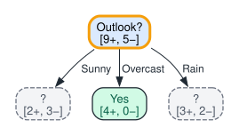

# Decision Trees 2: Play Tennis, Choosing the Root Node

ID3 builds a decision tree by splitting on the attribute with the highest information gain.

## Before you start
<!-- bite: 1aa03e6c-986c-41b8-8da3-18cc0c848f31 -->

You should be able to calculate entropy and information gain ([[machine-learning/03-classical-ml/05-decision-trees-1|Decision Trees 1]]). Keep a calculator next to you and work each number before you read it.

After this lesson you will be able to:

- calculate the entropy of a whole dataset from its Yes and No counts;
- calculate the information gain of every attribute from its count table;
- choose the root node and say which branches are already finished.

## What we are building
<!-- bite: ae3e09e7-3e11-4760-89e7-97ead816f826 -->

This lesson starts building a whole decision tree by hand with ID3. At every node, we find the information gain of each attribute and split on the one with the highest information gain. Here we do it for the first node, the root.

Next: the data, then the root node, worked one attribute at a time.

## The Play Tennis data
<!-- bite: 4e592bd7-48dd-45ad-b4a3-974b7ed7f479 -->

| Day | Outlook | Temp | Humidity | Wind | Play Tennis |
| --- | --- | --- | --- | --- | --- |
| 1 | Sunny | Hot | High | Weak | No |
| 2 | Sunny | Hot | High | Strong | No |
| 3 | Overcast | Hot | High | Weak | Yes |
| 4 | Rain | Mild | High | Weak | Yes |
| 5 | Rain | Cool | Normal | Weak | Yes |
| 6 | Rain | Cool | Normal | Strong | No |
| 7 | Overcast | Cool | Normal | Strong | Yes |
| 8 | Sunny | Mild | High | Weak | No |
| 9 | Sunny | Cool | Normal | Weak | Yes |
| 10 | Rain | Mild | Normal | Weak | Yes |
| 11 | Sunny | Mild | Normal | Strong | Yes |
| 12 | Overcast | Mild | High | Strong | Yes |
| 13 | Overcast | Hot | Normal | Weak | Yes |
| 14 | Rain | Mild | High | Strong | No |

We will build the decision tree for this data using ID3. At every node, we find the information gain of each attribute and split on the one with the highest information gain.

## Step 1: Choose the root node
<!-- bite: 9dbb87e5-2023-4b1e-9363-384bf28f1f62 -->

We want to decide which attribute to split on for the root node. The attributes are Outlook, Temp, Humidity and Wind, so we find the information gain of all four.

**First, the entropy of the whole dataset.** Out of the 14 days, 9 are Yes and 5 are No.

$$
E (Y) = - \left[(\frac{9}{14} \log_2 \left(\frac{9}{14}\right)) + (\frac{5}{14} \log_2 \left(\frac{5}{14}\right))\right] = 0.94029
$$

## Root node: Outlook
<!-- bite: eae2933e-5d7e-4554-91ae-98de886a8b92 -->

Outlook splits the data into 3 labels:

|  | Sunny | Overcast | Rain | Total |
| --- | --- | --- | --- | --- |
| Yes | 2 | 4 | 3 | 9 |
| No | 3 | 0 | 2 | 5 |
| Total | 5 | 4 | 5 | 14 |

Sunny:

$$
E (\text{Sunny}) = - \left[(\frac{2}{5} \log_2 \left(\frac{2}{5}\right)) + (\frac{3}{5} \log_2 \left(\frac{3}{5}\right))\right] = 0.97095
$$

Overcast: all 4 days are Yes, so P\_c = 1 or 0 and:

$$
E(\text{Overcast}) = 0
$$

Rain:

$$
E (\text{Rain}) = - \left[(\frac{3}{5} \log_2 \left(\frac{3}{5}\right)) + (\frac{2}{5} \log_2 \left(\frac{2}{5}\right))\right] = 0.97095
$$

## Root node: Outlook's information gain
<!-- bite: 1a2ecae7-5ee4-4529-8e33-791e69dfc7ba -->

Now we use the information gain formula. We take the entropy before the split and subtract the entropy after the split. Each part of the split is weighted by how many days it has.

$$
\text{IG} (\text{Outlook}) = E (Y) - \left[(\frac{5}{14} \times E (\text{Sunny})) + (\frac{4}{14} \times E (\text{Overcast})) + (\frac{5}{14} \times E (\text{Rain}))\right]
$$

$$
\text{IG} (\text{Outlook}) = 0.94029 - \left[\left(\frac{5}{14} \times 0.97095\right) + \left(\frac{4}{14} \times 0\right) + \left(\frac{5}{14} \times 0.97095\right)\right]
$$

$$
\text{IG} (\text{Outlook}) = 0.94029 - 0.69354 = 0.2468
$$

## Root node: Temperature
<!-- bite: 04250028-14fc-409e-903f-579321eb8a6e -->

|  | Hot | Mild | Cool | Total |
| --- | --- | --- | --- | --- |
| Yes | 2 | 4 | 3 | 9 |
| No | 2 | 2 | 1 | 5 |
| Total | 4 | 6 | 4 | 14 |

$$
E (\text{Hot}) = - \left[(\frac{2}{4} \log_2 \left(\frac{2}{4}\right)) + (\frac{2}{4} \log_2 \left(\frac{2}{4}\right))\right] = 1
$$

$$
E (\text{Mild}) = - \left[(\frac{4}{6} \log_2 \left(\frac{4}{6}\right)) + (\frac{2}{6} \log_2 \left(\frac{2}{6}\right))\right] = 0.9183
$$

$$
E (\text{Cool}) = - \left[(\frac{3}{4} \log_2 \left(\frac{3}{4}\right)) + (\frac{1}{4} \log_2 \left(\frac{1}{4}\right))\right] = 0.81128
$$

## Root node: Temperature's information gain
<!-- bite: 58a026c1-2e19-4eea-b785-9895804f5c19 -->

Now the information gain for Temperature, using the three entropies from the last bite.

$$
\text{IG} (\text{Temperature}) = 0.94029 - \left[\left(\frac{4}{14} \times 1\right) + \left(\frac{6}{14} \times 0.9183\right) + \left(\frac{4}{14} \times 0.81128\right)\right]
$$

$$
\text{IG} (\text{Temperature}) = 0.94029 - 0.91107 = 0.02922
$$

## Root node: Humidity
<!-- bite: fa26a4e5-a3e1-45a3-8729-9d732972de1c -->

|  | High | Normal | Total |
| --- | --- | --- | --- |
| Yes | 3 | 6 | 9 |
| No | 4 | 1 | 5 |
| Total | 7 | 7 | 14 |

$$
E (\text{High}) = - \left[(\frac{3}{7} \log_2 \left(\frac{3}{7}\right)) + (\frac{4}{7} \log_2 \left(\frac{4}{7}\right))\right] = 0.98523
$$

$$
E (\text{Normal}) = - \left[(\frac{6}{7} \log_2 \left(\frac{6}{7}\right)) + (\frac{1}{7} \log_2 \left(\frac{1}{7}\right))\right] = 0.59167
$$

$$
\text{IG} (\text{Humidity}) = 0.94029 - \left[\left(\frac{7}{14} \times 0.98523\right) + \left(\frac{7}{14} \times 0.59167\right)\right]
$$

$$
\text{IG} (\text{Humidity}) = 0.94029 - 0.78845 = 0.15184
$$

## Root node: Wind
<!-- bite: ddc1c7e0-6a47-4589-b9da-3453d2117945 -->

|  | Weak | Strong | Total |
| --- | --- | --- | --- |
| Yes | 6 | 3 | 9 |
| No | 2 | 3 | 5 |
| Total | 8 | 6 | 14 |

$$
E (\text{Weak}) = - \left[(\frac{6}{8} \log_2 \left(\frac{6}{8}\right)) + (\frac{2}{8} \log_2 \left(\frac{2}{8}\right))\right] = 0.8113
$$

$$
E (\text{Strong}) = - \left[(\frac{3}{6} \log_2 \left(\frac{3}{6}\right)) + (\frac{3}{6} \log_2 \left(\frac{3}{6}\right))\right] = 1
$$

$$
\text{IG} (\text{Wind}) = 0.94029 - \left[\left(\frac{8}{14} \times 0.8113\right) + \left(\frac{6}{14} \times 1\right)\right]
$$

$$
\text{IG} (\text{Wind}) = 0.94029 - 0.89217 = 0.04812
$$

## Root node: picking the winner
<!-- bite: 42de5507-12b1-406d-a688-9107808faf7e -->

Now we pick the one with the highest IG:

| Attribute | Information Gain |
| --- | --- |
| **Outlook** | **0.2468** (highest) |
| Temperature | 0.02922 |
| Humidity | 0.15184 |
| Wind | 0.04812 |

Outlook has the highest information gain, so it is our **root node**.

## The three branches of Outlook
<!-- bite: 732d88f8-48fa-4ece-b1fc-779cbf642eae -->

The root node splits the data into 3 branches. Here is the tree so far, with the new node outlined in orange:

Sunny holds days D1, D2, D8, D9 and D11. Overcast holds D3, D7, D12 and D13. Rain holds D4, D5, D6, D10 and D14.

> **NB:** We already have an answer (leaf node) for Overcast, because all its days are Yes.

Sunny and Rain do not have a final answer yet (they have both Yes and No). So we repeat the same steps for each of them, using only the days in that branch. We start with Sunny.

## Check your understanding
<!-- bite: c97be16f-a4d0-4982-8e62-8a7e002d6af7 -->

Try each one before you open the answer.

1. <!-- q: mcq id="da329657" -->
   Which attribute becomes the root node of the Play Tennis tree?

   - [x] Outlook (IG 0.2468)
   - [ ] Temperature (IG 0.02922)
   - [ ] Humidity (IG 0.15184)
   - [ ] Wind (IG 0.04812)

   

Answer

   Outlook, because it has the highest information gain of the four.

   

2. <!-- q: exact id="fc7cd6e2" answer="0.918295834054" sigfigs="2" -->
   A dataset has 4 Yes and 2 No. What is its entropy?

   

Answer

   About 0.92. −[(4/6) log₂(4/6) + (2/6) log₂(2/6)] = 0.390 + 0.528 = 0.918. Fairly mixed, but not 50/50, so below 1.

   

3. <!-- q: exact id="f891f7de" answer="0.419973094022" sigfigs="2" -->
   10 rows have 6 Yes and 4 No, so the entropy before splitting is 0.971. The attribute Colour splits them:

   | Colour | Yes | No |
   | --- | --- | --- |
   | Red | 4 | 0 |
   | Blue | 2 | 4 |

   What is IG(Colour)?

   

Answer

   About 0.42. E(Red) = 0 (pure). E(Blue) = −[(2/6) log₂(2/6) + (4/6) log₂(4/6)] = 0.918. Weighted entropy after = (4/10) × 0 + (6/10) × 0.918 = 0.551. IG = 0.971 − 0.551 = 0.420.

   

4. <!-- q: mcq id="44d9db5d" -->
   Five students:

   | Studied | Slept well | Result |
   | --- | --- | --- |
   | Yes | Yes | Pass |
   | Yes | No | Pass |
   | No | Yes | Fail |
   | No | No | Fail |
   | Yes | Yes | Pass |

   Without calculating, which attribute gives the bigger information gain?

   - [x] Studied
   - [ ] Slept well

   

Answer

   Studied. Studied = Yes is all Pass and Studied = No is all Fail, so both groups are pure and the gain is the whole entropy, 0.971. Slept well leaves both groups mixed, so its gain is only about 0.02.

   

5. <!-- q: open id="3bd8c400" -->
   Temperature has the lowest gain at the root (0.02922). What does a gain that small tell you?

   

Answer

   Splitting on Temperature hardly reduces the entropy: the Hot, Mild and Cool groups are almost as mixed as the whole dataset.

   

## Check your understanding: worked problems
<!-- bite: 1fe006ab-6d0b-423e-825a-0640afdf8801 -->

Work each one out on paper first, then type your answer.

1. <!-- q: exact id="45cf93cb" answer="0.721928094887" sigfigs="3" -->
   10 evenings: Go out = 5 Yes, 5 No. Splitting on Raining:

   | Raining | Go out: Yes | Go out: No |
   | --- | --- | --- |
   | No | 4 | 1 |
   | Yes | 1 | 4 |

   What is E(Raining = No)?

   

Answer

   About 0.722. −[(4/5) log₂(4/5) + (1/5) log₂(1/5)] = 0.258 + 0.464 = 0.722.

   

2. <!-- q: exact id="704141b0" answer="0.721928094887" sigfigs="3" -->
   10 evenings are split on Raining. E(Raining = No) = 0.722 and E(Raining = Yes) = 0.722, with 5 evenings each. What is the weighted entropy after splitting on Raining?

   

Answer

   About 0.722. (5/10) × 0.722 + (5/10) × 0.722 = 0.722. Both groups are equally mixed, just the other way round.

   

3. <!-- q: exact id="b0058ebf" answer="0.278071905113" sigfigs="2" -->
   10 evenings are split on Raining. The entropy before the split is 1 (5 Yes, 5 No), and the weighted entropy after is 0.722. What is IG(Raining)?

   

Answer

   About 0.28. 1 − 0.722 = 0.278. Raining helps, but it doesn't make the groups pure.

   

## Before moving on
<!-- bite: 2a19c777-f71a-497e-8155-af47d970f7e1 -->

Find the entropy of the whole data, then the weighted entropy after splitting on each attribute. The biggest drop (information gain) wins. For Play Tennis that is Outlook, and Overcast is already a leaf.

**Next:** [[machine-learning/03-classical-ml/07-decision-trees-3|Decision Trees 3]]. Sunny and Rain still have both Yes and No days, so we repeat the same steps for each of them.

## About this lesson
<!-- bite: 7fddff4a-bfd2-417d-976e-737159a12b33 -->

**Level:** Intermediate. **Covers:** the Play Tennis data and the full calculation for the root node with ID3. Part 2 of 6 on decision trees. **Source:** SSG 535 (Introduction to Machine Learning) class notes, 2025/2026 first semester. The wording is kept from the notes; only headings, links and the checks were added.
