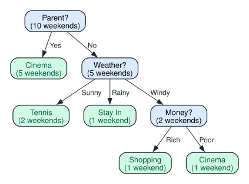

# Decision Trees 4: Gini Impurity and the Weekend Decision

Gini impurity is the probability of incorrectly classifying a random data point in the dataset. It measures the impurity or disorder of a node.

## Before you start
<!-- bite: 64c97012-00ce-4133-a36e-8588760721e9 -->

You should have built the Play Tennis tree with entropy ([[machine-learning/03-classical-ml/07-decision-trees-3|Decision Trees 3]]).

After this lesson you will be able to:

- calculate the Gini impurity of a node;
- calculate the Gini Index (the weighted average) of an attribute;
- build a whole tree by choosing the smallest Gini Index at each node.

## Gini Impurity
<!-- bite: 359ea63b-85d9-4f26-bd3d-dbff5dfb2c51 -->

Gini impurity is the second way of choosing the best attribute (the first was entropy and information gain). It is the one CART uses.

Similar to entropy, if set S, is pure i.e. belonging to one (same) class, then its impurity is zero.

Mathematical representation:

$$
G = 1 - \sum_{i=1} (P_i)^2
$$

> **Note:** Gini Index selects the lowest weighted average of the Gini Impurity.

## Gini Index Worked Example: Weekend Decision
<!-- bite: e5a07592-c8a0-4bb5-9f21-a6a9c9ade1b0 -->

We used entropy and information gain to build the Play Tennis tree. Now we build a tree with the Gini Index instead. The rule is: the attribute with the **smallest** Gini Index (the lowest weighted average of the Gini Impurity) is the best one to split on.

**Compute the Gini Index for the overall collection of training examples.**

| Weekend | Weather | Parent | Money | Decision |
| --- | --- | --- | --- | --- |
| W1 | Sunny | Yes | Rich | Cinema |
| W2 | Sunny | No | Rich | Tennis |
| W3 | Windy | Yes | Rich | Cinema |
| W4 | Rainy | Yes | Poor | Cinema |
| W5 | Rainy | No | Rich | Stay In |
| W6 | Rainy | Yes | Poor | Cinema |
| W7 | Windy | No | Poor | Cinema |
| W8 | Windy | No | Rich | Shopping |
| W9 | Windy | Yes | Rich | Cinema |
| W10 | Sunny | No | Rich | Tennis |

## Step 1: Gini Index of the whole dataset
<!-- bite: 254e3dda-0a63-4d1b-a410-c8e9708c223a -->

The Decision is what we want to predict: Cinema = 6, Tennis = 2, Stay In = 1, Shopping = 1 (out of 10).

$$
\text{Gini Index} (S) = 1 - \left[\left(\frac{6}{10}\right)^2 + \left(\frac{2}{10}\right)^2 + \left(\frac{1}{10}\right)^2 + \left(\frac{1}{10}\right)^2\right] = 0.58
$$

## Step 2: Choose the root node
<!-- bite: 8cc5c9d4-8ab9-4f8f-87da-ff7bb5a6a140 -->

We find the Gini Index of each attribute (Weather, Parent and Money). The smallest one becomes the root.

## Root node: Weather
<!-- bite: b3e84a84-6341-469a-b5f5-570494c70c1c -->

|  | Sunny | Windy | Rainy | Total |
| --- | --- | --- | --- | --- |
| Cinema | 1 | 3 | 2 | 6 |
| Tennis | 2 | 0 | 0 | 2 |
| Stay In | 0 | 0 | 1 | 1 |
| Shopping | 0 | 1 | 0 | 1 |
| Total | 3 | 4 | 3 | 10 |

$$
\text{Gini} (\text{Sunny}) = 1 - \left[\left(\frac{1}{3}\right)^2 + \left(\frac{2}{3}\right)^2\right] = 0.4444
$$

$$
\text{Gini} (\text{Windy}) = 1 - \left[\left(\frac{3}{4}\right)^2 + \left(\frac{1}{4}\right)^2\right] = 0.375
$$

$$
\text{Gini} (\text{Rainy}) = 1 - \left[\left(\frac{2}{3}\right)^2 + \left(\frac{1}{3}\right)^2\right] = 0.4444
$$

## Root node: Weather's weighted average
<!-- bite: 69f3d195-8b61-49ba-af07-7b46e7eb0a0c -->

Now we weight each Weather value's Gini by how many weekends it has.

The weighted average is:

$$
\text{Weighted Average} = \text{Gini}(\text{Sunny}) \times \frac{\text{Total of Sunny}}{\text{Total Decision}} + \text{Gini}(\text{Windy}) \times \frac{\text{Total of Windy}}{\text{Total Decision}} + \text{Gini}(\text{Rainy}) \times \frac{\text{Total of Rainy}}{\text{Total Decision}}
$$

$$
\text{Weighted Average} = \left(\frac{3}{10} \times 0.4444\right) + \left(\frac{4}{10} \times 0.375\right) + \left(\frac{3}{10} \times 0.4444\right) = 0.41664
$$

## Root node: Parent
<!-- bite: d543973b-f225-42bf-9710-e7efb8c349c1 -->

|  | Yes | No | Total |
| --- | --- | --- | --- |
| Cinema | 5 | 1 | 6 |
| Tennis | 0 | 2 | 2 |
| Stay In | 0 | 1 | 1 |
| Shopping | 0 | 1 | 1 |
| Total | 5 | 5 | 10 |

$$
\text{Gini} (\text{Yes}) = 1 - \left[\left(\frac{5}{5}\right)^2\right] = 0
$$

$$
\text{Gini} (\text{No}) = 1 - \left[\left(\frac{1}{5}\right)^2 + \left(\frac{2}{5}\right)^2 + \left(\frac{1}{5}\right)^2 + \left(\frac{1}{5}\right)^2\right] = 0.72
$$

$$
\text{Weighted Average} = \left(\frac{5}{10} \times 0\right) + \left(\frac{5}{10} \times 0.72\right) = 0.36
$$

## Root node: Money
<!-- bite: 3a06658f-fc1e-44fa-a8f8-c1272a25d222 -->

|  | Rich | Poor | Total |
| --- | --- | --- | --- |
| Cinema | 3 | 3 | 6 |
| Tennis | 2 | 0 | 2 |
| Stay In | 1 | 0 | 1 |
| Shopping | 1 | 0 | 1 |
| Total | 7 | 3 | 10 |

$$
\text{Gini} (\text{Rich}) = 1 - \left[\left(\frac{3}{7}\right)^2 + \left(\frac{2}{7}\right)^2 + \left(\frac{1}{7}\right)^2 + \left(\frac{1}{7}\right)^2\right] = 0.6939
$$

$$
\text{Gini} (\text{Poor}) = 1 - \left[\left(\frac{3}{3}\right)^2\right] = 0
$$

$$
\text{Weighted Average} = \left(\frac{7}{10} \times 0.6939\right) + \left(\frac{3}{10} \times 0\right) = 0.48573
$$

## Root node: picking the winner
<!-- bite: 7136a4d4-a944-4a95-8b21-1471e14dbffe -->

Now we compare the three Gini Indexes. The smallest one wins.

| Attribute | Gini Index |
| --- | --- |
| Weather | 0.41664 |
| **Parent** | **0.36** (smallest) |
| Money | 0.48573 |

Parent is selected as the smallest Gini Index, so it is our **root node**.

## Step 3: The Parent = No branch
<!-- bite: 32152270-ae36-4c58-b453-b86608579073 -->

When Parent = Yes, all 5 weekends are Cinema, so that branch is a leaf node: **Cinema (5)**. When Parent = No, we still have different decisions, so we repeat the steps with only the weekends in that branch.

| Weekend | Weather | Money | Decision |
| --- | --- | --- | --- |
| W2 | Sunny | Rich | Tennis |
| W5 | Rainy | Rich | Stay In |
| W7 | Windy | Poor | Cinema |
| W8 | Windy | Rich | Shopping |
| W10 | Sunny | Rich | Tennis |

Tennis = 2, Stay In = 1, Cinema = 1, Shopping = 1.

## Parent = No branch: Weather
<!-- bite: 582f3ea2-517b-4b49-940a-ca69ce3d0f2d -->

Sunny (W2, W10: both Tennis):

$$
\text{Gini} (\text{Sunny}) = 1 - \left[\left(\frac{2}{2}\right)^2\right] = 0
$$

Rainy (W5: Stay In):

$$
\text{Gini} (\text{Rainy}) = 1 - \left[\left(\frac{1}{1}\right)^2\right] = 0
$$

Windy (W7: Cinema, W8: Shopping):

$$
\text{Gini} (\text{Windy}) = 1 - \left[\left(\frac{1}{2}\right)^2 + \left(\frac{1}{2}\right)^2\right] = 0.5
$$

$$
\text{Weighted Average} = \left(\frac{2}{5} \times 0\right) + \left(\frac{1}{5} \times 0\right) + \left(\frac{2}{5} \times 0.5\right) = 0.2
$$

## Parent = No branch: Money
<!-- bite: 70a611e8-596d-4739-bebe-8b8f9a209f44 -->

Rich (W2, W5, W8, W10: Tennis 2, Stay In 1, Shopping 1):

$$
\text{Gini} (\text{Rich}) = 1 - \left[\left(\frac{2}{4}\right)^2 + \left(\frac{1}{4}\right)^2 + \left(\frac{1}{4}\right)^2\right] = 0.625
$$

Poor (W7: Cinema):

$$
\text{Gini} (\text{Poor}) = 1 - \left[\left(\frac{1}{1}\right)^2\right] = 0
$$

$$
\text{Weighted Average} = \left(\frac{4}{5} \times 0.625\right) + \left(\frac{1}{5} \times 0\right) = 0.5
$$

| Attribute | Gini Index |
| --- | --- |
| **Weather** | **0.2** (smallest) |
| Money | 0.5 |

Weather has the smallest Gini Index, so we split on it. Sunny is all Tennis and Rainy is all Stay In, so those become leaf nodes. Windy still has two different decisions, so we go one level deeper.

## Step 4: The Windy branch
<!-- bite: 34914059-6690-4293-a648-a7d2da205359 -->

| Weekend | Money | Decision |
| --- | --- | --- |
| W7 | Poor | Cinema |
| W8 | Rich | Shopping |

$$
\text{Gini} (\text{Rich}) = 1 - \left[\left(\frac{1}{1}\right)^2\right] = 0
$$

$$
\text{Gini} (\text{Poor}) = 1 - \left[\left(\frac{1}{1}\right)^2\right] = 0
$$

$$
\text{Weighted Average} = \left(0 \times \frac{1}{2}\right) + \left(0 \times \frac{1}{2}\right) = 0
$$

Both parts are pure, so we split on Money and stop.

## The final tree
<!-- bite: 6b7b1287-891e-47e0-baf1-47df36e129a7 -->

- **Parent** (root node)
  - Yes → **Cinema** (5)
  - No → **Weather**
    - Sunny → **Tennis** (2)
    - Rainy → **Stay In** (1)
    - Windy → **Money** {W7, W8}
      - Rich → **Shopping** (1)
      - Poor → **Cinema** (1)

## Seeing the Weekend tree
<!-- bite: dbdc6645-6601-43c4-a55b-a56584cbac41 -->

The same tree as a picture. Parent is asked first because it had the smallest Gini Index. Notice that Money is only asked on the Windy branch, the one place it is still needed.

## Check your understanding
<!-- bite: 31d65933-9dcf-4377-aa16-6c36af81d64a -->

Try each one before you open the answer.

1. <!-- q: exact id="12cd9029" answer="0.375" accept="3/8" tolerance="0.001" -->
   A node has 3 Cinema and 1 Tennis. What is its Gini impurity?

   

Answer

   G = 1 − [(3/4)² + (1/4)²] = 1 − (0.5625 + 0.0625) = 0.375.

   

2. <!-- q: mcq id="c2eee78b" -->
   For information gain we pick the highest value. For the Gini Index, do we pick the highest or the smallest?

   - [ ] The highest
   - [x] The smallest

   

Answer

   The smallest. A small Gini Index means the groups after the split are pure.

   

3. <!-- q: exact id="b9bcdd8d" answer="0" accept="zero" -->
   A node holds only one class. What is its Gini impurity?

   

Answer

   0. If the set is pure, 1 − (1)² = 0, just like entropy.

   

4. <!-- q: mcq id="4e877693" -->
   Which attribute is the root node of the Weekend tree?

   - [ ] Weather (0.41664)
   - [x] Parent (0.36)
   - [ ] Money (0.48573)

   

Answer

   Parent, because it has the smallest Gini Index.

   

5. <!-- q: mcq id="3b87489f" -->
   Using the final Weekend tree, what does a weekend with Parent = No, Weather = Windy and Money = Poor give?

   - [x] Cinema
   - [ ] Shopping
   - [ ] Tennis
   - [ ] Stay In

   

Answer

   Cinema (Parent = No → Weather = Windy → Money = Poor).

   

## Check your understanding: worked problems
<!-- bite: 544fd7b0-3ea8-47c3-9300-c189962bdd5c -->

Work each one out on paper first, then type your answer.

1. <!-- q: exact id="ea5d5e3e" answer="0.5" accept="1/2" -->
   A node has 2 of class A and 2 of class B. What is its Gini impurity?

   

Answer

   0.5. 1 − [(1/2)² + (1/2)²] = 0.5, the most impure two classes can be.

   

2. <!-- q: exact id="46fb2a71" answer="0.625" accept="5/8" -->
   A node has 2 Tennis, 1 Cinema and 1 Shopping. What is its Gini impurity?

   

Answer

   0.625. 1 − [(2/4)² + (1/4)² + (1/4)²] = 1 − 0.375 = 0.625.

   

3. <!-- q: exact id="89f3caab" answer="0.3" accept="3/10" -->
   An attribute splits 10 rows into a group of 4 with Gini 0 and a group of 6 with Gini 0.5. What is its Gini Index (the weighted average)?

   

Answer

   0.3. (4/10) × 0 + (6/10) × 0.5 = 0.3.

   

## Before moving on
<!-- bite: 0c2caf75-9b4d-4785-9587-ecc9790e6837 -->

Gini impurity is 1 minus the sum of the squared class proportions. The Gini Index of an attribute is the weighted average of the Gini impurity of its branches, and the smallest one wins.

**Next:** [[machine-learning/03-classical-ml/09-decision-trees-5|Decision Trees 5]]. We now have two ways to choose a split. Next we run both on the same small dataset and compare.

## About this lesson
<!-- bite: 1cf0e7c8-00e8-4a6a-98f7-6c7ff11f0710 -->

**Level:** Intermediate. **Covers:** Gini impurity, the Gini Index and the full Weekend Decision worked example. Part 4 of 6 on decision trees. **Source:** SSG 535 (Introduction to Machine Learning) class notes, 2025/2026 first semester. The wording is kept from the notes; only headings, links and the checks were added.
