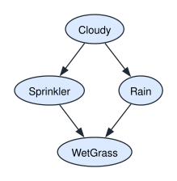
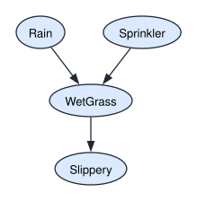

# Bayesian Networks 1: Nodes, Arcs and Bayes Theorem

A Bayesian network is a graph that shows how variables affect each other's probabilities.

## Before you start
<!-- bite: 0ec5014c-ebef-4e43-89b1-cc19eb364edc -->

You should know what a probability is, and what P(A|B), "the probability of A given B", means.

After this lesson you will be able to:

- describe a Bayesian network's nodes, arcs and conditional probability tables;
- read a probability from a conditional probability table (CPT);
- derive Bayes theorem from the definition of conditional probability.

## What a Bayesian network is
<!-- bite: bb2060d5-27de-4cf9-bef7-39f6c388f4fe -->

A Bayesian network is a graphical model that represents the probabilistic relationships among variables. It is used to handle uncertainty and make predictions or decisions based on probabilities.

Naive Bayes looks at each feature on its own. A Bayesian network goes further: it shows how the variables are connected to each other.

Bayesian networks, also known as belief networks or Bayesian belief networks (BBNs), are powerful tools for representing and reasoning about uncertain knowledge. These networks use a graphical structure to encode probabilistic relationships among variables, making them invaluable in fields such as artificial intelligence, bioinformatics and decision analysis.

## Basic Structure of a Bayesian Network
<!-- bite: 0f70f7d8-0a10-49f2-a3ee-225e8ca239c2 -->

A Bayesian network (BN) is a probabilistic graphical model for representing knowledge about an uncertain domain where each **node** corresponds to a random variable (which can be continuous or discrete), and each **edge** represents the conditional probability for the corresponding random variables.

> **Note:** Arcs show a link between one node and its influence on another.

## A Simple Example (Directed Acyclic Graph with 4 nodes)
<!-- bite: 1ac0461d-8388-4abf-973b-a68b6623c959 -->

The arcs are: Cloudy → Sprinkler, Cloudy → Rain, Sprinkler → WetGrass and Rain → WetGrass.

| Cloudy: P(C=T) | P(C=F) |
| --- | --- |
| 0.5 | 0.5 |

| Cloudy (C) | P(S=T) | P(S=F) |
| --- | --- | --- |
| T | 0.1 | 0.9 |
| F | 0.5 | 0.5 |

## Seeing the network
<!-- bite: 409a527a-4466-48eb-88cf-090ba36ca210 -->

Here are the four arcs as a picture. Each arrow points from a cause to what it affects. WetGrass has two arrows coming in, so its table needs a row for every mix of Sprinkler and Rain.

## The Rain and WetGrass tables
<!-- bite: 3d95609f-c9a1-4612-b1b3-56d001d17671 -->

The last two tables: Rain depends on Cloudy, and WetGrass depends on both Sprinkler and Rain.

| Cloudy (C) | P(R=T) | P(R=F) |
| --- | --- | --- |
| T | 0.8 | 0.2 |
| F | 0.2 | 0.8 |

| Sprinkler (S) | Rain (R) | P(W=T) | P(W=F) |
| --- | --- | --- | --- |
| T | T | 0.99 | 0.01 |
| T | F | 0.9 | 0.1 |
| F | T | 0.9 | 0.1 |
| F | F | 0.0 | 1.0 |

## Conditional Probability Tables (CPTs)
<!-- bite: f20c938e-d277-4039-a33d-ac4a9953421f -->

> **Note:** The probabilities of the wet grass can be changed based on the information on the cloud, rain and sprinkler condition. For example, if it rains and the sprinkler is on, the probability that the grass is wet is 0.99.

The strength of these relationships is defined in the **Conditional Probability Tables (CPTs)** attached to each node (the four tables above). CPTs specify the degree of belief (expressed as probabilities) that the node will be in a particular state given the states of the parent nodes (the nodes that directly affect the node).

| Method | Theoretical basis | Black-box or model-based | Possibility of incorporation of expert opinion | Use for data analysis |
| --- | --- | --- | --- | --- |
| Bayesian Networks | Probability Theory | Model-based | Yes | Yes |

## Bayes Theorem
<!-- bite: cf20d53e-973d-476e-aa97-49c8d9d7e05e -->

Bayesian networks are built on Bayes theorem. P(A|B) means the probability of A given B.

$$
P(A|B) = \frac{P(B|A)\,P(A)}{P(B)}
$$

Where this comes from:

$$
P(A \mid B) = \frac{P(A \cap B)}{P(B)}
$$

Note:

$$
P(A \cap B) = P(B \cap A)
$$

$$
P(B \mid A) = \frac{P(B \cap A)}{P(A)} = \frac{P(A \cap B)}{P(A)}
$$

So

$$
P(A \cap B) = P(B \mid A)\,P(A)
$$

Putting it together:

$$
P(A \mid B) = \frac{P(B \mid A)\,P(A)}{P(B)}
$$

## Check your understanding
<!-- bite: d115ff6f-61c1-451c-b08e-5b6a4b9bf459 -->

Try each one before you open the answer.

1. <!-- q: exact id="8f7fb0ee" answer="0.9" tolerance="0.001" -->
   WetGrass depends on Sprinkler (S) and Rain (R):

   | S | R | P(W = T) |
   | --- | --- | --- |
   | T | T | 0.99 |
   | T | F | 0.9 |
   | F | T | 0.9 |
   | F | F | 0.0 |

   What is P(WetGrass = T) if the sprinkler is off and it rains?

   

Answer

   0.9, read from the WetGrass CPT row S = F, R = T.

   

2. <!-- q: mcq id="d6599db0" -->
   Which nodes are the parents of WetGrass? Choose all that apply.

   - [ ] Cloudy
   - [x] Sprinkler
   - [x] Rain

   

Answer

   Sprinkler and Rain, because the arcs go Sprinkler → WetGrass and Rain → WetGrass.

   

3. <!-- q: exact id="59584ffe" answer="0.4" accept="2/5" tolerance="0.001" -->
   P(B|A) = 0.8, P(A) = 0.1 and P(B) = 0.2. Use Bayes theorem to find P(A|B).

   

Answer

   P(A|B) = (0.8 × 0.1) / 0.2 = 0.4.

   

4. <!-- q: gap id="ab0cc316" answers="conditional probability tables|conditional probability table|cpts|cpt" -->
   Fill in the gap. The strength of each link in the network is defined in the ___ attached to each node.

   

Answer

   Conditional probability tables (CPTs). They give the probability of each state of the node, given the states of its parents.

   

5. <!-- q: exact id="2de6e6cb" answer="0.8" tolerance="0.001" -->
   P(C = T) = 0.5, and:

   | | C = T | C = F |
   | --- | --- | --- |
   | P(S = T \| C) | 0.1 | 0.5 |
   | P(R = T \| C) | 0.8 | 0.2 |

   It is cloudy. What is P(Rain = T)?

   

Answer

   0.8, from the Rain CPT row C = T.

   

## Check your understanding: worked problems
<!-- bite: 41d83707-88b5-4eba-a2d2-8e096b7f5295 -->

Work each one out on paper first, then type your answer.

1. <!-- q: exact id="d0fc8345" answer="0.4" accept="2/5" -->
   P(C = T) = 0.5, and:

   | | C = T | C = F |
   | --- | --- | --- |
   | P(S = T \| C) | 0.1 | 0.5 |
   | P(R = T \| C) | 0.8 | 0.2 |

   What is P(C = T and R = T)?

   

Answer

   0.4. P(C = T) × P(R = T | C = T) = 0.5 × 0.8 = 0.4.

   

2. <!-- q: exact id="ef7f377c" answer="0.36" -->
   P(C = T) = 0.5, and:

   | | C = T | C = F |
   | --- | --- | --- |
   | P(S = T \| C) | 0.1 | 0.5 |
   | P(R = T \| C) | 0.8 | 0.2 |

   What is P(C = T, S = F, R = T)? (S and R are independent once C is known.)

   

Answer

   0.36. P(C = T) × P(S = F | C = T) × P(R = T | C = T) = 0.5 × 0.9 × 0.8 = 0.36.

   

3. <!-- q: exact id="5d6c8221" answer="0.05" accept="1/20" -->
   P(C = T) = 0.5, and:

   | | C = T | C = F |
   | --- | --- | --- |
   | P(S = T \| C) | 0.1 | 0.5 |
   | P(R = T \| C) | 0.8 | 0.2 |

   What is P(C = T and S = T)?

   

Answer

   0.05. 0.5 × 0.1 = 0.05. The sprinkler rarely runs on cloudy days.

   

4. <!-- q: sketch id="141684b6" -->
   Draw the Bayesian network for this story: rain and the sprinkler can each make the grass wet, and wet grass makes the path slippery. Then say which node needs the biggest conditional probability table.

   

Answer

   

   What to check:
   - Arrows go from cause to effect: Rain → WetGrass, Sprinkler → WetGrass, WetGrass → Slippery.
   - There is no arrow from Rain straight to Slippery: once you know the grass is wet, rain tells you nothing more.
   - WetGrass has the biggest table, one row for each of the 4 mixes of Rain and Sprinkler.

   

## Before moving on
<!-- bite: fde07d20-998f-4a5c-9204-0ccf7e837d8b -->

A Bayesian network is a directed acyclic graph: each node is a random variable, each arc shows influence, and each node has a CPT given its parents. It is built on Bayes theorem.

**Next:** [[machine-learning/03-classical-ml/13-bayesian-networks-2|Bayesian Networks 2]]. Now we use the network and Bayes theorem to calculate real probabilities.

## About this lesson
<!-- bite: 918bdd5d-fcb7-455d-87f5-86224a5432f6 -->

**Level:** Intermediate. **Covers:** the structure of a Bayesian network, the Cloudy/Sprinkler/Rain/WetGrass example, CPTs and the derivation of Bayes theorem. Part 1 of 2 on Bayesian networks. **Source:** SSG 535 (Introduction to Machine Learning) class notes, 2025/2026 first semester. The wording is kept from the notes; only headings, links and the checks were added.
