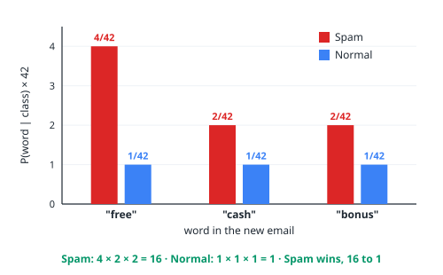

# Naive Bayes 2: Multinomial Naive Bayes and the Spam Filter

Multinomial naive Bayes is a word-counting classifier that sorts text into categories.

## Before you start
<!-- bite: 5212160d-60b4-436c-b105-7836dc505fe0 -->

You should have read [[machine-learning/03-classical-ml/11-naive-bayes-1|Naive Bayes 1]], where you met the three kinds of naive Bayes and the "naive" assumption. It helps to know [[machine-learning/00-foundations/03-mathematics/03-probability-and-statistics/03-bayes-theorem|Bayes theorem]] too.

After this lesson you will be able to:

- turn a sentence into a bag of words;
- work out P(class) and P(word | class) from a small table of emails, with add-one smoothing;
- classify a new email by hand and say how sure the model is;
- read the five steps of the scikit-learn code and say what each line does.

## What multinomial naive Bayes is
<!-- bite: 1d3c8a02-fffc-4b9f-b358-c8b514280637 -->

Multinomial naive Bayes is a **word frequency counter** joined to the **Bayes probability rule**. It counts how often each word appears in each category of text. Then, when a new message comes in, it uses those past word clues to predict which category the message belongs to.

Remember the "naive" part from Naive Bayes 1? Here it means the model treats every word as completely independent of the others. "Free" and "cash" are just two separate clues, even though they love to appear together in spam. That is not true of real language, but the model still works well, and it makes the maths very simple.

In Naive Bayes 1 we only named MultinomialNB in a table. In this lesson we open it up and build a spam filter with it by hand, one step at a time.

## Where you meet it every day
<!-- bite: feafe593-24d0-4b5f-a241-4fc6be73326e -->

You have used this model today without knowing it. Anywhere text has to be sorted into a few categories, multinomial naive Bayes is a natural first choice:

1. **Spam filtering**: it blocks junk emails automatically.
2. **Sentiment analysis**: it tells happy reviews from angry ones.
3. **News tagging**: it sorts articles into Sports, Tech, Politics and so on.
4. **Ticket routing**: it sends each customer support message to the right team.

All four are the same job: read some text, count the words, pick a category. We'll carry one of them through the whole lesson, the spam filter.

## Terms used in multinomial naive Bayes
<!-- bite: 30943f52-0c65-47e7-94c5-24408ae9174d -->

1. **Class**: This is also called a **category** or **label**. It is the group we want to put a message into, like Spam or Normal.
2. **Vocabulary**: This is the list of every different word that appears in the training messages. Each word is counted once, however many times it appears.
3. **Bag of words**: This is a way of turning a sentence into numbers by counting how many times each vocabulary word appears in it. The order of the words is thrown away, like pouring the words into a bag.
4. **Prior**: This is written **P(Class)**. It is how common a class is overall, before we read the message. If 3 of 6 training emails are spam, the prior for Spam is 3/6.
5. **Likelihood of a word**: This is written **P(word | Class)**, read "the probability of the word given the class". It is how likely that word is to appear in messages of that class.
6. **Add-one smoothing**: This is also known as **Laplace smoothing**. It means adding 1 to every word count before working out probabilities, so that a word the model has never seen in a class doesn't get a probability of zero.

## The sample dataset
<!-- bite: 30f0e538-08e2-4798-8d42-e8d7d13a225b -->

Here are the six emails our spam filter will learn from. Three are spam and three are normal.

| ID | Message text | Category |
| --- | --- | --- |
| 1 | "Win free cash prize now" | Spam |
| 2 | "Claim your free money today" | Spam |
| 3 | "Meeting scheduled for tomorrow morning" | Normal |
| 4 | "Project report attached for review" | Normal |
| 5 | "Urgent free bonus offer inside" | Spam |
| 6 | "Lunch with team at noon" | Normal |

Look at the word "free". It appears in all three spam emails and in none of the normal ones. You can already guess that "free" will be a strong spam clue. The model is going to turn that guess into a number.

But a computer can't count clues in a sentence until the sentence is numbers. That is the next step.

## Bag of words: turning text into numbers
<!-- bite: 8ea80bbe-aeee-4f8a-8b08-d926d349756c -->

To turn text into numbers, we list the vocabulary as columns and count how many times each word appears in each message. Here is the idea on two short phrases, using four of the vocabulary words:

| Email phrase | free | cash | meeting | tomorrow |
| --- | --- | --- | --- | --- |
| "Win free cash" | 1 | 1 | 0 | 0 |
| "Meeting tomorrow" | 0 | 0 | 1 | 1 |

Each message becomes one row of counts. "Win" is also in the vocabulary; it just isn't shown here.

For our six emails, the vocabulary has **27 different words**, so every email becomes a row of 27 counts. Every email has 5 words, so the three spam emails hold **15 words** in total, and so do the three normal ones. Remember these three numbers, 27, 15 and 15. We'll use them in every probability we work out.

## The core formula, in words first
<!-- bite: bfe6659b-cbfa-408c-9d6e-fe044ecd4438 -->

To score a message for one class, multiply how common the class is by how likely each word in the message is in that class. Do this for every class, and the class with the bigger score wins.

$$
\text{score(Class)} = P(\text{Class}) \times P(\text{word}_1 \mid \text{Class}) \times P(\text{word}_2 \mid \text{Class}) \times \dots
$$

There are just two kinds of number in it:

1. **P(Class)** tells you how common the category is overall.
2. **P(word | Class)** tells you how likely each word is to appear in that category.

Multiplying the word probabilities together is exactly the naive assumption at work. We can only multiply them like this because we pretend each word is independent of the others.

## Step 1: how common each class is
<!-- bite: c9ab1233-c6f7-4e7b-b30e-8de88aea5c6f -->

Three of the six emails are spam and three are normal, so:

$$
P(\text{Spam}) = \frac{3}{6} = 0.5 \qquad P(\text{Normal}) = \frac{3}{6} = 0.5
$$

The two classes are equally common, so the prior won't push the decision either way. The words will decide it.

## Step 2: how likely each word is in each class
<!-- bite: 6bebc2ff-be9f-4592-bbce-92f55a9bd735 -->

With add-one smoothing, the likelihood of a word in a class is its count in that class plus 1, divided by the class's total words plus the vocabulary size:

$$
P(\text{word} \mid \text{Class}) = \frac{\text{count of word in Class} + 1}{\text{total words in Class} + \text{vocabulary size}}
$$

For both classes the bottom is 15 + 27 = **42**. Now the counts we need for a new email, "Free cash bonus":

| Word | Count in Spam | P(word \| Spam) | Count in Normal | P(word \| Normal) |
| --- | --- | --- | --- | --- |
| free | 3 | (3 + 1)/42 = 4/42 | 0 | (0 + 1)/42 = 1/42 |
| cash | 1 | (1 + 1)/42 = 2/42 | 0 | 1/42 |
| bonus | 1 | (1 + 1)/42 = 2/42 | 0 | 1/42 |

## Why we add one
<!-- bite: 9ddeb4e5-fa90-4b49-a2df-abe4ce70e7e6 -->

Look at the Normal column above. "Free" never appears in a normal email, so without smoothing P(free | Normal) would be 0/15 = 0. Then the whole Normal score becomes zero, because anything multiplied by zero is zero.

That sounds fine for spam, but think about a real email from your boss saying "Feel free to join the meeting". One unseen word would wipe out every other clue, and "meeting" would count for nothing. Adding 1 to every count means no word is ever impossible, just unlikely. That is the whole job of add-one smoothing.

## Step 3: scoring "Free cash bonus"
<!-- bite: abfe2eb1-1486-4c8f-b41a-37cc920b055a -->

Now multiply, class by class:

$$
\text{score(Spam)} = 0.5 \times \frac{4}{42} \times \frac{2}{42} \times \frac{2}{42} = 0.5 \times \frac{16}{42^3}
$$

$$
\text{score(Normal)} = 0.5 \times \frac{1}{42} \times \frac{1}{42} \times \frac{1}{42} = 0.5 \times \frac{1}{42^3}
$$

Before you read on: which class wins, and by how much?

The 0.5 and the 42³ are the same on both sides, so all that matters is 16 against 1. **Spam wins, 16 to 1.** To turn the scores into a probability, divide one score by the total:

$$
P(\text{Spam} \mid \text{"Free cash bonus"}) = \frac{16}{16 + 1} \approx 0.941
$$

## Seeing the clues side by side
<!-- bite: 535967c6-e91d-4703-8532-1d7289617eb2 -->

The picture shows each word's likelihood in 42nds. Every word in the email is more likely in spam than in normal mail, and "free" most of all. Multiplying the three gives 16 for Spam and 1 for Normal.



## Step 4: scoring "Tomorrow project meeting"
<!-- bite: 1d334722-67ce-4e3d-8ead-91189c853608 -->

Now an email that should be normal. "Tomorrow", "project" and "meeting" each appear once in the normal emails and never in spam:

$$
\text{score(Spam)} = 0.5 \times \frac{1}{42} \times \frac{1}{42} \times \frac{1}{42} \qquad \text{score(Normal)} = 0.5 \times \frac{2}{42} \times \frac{2}{42} \times \frac{2}{42}
$$

That is 1 against 8, so **Normal wins**, with probability 8/9 ≈ 0.889.

Okay!!! You have just done everything the model does when it trains and predicts. Counting is training, and multiplying is predicting. Now let's see the same thing as code.

## The five-step procedure
<!-- bite: 616d0ae6-a9d1-4dd1-9b6f-8e46e272afee -->

Every multinomial naive Bayes project follows the same five steps:

1. **Load data**: gather labelled text messages.
2. **Vectorize text**: convert the words into counts (the bag of words).
3. **Train model**: work out the word probabilities for each class.
4. **Predict new**: classify emails the model has never seen.
5. **Evaluate**: check how often the predictions are right (the accuracy score).

Steps 1 to 4 are what we just did by hand. The code below does them with scikit-learn.

## The code, part 1: data and vectorizer
<!-- bite: 3d43c74d-0647-4e6c-82a8-62091b2147a6 -->

```python
from sklearn.feature_extraction.text import CountVectorizer
from sklearn.naive_bayes import MultinomialNB

# 1. Training dataset: the six emails and their labels
emails = [
    "Win free cash prize now",
    "Claim your free money today",
    "Meeting scheduled for tomorrow morning",
    "Project report attached for review",
    "Urgent free bonus offer inside",
    "Lunch with team at noon",
]
labels = ["Spam", "Spam", "Normal", "Normal", "Spam", "Normal"]

# 2. Convert text into a word count matrix (bag of words)
vectorizer = CountVectorizer()
X_train = vectorizer.fit_transform(emails)
```

`X_train` is a table of 6 rows (one per email) and 27 columns (one per vocabulary word), the same bag of words we described by hand.

## The code, part 2: train and predict
<!-- bite: aba59df3-c7ac-45fb-a032-0ea83e281e39 -->

```python
# 3. Create and train the multinomial naive Bayes model
model = MultinomialNB()          # alpha=1 by default: add-one smoothing
model.fit(X_train, labels)

# 4. Predict the category of new, unseen emails
new_emails = ["Free cash bonus", "Tomorrow project meeting"]
X_new = vectorizer.transform(new_emails)
print(model.predict(X_new))
print(model.predict_proba(X_new).round(3))
```

Expected output:

```text
['Spam' 'Normal']
[[0.059 0.941]
 [0.889 0.111]]
```

The probability columns are in alphabetical order, Normal then Spam, so 0.941 and 0.889 are the same numbers we got by hand. The original slide's version trained on only four emails, but the steps are the same.

## A layman's guide to the code
<!-- bite: 8bbbdb3b-11b8-48f5-b70b-6fd2938898e8 -->

If the code looks like plenty, here are the three lines that do the real work, in plain words:

1. **`CountVectorizer()`**: "Build a dictionary and tally every word."
2. **`model.fit(X_train, labels)`**: "Study past emails to learn spam clues."
3. **`model.predict(X_new)`**: "Score new emails and pick the winner."

Notice that we call `vectorizer.transform` on the new emails, not `fit_transform`. The dictionary was built from the training emails, and new emails must be counted with that same dictionary, or the columns won't line up. A word the dictionary has never seen, like "bonus" would be if it were missing from training, is simply ignored.

## Why multinomial naive Bayes shines
<!-- bite: d5eef3b0-3efa-4a47-a787-0868b8700fb7 -->

1. **Blazing fast**: it trains in milliseconds, even on huge text datasets, because training is only counting.
2. **Simple maths**: it relies purely on word counts and basic probability.
3. **Low data need**: it works reliably even with small training sets, like our six emails.
4. **Easy baseline**: it is the ideal first model for any text classification task. Build it first, then see whether a fancier model actually beats it.

## Where it falls short
<!-- bite: 48b88e14-2236-4824-9cba-3393e86c6f76 -->

The same simplicity has a price. The bag of words throws away word order, so "not good" and "good" look almost the same, and sarcasm sails right past it. The naive assumption also makes the exact probabilities too confident, as Naive Bayes 1 warned: trust which class wins more than the exact 0.941. When order and meaning matter, you need the [[machine-learning/07-sequence-models-and-nlp/03-nlp-and-embeddings|embeddings and sequence models]] that came later.

## Check your understanding
<!-- bite: 14edf27e-f10a-4548-8d7c-64c236190cd4 -->

Try each one before you open the answer.

1. <!-- q: gap id="e50fdad6" answers="bag of words|bag-of-words" -->
   Fill in the gap. Turning a sentence into a row of word counts, ignoring the order of the words, is called a ___.

   <details><summary>Answer</summary>

   A bag of words. Each vocabulary word gets a column, and the row holds how many times each word appears.

   </details>

2. <!-- q: mcq id="3d30a74b" -->
   Which of these is P(Class) in multinomial naive Bayes?

   - [x] How common the category is overall
   - [ ] How likely a word is to appear in that category
   - [ ] How many words are in the vocabulary

   <details><summary>Answer</summary>

   How common the category is overall. It is the prior, worked out before reading the message.

   </details>

3. <!-- q: exact id="185941d2" answer="0.1" accept="1/10|3/30" tolerance="0.001" -->
   With add-one smoothing, a word appears 2 times in the Sport class. The Sport class has 10 words in total, and the vocabulary has 20 words. What is P(word | Sport)?

   <details><summary>Answer</summary>

   (2 + 1) / (10 + 20) = 3/30 = 0.1.

   </details>

4. <!-- q: mcq id="665e93fc" -->
   Why does multinomial naive Bayes add 1 to every word count?

   - [ ] To make the model train faster
   - [x] So a word never seen in a class doesn't make that class's whole score zero
   - [ ] To count the word order

   <details><summary>Answer</summary>

   Without it, an unseen word gets probability 0, and multiplying by 0 wipes out every other clue for that class.

   </details>

5. <!-- q: open id="f3c57b84" -->
   The model multiplies P(free | Spam) by P(cash | Spam). Which assumption makes that multiplication allowed, and is the assumption true for real emails?

   <details><summary>Answer</summary>

   The naive assumption: every word is independent of the others once we know the class. It isn't true, because words like "free" and "cash" tend to appear together, but the model still classifies well.

   </details>

## Check your understanding: worked problems
<!-- bite: 0aa66b4b-9eb5-45ce-9bc0-ca0e9a3301d3 -->

6. <!-- q: mcq id="07d946b0" -->
   A spam filter learned from these four messages, with add-one smoothing. The vocabulary has 8 words, and each class has 6 words in total.

   | Message | Class |
   | --- | --- |
   | "buy cheap now" | Spam |
   | "cheap cheap deal" | Spam |
   | "see you soon" | Normal |
   | "call you now" | Normal |

   Which class does it give the new message "cheap call"?

   - [x] Spam
   - [ ] Normal

   <details><summary>Answer</summary>

   Spam. Both priors are 2/4 = 0.5, and the bottom of every likelihood is 6 + 8 = 14. Spam: cheap (3 + 1)/14, call (0 + 1)/14, so the words give 4 × 1 = 4. Normal: cheap (0 + 1)/14, call (1 + 1)/14, so 1 × 2 = 2. Spam wins, 4 to 2.

   </details>

7. <!-- q: exact id="6b7540cf" answer="0.666667" accept="2/3|4/6" sigfigs="2" -->
   A message's word scores come out as 4 parts for Spam and 2 parts for Normal, and both classes have the same prior. What is the probability that the message is spam?

   <details><summary>Answer</summary>

   4 / (4 + 2) = 2/3 ≈ 0.67.

   </details>

8. <!-- q: open id="af2d74c1" -->
   After training, you call `vectorizer.fit_transform(new_emails)` on new emails instead of `vectorizer.transform(new_emails)`. What goes wrong?

   <details><summary>Answer</summary>

   `fit_transform` builds a new dictionary from the new emails, so their columns no longer match the words the model was trained on. The new emails must be counted with the training dictionary, which is what `transform` does.

   </details>

## Before moving on
<!-- bite: 84856225-7e22-4534-83a5-eb46860057d4 -->

You're done when you can take a small table of labelled messages, count the words in each class, and classify a new message by hand with add-one smoothing.

The short version: turn text into a bag of words, take P(Class) from how common each class is, take P(word | Class) as (count + 1) / (class words + vocabulary size), multiply, and the bigger score wins. In scikit-learn that is `CountVectorizer` then `MultinomialNB`.

**Next:** [[machine-learning/03-classical-ml/13-bayesian-networks-1|Bayesian Networks 1]]. Naive Bayes treats every word as unconnected. A Bayesian network goes further and draws how the variables are connected to each other.

## About this lesson
<!-- bite: fe371e5b-d910-477b-98b8-5c3bfa933fa8 -->

**Level:** Intermediate. Part 2 of 2 on naive Bayes. **Covers:** what multinomial naive Bayes is, where it is used, the bag of words, priors and word likelihoods with add-one smoothing, a spam filter classified by hand, and the scikit-learn code. **Source:** the class slides "Multinomial Naïve Bayes: Concept, Dataset, Step-by-Step Procedure & Python Implementation". The slides give the dataset, the formula, the five steps and the code; the hand calculation with add-one smoothing, the expected output and the code run on all six emails were added so the numbers can be followed. Diagram from `scripts/diagrams/machine_learning.py`, which asserts the 4/42, 2/42 and 16-to-1 numbers.
