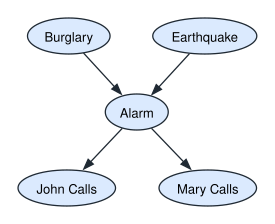

# Bayesian Networks 2: Working Out Probabilities

In this lesson we use a Bayesian network to calculate probabilities, by multiplying the right numbers from its tables and adding up the cases we don't know.

## Before you start
<!-- bite: 814f7c9a-df8c-4e27-995a-153f722a9a94 -->

Read [[machine-learning/03-classical-ml/12-bayesian-networks-1|Bayesian Networks 1]] first, so CPTs and P(A|B) are familiar.

After this lesson you will be able to:

- calculate a joint probability by multiplying each node's probability given its parents;
- calculate a single probability like P(J) by summing out the unknown variables;
- explain conditional independence and the main ways to do inference.

## The burglary alarm network
<!-- bite: 80e10b79-3dae-437c-9f32-55deba0ec8a7 -->

Now we use the network and Bayes theorem on an example. The network has two causes (Burglary and Earthquake) that can set off an Alarm. When the Alarm sounds, John and Mary may call.

The arcs are: Burglary → Alarm, Earthquake → Alarm, Alarm → John Calls and Alarm → Mary Calls.

As a picture:

## The burglary network's tables
<!-- bite: 158a12ce-e48f-4062-a936-7bc9edd3bd6a -->

Each node has a table of probabilities. Alarm depends on Burglary and Earthquake; John and Mary depend on Alarm.

| P(B) | P(E) |
| --- | --- |
| 0.001 | 0.002 |

| B | E | P(A\|B,E) |
| --- | --- | --- |
| T | T | 0.95 |
| T | F | 0.94 |
| F | T | 0.29 |
| F | F | 0.001 |

| A | P(J\|A) | P(M\|A) |
| --- | --- | --- |
| T | 0.90 | 0.70 |
| F | 0.05 | 0.01 |

## Example 1
<!-- bite: 7de67f7b-6eb8-4edf-8b8e-2d9674958fc6 -->

**What is the probability that the alarm has sounded but neither a burglary nor an earthquake has occurred, and both John and Mary call?**

$$
\begin{aligned}P(J \cap M \cap A \cap \neg B \cap \neg E) &= P(J \mid A) \times P(M \mid A) \times P(A \mid \neg B, \neg E) \times P(\neg B) \times P(\neg E) \\ &= 0.90 \times 0.70 \times 0.001 \times (1 - 0.001) \times (1 - 0.002) \\ &= 0.90 \times 0.70 \times 0.001 \times 0.999 \times 0.998 \\ &= 0.000628\end{aligned}
$$

## Example 2
<!-- bite: cc69bba7-a376-4b3a-8028-e5b765e1189b -->

**What is the probability that John calls?**

John can call when the alarm sounded (A) or when it did not (¬A), so we add the two cases:

$$
P(J) = P(J \mid A)\,P(A) + P(J \mid \neg A)\,P(\neg A)
$$

**Case 1: the alarm sounded.** P(A) is found by adding up every way the alarm can sound (burglary and/or earthquake):

$$
\begin{aligned}P(J \mid A)\,P(A) &= 0.90 \times [(0.95 \times 0.001 \times 0.002) + (0.29 \times 0.999 \times 0.002) + (0.94 \times 0.001 \times 0.998) + (0.001 \times 0.999 \times 0.998)] \\ &= 0.90 \times 0.00251644 \\ &= 0.00226\end{aligned}
$$

## Example 2, case 2: the alarm did not sound
<!-- bite: 38421364-68e3-4975-b09a-497b37839628 -->

Now the second case from Example 2. John can still call when the alarm is silent.

$$
\begin{aligned}P(J \mid \neg A)\,P(\neg A) &= 0.05 \times [(0.05 \times 0.001 \times 0.002) + (0.71 \times 0.999 \times 0.002) + (0.06 \times 0.001 \times 0.998) + (0.999 \times 0.999 \times 0.998)] \\ &= 0.05 \times 0.99748 \\ &= 0.04987\end{aligned}
$$

Add them:

$$
P(J) = 0.00226 + 0.04987 = 0.05213
$$

## Conditional Independence
<!-- bite: 96554ed4-7bee-4243-91d4-c031159707f2 -->

The fundamental property of Bayesian networks is that they encode conditional independence relationships between variables. This means that each node is conditionally independent of its non-descendants given its parents. This property significantly reduces the complexity of the network by breaking down the joint probability distribution into simpler, local distributions.

## Joint Probability Distribution
<!-- bite: 1f782451-5462-45ce-8120-99c5e323edc4 -->

A Bayesian network defines a joint probability distribution over its variables. The joint probability of a set of variables can be expressed as the product of the conditional probabilities of each variable given its parents:

$$
P(X_1, X_2, \ldots, X_n) = \prod_{i=1}^{n} P(X_i \mid Parents(X_i))
$$

This factorization is what allows Bayesian networks to efficiently represent the probabilistic relationships in a system.

For the Cloudy, Sprinkler, Rain, WetGrass network from earlier, the full joint probability distribution is:

$$
P(C, S, R, W) = P(C)\,P(S|C)\,P(R|C)\,P(W|S,R)
$$

To find P(W), we sum over all the other variables. We can pull each sum inside, step by step:

$$
P(W) = \sum_{C}\sum_{S}\sum_{R} P(C,S,R,W) = \sum_{C} P(C) \sum_{S} P(S|C) \sum_{R} P(R|C)\,P(W|S,R)
$$

## Inference in Bayesian Networks
<!-- bite: ba9c888f-6185-482b-a8d7-a0df1a42d7d1 -->

Inference in Bayesian networks involves computing the probability distribution of a subset of variables given known values for other variables. This can be achieved through various methods:

- **Exact inference:** Algorithms like Variable Elimination and Junction Tree Algorithm.
- **Approximate inference:** Techniques like Monte Carlo methods and Loopy Belief Propagation.

These inference methods are crucial for querying the network and making predictions based on observed data.

## Summing Out Variables (Marginalization)
<!-- bite: 2385c9a2-6f1a-495a-88d4-8bbdae98113a -->

The sums we used above all come from the same idea:

$$
P(X) = \sum_{Y} P(X, Y)
$$

$$
P(A) = P(A \mid B)\,P(B) + P(A \mid \neg B)\,P(\neg B) = \sum_{B} P(A, B)
$$

$$
P(B) = P(B \mid A)\,P(A) + P(B \mid \neg A)\,P(\neg A) = \sum_{A} P(A, B)
$$

With more than one variable to sum out, we sum over each one:

$$
P(X) = \sum_{y} \sum_{z} P(X, y, z)
$$

## Learning Bayesian Networks
<!-- bite: 7d559e5b-4653-4335-88f8-f97d7504dd5b -->

Learning a Bayesian network involves two main tasks:

- **Structure learning:** Determining the network structure, i.e. the DAG
- **Parameter learning:** Estimating the conditional probability distributions

## Applications of Bayesian Networks (Forecasting)
<!-- bite: 14bbac8c-d42d-4cae-8cf3-d308b0e99b94 -->

Bayesian networks are used in various applications, including:

- **Medical diagnosis:** where they model the probabilistic relationships between diseases and symptoms
- **Risk assessment:** for evaluating the likelihood of different risk factors leading to an adverse event
- **Decision support systems:** aiding in making informed decisions under uncertainty

## Check your understanding
<!-- bite: 3a413d86-4568-493b-a5b9-2bfff720649d -->

Try each one before you open the answer.

1. <!-- q: open id="cf33bd11" -->
   Using the alarm network, write the product for P(J ∩ M ∩ A ∩ B ∩ E): the alarm sounds, there is a burglary and an earthquake, and both call. (Just set it up.)

   

Answer

   P(J|A) × P(M|A) × P(A|B,E) × P(B) × P(E) = 0.90 × 0.70 × 0.95 × 0.001 × 0.002.

   

2. <!-- q: exact id="bf56f531" answer="0.999" tolerance="0.0001" -->
   P(B) = 0.001. What is P(¬B), the probability of no burglary?

   

Answer

   0.999. P(¬B) = 1 − P(B) = 1 − 0.001.

   

3. <!-- q: open id="3c44a691" -->
   What does "summing out" (marginalization) a variable mean?

   

Answer

   To get the probability of X alone, we add up the joint probability over every value of the other variable: P(X) = Σ_Y P(X, Y).

   

4. <!-- q: gap id="6a06ec97" answers="structure;parameter" -->
   Fill in the gaps. The two tasks in learning a Bayesian network are ___ learning (finding the DAG) and ___ learning (estimating the conditional probability tables).

   

Answer

   Structure learning (finding the DAG) and parameter learning (estimating the conditional probability tables).

   

5. <!-- q: mcq id="a372abf1" -->
   Which of these are exact inference methods? Choose all that apply.

   - [x] Variable Elimination
   - [x] Junction Tree Algorithm
   - [ ] Monte Carlo methods
   - [ ] Loopy Belief Propagation

   

Answer

   Variable Elimination and the Junction Tree Algorithm. Monte Carlo and Loopy Belief Propagation are approximate.

   

## Check your understanding: worked problems
<!-- bite: c98bc9e1-71e4-4b6c-93f8-b000ef5cda5f -->

Work each one out on paper first, then type your answer.

1. <!-- q: exact id="b82d7872" answer="0.05" accept="1/20" -->
   In the alarm network, what is P(¬A | B, E), the chance the alarm stays silent during a burglary and an earthquake?

   

Answer

   0.05. 1 − P(A | B, E) = 1 − 0.95.

   

2. <!-- q: exact id="6a1a37ba" answer="0.0006979014" sigfigs="2" -->
   What is P(M ∩ A ∩ ¬B ∩ ¬E): the alarm sounds with no burglary and no earthquake, and Mary calls?

   

Answer

   About 0.00070. P(M | A) × P(A | ¬B, ¬E) × P(¬B) × P(¬E) = 0.70 × 0.001 × 0.999 × 0.998 ≈ 0.000698.

   

3. <!-- q: exact id="1a7386f6" answer="0.0117363436" sigfigs="2" -->
   P(A) = 0.00251644. What is P(M), the probability Mary calls? Add the alarm and no-alarm cases.

   

Answer

   About 0.0117. P(M | A) P(A) + P(M | ¬A) P(¬A) = 0.70 × 0.00251644 + 0.01 × 0.99748356 ≈ 0.00176 + 0.00997 = 0.01174.

   

## Before moving on
<!-- bite: 316ae2c8-ef45-4b1a-bff5-004a6962e500 -->

The joint probability of a Bayesian network is the product of each variable's probability given its parents. To find one variable's probability, we sum out the others.

**Next:** [[machine-learning/03-classical-ml/14-linear-models-and-regression|Linear Models and Regression]]. Next we leave probability for the simplest kind of model: a weighted sum of the features.

## About this lesson
<!-- bite: 9bbbec24-ccaa-4ef8-9e17-1000e67dd9ad -->

**Level:** Intermediate. **Covers:** the burglary alarm worked examples, conditional independence, the joint probability distribution, inference, marginalization, learning and applications. Part 2 of 2 on Bayesian networks. **Source:** SSG 535 (Introduction to Machine Learning) class notes, 2025/2026 first semester. The wording is kept from the notes; only headings, links and the checks were added.
