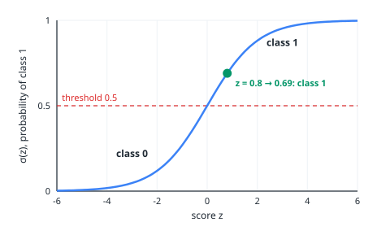

# Linear Models and Regression

A linear model predicts from a weighted sum of the features.

## Before you start
<!-- bite: 3c3bad11-c551-4a07-bc44-c502e4a1d0bd -->

You should know what regression and classification are ([[machine-learning/01-foundations-of-ml/01-what-is-ml-and-types|What ML Is]]) and what MSE measures ([[machine-learning/04-model-evaluation/03-evaluation-metrics-3|Evaluation Metrics 3]] — or come back to it).

After this lesson you will be able to:

- make a prediction from a linear regression model's weights;
- turn a logistic regression score into a probability and a class;
- say what a linear classifier can't do, and what regularization is for.

## What a linear model is
<!-- bite: d1a46677-fff4-4c01-8fe7-93c43a63ff6c -->

A linear model makes its prediction from a weighted sum of the features. It is the simplest kind of model, and it is the starting point for the Kernel Machines section that follows, which begins by saying that simple linear models fail when the data cannot be separated by a straight line.

Next: linear regression, then logistic regression for classes.

## Linear regression
<!-- bite: 8a3a5e7b-5b63-4ba5-a4be-f94c524bf362 -->

Linear regression predicts a number. For each feature it learns a weight, and the prediction is the weighted sum plus a starting value w₀:

$$
\hat{y} = w_0 + w_1 x_1 + w_2 x_2 + \cdots + w_n x_n
$$

The weights are chosen so that the total squared error on the training data is as small as possible (the least squares method). This is the same squared error we used in MSE (see [[machine-learning/04-model-evaluation/03-evaluation-metrics-3|regression metrics]]):

$$
\min \sum_{i=1}^{N} (y_i - \hat{y}_i)^2
$$

Example: suppose the model learned w₀ = 10 and w₁ = 3, and x₁ = 4:

$$
\hat{y} = 10 + 3 \times 4 = 22
$$

## Logistic regression and linear classifiers
<!-- bite: adebfcfd-0d2e-4a63-96cb-e3d42ac503b7 -->

Despite its name, logistic regression is a classification method. It first works out a score z from the features, then squeezes that score into a probability between 0 and 1 with the sigmoid function:

$$
z = w_1 x_1 + w_2 x_2 + \cdots + w_n x_n + b \qquad \sigma(z) = \frac{1}{1 + e^{-z}}
$$

If the probability is 0.5 or more, we predict class 1. Otherwise we predict class 0. Example: if z = 0.8,

$$
\sigma(0.8) = \frac{1}{1 + e^{-0.8}} = \frac{1}{1 + 0.4493} = 0.690
$$

which is above 0.5, so we predict class 1.

The boundary between the two classes is where z = 0, and that is a straight line (or a flat plane when there are more features). Any method that separates classes with a straight boundary like this is called a **linear classifier**. A linear SVM is another example.

## Seeing the sigmoid
<!-- bite: c83f0da3-3fd0-4205-8873-6d52a4388623 -->

The sigmoid takes any score z and squeezes it into a probability between 0 and 1. Every z above 0 lands above the 0.5 line, so it is class 1; every z below 0 is class 0. The green dot is the example above, z = 0.8 giving 0.69.



## Strengths and weaknesses
<!-- bite: 14a03496-0221-41a8-8bfa-f4ec5cc1ce6e -->

- **Strengths:** very fast to train and to predict, works on large datasets, and is easy to explain, because each weight tells us how much a feature pushes the result up or down.
- **Weaknesses:** it can only draw straight boundaries. If the classes are tangled together, a linear model underfits (see [[machine-learning/04-model-evaluation/04-overfitting-and-regularization|overfitting]]). Kernel machines fix this, and they come next.

```python
from sklearn.linear_model import LinearRegression, LogisticRegression

reg = LinearRegression().fit(X_train, y_train)   # predicts a number
clf = LogisticRegression().fit(X_train, y_train) # predicts a class
print(clf.score(X_test, y_test))
```

## Polynomial regression — curved relationships
<!-- bite: bdb044f9-8221-4080-874f-d899ddac2a84 -->

Still linear *in the weights*, but you add powers of features (`x², x³`) so the model can fit curves. Powerful but the classic overfitting trap: a high enough degree fits the training points perfectly and generalizes terribly ([[machine-learning/04-model-evaluation/04-overfitting-and-regularization|overfitting]]). Degree is a hyperparameter to tune, not maximize.

## Regularization — the cure for overfitting
<!-- bite: 01370fe4-0bb5-40c5-bba1-805e3f71c58b -->

The single most important idea attached to linear models: add a penalty on large weights to the loss, discouraging the model from fitting noise. Three flavors:

| Method | Penalty | Effect |
|---|---|---|
| **Ridge (L2)** | sum of squared weights | shrinks all weights toward zero, none exactly zero — handles correlated features well |
| **Lasso (L1)** | sum of absolute weights | drives some weights to *exactly* zero → automatic **feature selection** |
| **Elastic Net** | mix of L1 + L2 | best of both; the pragmatic default when unsure |

```python
from sklearn.linear_model import Ridge, Lasso
Ridge(alpha=1.0).fit(X_train, y_train)   # alpha = regularization strength, a key hyperparameter
```

Regularization is the concrete mechanism behind the bias-variance tradeoff ([[machine-learning/04-model-evaluation/04-overfitting-and-regularization|overfitting & regularization]]): more penalty = simpler model = more bias, less variance. `alpha` is tuned via [[machine-learning/04-model-evaluation/05-validation-and-tuning|cross-validation]]. The same L1/L2 idea reappears in deep learning as weight decay.

## When regression is the right tool
<!-- bite: 9cbc75d4-b30f-4f95-853c-08e95ff64043 -->

For **structured/tabular data**, a regularized linear or logistic model is often competitive with far fancier methods, trains instantly, and is interpretable — a real advantage when you need to *explain* a decision ([[machine-learning/09-building-and-fine-tuning/04-explainable-ai|explainable AI]]). Reach past it to [[machine-learning/03-classical-ml/10-decision-trees-6|trees/ensembles]] when relationships are strongly non-linear, or to [[machine-learning/05-deep-learning/index|deep learning]] for unstructured data (text/images).

## Check your understanding
<!-- bite: e9a42d21-d5ff-4c74-a6ec-89d48b17051b -->

Try each one before you open the answer.

1. <!-- q: exact id="02c92949" answer="7" accept="seven" -->
   A model learned w₀ = 5, w₁ = 2 and w₂ = −1. Predict ŷ for x₁ = 3 and x₂ = 4.

   <details><summary>Answer</summary>

   ŷ = 5 + 2 × 3 + (−1) × 4 = 5 + 6 − 4 = 7.

   </details>

2. <!-- q: mcq id="785b2af3" -->
   Logistic regression gives z = −1. Is the prediction class 0 or class 1?

   - [x] Class 0
   - [ ] Class 1

   <details><summary>Answer</summary>

   σ(−1) = 1 / (1 + e¹) ≈ 0.269, which is below 0.5, so class 0. (Quick check: any z below 0 gives class 0.)

   </details>

3. <!-- q: mcq id="4d2c6ae0" -->
   You want regularization that drives some weights to exactly zero, so it picks features for you. Which one?

   - [ ] Ridge (L2)
   - [x] Lasso (L1)

   <details><summary>Answer</summary>

   Lasso (L1). Ridge shrinks every weight toward zero, but none become exactly zero. Elastic Net mixes the two.

   </details>

4. <!-- q: gap id="cf97a960" answers="classification|classifying" -->
   Fill in the gap. Despite its name, logistic regression is a ___ method.

   <details><summary>Answer</summary>

   Classification. It turns a score into a probability with the sigmoid, then predicts class 1 if the probability is 0.5 or more.

   </details>

5. <!-- q: open id="0d6e2d5a" -->
   Why does a linear model underfit when the classes are tangled together?

   <details><summary>Answer</summary>

   It can only draw straight boundaries (z = 0 is a straight line or flat plane).

   </details>

## Check your understanding: worked problems
<!-- bite: f0ee0315-c5d0-4f4a-9ec5-3cb0486816f5 -->

Work each one out on paper first, then type your answer.

1. <!-- q: exact id="f563b627" answer="9" -->
   w₀ = 1, w₁ = 0.5 and w₂ = 2. Predict ŷ for x₁ = 4 and x₂ = 3.

   <details><summary>Answer</summary>

   9. 1 + 0.5 × 4 + 2 × 3 = 1 + 2 + 6 = 9.

   </details>

2. <!-- q: exact id="1c6524e3" answer="0.5" accept="1/2" -->
   What is σ(0), the sigmoid of zero?

   <details><summary>Answer</summary>

   0.5. 1 ÷ (1 + e⁰) = 1/2. z = 0 is exactly the decision boundary.

   </details>

3. <!-- q: exact id="2965f416" answer="0.880797077978" sigfigs="2" -->
   Logistic regression gives z = 2. What is the probability of class 1?

   <details><summary>Answer</summary>

   About 0.88. σ(2) = 1 ÷ (1 + e⁻²) = 1 ÷ 1.1353 ≈ 0.881, so it predicts class 1.

   </details>

4. <!-- q: sketch id="f3d75f5e" -->
   Sketch the sigmoid σ(z) for z from −6 to 6. Mark σ(0), the 0.5 threshold, and which side is class 1.

   <details><summary>Answer</summary>

   

   What to check:
   - An S shape that never goes below 0 or above 1.
   - It passes through (0, 0.5).
   - Positive z is above 0.5, which is class 1; negative z is class 0.
   - It is almost flat beyond about ±4.

   </details>

## Before moving on
<!-- bite: e31518cb-5fa9-483d-ae49-64bd28c57615 -->

A linear model predicts from a weighted sum of the features. Linear regression gives a number, chosen by least squares. Logistic regression squeezes the sum into a probability with the sigmoid. Both can only draw straight boundaries.

**Next:** [[machine-learning/03-classical-ml/15-kernel-machines|Kernel Machines]]. Kernel machines fix the straight-line problem.

## About this lesson
<!-- bite: 6ca82c5d-554a-4fe9-89fb-bfbc202f9938 -->

**Level:** Intermediate. **Covers:** linear regression, least squares, logistic regression and the sigmoid, linear classifiers, polynomial regression and regularization. The polynomial and regularization parts come from the roadmap.sh machine-learning roadmap. **Source:** SSG 535 (Introduction to Machine Learning) class notes, 2025/2026 first semester. The wording is kept from the notes; only headings, links and the checks were added.
