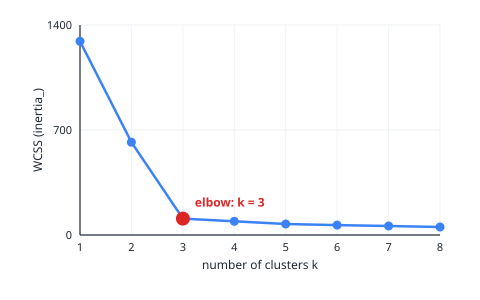
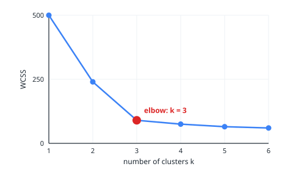

# Clustering 2: Choosing k and Checking Cluster Quality

Clustering has no right answers to check against, so we need tools to choose k and judge the clusters.

## Before you start
<!-- bite: f609ed30-b19a-4f04-827c-9313b8351dfc -->

Read [[machine-learning/03-classical-ml/17-clustering-1|Clustering 1]] first.

After this lesson you will be able to:

- choose k with the elbow method;
- calculate the silhouette value of a point and read the silhouette score;
- name other ways to check that clusters are real and useful.

## What we need to check
<!-- bite: 10c3d033-4f30-4b24-afca-25b2f3bf4a10 -->

K-Means needs us to choose k (the number of clusters) before we start, and clustering has no correct answers to compare with, because the data has no labels. So we use two common tools.

Next: the elbow method for choosing k, then the silhouette score for judging the clusters.

## The elbow method (choosing k)
<!-- bite: 6ae356cf-f605-48ca-9c9a-fe0c33a9bab2 -->

 Run K-Means for k = 1, 2, 3, and so on. For each k, calculate the total squared distance from every point to the centre of its own cluster. This is called WCSS (within-cluster sum of squares), and scikit-learn gives it as `inertia_`:

$$
\text{WCSS} = \sum_{j=1}^{k} \sum_{x \in C_j} \lVert x - \mu_j \rVert^2
$$

Here Cⱼ is cluster j and μⱼ is its centre. WCSS always goes down as k goes up (with k equal to the number of points it would be 0), so we do not pick the smallest value. We plot WCSS against k and look for the "elbow", the point where the drop suddenly becomes small. That k is a good choice.

```python
from sklearn.cluster import KMeans

for k in range(1, 11):
    km = KMeans(n_clusters=k, n_init=10, random_state=0).fit(X)
    print(k, km.inertia_)
```

## Seeing the elbow
<!-- bite: ab3a1c8c-4a69-4ca2-a3bf-09ce4253ab57 -->

This plot comes from running K-Means on 90 points that form three groups. WCSS falls steeply from k = 1 to k = 3, then hardly moves. That bend is the elbow, and it picks k = 3, matching the three groups.



## The silhouette score (checking quality)
<!-- bite: 56863b34-2fc6-4ff4-99df-8904cb279118 -->

 For each point i, we work out two numbers. a(i) is the average distance from i to the other points in its own cluster. b(i) is the average distance from i to the points in the nearest other cluster. Then:

$$
s(i) = \frac{b(i) - a(i)}{\max\big(a(i),\ b(i)\big)}
$$

The value is always between −1 and 1. Close to 1 means the point sits well inside its own cluster. Close to 0 means it is on the border between two clusters. Negative means it may be in the wrong cluster. The average of s(i) over all points is the silhouette score of the whole clustering, and a higher score is better.

## Silhouette score worked by hand
<!-- bite: bdce401e-41c4-4953-9f85-08f0c5bcab1b -->

Two example points, one in the right cluster and one probably in the wrong one.

Example: a point with a(i) = 2 and b(i) = 5:

$$
s(i) = \frac{5 - 2}{\max(2,\ 5)} = \frac{3}{5} = 0.6
$$

A point with a(i) = 4 and b(i) = 3 is closer to another cluster than to its own:

$$
s(i) = \frac{3 - 4}{\max(4,\ 3)} = \frac{-1}{4} = -0.25
$$

```python
from sklearn.metrics import silhouette_score

km = KMeans(n_clusters=3, n_init=10, random_state=0).fit(X)
print(silhouette_score(X, km.labels_))
```

## Other checks
<!-- bite: 66bfd80e-2027-41d4-bd41-23beeda910f8 -->

 run the clustering again with different starting centres or a different sample and see if the groups stay the same (stability). With hierarchical clustering, read the number of clusters from the dendrogram. Finally, look at the average values of each group and ask whether the business can actually describe and use it.

## Check your understanding
<!-- bite: c7c0f7c0-b223-40a9-bac1-7fe9c5edc32f -->

Try each one before you open the answer.

1. <!-- q: open id="9881f110" -->
   Why don't we just pick the k with the smallest WCSS?

   <details><summary>Answer</summary>

   WCSS always goes down as k goes up (it is 0 when every point is its own cluster). We look for the elbow, where the drop suddenly becomes small.

   </details>

2. <!-- q: exact id="161eb553" answer="0.5" accept="1/2" tolerance="0.001" -->
   A point has a(i) = 3 and b(i) = 6. What is its silhouette value s(i)?

   <details><summary>Answer</summary>

   s(i) = (6 − 3) / max(3, 6) = 3/6 = 0.5. It is fairly well inside its own cluster.

   </details>

3. <!-- q: mcq id="875781e0" -->
   A point's silhouette value is negative. What does that suggest?

   - [ ] It sits well inside its own cluster
   - [ ] It is on the border between two clusters
   - [x] It may be in the wrong cluster

   <details><summary>Answer</summary>

   It may be in the wrong cluster: it is closer, on average, to another cluster than to its own. Close to 1 is well placed and close to 0 is on a border.

   </details>

4. <!-- q: gap id="4953fd91" answers="inertia_|inertia" -->
   Fill in the gap. In scikit-learn, a fitted KMeans model gives its WCSS as `km.___`.

   <details><summary>Answer</summary>

   `inertia_`. Print it for k = 1 to 10 and look for the elbow.

   </details>

5. <!-- q: mcq id="5bee2caf" -->
   Which of these are ways to check that clusters are real and useful? Choose all that apply.

   - [x] Rerun with different starting centres and see if the groups stay the same
   - [x] Look at each group's average values and ask if the business can use them
   - [x] Read the number of clusters from a dendrogram (hierarchical clustering)
   - [ ] Compare the clusters with the true labels in the training data

   <details><summary>Answer</summary>

   The first three. Clustering data has no labels, which is why we need these other checks.

   </details>

## Check your understanding: worked problems
<!-- bite: 108eba1d-0d0b-4fc7-9e43-5a9ed3f729c5 -->

Work each one out on paper first, then type your answer.

1. <!-- q: exact id="0d02cf70" answer="0.75" accept="3/4" -->
   A point has a(i) = 1 and b(i) = 4. What is s(i)?

   <details><summary>Answer</summary>

   0.75. (4 − 1) ÷ max(1, 4) = 3/4. Well inside its cluster.

   </details>

2. <!-- q: exact id="3827413b" answer="0" accept="zero" -->
   A point has a(i) = 5 and b(i) = 5. What is s(i)?

   <details><summary>Answer</summary>

   0. It is equally close to its own cluster and the nearest other one: on the border.

   </details>

3. <!-- q: exact id="113d2753" answer="10" -->
   On a number line, cluster 1 is {1, 3} with centre 2, and cluster 2 is {8, 10, 12} with centre 10. What is the WCSS?

   <details><summary>Answer</summary>

   10. Cluster 1: 1 + 1 = 2. Cluster 2: 4 + 0 + 4 = 8. Total 10.

   </details>

4. <!-- q: sketch id="f7293006" -->
   K-Means gives these WCSS values for k = 1 to 6: 500, 240, 90, 75, 65, 60. Sketch the elbow plot and mark the k you would choose.

   <details><summary>Answer</summary>

   

   What to check:
   - k on the horizontal axis, WCSS on the vertical, and the line always going down.
   - The big drops are 260 and 150; after k = 3 each drop is 15 or less.
   - The elbow, and your choice, is k = 3.

   </details>

## Practice — independent task
<!-- bite: 065252b7-261a-4cc6-845c-d84067a2bc75 -->

Past question 5(a) in the [[machine-learning/ssg-535-question-bank|SSG 535 question bank]] is a telecom customer segmentation problem. Design the clustering approach: preprocessing, algorithm choice and how to check cluster quality. **Done when** your answer scales the features, justifies K-Means or hierarchical clustering, and uses the elbow method and the silhouette score.

## Before moving on
<!-- bite: fe48f8c6-bf24-47fc-af80-4b8a5ff36300 -->

Choose k by plotting WCSS against k and finding the elbow. Check quality with the silhouette score (closer to 1 is better), stability across runs, and whether the business can use the groups.

**Next:** [[machine-learning/03-classical-ml/19-dimensionality-reduction-pca|Dimensionality Reduction with PCA]]. Clustering finds groups of rows. PCA is the other big unsupervised tool: it shrinks the columns.

## About this lesson
<!-- bite: 414864d0-71fa-4076-a566-bddec1acfb6e -->

**Level:** Intermediate. **Covers:** the elbow method, WCSS, the silhouette score and other cluster checks. Part 2 of 2 on clustering. **Source:** SSG 535 (Introduction to Machine Learning) class notes, 2025/2026 first semester. The wording is kept from the notes; only headings, links and the checks were added.
