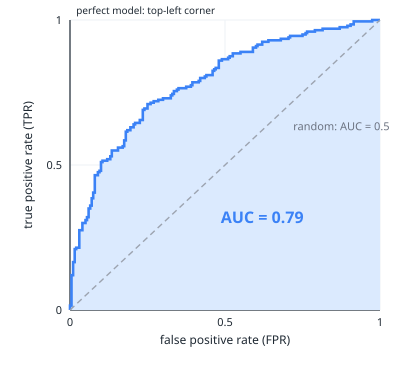

# Evaluation Metrics 2: Log Loss, ROC and AUC

Log loss and AUC judge a model by its probabilities, not just its yes or no.

## Before you start
<!-- bite: 0f79b437-1c6c-4bd6-a489-107d060389ae -->

You should be able to build a confusion matrix and calculate recall ([[machine-learning/04-model-evaluation/01-evaluation-metrics-1|Evaluation Metrics 1]]).

After this lesson you will be able to:

- calculate log loss for a few predictions;
- calculate TPR, TNR, FPR and FNR from a confusion matrix;
- read an ROC curve and an AUC value.

## What log loss and AUC are
<!-- bite: 3c00127a-20f6-4c39-bc62-ffc39532f878 -->

Log loss measures the uncertainty of the model's predictions, and AUC measures how well the model separates the positive class from the negative class. Both look at the model's probabilities, not just its final yes or no.

Next: log loss, then AUC and the ROC curve.

## Logarithmic Loss (Log Loss)
<!-- bite: 8c375efa-d567-47c9-b50c-17bb748ebd4c -->

Log loss measures the uncertainty of the model's predictions. It is calculated by penalizing the model for assigning low probabilities to the correct classes. This metric is used in multi-class classification and is helpful when we want to assess a model's confidence in its predictions. If there are N samples belonging to the M class, then we calculate the Log Loss this way:

$$
LogLoss = -\frac{1}{N} \sum_{i=1}^{N} \sum_{j=1}^{M} y_{ij} \cdot \log(p_{ij})
$$

where:

- **y\_ij** = Actual class (0 or 1) for sample i and class j
- **p\_ij** = Predicted probability for sample i and class j

The goal is to minimize Log Loss, as a lower Log Loss shows higher prediction accuracy.

## Area Under Curve (AUC) and ROC Curve
<!-- bite: 08e45968-1f6b-4ec7-a1e5-063339649fab -->

It is useful for binary classification tasks. The AUC value represents the probability that the model will rank a randomly chosen positive example higher than a randomly chosen negative example. AUC ranges from 0 to 1 with a higher value showing better model performance.

## The four rates behind the ROC curve
<!-- bite: 2b6e64a6-b1e0-4ea5-988a-076116c798d1 -->

The ROC curve is built from four rates, all made from the four confusion-matrix counts:

| Rate | Formula | What it measures |
| --- | --- | --- |
| **True Positive Rate (TPR)**, also known as sensitivity or recall | TP / (TP + FN) | How many actual positive instances were correctly identified by the model |
| **True Negative Rate (TNR)**, also called specificity | TN / (TN + FP) | How many actual negative instances were correctly identified by the model |
| **False Positive Rate (FPR)** | FP / (FP + TN) | How many actual negative instances were incorrectly classified as positive |
| **False Negative Rate (FNR)** | FN / (FN + TP) | How many actual positive instances were incorrectly classified as negative. It answers: out of all the actual positive cases, how many were misclassified as negative? |

where TP = True Positive (correctly predicted positive cases), FN = False Negative (actual positive cases incorrectly predicted as negative), TN = True Negative (correctly predicted negative cases), and FP = False Positive (actual negative cases incorrectly predicted as positive).

## The ROC curve and AUC values
<!-- bite: 18c41aef-9871-42a6-8c7c-f96d4622aa08 -->

**ROC Curve:** It is a graphical representation of the True Positive Rate (TPR) vs the False Positive Rate (FPR) at different classification thresholds. The curve helps us visualize the trade-offs between sensitivity (TPR) and specificity (1 − FPR) across various thresholds.

- **AUC = 1:** Perfect model (always correctly classifies positive and negative cases)
- **AUC = 0.5:** Model performs no better than random guessing
- **AUC < 0.5:** Model performs worse than random guessing (showing that the model is inverted)

AUC quantifies the overall ability of the model to distinguish between positive and negative classes.

## Seeing an ROC curve
<!-- bite: 9f162ab5-e74a-498f-b270-d94368f2356d -->

Each point on the curve is one threshold. Lowering the threshold moves up and to the right: more true positives, but more false positives too. The shaded area is the AUC; the dashed diagonal is random guessing.

## Why AUC and log loss don't depend on one threshold
<!-- bite: bd65ef23-5831-4fd0-8e09-1d86649e508e -->

Beyond the accuracy/precision/recall/F1 in [[machine-learning/04-model-evaluation/01-evaluation-metrics-1|evaluation metrics]], two threshold-independent measures:

- **ROC-AUC** — a classifier outputs a *score*; where you set the threshold trades false positives against false negatives. The ROC curve plots that tradeoff across all thresholds, and **AUC** (area under it) summarizes it: 1.0 is perfect, 0.5 is random. Great for comparing models independent of a specific threshold, and robust to class imbalance.
- **Log-loss** — penalizes *confident wrong* predictions heavily, rewarding well-**calibrated** probabilities (a model that says "90%" should be right ~90% of the time). The metric to watch when you care about the probability, not just the label. It's also what [[machine-learning/03-classical-ml/15-linear-models-and-regression|logistic regression]] optimizes.

## Check your understanding
<!-- bite: 1a113eb7-48d1-4e11-b2df-c3c7f26d9655 -->

Try each one before you open the answer.

1. <!-- q: gap id="259f0f90" answers="0.8|80%;0.1|10%" -->
   Fill in the gaps. TP = 40, FN = 10, FP = 5, TN = 45. The TPR is ___ and the FPR is ___.

   

Answer

   TPR = 40 / (40 + 10) = 0.8. FPR = 5 / (5 + 45) = 0.1.

   

2. <!-- q: mcq id="304b8994" -->
   A model has AUC = 0.5. What does that tell you?

   - [ ] It is a perfect model
   - [x] It performs no better than random guessing
   - [ ] It is inverted, worse than random

   

Answer

   It performs no better than random guessing. AUC = 1 is perfect, and below 0.5 is worse than random.

   

3. <!-- q: mcq id="7314857e" -->
   For one sample whose true class is 1, the model gave probability 0.9. For another, 0.1. Which one adds more to the log loss?

   - [ ] The 0.9 one
   - [x] The 0.1 one

   

Answer

   The 0.1 one: −log(0.1) ≈ 2.30 against −log(0.9) ≈ 0.105. Log loss punishes giving a low probability to the correct class.

   

4. <!-- q: gap id="1effd64c" answers="sensitivity|recall;specificity" -->
   Fill in the gaps. The true positive rate is also called ___. The true negative rate is also called ___.

   

Answer

   Sensitivity (or recall), then specificity.

   

5. <!-- q: open id="912da621" -->
   Why is AUC useful for comparing two models, even before you choose a threshold?

   

Answer

   The ROC curve plots TPR against FPR across every threshold, and AUC sums up the whole curve. So it measures how well the model separates the classes overall, not at one chosen threshold. It also holds up well when the classes are imbalanced.

   

## Check your understanding: worked problems
<!-- bite: 3b8b74d6-8804-4052-b339-42e323ec8f40 -->

Work each one out on paper first, then type your answer.

1. <!-- q: gap id="5e95e81b" answers="0.9;0.2" -->
   Fill in the gaps. TP = 40, FN = 10, FP = 5, TN = 45. The TNR (specificity) is ___ and the FNR is ___.

   

Answer

   TNR = 45 / (45 + 5) = 0.9. FNR = 10 / (10 + 40) = 0.2.

   

2. <!-- q: exact id="4375478f" answer="0.223143551314" sigfigs="2" -->
   One sample's true class is 1, and the model gave it probability 0.8. What is its log loss, −ln(0.8)?

   

Answer

   About 0.22. −ln(0.8) ≈ 0.223. A confident, correct prediction costs little.

   

3. <!-- q: exact id="12b7c498" answer="0.399253848109" sigfigs="2" -->
   Two samples, both truly class 1. The model gave them probabilities 0.9 and 0.5. What is the average log loss (natural log)?

   

Answer

   About 0.40. −ln(0.9) ≈ 0.105 and −ln(0.5) ≈ 0.693, and their average is about 0.399. The less confident answer costs far more.

   

## Practice — independent task
<!-- bite: 610429f5-f361-4352-8635-492aa457c17b -->

Practice question 2 in the [[machine-learning/ssg-535-question-bank|SSG 535 question bank]] sets a recall rate of at least 60% and an FPR of 20% or less on 10,000 instances. Work out the precision, recall and F1-score at those limits. **Done when** you have stated your assumption about how many positives there are.

## Before moving on
<!-- bite: 242dad15-5897-4099-b1f0-d12dcda7f378 -->

Log loss punishes low probabilities on the correct class. The ROC curve plots TPR against FPR at every threshold, and AUC sums it up: 1 is perfect, 0.5 is random guessing.

**Next:** [[machine-learning/04-model-evaluation/03-evaluation-metrics-3|Evaluation Metrics 3]]. Those metrics were for classification. For regression we use different ones, because the output is a number and not a class.

## About this lesson
<!-- bite: 10cae02a-0279-4eb3-9d06-a67e1c91069d -->

**Level:** Intermediate. **Covers:** log loss, TPR, TNR, FPR, FNR, the ROC curve and AUC. Part 2 of 3 on evaluation metrics. **Source:** SSG 535 (Introduction to Machine Learning) class notes, 2025/2026 first semester. The wording is kept from the notes; only headings, links and the checks were added.
