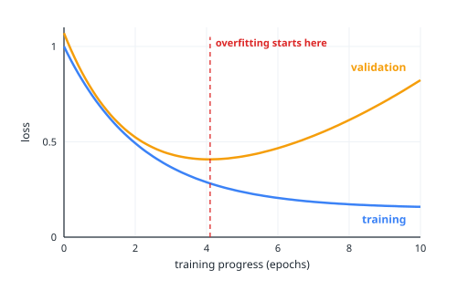

# Overfitting and Regularization

Overfitting is when a model learns the training data too closely to work on new data.

## Before you start
<!-- bite: 142122be-5703-4442-84df-22c95fedf900 -->

You should know why we keep a test set ([[machine-learning/02-working-with-data/03-train-val-test-splits|Train/Val/Test Splits]]).

After this lesson you will be able to:

- say what it means for a model to generalize;
- spot over-fitting and under-fitting from training and test accuracy;
- name ways to fix an over-fitting model.

## What overfitting is
<!-- bite: 4baeb17f-972f-4987-8043-636a9d673157 -->

Over-fitting occurs when you fit a model too closely to the particularities of the training set and obtain a model that works well on the training set but is not able to generalize to new data. Under-fitting is the opposite: the model is too simple to capture patterns.

Next: generalizing, overfitting and underfitting side by side.

## Generalizing, Overfitting and Underfitting
<!-- bite: 2715c3b9-6b06-443a-9307-904279c45f23 -->

After we train a supervised model, the real question is: does it work on data it has never seen? That is what these words are about.

If a model is able to make accurate predictions on unseen data, we say it is able to **generalize** from the training set to the test set.

- **Over-fitting** occurs when you fit a model too closely to the particularities of the training set and obtain a model that works well on the training set but is not able to generalize to new data.
- **Under-fitting** occurs when the model is too simple to capture patterns.

## Under-fitting vs over-fitting
<!-- bite: 22e02181-4cd7-453b-a91e-be4572b59739 -->

The two failures side by side, and how model complexity moves you between them.

|  | Under-fitting | Over-fitting |
| --- | --- | --- |
| Also called | High Bias | High variance |
| The model's prediction line | Does not cover all data points | Fits the training data perfectly, including noise and outliers |

**Trade-off of model complexity against training and test accuracy:** as the model gets more complex (going from under-fitting to over-fitting), the training accuracy keeps going up. The test (generalization) accuracy goes up at first, then starts to drop. The best model is at the top of the test accuracy curve.

> **Note:** Any intuition derived from datasets with few features (also called low dimensional datasets) might not hold in datasets with many features (high dimensional datasets).

## Recognizing it
<!-- bite: 115c9d4e-83af-4416-b2b3-d857aa4cb798 -->

The textbook signature: training loss keeps dropping while validation loss flattens out or starts rising.



That growing gap between training and validation performance (see [[03-train-val-test-splits|train-val-test-splits]] and [[machine-learning/04-model-evaluation/01-evaluation-metrics-1|evaluation-metrics]]) is overfitting in numeric form — the model is still improving at fitting training data, but that improvement has stopped transferring to unseen data.

## The opposite failure — underfitting
<!-- bite: c0810a5c-18f1-438c-849f-e2a37d5bb434 -->

A model that performs poorly on *both* training and validation data isn't overfitting — it's **underfitting**: too simple, or not trained long enough, to capture the real pattern in the data at all. The fix for underfitting (bigger model, more training, better features) is often the opposite of the fix for overfitting, so correctly diagnosing which one is happening matters before reaching for a fix.

## Regularization techniques
<!-- bite: 31d73974-3d2d-4b29-be20-51befd789a3a -->

**L2 regularization (weight decay)** — add a penalty to the loss proportional to the size of the model's weights, discouraging any single weight from growing very large. Large weights tend to make a model extremely sensitive to small input changes — exactly the kind of fragile, memorization-prone behavior overfitting produces.

```python
optimizer = torch.optim.Adam(model.parameters(), lr=0.001, weight_decay=1e-4)  # PyTorch's built-in L2 penalty
```

## Regularization: dropout and early stopping
<!-- bite: f3d1362b-82a6-4c38-b143-b7cbd232e33d -->

Two more regularization techniques, both used while training.

**Dropout** — during training, randomly zero out a fraction of a layer's neurons on each forward pass, forcing the network to not rely too heavily on any single neuron or narrow path through the network. Disabled automatically at inference time (this is part of why `model.eval()` matters, see [[machine-learning/05-deep-learning/02-training-loop-in-pytorch|training-loop-in-pytorch]]).

```python
nn.Dropout(p=0.5)   # zero out 50% of activations during training
```

**Early stopping** — track validation loss during training and stop (or restore the best-seen checkpoint) once it stops improving, rather than training for a fixed number of epochs regardless of what validation performance is doing. Directly targets the exact symptom shown in the loss-curve picture above.

## Regularization: more data, real or made-up
<!-- bite: 2e2d744a-a4d2-42d2-b72a-9778f6c2664d -->

The last two techniques work on the data instead of the model.

**Data augmentation** — artificially expand the effective size/diversity of the training set (rotating/cropping images, paraphrasing text) so the model sees more variation and has a harder time simply memorizing exact training examples (covered concretely for images in [[02-image-data-and-augmentation|image-data-and-augmentation]]).

**More data** — often the single most effective fix, when available: a model has a much harder time memorizing noise in a dataset large enough that noise doesn't repeat in exploitable patterns.

## The bias-variance tradeoff, briefly
<!-- bite: 9e117709-4c31-40ab-b4b2-c17c357a8d6f -->

Underfitting is "high bias" (the model's assumptions are too simple to capture the pattern); overfitting is "high variance" (the model is too sensitive to the specific noise in this particular training set). Model complexity, training time, and regularization strength all trade off between these two failure modes — pushing too hard against one risks sliding into the other, which is why regularization strength is itself a setting to tune, not something to maximize blindly.

## Gotchas
<!-- bite: 4f727539-5ec1-4bde-ae64-e06da21202a4 -->

- Adding regularization doesn't fix underfitting — if a model is already too simple or undertrained, more dropout or weight decay makes it worse, not better. Diagnose which failure mode is actually happening before choosing a fix.
- A model that looks great on the validation set after many rounds of tuning against that same validation set can still be subtly overfit *to the validation set* (see the gotcha in [[03-train-val-test-splits|train-val-test-splits]]) — the untouched test set is the real check.

## Check your understanding
<!-- bite: 1938ed4b-2b21-4831-b756-3a2135c9491e -->

Try each one before you open the answer.

1. <!-- q: mcq id="5e8b9072" -->
   Model A: 98% training accuracy, 60% test accuracy. Model B: 85% and 82%. Which is better?

   - [ ] Model A
   - [x] Model B

   <details><summary>Answer</summary>

   Model B. What matters is the test accuracy, the score on unseen data. Model A's big gap means it has memorized the training data (over-fitting).

   </details>

2. <!-- q: gap id="8f442e83" answers="bias;variance" -->
   Fill in the gaps. Under-fitting is also called high ___, and over-fitting is also called high ___.

   <details><summary>Answer</summary>

   Under-fitting is high bias. Over-fitting is high variance.

   </details>

3. <!-- q: mcq id="6a90c729" -->
   A model scores badly on both the training data and the validation data. Will adding dropout help?

   - [ ] Yes, dropout fixes any bad model
   - [x] No, this is under-fitting, and regularization makes it worse

   <details><summary>Answer</summary>

   No. Bad on both means under-fitting: the model is too simple or under-trained. The fix is a bigger model, more training or better features, the opposite of regularization.

   </details>

4. <!-- q: mcq id="162d78f0" -->
   Which of these fight over-fitting? Choose all that apply.

   - [x] L2 regularization (weight decay)
   - [x] Dropout
   - [x] Early stopping
   - [x] Data augmentation and more data
   - [ ] Training for many more epochs

   <details><summary>Answer</summary>

   The first four. Training longer past the point where validation loss bottoms out makes over-fitting worse.

   </details>

5. <!-- q: open id="f5c262e1" -->
   Describe what the training loss and validation loss curves look like once a model starts over-fitting.

   <details><summary>Answer</summary>

   Training loss keeps falling, but validation loss bottoms out and then starts rising. The growing gap between them means the model is still getting better at the training data, but that no longer carries over to unseen data.

   </details>

6. <!-- q: sketch id="8086ff85" -->
   Without looking back, sketch the training loss and validation loss of a model that starts to overfit. Label both curves and mark where overfitting starts.

   <details><summary>Answer</summary>

   

   What to check:
   - Both curves start high and fall at first.
   - Training loss keeps falling all the way.
   - Validation loss reaches a lowest point, then rises, and overfitting starts at that lowest point (where early stopping would stop).
   - The gap between the curves grows after that point.

   </details>

## Before moving on
<!-- bite: 61f0e24e-0d7a-482d-b19b-1d269d1898b3 -->

A model generalizes when it predicts unseen data accurately. As complexity grows, training accuracy keeps rising but test accuracy rises and then falls; the best model sits at the top of the test curve.

**Next:** [[machine-learning/04-model-evaluation/05-validation-and-tuning|Validation and Tuning]]. One train/test split can be lucky or unlucky. Cross-validation gives a steadier answer.

## Related
<!-- bite: c1767685-e99b-4ad9-b0e4-6e6dfdbdcb82 -->
- [[03-train-val-test-splits|train-val-test-splits]]
- [[machine-learning/04-model-evaluation/01-evaluation-metrics-1|evaluation-metrics]]
- [[machine-learning/05-deep-learning/02-training-loop-in-pytorch|training-loop-in-pytorch]]

## About this lesson
<!-- bite: 6e8a8e5d-f369-4f47-bdcf-4ab9811ccc0a -->

**Level:** Intermediate. **Covers:** generalizing, over-fitting and under-fitting, and regularization techniques. The regularization part comes from the roadmap.sh machine-learning roadmap. **Source:** SSG 535 (Introduction to Machine Learning) class notes, 2025/2026 first semester. The wording is kept from the notes; only headings, links and the checks were added.
