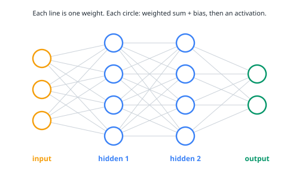
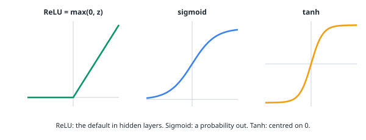

# Neural Network Fundamentals

A neural network is many small units, called neurons, connected in layers.

## What a neural network is
<!-- bite: 47b42c83-d88b-4769-892e-38f90b2962b2 -->

A neural network is a model made of many small units, called neurons, connected in layers, where each unit does a simple sum and passes the result on. Stacked together, these simple steps can learn very complex patterns. Neural networks are behind voice assistants, photo filters on your phone and chat apps like ChatGPT.

Next: one neuron on its own, the perceptron.

## The perceptron — one neuron
<!-- bite: 8d119349-dc14-4686-86cb-8448ed0c41d5 -->

The building block: a neuron takes inputs, multiplies each by a weight, sums them, adds a bias, and passes the result through an **activation function**:

```text
output = activation( w₁x₁ + w₂x₂ + … + b )
```

That weighted sum is a [[machine-learning/00-foundations/03-mathematics/01-linear-algebra/03-dot-product|dot product]] — the same operation everywhere in ML. A single perceptron is just a linear classifier (it can only draw a straight boundary); its famous limitation is that it can't learn XOR. The fix is stacking neurons into layers.

## The multi-layer perceptron (MLP)
<!-- bite: b5d9689d-f4c3-4e7f-8e92-7d9fea8583b3 -->

Stack neurons into **layers** — an input layer, one or more **hidden layers**, and an output layer — with every neuron in one layer connected to every neuron in the next. This is a **fully-connected** (dense) network, and with enough hidden units it's a _universal approximator_: it can represent essentially any function. "Deep" learning just means many layers, letting the network learn increasingly abstract features (early layers: edges/simple patterns; later layers: complex concepts).

## Seeing an MLP
<!-- bite: d632de8a-c5d6-4aeb-a4ed-61063ba9e6d5 -->

Three inputs, two hidden layers and two outputs. Every neuron connects to every neuron in the next layer, and every line is one weight to learn.



## Activation functions — where non-linearity comes from
<!-- bite: 69412ac7-5645-492c-a5ca-530804e3c1e8 -->

Without a non-linear activation between layers, stacking layers is pointless — a chain of linear operations collapses into a single linear one. Activations are what let networks learn non-linear patterns:

| Function               | Shape                                 | Use                                                                          |
| ---------------------- | ------------------------------------- | ---------------------------------------------------------------------------- |
| **ReLU** (`max(0, x)`) | 0 for negatives, linear for positives | the default hidden-layer activation — cheap, avoids vanishing gradients      |
| **Sigmoid**            | squashes to (0, 1)                    | binary output as a probability; avoid in hidden layers (vanishing gradients) |
| **Softmax**            | vector → probability distribution     | multi-class output layer                                                     |
| **Tanh**               | squashes to (−1, 1)                   | sometimes in RNNs                                                            |

ReLU's dominance in hidden layers is a big part of why deep networks became trainable — it doesn't saturate for positive values, so gradients flow.

## Seeing the activation functions
<!-- bite: 6f519304-6386-4ad2-94a9-ed23e309b897 -->

The three shapes side by side. ReLU is flat for negatives and a straight line for positives. Sigmoid and tanh are S-shaped, and flatten out at the ends, which is where gradients vanish.



## Forward propagation
<!-- bite: ee0d25b8-502f-4313-b218-b3cf81098296 -->

**Forward pass**: feed the input through the layers — each layer computes its weighted sums and activations — until the output layer produces a prediction. Then a **loss function** measures how wrong that prediction is versus the true answer:

| Loss              | For                                         |
| ----------------- | ------------------------------------------- |
| **Cross-entropy** | classification (pairs with softmax/sigmoid) |
| **MSE**           | regression                                  |

## Backpropagation — how it learns
<!-- bite: 29092880-8ff3-41b9-aa4b-8c47981ddb18 -->

The core algorithm of deep learning. After the forward pass computes the loss, **backpropagation** works _backward_ through the network computing the gradient of the loss with respect to every weight — how much each weight contributed to the error — by applying the [[machine-learning/00-foundations/03-mathematics/02-calculus/03-chain-rule|chain rule]] of calculus layer by layer. Then an **optimizer** (gradient descent and its variants — [[machine-learning/00-foundations/03-mathematics/04-optimization|optimization]]) nudges each weight in the direction that reduces the loss.

```text
forward pass → compute loss → backpropagate (chain rule → gradients) → optimizer updates weights → repeat
```

That loop, run over many batches for many epochs, _is_ training. Everything fancier — CNNs, transformers — is this same forward/backward/update loop with different layer types. Seeing it as real code is the whole point of the [[machine-learning/05-deep-learning/02-training-loop-in-pytorch|PyTorch training loop]] note.

## Key training concepts
<!-- bite: 5f3949cf-76f3-485a-93c4-614875ec025a -->

- **Epoch** — one full pass over the training data; **batch** — the subset processed before each weight update ([[machine-learning/00-foundations/03-mathematics/04-optimization|batches]]).
- **Learning rate** — how big each update step is; the single most important hyperparameter. Too high diverges, too low crawls.
- **Vanishing/exploding gradients** — in deep networks, gradients can shrink to nothing or blow up as they propagate back; ReLU, careful initialization, batch normalization, and residual connections are the fixes that made very deep networks trainable.
- **Regularization for nets** — dropout (randomly zeroing neurons during training) and weight decay (L2) fight [[machine-learning/04-model-evaluation/04-overfitting-and-regularization|overfitting]], the same battle as everywhere.

## When to reach for deep learning
<!-- bite: 1a5b3478-43bc-4a8a-be21-382a975c9b08 -->

Neural nets earn their cost on **unstructured data** — images ([[machine-learning/06-computer-vision/index|CNNs]]), text/sequences ([[machine-learning/07-sequence-models-and-nlp/index|transformers]]), audio — and huge datasets. On structured/tabular data, [[machine-learning/03-classical-ml/10-decision-trees-6|gradient boosting]] usually wins for less cost. Match the tool to the data shape.

## Check your understanding
<!-- bite: 82b4da7c-bf64-4774-9aca-4a62c6c58fcd -->

Try each one before you open the answer.

1. <!-- q: exact id="d6cbebd7" answer="5" accept="five" -->
   A neuron has weights w₁ = 2 and w₂ = 1, bias b = −1, and ReLU activation. The inputs are x₁ = 1 and x₂ = 4. What is its output?

   <details><summary>Answer</summary>

   5. The weighted sum is 2×1 + 1×4 − 1 = 5, and ReLU(5) = max(0, 5) = 5.

   </details>

2. <!-- q: mcq id="682b0796" -->
   Which activation goes on the output layer of a classifier with many classes?

   - [ ] ReLU
   - [ ] Sigmoid
   - [x] Softmax
   - [ ] Tanh

   <details><summary>Answer</summary>

   Softmax, which turns the outputs into a probability distribution. ReLU is the default for hidden layers, and sigmoid is for a single binary output.

   </details>

3. <!-- q: mcq id="e810ed38" -->
   What can a single perceptron not learn?

   - [ ] AND
   - [ ] OR
   - [x] XOR

   <details><summary>Answer</summary>

   XOR. A single perceptron is a linear classifier and can only draw a straight boundary, and XOR needs more than one. Stacking neurons into layers fixes it.

   </details>

4. <!-- q: gap id="4ee1c252" answers="cross-entropy|cross entropy;mse|mean squared error" -->
   Fill in the gaps. For classification, the usual loss is ___. For regression, it is ___.

   <details><summary>Answer</summary>

   Cross-entropy for classification (it pairs with softmax or sigmoid), and MSE for regression.

   </details>

5. <!-- q: open id="dc7d1da9" -->
   Why is it pointless to stack layers without a non-linear activation between them?

   <details><summary>Answer</summary>

   A chain of linear operations collapses into a single linear operation, so the extra layers add nothing. The non-linear activations are what let the network learn non-linear patterns.

   </details>

## Related
<!-- bite: bd074feb-df4c-4e1f-b0b7-a2057f84d4db -->

- [[machine-learning/05-deep-learning/02-training-loop-in-pytorch|Training Loop in PyTorch]] — this as runnable code
- [[machine-learning/00-foundations/03-mathematics/02-calculus/03-chain-rule|Chain Rule]] — the calculus backprop is built on
- [[machine-learning/00-foundations/03-mathematics/04-optimization|Optimization]] — the gradient descent that updates weights

## About this lesson
<!-- bite: fefb238d-c553-42b6-b689-9d9930d49ef6 -->

**Level:** reference. **Covers:** from the roadmap.sh `machine-learning` roadmap. The theory under the [[machine-learning/05-deep-learning/02-training-loop-in-pytorch|PyTorch training loop]] — what a network is and how it learns.
