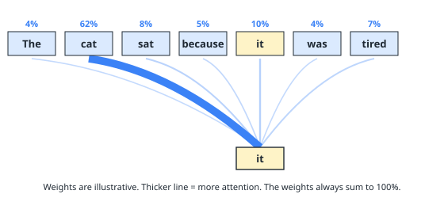

# Transformers & Attention

A transformer looks at a whole sentence at once and works out which words matter to each other.

## What a transformer is
<!-- bite: f8bb0e21-a95a-4ac7-9069-9259a6d7cb80 -->

A transformer is a kind of neural network that looks at a whole sentence at once and, for each word, works out which other words matter most to it. That step is called attention. Transformers are the design behind ChatGPT, Google Translate and most of the AI tools people use today.

Next: attention, the core idea.

## The core idea: attention
<!-- bite: d7c31ee8-7b9f-4c9b-8739-98caf5bb6e7e -->

The 2017 paper "Attention Is All You Need" replaced recurrence entirely with **self-attention**. Instead of carrying a hidden state step by step ([[machine-learning/07-sequence-models-and-nlp/01-rnns-lstms-grus|RNNs]]), a transformer looks at the **whole sequence at once** and, for each element, computes how much every *other* element should influence it.

Mechanically, each token is projected into three vectors — a **query**, a **key**, and a **value**. Attention scores how well a token's query matches every other token's key (via [[machine-learning/00-foundations/03-mathematics/01-linear-algebra/03-dot-product|dot products]]), normalizes those scores into weights (softmax), and produces a weighted blend of the values:

```text
attention(Q, K, V) = softmax( Q·Kᵀ / √d ) · V
```

That's the whole mechanism: **"for each token, gather information from the tokens most relevant to it."** It's what lets a model resolve "it" to the right noun, or connect a verb to a subject 40 words back — any two positions interact *directly*, no matter the distance.

## Seeing attention
<!-- bite: 4a0d43c1-a004-46b8-aa1a-9b32a455102d -->

While processing "it", the model spreads its attention over every word. Most of it goes to "cat", which is how it works out what "it" refers to. (The weights here are illustrative.)



## Multi-head attention
<!-- bite: 70b73111-49d5-4d5c-bb0b-fa955f5e0611 -->

One attention computation captures one kind of relationship. **Multi-head attention** runs several in parallel, each learning to attend to different aspects (syntax, coreference, topic), then combines them. More heads = more relationship types the model can track at once.

## The full transformer block
<!-- bite: 1c169d28-3f4a-4aa2-9176-a1234aa2b5f6 -->

Stack these pieces into a block, then stack many blocks:

- **Self-attention** — mix information across positions (above).
- **Feed-forward network** — an [[machine-learning/05-deep-learning/01-neural-network-fundamentals|MLP]] applied to each position, for per-token processing.
- **Residual connections + layer normalization** — let gradients flow through many layers, making very deep stacks trainable.
- **Positional encoding** — since attention has no inherent notion of order (it sees a *set*, not a sequence), position information is added to the inputs so the model knows word order.

## Why transformers won
<!-- bite: 87dbcaaa-23ff-4aed-9416-6c17fc449bf1 -->

- **Parallelism** — the whole sequence is processed at once, not step by step, so training uses GPUs fully (the [[machine-learning/07-sequence-models-and-nlp/01-rnns-lstms-grus|RNN bottleneck]]).
- **Long-range dependencies** — any two positions connect directly; no decay over distance.
- **Scale** — they keep improving with more data and parameters, which (with [[machine-learning/01-foundations-of-ml/01-what-is-ml-and-types|self-supervised]] pretraining on internet-scale text) is exactly what produced LLMs.

The one cost: attention is **O(n²)** in sequence length (every token attends to every other), which is why context windows have limits and why efficient-attention variants (FlashAttention, sparse/linear attention) are active work.

## The families
<!-- bite: c19451a2-7cdd-4d49-a493-36957b214247 -->

- **Encoder-only** (BERT) — bidirectional, good for understanding/classification/embeddings.
- **Decoder-only** (GPT, most LLMs) — autoregressive next-token prediction, good for generation ([[ai-engineering/02-how-llms-work/index|how LLMs work]]).
- **Encoder-decoder** (T5, original translation model) — for sequence-to-sequence tasks.

Transformers also crossed over into [[machine-learning/06-computer-vision/index|vision]] (Vision Transformers) and other modalities — the architecture generalized far beyond text.

## Check your understanding
<!-- bite: f46af494-b995-4e66-a848-eb037f56fa30 -->

Try each one before you open the answer.

1. <!-- q: gap id="8736c0b9" answers="query;key;value" -->
   Fill in the gaps. In attention, each token is projected into three vectors: a ___, a ___ and a ___.

   <details><summary>Answer</summary>

   Query, key and value. A token's query is matched against every key with dot products, softmax turns the scores into weights, and the result is a weighted blend of the values.

   </details>

2. <!-- q: mcq id="7f3ce289" -->
   Why does a transformer need positional encoding?

   - [ ] To make training faster
   - [x] Attention has no built-in notion of order, so word order must be added to the inputs
   - [ ] To reduce the number of parameters

   <details><summary>Answer</summary>

   Attention sees a set, not a sequence. Without positional encoding, "dog bites man" and "man bites dog" would look the same.

   </details>

3. <!-- q: mcq id="b628fe25" -->
   Which family are GPT and most LLMs?

   - [ ] Encoder-only
   - [x] Decoder-only
   - [ ] Encoder-decoder

   <details><summary>Answer</summary>

   Decoder-only: they predict the next token. BERT is encoder-only, and T5 is encoder-decoder.

   </details>

4. <!-- q: exact id="66794556" answer="4" accept="four|4x|4 times" -->
   Attention cost grows as O(n²) in sequence length. If the sequence gets 2 times longer, about how many times more work is attention?

   <details><summary>Answer</summary>

   4 times. (2n)² = 4n². This is why context windows have limits.

   </details>

5. <!-- q: open id="1a3a9699" -->
   What does multi-head attention add over a single attention computation?

   <details><summary>Answer</summary>

   Several attention computations run in parallel, and each can learn a different kind of relationship, such as syntax, coreference or topic. Their results are combined, so the model tracks many relationship types at once.

   </details>

## Related
<!-- bite: cb0be1f0-fb23-4bde-8f73-5350c94ee044 -->
- [[ai-engineering/02-how-llms-work/index|How LLMs Work]] — the applied view of what these enable
- [[machine-learning/07-sequence-models-and-nlp/01-rnns-lstms-grus|RNNs/LSTMs]] — what transformers replaced
- [[machine-learning/00-foundations/03-mathematics/01-linear-algebra/03-dot-product|Dot Product]] — the similarity operation attention is built on
- [[build-your-own-shit/24-your-own-llm|Your Own LLM]] — **this note as running code**: attention built up in four stages, then blocks, training and sampling

## About this lesson
<!-- bite: b89084fa-e94e-4cfd-aacc-0e232064e889 -->

**Level:** reference. **Covers:** from the roadmap.sh `machine-learning` roadmap. The architecture behind every modern LLM ([[ai-engineering/02-how-llms-work/index|how LLMs work]] is the applied view; this is the modeling view).
