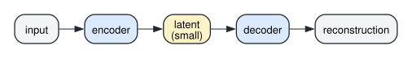
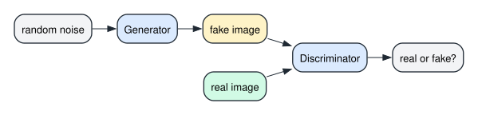

# Autoencoders & GANs

Autoencoders squeeze data and rebuild it; GANs make fakes and learn by competing.

## What autoencoders and GANs are
<!-- bite: f049ef6f-6dbe-427b-a51e-a1afe268886e -->

An autoencoder is a neural network that learns to squeeze its input into a small summary and then rebuild it. A GAN is a pair of networks where one makes fake examples and the other tries to catch them, and both get better by competing. These ideas are behind things like photo clean-up tools and computer-generated faces.

Next: autoencoders, then GANs.

## Autoencoders — learning compressed representations
<!-- bite: 26c0f949-3936-403b-b358-06671ce7ffd8 -->

An autoencoder is a network trained to **reconstruct its own input**, forced through a narrow middle layer (the *bottleneck*). It has two halves:

- **Encoder** — compresses the input into a small latent vector.
- **Decoder** — reconstructs the original from that vector.

Because the bottleneck can't hold everything, the network is forced to learn a compressed, meaningful representation — the *neural, non-linear* counterpart to [[machine-learning/03-classical-ml/19-dimensionality-reduction-pca|PCA]]. It's [[machine-learning/01-foundations-of-ml/01-what-is-ml-and-types|unsupervised]] (the label is the input itself, a form of self-supervision). Uses:

- **Dimensionality reduction** and feature learning.
- **Anomaly detection** — train on normal data; anything that reconstructs *badly* is anomalous (fraud, defects).
- **Denoising** — train to reconstruct clean data from corrupted input.
- **Variational autoencoders (VAEs)** — a probabilistic variant whose latent space is smooth enough to *generate* new samples, an early generative model.

## GANs — generation by competition
<!-- bite: 364d641c-f69c-4a79-beb4-f4f48cf15393 -->

A **Generative Adversarial Network** pits two networks against each other:

- **Generator** — tries to produce fake data (e.g. images) that look real.
- **Discriminator** — tries to tell real data from the generator's fakes.

They train together in a contest: the generator gets better at fooling, the discriminator gets better at catching, and at equilibrium the generator produces convincingly realistic output.

GANs produced a leap in realistic image generation (faces, art, super-resolution, style transfer). The catch: they're **notoriously hard to train** — unstable, prone to "mode collapse" (generating only a few varieties), and sensitive to hyperparameters.

## Where these sit now
<!-- bite: aab0ca88-e6e1-4708-98e0-bd9ea6572c7e -->

Both matter to recognize, but the generative frontier has largely moved to **diffusion models** ([[ai-engineering/09-multimodal/index|multimodal]]), which are more stable to train and produce higher-quality, more diverse images — they power today's image generators. Autoencoders remain widely useful for representation learning, anomaly detection, and as components (the VAE in some diffusion pipelines); GANs remain relevant for specific generation and super-resolution tasks. The through-line — encoder/decoder and adversarial training — recurs across modern architectures.

## Check your understanding
<!-- bite: 3831c563-cf59-4ad4-b421-c948caa2d187 -->

Try each one before you open the answer.

1. <!-- q: gap id="db988bd7" answers="encoder;decoder" -->
   Fill in the gaps. In an autoencoder, the ___ compresses the input into a small latent vector, and the ___ rebuilds the input from it.

   

Answer

   Encoder, then decoder. The narrow middle (the bottleneck) forces it to learn a compact representation.

   

2. <!-- q: mcq id="a2da945a" -->
   You train an autoencoder on normal transactions only. How do you spot fraud?

   - [ ] Fraud reconstructs perfectly
   - [x] Fraud reconstructs badly, because it doesn't look like the normal data
   - [ ] The autoencoder outputs a "fraud" label

   

Answer

   Anything that reconstructs badly is unusual. That is anomaly detection with an autoencoder.

   

3. <!-- q: mcq id="8ae2fdd6" -->
   In a GAN, what does the discriminator do?

   - [ ] Generates fake images from noise
   - [x] Tries to tell real data from the generator's fakes
   - [ ] Compresses the input

   

Answer

   It tries to catch the fakes. The generator tries to fool it, and both improve by competing.

   

4. <!-- q: gap id="3eec8df1" answers="mode collapse" -->
   Fill in the gap. When a GAN only generates a few kinds of output, that failure is called ___.

   

Answer

   Mode collapse. GANs are also unstable and sensitive to hyperparameters.

   

5. <!-- q: open id="732d05bc" -->
   Why have diffusion models largely replaced GANs for image generation?

   

Answer

   Diffusion models are more stable to train, and they produce higher-quality, more varied images. GANs are notoriously hard to train and prone to mode collapse.

   

## Related
<!-- bite: 1378fcc1-66e9-474a-8830-cf63a29bc178 -->
- [[machine-learning/03-classical-ml/17-clustering-1|Clustering & PCA]] — the linear version of dimensionality reduction
- [[ai-engineering/09-multimodal/index|Multimodal AI]] — diffusion models, the current generative frontier
- [[machine-learning/05-deep-learning/01-neural-network-fundamentals|Neural Network Fundamentals]] — the building blocks

## About this lesson
<!-- bite: 3ff20df3-aadf-4d10-b9d2-54daf3d2a3fb -->

**Level:** reference. **Covers:** from the roadmap.sh `machine-learning` roadmap. Two generative/representation architectures worth recognizing.
