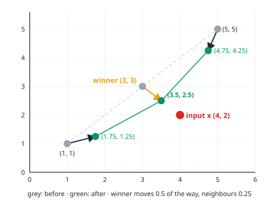

# Self-Organising Systems 2: Maps, Swarms and Where They Are Used

This part shows self-organisation doing real work in AI: maps that sort data, and swarms that find paths.

## Before you start
<!-- bite: 79173241-da19-4147-9c13-2a272bd0865b -->

You should have read [[machine-learning/08-other-architectures/04-self-organising-systems-1|Self-Organising Systems 1]]: local interactions, feedback loops, emergence, and the four types. The SOM update uses the same move-a-point rule as [[machine-learning/03-classical-ml/04-learning-vector-quantization|LVQ]], so look at that lesson if the maths feels new.

After this lesson you will be able to:

- do one training step of a self-organising map by hand;
- explain how ant colony optimisation finds a short path, using positive and negative feedback;
- list where self-organisation is used in AI, with a case study for each;
- give the advantages and challenges of self-organising systems.

## What this part covers
<!-- bite: 50b03018-9044-4335-985a-0472fd83a794 -->

Remember the flock from part 1? No boss, simple local rules, and order emerges. In this part we see that same recipe used on purpose, to build AI that works.

We start with the self-organising map, because it is the one that sits right inside machine learning. Then we look at swarms, the applications, some famous case studies, and finally what is good and hard about the whole approach.

## The self-organising map, in words
<!-- bite: 3b17d765-0387-4038-aa59-69b7cc071c1f -->

A self-organising map (SOM) was invented by **Teuvo Kohonen**, the same person behind LVQ. It is a set of **nodes** arranged on a grid or a chain, and each node holds a point in the data space (its **weight**).

Training repeats three steps for each data point x:

1. **Find the winner.** The node whose weight is closest to x wins. The winner is also called the **best matching unit**.
2. **Move the winner** part of the way towards x, using a learning rate α (alpha).
3. **Move the winner's neighbours on the grid** towards x too, but by less.

Step 3 is the self-organising part. Because neighbours on the grid get dragged along together, nodes next to each other on the grid end up holding similar data. Nobody tells the map where things go; it is local interactions on the grid again.

## A SOM step by hand: finding the winner
<!-- bite: 3852dcd7-2211-42ab-a4bb-690027f3068c -->

Take a chain of three nodes: node 1 at (1, 1), node 2 at (3, 3) and node 3 at (5, 5). Node 2 is the neighbour of both of the others. One data point arrives: x = (4, 2). Let α = 0.5, and let neighbours move half as much as the winner, so 0.25.

First, the squared distance from x to each node:

| Node | Weight | Squared distance to (4, 2) |
| --- | --- | --- |
| 1 | (1, 1) | (4 − 1)² + (2 − 1)² = 9 + 1 = 10 |
| 2 | (3, 3) | (4 − 3)² + (2 − 3)² = 1 + 1 = 2 |
| 3 | (5, 5) | (4 − 5)² + (2 − 5)² = 1 + 9 = 10 |

Node 2 is closest, so **node 2 wins**. We can skip the square root, because the smallest squared distance is also the smallest distance.

## A SOM step by hand: moving the nodes
<!-- bite: 3e9bb46d-a063-4ae6-8802-5b786d593cc9 -->

Every node moves with the LVQ "move closer" rule, w ← w + rate × (x − w):

1. **Node 2, the winner, rate 0.5:** (3, 3) + 0.5 × (1, −1) = **(3.5, 2.5)**.
2. **Node 1, a neighbour, rate 0.25:** (1, 1) + 0.25 × (3, 1) = **(1.75, 1.25)**.
3. **Node 3, a neighbour, rate 0.25:** (5, 5) + 0.25 × (−1, −3) = **(4.75, 4.25)**.

The whole chain bent towards x, and the winner bent the most. Repeat this for thousands of data points, shrinking α and the neighbourhood as you go, and the chain spreads out to cover the data in order.

## Seeing the SOM step
<!-- bite: a3232995-4a6b-4dc8-831f-4ae7999c7a05 -->

The grey chain is before, the green chain is after. Look at how the winner's pull drags its neighbours along: that is what keeps neighbouring nodes similar.

Compare this with LVQ. LVQ moves only the winner and uses class labels. A SOM uses no labels at all, which makes it unsupervised, like [[machine-learning/03-classical-ml/17-clustering-1|clustering]].

## Swarm intelligence
<!-- bite: e01791b1-9a5f-4796-93b7-fa40d3a815ee -->

**Swarm intelligence** is the collective behaviour of decentralised systems, such as flocks of birds or schools of fish, turned into algorithms. Two are famous:

1. **Ant colony optimisation (ACO).** This is inspired by how ants find short paths to food. Each ant leaves a chemical trail called **pheromone** as it walks. Ants on a shorter path get back sooner, so that path collects pheromone faster, so more ants choose it, so it collects even more: **positive feedback**. Pheromone also slowly evaporates, so a long, unused path fades away: **negative feedback**. Together they make the colony settle on the shortest path, and no ant ever compared the paths.
2. **Particle swarm optimisation (PSO).** This was introduced by Kennedy and Eberhart in 1995. Many "particles" fly around the space of possible answers. Each one is pulled towards the best answer it has found itself and the best answer any particle has found. The swarm closes in on a good answer.

Notice the two feedback loops from part 1 doing exactly the jobs we gave them.

## Applications in AI
<!-- bite: 0f716b7b-5812-4a81-9a59-38c19cfe88e1 -->

Self-organising ideas show up all over AI:

1. **Clustering algorithms**: grouping similar data points in data mining.
2. **Robotics**: robots use self-organising principles for navigation and for sharing out tasks.
3. **Swarm intelligence**: algorithms like particle swarm optimisation and ant colony optimisation.
4. **Neural networks**: self-organising maps for clustering and visualisation.
5. **Decentralised systems**: blockchain is an example of decentralised consensus, many computers agreeing on one record with no central bank in charge.
6. **Autonomous agents**: robots and multi-agent systems using self-organisation to share out tasks.

## Case studies
<!-- bite: 2b6133c2-dc2f-485b-9a98-d325f230b407 -->

Four well-known cases, one for each big idea:

1. **Ant colony optimisation**: inspired by the behaviour of ants finding efficient paths, and used for routing problems like delivery routes and network traffic.
2. **Swarm intelligence**: the collective behaviour of decentralised systems, such as flocks of birds or schools of fish.
3. **Self-organising maps**: invented by Teuvo Kohonen. One example is clustering customer data for market segmentation, so customers who buy alike land on nearby spots of the map.
4. **Swarm robotics**: for example, collective search and rescue using swarms of drones, where each drone covers its own patch and they spread out without a central pilot.

## Advantages and challenges
<!-- bite: c76b7cee-2aa5-46e7-b76a-6e9737e1276a -->

Self-organising systems have three big advantages:

1. **Scalability**: they handle large systems efficiently, because no central controller has to keep track of everything.
2. **Robustness**: they tolerate the failure of individual parts. Lose a few birds and the flock still flies.
3. **Adaptability**: they learn and evolve as the environment changes.

And three challenges, which you should know just as well:

1. **They are hard to understand and control.** The order is emergent, so you can't point to one line of code that caused a behaviour, and groupthink shows it can go wrong.
2. **Scalability issues and computational cost in large systems.** Many parts talking to their neighbours means a lot of computation.
3. **Balancing efficiency and adaptability.** A system that settles fast may struggle to change, and one that keeps changing may never settle.

## Where it is going
<!-- bite: 71dea552-fb67-4c87-a1b1-5214d2bb4fc2 -->

The future directions are:

1. **Hybrid approaches** that combine self-organisation with traditional AI techniques.
2. **New self-organising algorithms and models.**
3. **Applying self-organising systems to real-world problems**, from robotics to healthcare.

The big promise: by understanding and harnessing emergence, we can build AI that learns, adapts and evolves on its own.

## Check your understanding
<!-- bite: 9bf66944-fe45-4c33-8fd4-8f2ef809d103 -->

Try each one before you open the answer.

1. <!-- q: mcq id="5389ca36" -->
   A SOM has three nodes at (1, 5), (4, 4) and (6, 0). The data point x = (5, 1) arrives. Which node wins?

   - [ ] (1, 5)
   - [ ] (4, 4)
   - [x] (6, 0)

   

Answer

   (6, 0). The squared distances are 16 + 16 = 32, 1 + 9 = 10 and 1 + 1 = 2, and 2 is the smallest.

   

2. <!-- q: exact id="54b43d3b" answer="(3, 2)" accept="(3,2)|3, 2|3,2" -->
   A SOM winner sits at (2, 4). The data point is x = (4, 0) and the learning rate is α = 0.5. Where does the winner move to? Give it as (x, y).

   

Answer

   (2, 4) + 0.5 × (2, −4) = (3, 2).

   

3. <!-- q: mcq id="e343abb4" -->
   What makes a SOM different from LVQ?

   - [ ] A SOM moves the winner away from the data point
   - [x] A SOM uses no class labels and also moves the winner's neighbours
   - [ ] A SOM stores the whole training set

   

Answer

   A SOM is unsupervised and drags the winner's grid neighbours along, which keeps neighbouring nodes similar. LVQ uses labels and moves only the winner.

   

4. <!-- q: open id="d8879b69" -->
   In ant colony optimisation, which part is positive feedback and which part is negative feedback?

   

Answer

   Positive feedback: a shorter path gets pheromone faster, which attracts more ants, which adds more pheromone. Negative feedback: pheromone evaporates, so unused paths fade away.

   

5. <!-- q: mcq id="ad39791f" -->
   A drone swarm keeps searching after three of its twenty drones crash. Which advantage of self-organising systems is this?

   - [ ] Scalability
   - [x] Robustness
   - [ ] Adaptability

   

Answer

   Robustness: the system tolerates the failure of individual parts.

   

6. <!-- q: open id="8893ed3d" -->
   Give two challenges of self-organising systems.

   

Answer

   Any two of: they are hard to understand and control because the order is emergent; they can have scalability problems and high computational cost in large systems; and it is hard to balance settling efficiently against staying adaptable.

   

## Before moving on
<!-- bite: ef95d0e6-b97b-4a07-8f5c-5cbd09983ffc -->

You're done when you can do one SOM step by hand (winner, winner's move, neighbours' moves) and explain ant colony optimisation with the two feedback loops.

The short version: a SOM pulls the winning node and its grid neighbours towards each data point, so similar data lands close together on the map. Swarms like ACO and PSO find good answers through positive and negative feedback. Self-organising systems scale, survive failures and adapt, but they are hard to understand and control.

**Next:** [[machine-learning/08-other-architectures/06-rational-decision-making-1|Rational Decision Making 1]]. Self-organising systems let good choices emerge from many parts. The next lesson looks at the other way: one decision maker choosing the best option on purpose, by weighing costs and benefits.

## About this lesson
<!-- bite: a32648b5-349c-4c51-907d-39ec06d49717 -->

**Level:** Intermediate. Part 2 of 2 on self-organising systems. **Covers:** the self-organising map with one training step by hand, swarm intelligence (ACO and PSO), applications, case studies, advantages, challenges and future directions. **Source:** SSG 518 (Introduction to Artificial Intelligence Systems), Module 2: Self-Organising System, class slides. The SOM step by hand and the explanation of how ACO and PSO work were added to make the slides' points concrete. The slides' references: Kohonen (1982, 2001), Bonabeau, Dorigo and Theraulaz (1999), Holland (1992), Kennedy and Eberhart (1995), Strogatz (2003), Parunak (1999), Wolfram (2002), Mitchell (1996), Langton (1990). Diagram from `scripts/diagrams/machine_learning.py`, which asserts the step's numbers.
