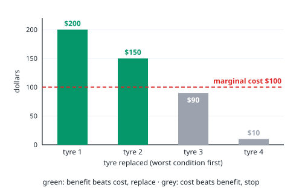

# Rational Decision Making 1: Net Benefit and Marginal Analysis

Rational decision making is choosing the best option on purpose, by weighing what each one costs against what it gives.

## Before you start
<!-- bite: 7d4048a0-369e-4ec4-be1c-f98d7b263c7a -->

You don't need any maths beyond subtraction for this lesson. It helps to have read [[machine-learning/08-other-architectures/03-reinforcement-learning|Reinforcement Learning]], because an AI agent choosing an action is exactly a decision maker choosing an option.

After this lesson you will be able to:

- define decision making and rational decision making;
- tell a "which one" decision from a "how many" decision;
- pick the best option from a table of benefits and costs using net benefit;
- decide how many of something to do using marginal benefit and marginal cost.

## What decision making is
<!-- bite: 1e69a1ce-f299-4468-967a-eb8a5d7edc3d -->

Every day you choose: go to class or sleep in, buy the phone now or wait, study one more hour or stop. Each time, you have a few options and you pick one.

That is decision making. **Decision making is the process of choosing a course of action out of a number of different alternatives.** In an organisation, the goal is to pick the course of action that brings the most benefit to the organisation.

But people don't always choose well. Sometimes we choose on feeling, or because everyone else did. That leads us to the kind of deciding this lesson is about.

## What rational decision making is
<!-- bite: f9f60cd9-0004-4819-948d-795d20bde7bc -->

Rational decision making is a problem-solving approach that uses **logic, objectivity and a systematic process** to analyse the information and pick the best of several alternatives. It aims to get the most benefit for the least cost, by carefully considering all the relevant factors and possible outcomes, instead of relying on intuition or emotion.

The key idea is simple. To make a rational decision, you compare the costs and benefits of each option and choose the one that best serves your interests.

A rational decision benefits the decision maker as much as possible. A self-interested person makes decisions for their own benefit, weighing the benefits and costs of the options. Wearing a seat belt is an example of a rational decision: the small cost (a few seconds, a bit of discomfort) is far smaller than the benefit (your life in a crash).

## Two types of decision
<!-- bite: 1ee2f16a-af55-47b7-96a4-3c4d60f94617 -->

Almost every decision is one of two types:

1. **Deciding which one.** You pick one option from a list: go to a movie, a class, church or the mosque; buy this car or that car.
2. **Deciding how many.** You choose an amount: how much time to give to studying, how much food to buy, how many tyres to replace.

Each type has its own tool. "Which one" uses **net benefit**, and "how many" uses **marginal analysis**. We'll follow one person through both: you, buying a used car.

## Terms used in rational decision making
<!-- bite: c78b8fa6-785e-4371-8f53-4eedd58a7efc -->

1. **Benefit**: This is what an option gives you, measured in money so options can be compared. If a car is worth $4,000 to you, its benefit is $4,000.
2. **Cost**: This is what you give up to get the option, usually the price.
3. **Net benefit**: This is the benefit of a choice minus its cost. It says how much better off the choice leaves you.
4. **Opportunity cost**: This is the value of the best alternative you give up when you choose. The money spent on a car can't also pay your rent.
5. **Marginal benefit**: This is the extra benefit of taking the next step, doing something one more time.
6. **Marginal cost**: This is the extra cost of taking the next step, doing something one more time.

## "Which one": choosing a car by net benefit
<!-- bite: e36b70dc-f987-4e20-9003-00068c86abb2 -->

You have three used cars to choose from. You've measured how much each car is worth to you in dollars:

| Car | How you feel about it | Benefit | Cost | Net benefit (benefit − cost) |
| --- | --- | --- | --- | --- |
| 2006 Toyota Corolla | Love it! | $6,000 | $8,000 | −$2,000 |
| 2005 Ford Taurus | Like it | $4,000 | $3,000 | $1,000 |
| 2002 Hyundai Sonata | It's OK | $2,500 | $2,000 | $500 |

Before you read on: which car does a rational buyer choose?

## The net benefit rule
<!-- bite: 96666558-36f5-4328-8043-5e42c85a0a2d -->

The Ford Taurus. Here is the rule: **a rational decision maker never chooses an option with a negative net benefit, and among the rest chooses the one with the highest positive net benefit.**

The Corolla is the car you *love*, but it costs $2,000 more than it is worth to you, so choosing it leaves you worse off. That is the difference between deciding on feeling and deciding rationally. Between the Taurus ($1,000) and the Sonata ($500), the Taurus leaves you $500 better off.

You've bought the Taurus. Now the tyres are worn, and that is a different kind of question.

## "How many": marginal analysis
<!-- bite: b9fd5394-045c-41d9-8888-a4a78f61b970 -->

The question is no longer "which one" but "how many tyres should I replace?". Here, we take it one step at a time and ask: is the **next** tyre worth it?

The marginal benefit of a new tyre is how much it raises the resale price of the car. The marginal cost is the price of one tyre, $100:

| Tyre replaced | Marginal benefit | Marginal cost | Net benefit |
| --- | --- | --- | --- |
| 1. Tyre in worst condition | $200 | $100 | $100 |
| 2. Tyre in second-worst condition | $150 | $100 | $50 |
| 3. Tyre in second-best condition | $90 | $100 | −$10 |
| 4. Tyre in best condition | $10 | $100 | −$90 |

## The marginal rule
<!-- bite: a53ca989-ad00-485d-968f-20f1904db3e4 -->

**Take a step only when its marginal benefit is bigger than its marginal cost.** Tyres 1 and 2 pass. Tyre 3 fails: it costs $100 but only adds $90 to the car's value. So you replace **two tyres**.

Notice the marginal benefit falls with each tyre. The worst tyre helps most; by the fourth, a new tyre barely changes anything. That shrinking pattern is very common, and it is why "how many" questions have a stopping point.

## Five lessons for rational decision making
<!-- bite: 55635e24-1890-4cc5-9e02-6346f3962b2d -->

Remember these five. They sum up everything in this lesson:

1. Consider the benefits and costs of each choice.
2. Don't neglect opportunity costs. The $3,000 on the Taurus is $3,000 you can't spend on anything else.
3. Approach "which one" questions by choosing the option with the greatest net benefit.
4. Consider "how much" and "how many" decisions one step at a time.
5. Take steps whose marginal benefit exceeds the marginal cost.

## Check your understanding
<!-- bite: 38f7637d-5dc0-4dc5-8113-774da1a0a16e -->

Try each one before you open the answer.

1. <!-- q: open id="675e384d" -->
   What is rational decision making?

   

Answer

   A problem-solving approach that uses logic, objectivity and a systematic process to analyse information and choose the best of several alternatives, getting the most benefit for the least cost instead of relying on intuition or emotion.

   

2. <!-- q: mcq id="b0f50e58" -->
   "How many hours should I spend on this assignment?" Which type of decision is this?

   - [ ] Which one
   - [x] How many

   

Answer

   How many. You are choosing an amount, so marginal analysis is the tool.

   

3. <!-- q: mcq id="ecc9ab61" -->
   You can buy one of three phones. Which does a rational buyer choose?

   | Phone | Benefit | Cost |
   | --- | --- | --- |
   | X | ₦120,000 | ₦150,000 |
   | Y | ₦90,000 | ₦70,000 |
   | Z | ₦60,000 | ₦45,000 |

   - [ ] X
   - [x] Y
   - [ ] Z

   

Answer

   Y. Net benefits: X is −₦30,000 (never choose a negative one), Y is ₦20,000 and Z is ₦15,000. Y is the highest positive.

   

4. <!-- q: exact id="5d7b72c7" answer="2" accept="two" -->
   Each extra hour of private lesson costs ₦2,500. The marginal benefits of hours 1, 2, 3 and 4 are ₦6,000, ₦4,000, ₦2,000 and ₦1,000. How many hours should you book?

   

Answer

   2. Hours 1 and 2 have marginal benefit above ₦2,500. Hour 3 adds only ₦2,000, less than its cost, so stop at 2.

   

5. <!-- q: gap id="f0b41e87" answers="opportunity" -->
   Fill in the gap. The value of the best alternative you give up when you make a choice is its ___ cost.

   

Answer

   Opportunity cost.

   

6. <!-- q: open id="e0a2243b" -->
   You love a car with a benefit of $6,000 and a cost of $8,000. Why would a rational decision maker not buy it?

   

Answer

   Its net benefit is $6,000 − $8,000 = −$2,000. Buying it leaves you worse off, and a rational decision maker never chooses an option with a negative net benefit, however much they like it.

   

## Before moving on
<!-- bite: ee6a95d2-b8e6-46b2-bf48-25eb8de9e6fd -->

You're done when you can pick the best option from a benefit-and-cost table and find the stopping point in a marginal benefit table.

The short version: for "which one", subtract cost from benefit and take the highest positive net benefit. For "how many", keep taking the next step while its marginal benefit beats its marginal cost.

**Next:** [[machine-learning/08-other-architectures/07-rational-decision-making-2|Rational Decision Making 2]]. Here every option had one number for its benefit. Real problems have several things to care about at once, like cost, time and how long the fix lasts. Part 2 gives you a six-step model for exactly that.

## About this lesson
<!-- bite: b96efeab-937d-40ce-b3d6-e1a8f99ae96f -->

**Level:** Beginner. Part 1 of 2 on rational decision making. **Covers:** decision making, rational decision making, the two types of decision, net benefit, marginal analysis and the five lessons. **Source:** SSG 518 (Introduction to Artificial Intelligence), Module 4: Rational Decision Making (RDM), class slides, including the two textbook tables (choosing a car, and comparing marginal benefit and marginal cost for tyres). The same cost ideas appear in [[engineering-economics/index|Engineering Economics]]. Diagram from `scripts/diagrams/machine_learning.py`, which asserts the tyre numbers.
