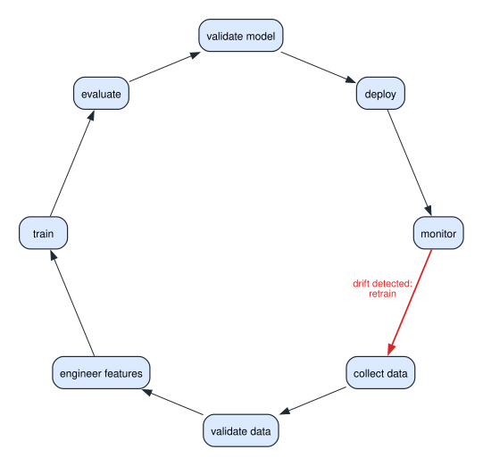

# MLOps Fundamentals

MLOps is getting ML models into real use and keeping them working.

## What MLOps is
<!-- bite: b8bb1bab-c9a2-4e64-b984-d31c1b02da0c -->

MLOps is the practice of getting machine learning models into real use and keeping them working well over time. It borrows most of its tools from DevOps, the practice of shipping and running ordinary software. Training a model once is the easy part. Keeping the fraud check in a bank app accurate month after month is what MLOps is for.

MLOps is the discipline of reliably building, deploying, and maintaining ML models in production. It's **DevOps applied to ML**, and it borrows most of DevOps wholesale — CI/CD, containers, infrastructure-as-code, monitoring. So rather than re-explain those, this section **cross-links the [[devops/index|DevOps domain]]** for the shared parts and focuses on what's genuinely ML-specific.

## What ML adds beyond ordinary DevOps
<!-- bite: 55bb27fb-f2cc-40c6-8fa6-5b9fc20b5f55 -->

Traditional software has one thing that changes: **code**. ML systems have **three** things that change and interact — and that's the entire source of MLOps's extra complexity:

```text
Traditional:   code → build → test → deploy → monitor
ML:            code + DATA + MODEL → ... → deploy → monitor for DRIFT → retrain
```

## The four ways ML is different
<!-- bite: 512344d3-3197-4dba-940a-f6d886b67b92 -->

Because data and the model change too, four things work differently from ordinary software.

- **Data is a versioned artifact.** The same code trained on different data produces a different model. You must version *data*, not just code ([[machine-learning/10-mlops/02-experiment-tracking-and-pipelines|DVC, feature stores]]). Git doesn't handle multi-GB datasets.
- **The model is a versioned artifact** — a trained binary that must be tracked, registered, and rollback-able, tied to the exact data + code that produced it ([[machine-learning/10-mlops/02-experiment-tracking-and-pipelines|model registry]]).
- **"Correct" isn't binary and it decays.** Software is right or has a bug; a model is *accurate enough* until the world shifts and it silently degrades ([[machine-learning/10-mlops/03-monitoring-and-edge|drift]]). It needs **retraining**, not just patching.
- **Testing is different.** You can't unit-test "is this prediction correct." You test data quality, validate model performance against thresholds, and check for training-serving skew ([[machine-learning/10-mlops/04-serving-and-monitoring|serving]]).

## The ML lifecycle
<!-- bite: 317cb37c-5298-4e81-a8f8-1616924ff553 -->

MLOps automates and monitors this loop, rather than treating training as a one-time event:



The goal is **reproducibility** (rebuild any model from versioned data+code+config), **automation** (retrain/deploy via pipelines, not by hand), and **continuous monitoring** (catch degradation before it hurts).

## MLOps maturity
<!-- bite: 9d6c74df-d7ad-45ed-b819-947b935bbc19 -->

A useful way to place a team: from **manual** (notebooks, hand-deployed models, no monitoring — where most start) → **automated training pipelines** (retrain on a trigger) → **full CI/CD for ML** (automated retraining, validation, deployment, and monitoring closing the loop). You don't need the top rung on day one; match the investment to how much the model matters and how fast its world changes.

## What maps to DevOps (cross-links, not re-explained)
<!-- bite: eb069612-5f86-4ea2-8136-6b057224e8c5 -->

| MLOps needs | Lives in DevOps |
|---|---|
| Containerizing a model service | [[devops/03-docker/index\|Docker]] / [[devops/10-orchestration/index\|Kubernetes]] |
| Automated pipelines | [[devops/05-ci-cd/index\|CI/CD]] |
| Provisioning training/serving infra | [[devops/09-infrastructure-as-code/index\|Terraform/IaC]] |
| Metrics/logs/dashboards | [[devops/07-observability/index\|Observability]] |

MLOps = these + data/model versioning + experiment tracking + drift monitoring + retraining. The next notes cover that ML-specific delta.

## Check your understanding
<!-- bite: 3bf74947-898d-4dea-b1ad-4022452fe65b -->

Try each one before you open the answer.

1. <!-- q: gap id="d93fe5e3" answers="data;model" -->
   Fill in the gaps. Ordinary software has one thing that changes: code. ML systems have three: code, ___ and the ___.

   <details><summary>Answer</summary>

   Data and the model. That is the source of MLOps's extra complexity.

   </details>

2. <!-- q: mcq id="26c0fb9a" -->
   Why does a working model still need retraining?

   - [ ] Because its code has bugs
   - [x] Because the world shifts, and its accuracy quietly decays (drift)
   - [ ] Because models expire after a year

   <details><summary>Answer</summary>

   Drift. A model is "accurate enough" until the world moves away from its training data. It needs retraining, not just patching.

   </details>

3. <!-- q: mcq id="deda78f2" -->
   Which of these are goals of MLOps? Choose all that apply.

   - [x] Reproducibility: rebuild any model from versioned data, code and config
   - [x] Automation: retrain and deploy through pipelines
   - [x] Continuous monitoring: catch degradation early
   - [ ] Training once and never touching the model again

   <details><summary>Answer</summary>

   The first three. MLOps treats training as a loop, not a one-time event.

   </details>

4. <!-- q: mcq id="4382b8e2" -->
   A team uses notebooks and hand-deployed models with no monitoring. Where are they on the MLOps maturity scale?

   - [x] Manual
   - [ ] Automated training pipelines
   - [ ] Full CI/CD for ML

   <details><summary>Answer</summary>

   Manual, where most teams start. Match how far you climb to how much the model matters and how fast its world changes.

   </details>

5. <!-- q: open id="1429a09e" -->
   Why can't you just unit-test whether a model's predictions are correct? What do you test instead?

   <details><summary>Answer</summary>

   A model isn't right or wrong like a function; it is accurate enough, to a degree. Instead you test data quality, check model performance against thresholds, and check for training-serving skew.

   </details>

## Related
<!-- bite: 9d82528e-f213-49c1-93a7-c827d20cb2d3 -->
- [[machine-learning/10-mlops/02-experiment-tracking-and-pipelines|Experiment Tracking & Pipelines]] — versioning data/models/experiments
- [[machine-learning/10-mlops/03-monitoring-and-edge|Monitoring & Edge]] — drift and edge deployment
- [[devops/index|DevOps]] — the shared foundation MLOps extends

## About this lesson
<!-- bite: 47732379-b0db-4804-b7a8-0770c9112a1f -->

**Level:** reference. **Covers:** from the roadmap.sh `mlops` roadmap. What MLOps is, and — the key framing — what it adds *beyond* the [[devops/index|DevOps]] you already know.
