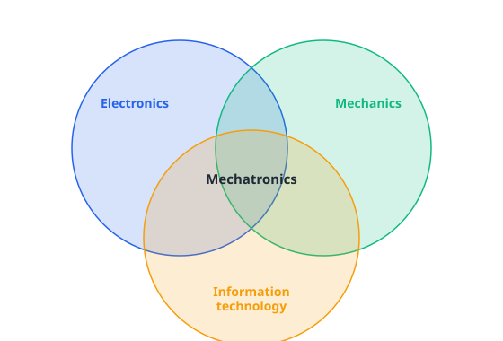

# What Mechatronics Is

**Mechatronics is the field of designing products that combine mechanical parts, electronics, control and computing into one system, built together on purpose so the whole does something the parts could not do alone.**

You have met mechatronic systems all your life without calling them that: a washing machine that senses the load and adjusts the spin, a car that pumps the brakes faster than any foot could, a drone that holds itself level in wind, a phone camera that moves a tiny lens to steady the picture.

## Before you start
<!-- bite: 459eaa63-80b2-4913-acfa-27934fa72ad0 -->

You need almost no maths for this lesson — it is the map of the whole subject. It helps to have seen a simple electric circuit and to know roughly what "software" and "a sensor" mean.

After this lesson you will be able to:

1. say what the word "mechatronics" means and where it comes from;
2. name the four engineering fields it brings together, and explain what "synergy" adds;
3. place a machine on the historical line from purely mechanical to fully mechatronic.

## What mechatronics is
<!-- bite: 5427e2b2-bd71-424d-85d6-3a12ec630abe -->

The word **mechatronics** was coined in Japan in the late 1960s by joining **"mecha"** from *mechanism* and **"tronics"** from *electronics*. So right there in the name you already have the two halves: the moving machine, and the electronics that drive it.

But the modern meaning is wider than those two words. Mechatronics is a **multi-disciplinary field** built on the **synergistic integration** of **mechanical engineering, electronic engineering, electrical engineering, control engineering and computer technology**, for the design, manufacture, analysis and maintenance of engineering products and processes.

Two phrases in that definition are doing the real work, so let us slow down on them. "Multi-disciplinary" just means it pulls from several fields of engineering at once. "Synergistic integration" is the important one, and the next section is all about it.

## The kid version
<!-- bite: 5a6ae136-13b7-4c54-958f-417ee5d601af -->

Imagine three friends building a go-kart. One is great with the frame, wheels and steering — the mechanical parts. One is great with batteries, motors and wiring — the electrics. One is great with a little computer that can read a button and switch the motor — the software. If each works alone and bolts their bit on at the end, you get a clumsy kart. But if they sit together from day one — "if the motor is this heavy, the frame needs this shape; if the computer reads the speed, it can ease the motor on a bend" — they build something none of them could manage alone. **Mechatronics is the three friends working together from the start.**

**Where the analogy stops working.** Three friends stay three people; in a real mechatronic product the disciplines blur into one design where you often cannot point to "the mechanical bit" and "the electronic bit" as separate things — a MEMS accelerometer is a mechanical spring *and* a circuit etched on the same chip.

## 1. Synergy: why integration is the whole point
<!-- bite: 7c837432-3a5a-4326-847c-123372508f8c -->

Here is the idea that makes mechatronics more than "a machine with a circuit stuck on". You can describe what it does first, then meet its name.

If you design the mechanical parts fully, then hand them over to be wired, then hand that over to be programmed, each stage is stuck with the choices of the one before it. The software cannot fix a motor that is too weak; the electronics cannot fix a frame that flexes. Each discipline patches around the others' mistakes.

Now instead design them **together**. The control engineer says "if I can read the wheel speed, I can let the motor run lighter and still hold the line." The mechanical engineer makes room for that sensor. The result is lighter, cheaper and does more. The combined system is better than the sum of the separate parts — and **synergy** is the name for exactly that: the whole being more than the sum of its parts.

## Seeing the three disciplines overlap
<!-- bite: 9440fc8c-a7d1-491c-a972-4ddfc5bdac07 -->

This is why we draw mechatronics as three overlapping circles — electronics, mechanics, and information technology — and put mechatronics in the middle, where all three meet.

Electronics brings microelectronics, power electronics, sensors and actuators. Mechanics brings the mechanical elements, machines and precision mechanics. Information technology brings system theory, modelling, automation and AI. Where they overlap, you have mechatronics. And because the overlap is the point, the next thing to understand is how products got to this overlap in the first place.

## 2. How machines became mechatronic
<!-- bite: e9da4208-9f71-4690-87c0-04fa306e4ef5 -->

Mechatronics did not appear overnight. Machines crossed into it in stages, as each new technology became cheap and reliable enough to build in. Reading this line tells you *why* mechatronics is a distinct field and not just "engineering".

## The six stages, from metal to software
<!-- bite: 70673c92-f6c7-44ec-b27c-ef4089f1dd9f -->

Read the stages in order — each one adds a technology that the one before could not use:

1. **Pure mechanical (before 1900).** Gears, cams and linkages. A clock, a loom. The "control" is the shape of the metal.
2. **Mechanical with electrical drives (around 1920).** The electric motor replaces the steam shaft, but the machine is still steered by mechanical means.
3. **Mechanical with automatic control (around 1935).** Feedback governors and relays — the machine starts to correct itself.
4. **Electronic analog and sequential control (around 1955).** Valves and transistors do the controlling; electronics now shape behaviour, not just supply power.
5. **Digital continuous and sequential control (around 1975).** The microprocessor arrives. Now a *program* decides, and the same hardware can be given a new job by changing code.
6. **Mechatronic systems (1985 onward).** Hardware and software are designed as one, with the synergistic effects we just met. This is where we are.

The jump that matters is step 5 to step 6: once a cheap computer could sit inside the machine, the economical thing was to move cleverness out of the metal and into the software — and to design both at once.

## Terms used in mechatronics
<!-- bite: e36d4d4f-725d-4426-bc4f-b785fd2c0236 -->

1. **Mechatronics**: the field that integrates mechanical, electronic, electrical, control and computer engineering into single products and processes. The name joins *mecha*nism and elec*tronics*.
2. **Synergy**: this is the effect where a combined system does more, or does it better, than its separate parts added together would. It is the reason for integrating the disciplines rather than keeping them apart.
3. **Integration**: this is designing and building the parts together as one system, instead of finishing one part and handing it to the next discipline. Tight integration is what lets synergy happen.
4. **Actuator**: this is a part that turns an electrical signal into physical action — movement, force, heat, light or sound. A motor and a valve are actuators. (Sensors, their opposite, get their own lessons.)
5. **Embedded computer**: this is a small computer built into a product to run just that product, rather than a general-purpose PC. The microprocessor in a washing machine is embedded.

## Common pitfalls and traps
<!-- bite: a6c768d7-10d5-41e8-87cd-ad12a73039d0 -->

- **Thinking mechatronics is "mechanical plus a bit of electronics".** The defining feature is *integration and synergy*, not the presence of a circuit. A mechanical machine with an electrical motor bolted on is step 2 of the history, not mechatronics.
- **Forgetting control and computing are in the definition.** Many students list only mechanical and electronic engineering. Control engineering and computer technology are named explicitly, because deciding and programming are half of what makes a system mechatronic.
- **Treating the history as trivia.** The exam asks for it because the *reason* for each step — new technology becoming cheap enough to integrate — is the reason the field exists.

## Check your understanding
<!-- bite: 65be618c-5567-4580-a489-7709a87b5f31 -->

Try each one before you open the answer.

1. <!-- q: gap id="68d74568" answers="mechanism;electronics" -->
   The word "mechatronics" was formed by joining "mecha", from ___, with "tronics", from ___.

   

Answer

   *Mechanism* and *electronics*. The name itself tells you the two original halves of the field.

   

2. <!-- q: mcq id="da4ae289" -->
   Which phrase best captures what makes a system *mechatronic*, rather than just a machine with a motor?

   - [ ] It contains at least one electric motor.
   - [x] Its mechanical, electronic, control and computing parts are integrated so the whole does more than the parts alone.
   - [ ] It is controlled by a human operator.
   - [ ] It is made mostly of metal.

   

Answer

   The defining feature is synergistic integration. A motor alone is just an electrical drive bolted to a machine — step 2 of the history, not mechatronics.

   

3. <!-- q: mcq id="5de3e7d0" -->
   In the standard definition, which engineering fields does mechatronics integrate? (choose all that apply)

   - [x] Mechanical engineering
   - [x] Electronic and electrical engineering
   - [x] Control engineering
   - [x] Computer technology
   - [ ] Civil engineering

   

Answer

   Mechanical, electronic/electrical, control, and computer technology. Civil engineering is not part of the definition.

   

4. <!-- q: exact id="b2b0a1d2" answer="synergy" -->
   What is the one-word name for the effect in which an integrated system does more than its separate parts added together?

   

Answer

   Synergy. It is the reason for integrating the disciplines rather than designing them one after another.

   

5. <!-- q: open id="eb888f16" -->
   A colleague says "my project uses a microcontroller to read a switch and turn on a light, so it's mechatronic." Using the history of the field, explain in two or three sentences why this does or does not qualify, and what would make it more clearly mechatronic.

   

Answer

   It sits at the digital-control stage (a program deciding), so it has the computing ingredient, but on its own a switch-and-light has almost no mechanical system and no real integration or synergy — the computer is not helping the mechanics do more. It becomes clearly mechatronic when the computing, sensing and a real mechanical action are designed together so the system does something none of the parts could alone — for example, reading a position sensor to drive a motor that holds a mechanism at a set point.

   

## Before moving on
<!-- bite: f6c034e1-bbf1-482f-a1a3-eb3fb1722ba9 -->

You can finish this lesson when you can define mechatronics without looking, name the fields it integrates, say what synergy adds, and place a given machine on the historical line.

Recap: mechatronics = *mecha*nism + elec*tronics*, meaning the synergistic integration of mechanical, electronic/electrical, control and computer engineering; machines reached it in stages, and the field exists because cheap embedded computers made integrating cleverness into software the economical choice.

Next, [[mechatronics/02-the-five-elements-of-mechatronics|The Five Elements of Mechatronics]] breaks that integration down into the five concrete building blocks every mechatronic system is made of — so "integration" stops being a slogan and becomes a parts list.

## Related
<!-- bite: 6d16b119-0f65-44f9-99be-7924f047120a -->

- [[mechatronics/02-the-five-elements-of-mechatronics|The Five Elements of Mechatronics]]: the parts list behind the definition.
- [[engineering-design-and-prototyping/24-embedded-electronics-and-mechatronics|Embedded Electronics and Mechatronic Integration]]: the same idea from the product-design side.

## About this lesson
<!-- bite: a964fa85-1eca-44cc-9eca-713e10c7d0d7 -->

**Level:** introductory, first lesson of the mechatronics course — no maths. It covers the definition and origin of the word, the four integrated fields and the meaning of synergy, and the historical development of the field. It is lesson 1 of section A (fundamentals); read it before [[mechatronics/02-the-five-elements-of-mechatronics|the five elements]].

**Source:** University of Lagos SSG 415 lecture notes (definition, historical development and interdisciplinary synergy), and the SSG 415 past-exam question banks (2020/21–2025/26, Question 1).
