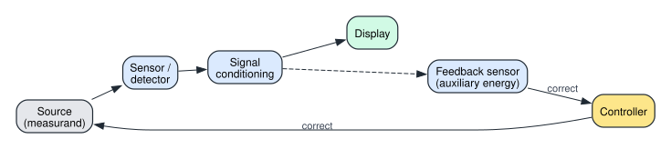
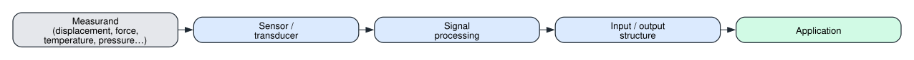

# Sensors and Transducers

**A transducer is a device that converts a signal from one physical form into a corresponding signal in a different physical form, and a sensor is the transducer that sits at the front of a measurement system and detects the quantity being measured.**

Your phone is full of them: the microphone turns sound pressure into voltage, the camera turns light into charge, and the tiny accelerometer turns tilt into a number that rotates your screen.

## Before you start
<!-- bite: 420f3373-ef80-4979-96f0-6f3dbf944b0b -->

You should know the five elements of mechatronics ([[mechatronics/02-the-five-elements-of-mechatronics|The Five Elements of Mechatronics]]); sensors are half of element 2. You need only F = Kx from school physics.

After this lesson you will be able to:

1. describe a sensor and a transducer as used in mechatronic systems;
2. draw the mechatronic measurement loop and the instrumentation chain;
3. name the main families of sensors and what each measures.

## What a sensor is
<!-- bite: c36829f1-b8c6-40f4-9f36-ab7ead3c776b -->

Remember the sense → decide → act loop from the car examples? The sensor is the **sense** part. Without it, the controller is blind: it can decide and act, but it has no idea what the world is actually doing.

The notes put it in one line: a transducer **converts a signal from one physical form to a corresponding signal in a different physical form**. "Corresponding" is the key word. The output must follow the input faithfully, so that reading the output tells you the input.

The running example for this lesson is a **drone holding its height and speed** — the exam asks about choosing its position and speed sensors, so we will keep coming back to it.

## The kid version
<!-- bite: 2175e392-a0d4-4e40-b508-7517fac1f1fd -->

Think of a thermometer with red liquid in it. You cannot see "temperature" — it is not a thing you can look at. But the liquid swells when it is hot, and you *can* see how high the liquid goes. The thermometer has changed something you cannot see (heat) into something you can (a length). Every sensor does that trick: it turns the thing you care about into something a person or a computer can read.

**Where the analogy stops working.** A thermometer's output is read by an eye; a mechatronic sensor's output is usually a voltage read by a computer, so it also needs power, conditioning and conversion before it means anything — which is the rest of the measurement system.

## A spring is a transducer
<!-- bite: c26b7725-b5cb-49a5-b938-5288e6a9b2af -->

Here is the simplest transducer of all, from the notes: a **spring**. Hang a force F on a spring of stiffness K and it stretches by y, where

$$F = K\,y$$

So the spring converts **force** (hard to see) into **displacement** (easy to measure). If K = 400 N/m and the spring stretches 0.05 m, the force is 400 × 0.05 = 20 N.

This is exactly how a kitchen scale or a load cell works: the force bends something springy, and a second transducer reads the bend. Many sensors are a **chain** of transducers like that — force to bend, bend to resistance, resistance to voltage.

## Sensor or transducer?
<!-- bite: 84e82bf5-8a84-4413-8644-8e4466d8ad05 -->

The two words are used almost interchangeably in the notes and in exams, but there is a small difference worth knowing.

A **transducer** is any device that changes one form of energy or signal into another — the definition above. A **sensor** is the transducer whose job is to *detect* the measurand at the front of the system. So every sensor is a transducer, but a loudspeaker (electrical to sound) is a transducer that is not a sensor; it is an actuator.

A one-sentence version for an exam: *A sensor is a device that detects a physical quantity (the measurand) and converts it into a corresponding signal, usually electrical, that the mechatronic system can process.*

## The mechatronic measurement loop
<!-- bite: 680409cb-b1e1-483d-8571-d4fd405cffe5 -->

A sensor never works alone. In a mechatronic system it sits in a loop, and the notes draw it like this:

The **source** is the thing being measured. The **sensor/detector** picks it up, **signal conditioning** cleans and amplifies it, and the **display** shows it. The **feedback sensor**, powered by an auxiliary energy source, passes the measurement to the **controller**, which acts back on the source. For the drone: the source is its height, the controller is the flight computer, and the action is changing the motor speeds.

## The instrumentation chain
<!-- bite: 4313be3a-41a3-470b-8dc8-d1aabbcc976e -->

The notes also describe the same idea as a straight chain of **instrumentation elements**, which is useful when you want to say what happens to the signal step by step:

The **measurand** is the quantity measured: displacement, force, weight, temperature, pressure, sound, or even a digital count. The sensor turns it into a signal, **signal processing** filters and scales it, the **input/output structure** (converters and interfaces) carries it into the computer, and the **application** uses it.

## Families of sensors
<!-- bite: d239130b-3a7b-4747-bfe7-94ef1ff3bbe4 -->

The notes group the sensors a mechatronic engineer meets by what they measure. Here is the list, with one example each:

1. **Motion and position sensors**: measure where something is. The **LVDT** measures straight-line position; a potentiometer measures angle.
2. **Digital motion sensors**: give position as counts. An **encoder** on a motor shaft gives so many pulses per turn.
3. **Force, torque and tactile sensors**: measure push, twist and touch. A **strain gauge** changes resistance as it stretches.
4. **Vibration and acceleration sensors**: an **accelerometer** measures acceleration, so vibration too.
5. **Flow sensors**: measure how much fluid passes per second.
6. **Temperature sensors**: thermocouples, resistance thermometers and thermistors.

For the drone: a barometer or rangefinder for height, GPS for position, an accelerometer and gyroscope for motion, and encoders or back-EMF on the motors for speed.

## Terms used with sensors
<!-- bite: 418a08ff-07c3-4aba-8bc8-98608822030a -->

1. **Measurand**: this is the physical quantity a sensor is trying to measure — the temperature, the force, the position.
2. **Transducer**: this is any device that converts a signal from one physical form into a corresponding signal in another form.
3. **Sensor**: this is the transducer at the front of a measurement system that detects the measurand.
4. **Signal conditioning**: this is amplifying, filtering and shifting a raw sensor signal so it is clean and the right size for the next stage.
5. **LVDT (linear variable differential transformer)**: this is a position sensor in which a movable core inside three coils changes the voltage induced in two of them, in proportion to how far the core has moved.
6. **Encoder**: this is a sensor that turns rotation or movement into digital pulses, so the controller can count position directly.

## Common pitfalls and traps
<!-- bite: 67968b18-9a87-48d3-833d-a7a135670406 -->

- **Saying a sensor "measures" without saying what it converts to.** The exam's "describe a sensor" wants the conversion: physical quantity in, corresponding (usually electrical) signal out.
- **Treating the sensor as the whole measurement.** A raw sensor signal is tiny and noisy. Without conditioning and conversion the computer cannot use it.
- **Forgetting that many sensors are chains.** A load cell is force → strain → resistance → voltage. An error in any link shows up in the reading.

## Check your understanding
<!-- bite: 3881d0a0-e23a-42f9-960b-4da3955cb4ed -->

Try each one before you open the answer.

1. <!-- q: open id="bc4c02b8" -->
   Describe a sensor as used in a mechatronic system, in two or three sentences.

   

Answer

   A sensor is a device that detects a physical quantity (the measurand), such as position, force or temperature, and converts it into a corresponding signal — usually electrical — that the system can process. It is the "sense" part of the sense–decide–act loop: it feeds the controller the information it needs to decide what to do.

   

2. <!-- q: exact id="71de3f14" answer="15" tolerance="0.01" -->
   A spring of stiffness K = 300 N/m is used as a force transducer. Under load it stretches 0.05 m. What force, in newtons, is being applied?

   

Answer

   F = K y = 300 × 0.05 = 15 N.

   

3. <!-- q: mcq id="01d1f7d4" -->
   Which device is a transducer but **not** a sensor?

   - [ ] A thermocouple
   - [ ] A strain gauge
   - [x] A loudspeaker
   - [ ] An encoder

   

Answer

   The loudspeaker converts an electrical signal into sound, so it is a transducer, but it acts on the world rather than detecting anything — it is an actuator. The other three detect a measurand.

   

4. <!-- q: gap id="0b9e8cd6" answers="signal conditioning|conditioning;controller" -->
   In the mechatronic measurement loop, the raw output of the sensor is cleaned and amplified by ___ before display, and the feedback sensor passes the measurement to the ___, which acts back on the source.

   

Answer

   Signal conditioning, then the controller. The controller closes the loop by acting on the source.

   

5. <!-- q: mcq id="4e515151" -->
   An autonomous drone must hold its height. Which of these sensors could measure that height? (choose all that apply)

   - [x] A barometric pressure sensor
   - [x] A downward-facing ultrasonic or laser rangefinder
   - [ ] A strain gauge on the frame
   - [ ] A thermocouple on the battery

   

Answer

   A barometer (air pressure falls with height) and a rangefinder (distance to the ground) both measure height. A strain gauge measures strain and a thermocouple measures temperature.

   

## Before moving on
<!-- bite: 5d69da38-0e70-41ce-a5a5-e375e66ee3ef -->

You are done when you can describe a sensor in exam language, draw the measurement loop and the instrumentation chain, and give an example sensor for each family.

Recap: a transducer converts a signal from one physical form to a corresponding signal in another; a sensor is the transducer that detects the measurand; it sits in a loop of sensor, signal conditioning, display, feedback and controller.

Next, [[mechatronics/06-sensor-performance-characteristics|Sensor Performance Characteristics]] answers the question you will ask the moment you have two sensors to choose from: which one is *better*, and by which numbers?

## Related
<!-- bite: 9a9d37df-43b5-4995-a978-3df2176b59f8 -->

- [[robotics/02-sensors-and-perception|Sensors and Perception]]: robot sensors such as lidar and cameras.
- [[mechatronics/07-choosing-and-classifying-sensors|Choosing and Classifying Sensors]]: how to classify and select them.

## About this lesson
<!-- bite: a60e77ee-a3da-439f-9ca0-1691098aaa73 -->

**Level:** introductory; only F = Ky. It covers the definitions of sensor and transducer, the mechatronic measurement loop, the instrumentation chain and the families of sensors, with a drone as the running example. It is lesson 5, the first of section B (sensors and measurement).

**Source:** University of Lagos SSG 415 "Sensors and Transducers" handwritten notes (definitions, measurement-system block diagram, instrumentation elements, topics covered) and the SSG 415 exam question banks (Question 1e "describe sensor as used in mechatronic systems"; 2025/26 Question 1d on drone position and speed sensors).
