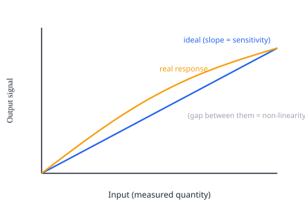
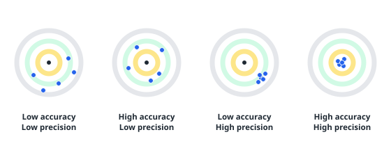

# Sensor Performance Characteristics

**Sensor performance characteristics are the numbers that describe how well a sensor measures: its sensitivity, resolution, accuracy, precision, repeatability, linearity, backlash and range.**

Two bathroom scales can both "measure weight", yet one gives the same answer every morning and the other jumps around by a kilogram. The characteristics are how you say that difference in engineering terms.

## Before you start
<!-- bite: 379b29c5-103f-40e9-a9f1-aca46323bee8 -->

You should know what a sensor and a transducer are ([[mechatronics/05-sensors-and-transducers|Sensors and Transducers]]). You need simple division and percentages.

After this lesson you will be able to:

1. define and calculate sensitivity, and define resolution, accuracy and precision;
2. tell accuracy and precision apart from a set of readings;
3. outline six performance characteristics, as the exam asks.

## What the characteristics are for
<!-- bite: 2e4f80cb-02ef-4226-bafb-647b722c3565 -->

In the last lesson the sensor turned the measurand into a signal. But *how faithfully*? A sensor can be slow to notice small changes, can read consistently high, can scatter, or can bend away from a straight line. Each of those faults has a name and a number.

The notes list them as the sensor **quality and performance characteristics**: sensitivity, resolution, accuracy, precision, backlash, repeatability and linearity. We will take them one at a time, with a **temperature sensor** as the running example.

## The kid version
<!-- bite: cac91c64-39be-4a18-b969-1d754e0ffc07 -->

Imagine judging a darts player. Do their darts land near the bullseye? That is **accuracy**. Do their darts land close to each other, wherever that is? That is **precision**. A player can throw a tight little group in the wrong corner — precise but not accurate. Can they notice that a dartboard moved one millimetre? That is **resolution**. Sensors get judged the same way, only with numbers.

**Where the analogy stops working.** A darts player can see where their dart landed. A sensor cannot see the true value — that is why accuracy can only be checked against a better reference instrument, during calibration.

## Sensitivity
<!-- bite: db95e4ac-fc80-4263-862d-457df855ed39 -->

**Sensitivity** is how much the output changes for a given change in the input. A sensitive sensor gives a big output change for a small input change. In symbols, from the notes:

$$S = \frac{\Delta\,\text{output}}{\Delta\,\text{input}}$$

*Worked example.* A temperature sensor gives 0.50 V at 20 °C and 1.10 V at 80 °C. The output changed by 0.60 V while the input changed by 60 °C, so

$$S = \frac{0.60\ \text{V}}{60\ ^\circ\text{C}} = 0.010\ \text{V}/^\circ\text{C} = 10\ \text{mV}/^\circ\text{C}$$

Always keep the units: sensitivity is "output units per input unit".

## Sensitivity and linearity on one graph
<!-- bite: 7cfc76b1-5ecc-47c6-800e-da84398a8ed4 -->

Sensitivity is the **slope** of the output–input graph. If the sensor were perfect, the graph would be a straight line, and that is what **linearity** measures: how closely the real response follows the straight line.

When the real curve bends away from the line, the sensitivity is not the same everywhere, and a single number S is only an approximation. Non-linearity is usually quoted as the biggest gap, as a percentage of full scale.

## Resolution
<!-- bite: 90333cbe-ac1c-4e75-8b91-a5fe20b0105c -->

**Resolution** is the smallest change in the measured value that the sensor can detect. Change the input by less than that, and the output does not budge.

A dial gauge marked in steps of 0.01 mm has a resolution of 0.01 mm: it cannot show you 0.003 mm. A digital temperature sensor that reports whole tenths of a degree has a resolution of 0.1 °C.

Do not confuse it with sensitivity. Sensitivity is *how big* the output change is; resolution is *how small* an input change can be noticed at all.

## Accuracy
<!-- bite: c3d86785-f5fc-4b89-82bc-526e24761141 -->

**Accuracy** is how close the measured value is to the true, actual value. The notes define it by the difference between them — the **error**:

$$\text{error} = \text{measured value} - \text{true value}$$

It is often quoted as a percentage. If an oven is truly at 200 °C and the sensor reads 203 °C, the error is 3 °C, which is 3/200 = 1.5 % of the true value. A smaller error means a more accurate sensor.

## Precision
<!-- bite: 9737ce60-0808-4466-bad4-7f5dbf74c394 -->

**Precision** is the ability of an instrument to reproduce a certain set of readings within a given accuracy. In plain words: measure the same thing several times, and a precise sensor gives nearly the same answer every time.

The true value below is 50.0 °C. Look at the two sensors:

| Reading | 1 | 2 | 3 | 4 | 5 |
| --- | --- | --- | --- | --- | --- |
| Sensor A | 49.9 | 50.1 | 50.0 | 49.9 | 50.1 |
| Sensor B | 52.1 | 52.0 | 52.1 | 52.0 | 52.1 |

Both are **precise** — each scatters by only 0.2 °C. But only A is **accurate**; B is consistently about 2 °C high. B's problem is a fixed offset, which calibration can remove. Scatter cannot be calibrated away.

## Accuracy and precision side by side
<!-- bite: bd89811a-02f6-4296-b9ef-df19c60db457 -->

Here are the four combinations, as darts on a board:

Sensor B from the table is the third board: a tight group in the wrong place.

## Repeatability, backlash and range
<!-- bite: 31493f2e-4bda-4b96-8867-f786ecb86eb0 -->

The notes finish the list with three more:

1. **Repeatability** is getting the same output when the same input is applied again, under the same conditions, over a short time. It is precision measured the strict way.
2. **Backlash** is the dead band in a mechanical sensor or gear train when the direction of movement reverses. Turn a geared dial forward and then back, and for a moment the gears move through their slack without moving the output, so the reading lags.
3. **Dynamic range** is the span from the smallest to the largest value the sensor can measure properly. A drone's rangefinder that works from 0.2 m to 8 m has that as its range. (The notes list it among the selection criteria, the next lesson.)

## Terms used for sensor performance
<!-- bite: d39a037c-b0d1-46d2-a191-5e70f007d5ee -->

1. **Sensitivity**: this is the change in output divided by the change in input, S = Δoutput/Δinput.
2. **Resolution**: this is the smallest increment in the measured value that can be detected.
3. **Accuracy**: this is how close the measured value is to the true value; the difference between them is the error.
4. **Precision**: this is the ability of an instrument to reproduce a set of readings within a given accuracy — small scatter.
5. **Repeatability**: this is giving the same output for the same input under the same conditions, when the measurement is repeated.
6. **Linearity**: this is how closely the output–input graph follows a straight line.
7. **Backlash**: this is the lost motion when a mechanical system reverses direction, so the output lags the input for a moment.

## Common pitfalls and traps
<!-- bite: 3368e8e7-f8d3-4907-b7c5-49b85bf74e3a -->

- **Swapping accuracy and precision.** Accuracy is closeness to the truth; precision is closeness of readings to each other. A sensor can be precise and wrong.
- **Swapping sensitivity and resolution.** A sensor can give a big output per degree (sensitive) and still be unable to notice a 0.01 degree change (coarse resolution).
- **Dropping the units of sensitivity.** "S = 0.01" means nothing; "10 mV/°C" does.
- **Thinking calibration fixes everything.** It removes a fixed offset (sensor B), not random scatter.

## Check your understanding
<!-- bite: 4c0311fd-f859-41e0-b5a4-f7a2dfcfd82b -->

Try each one before you open the answer.

1. <!-- q: exact id="9a6058dc" answer="4" tolerance="0.01" -->
   A pressure sensor gives 0.2 V at 100 kPa and 1.8 V at 500 kPa. What is its sensitivity, in mV/kPa?

   

Answer

   S = (1.8 − 0.2) V / (500 − 100) kPa = 1.6 V / 400 kPa = 0.004 V/kPa = 4 mV/kPa.

   

2. <!-- q: exact id="95b68a7c" answer="1.2" accept="1.2%" tolerance="0.01" -->
   A furnace is truly at 250 °C and the sensor reads 247 °C. What is the error as a percentage of the true value? (Give the number only.)

   

Answer

   Error = 3 °C; 3 / 250 = 0.012 = 1.2 %.

   

3. <!-- q: mcq id="74749a16" -->
   The true value is 10.00 N. Four sensors each take five readings:

   | Sensor | Readings (N) |
   | --- | --- |
   | P | 10.01, 9.99, 10.00, 10.01, 9.99 |
   | Q | 11.20, 11.21, 11.19, 11.20, 11.20 |
   | R | 9.40, 10.70, 10.10, 9.80, 10.20 |
   | S | 8.10, 9.30, 8.60, 9.00, 8.40 |

   Which sensor is precise but **not** accurate?

   - [ ] P
   - [x] Q
   - [ ] R
   - [ ] S

   

Answer

   Q: its readings agree to within 0.02 N, but they all sit about 1.2 N above the true value. P is precise and accurate; R scatters around the truth; S scatters and is low.

   

4. <!-- q: mcq id="0b8045b1" -->
   Which of these are sensor performance characteristics? (choose all that apply)

   - [x] Resolution
   - [x] Repeatability
   - [x] Linearity
   - [x] Backlash
   - [ ] Colour of the housing

   

Answer

   Resolution, repeatability, linearity and backlash are all on the list, along with sensitivity, accuracy and precision.

   

5. <!-- q: gap id="1559b268" answers="resolution;sensitivity" -->
   The smallest change in the measured value that a sensor can detect is its ___, while the change in output per unit change in input is its ___.

   

Answer

   Resolution, then sensitivity.

   

6. <!-- q: open id="c92404ac" -->
   A position sensor is driven by a small gear train. When the shaft turns forward then back to the same spot, the reading comes back 0.3° short. Name the characteristic involved and explain what causes it.

   

Answer

   Backlash. The gears have a little slack between their teeth. When the direction reverses, the driving gear first moves through that slack without moving the output gear, so the output lags and the reading comes back short. It can be reduced with anti-backlash (spring-loaded) gears or by putting the sensor directly on the shaft.

   

## Before moving on
<!-- bite: f213c5cd-8b95-43b4-88a9-3702e6d8687c -->

You are done when you can calculate a sensitivity with units, define six characteristics in one line each, and pick out accuracy versus precision from a table of readings.

Recap: sensitivity S = Δoutput/Δinput; resolution = smallest detectable change; accuracy = closeness to the truth; precision = reproducing readings; plus repeatability, linearity, backlash and range.

Next, [[mechatronics/07-choosing-and-classifying-sensors|Choosing and Classifying Sensors]] puts these numbers to work: how sensors are grouped, what you select on, and how the datasheet tells you all of it.

## Related
<!-- bite: 8ccfdf64-ad3e-49ce-9170-c03656426193 -->

- [[mechatronics/15-measurement-uncertainty|Measurement Uncertainty and Error Propagation]]: what happens to errors when you calculate with several measurements.

## About this lesson
<!-- bite: 26f92a42-c3a5-4dbd-b39f-087c76ac0ec7 -->

**Level:** introductory, simple arithmetic. It covers sensitivity, resolution, accuracy, precision, repeatability, linearity, backlash and dynamic range, with a temperature sensor as the running example. It is lesson 6, in section B.

**Source:** University of Lagos SSG 415 "Sensors and Transducers" notes (sensor quality and performance characteristics) and the SSG 415 exam question banks (Question 1g "outline six sensor performance characteristics"; 2025/26 Question 1e "list four key performance characteristics of sensors used in industrial automation").
