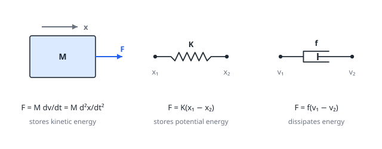
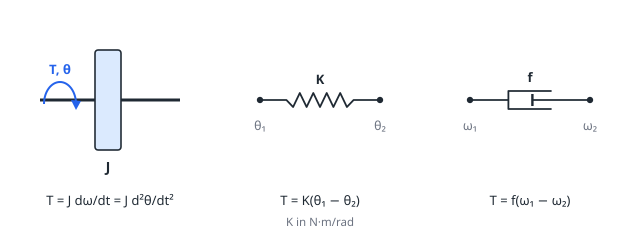

# Mechanical System Elements

**Every mechanical system, however complicated, is modelled from three ideal elements — the mass, the spring and the damper — and their rotational cousins, the inertia, the torsional spring and the rotational damper.**

A car's suspension is a mass (the car) on springs with shock absorbers (dampers). A washing machine drum, a robot joint and a train coupling are built from the same three pieces.

## Before you start
<!-- bite: c7507d04-26cd-45de-ae0b-d22e2d4031e2 -->

You should know what the physical-modelling element of mechatronics is for ([[mechatronics/02-the-five-elements-of-mechatronics|The Five Elements of Mechatronics]]). You need Newton's second law, F = ma, and what a derivative and an integral are.

After this lesson you will be able to:

1. name the three translational and three rotational elements and write the equation of each;
2. say which elements store energy and which one dissipates it;
3. calculate the force or torque in an element from its displacements or velocities, and write it in D-operator form.

## What a system element is
<!-- bite: 11c5518d-6d7a-4887-9400-fa693296f87e -->

Remember the design process from lesson 3? Its third stage was "first-principle mathematical modelling". This is where it starts. Before you can write the equation of a whole machine, you need the equation of each **piece** — and it turns out mechanical machines are made of only three kinds of piece.

A **mass** resists being accelerated. A **spring** resists being stretched. A **damper** resists being moved quickly. Every real part is modelled as some mix of these three. A real spring has a little mass and a little damping too, but we split those off into separate ideal elements, so each element does exactly one job.

## The kid version
<!-- bite: 03906148-11af-4f10-bc2f-90a753419288 -->

Push a shopping trolley, a door on a spring hinge, and a spoon through honey. The trolley is hard to get going and hard to stop — that is **mass**. The spring door pushes back harder the further you open it, and swings back when you let go — that is a **spring**. The spoon is easy to move slowly but fights you if you move it fast, and it never pushes back on its own — that is a **damper**. Everything mechanical is some mixture of trolley, spring door and honey.

**Where the analogy stops working.** Real objects mix the three behaviours in one lump. In a model we pretend each is a separate, perfect element — a weightless spring, a rigid mass — which is what makes the maths possible.

## Here are the three translational elements
<!-- bite: c9554024-b2ca-4220-bce8-50c790bcf720 -->

**Translational** means moving in a straight line. Here are the three elements side by side, each with its equation:

We will take them one at a time. Throughout, x is displacement in metres, v = dx/dt is velocity, and F is force in newtons.

## The mass, M
<!-- bite: 1997abd1-3434-4aa9-bfe4-034cb5681d57 -->

The **mass** is the property of an element that stores the **kinetic energy** of translational motion. Its force is Newton's second law: the force needed is the mass times the acceleration.

$$F = M\frac{dv}{dt} = M\frac{d^2x}{dt^2}$$

If you know the weight W instead, use M = W/g. A block that weighs 98.1 N has mass 98.1 / 9.81 = 10 kg.

One thing to notice: a mass has only **one** end. Its acceleration is measured against the fixed ground, never against another mass. Hold on to that, because it decides how masses are drawn in a mechanical network later.

## The spring, K
<!-- bite: 17b62e77-7ae4-4cb2-bf9b-1efe225d56cf -->

The **linear spring** is the element that stores **potential energy**. Its force is proportional to how much it is stretched — the difference between the displacements of its two ends:

$$F = K(x_1 - x_2) = K\int_{-\infty}^{t}(v_1 - v_2)\,dt$$

If one end is fixed, x₂ = 0 and F = Kx. K is the **stiffness**, in N/m. A spring with K = 400 N/m whose ends are at x₁ = 0.08 m and x₂ = 0.03 m pushes with 400 × 0.05 = 20 N.

The integral form says the same thing in velocities: displacement is velocity added up over time. You will need it when we turn mechanical systems into electrical circuits.

## The damper, f
<!-- bite: e871917e-0892-4d6c-a2fa-b97bd2a0d51c -->

The **damper**, also called friction, is the element that **dissipates** energy — it turns motion into heat and never gives it back. The notes name three kinds of friction: **viscous** friction, **Coulomb** friction and **stiction**. Only viscous friction is linear, so it is the one we model: the force is proportional to the difference in velocity between the two ends.

$$F = f(v_1 - v_2) = f\left(\frac{dx_1}{dt} - \frac{dx_2}{dt}\right)$$

f is the **viscous friction coefficient**, in N·s/m. A shock absorber is a damper: oil forced through small holes. With f = 20 N·s/m and the ends moving at 0.5 m/s and 0.2 m/s, it resists with 20 × 0.3 = 6 N.

## Here are the three rotational elements
<!-- bite: f51722e8-92ff-47be-ae8c-4085faa6889a -->

**Rotational** means turning about an axis. Each translational element has a twin, with **torque** T (N·m) in place of force, **angle** θ (rad) in place of displacement, and **angular velocity** ω = dθ/dt (rad/s) in place of velocity:

## The inertia, J, and the torsional spring, K
<!-- bite: 4186ceb5-8b9d-4a90-8bbc-1cfada7f298f -->

The **moment of inertia** J stores the kinetic energy of rotational motion. Torque is inertia times angular acceleration α:

$$T = J\alpha = J\frac{d\omega}{dt} = J\frac{d^2\theta}{dt^2}$$

The **torsional spring** represents the compliance (springiness) of a rod or shaft when a torque twists it. Its torque is proportional to the twist between its ends:

$$T = K(\theta_1 - \theta_2) = K\int_{-\infty}^{t}(\omega_1 - \omega_2)\,dt$$

Units, from the notes: K in N·m/rad, T in N·m, θ in rad, ω in rad/s.

## The rotational damper, f
<!-- bite: 19bf6d7b-3fd0-4781-8e1a-a0ba4d53b2ac -->

The **rotational damper** is a disc turning in viscous fluid. Its torque is proportional to the difference in angular velocity:

$$T = f(\omega_1 - \omega_2) = f\left(\frac{d\theta_1}{dt} - \frac{d\theta_2}{dt}\right)$$

Here f is in N·m·s/rad. Look at the pattern across both sets: the mass and inertia use the **second** derivative, the dampers use the **first**, and the springs use the variable **itself**. That pattern is the whole of the next lesson in disguise.

## The D operator: a shorthand
<!-- bite: 348993fb-af83-454e-94c8-d5ea0f8ba0e7 -->

Writing d/dt over and over gets heavy, so the notes use the **D operator**: D stands for "differentiate with respect to time", and 1/D for "integrate from the start time".

$$D = \frac{d}{dt}, \qquad \frac{1}{D}(\cdot) = \int_{t_0}^{t}(\cdot)\,d\tau$$

In D form the three elements become F = M·D²x, F = fDx and F = Kx. A whole equation shortens too: the notes' example d²x/dt² − 6 dx/dt + x = dr/dt − 1 is written D²x(t) − 6Dx(t) + x(t) = Dr(t) − 1, and dx/dt + x − ∫x dt + r = 0 becomes Dx(t) + x(t) − (1/D)x(t) + r(t) = 0.

This is not just neat writing. When we take the Laplace transform with zero initial conditions, D simply becomes s. That is how we will turn these equations into transfer functions.

## Terms used for mechanical elements
<!-- bite: 4b6acc6b-8185-4b38-bf86-7e463bd74d67 -->

1. **Translational system**: this is a system whose parts move in straight lines, described by forces and displacements.
2. **Rotational system**: this is a system whose parts turn about an axis, described by torques and angles.
3. **Stiffness, K**: this is the force (or torque) a spring produces per unit stretch (or twist). It is measured in N/m, or N·m/rad for a torsional spring.
4. **Viscous friction coefficient, f**: this is the force (or torque) a damper produces per unit difference in velocity. It is measured in N·s/m, or N·m·s/rad.
5. **Moment of inertia, J**: this is the rotational version of mass: how hard a body is to set spinning. It is measured in kg·m².
6. **Compliance**: this is the springiness of a part — how much it gives under load. A torsional spring models the compliance of a shaft.
7. **D operator**: this is shorthand for differentiation with respect to time, so that D x = dx/dt and 1/D means integration.

## Common pitfalls and traps
<!-- bite: 7156ab8e-1922-4bff-a50d-0bcd1331558b -->

- **Using x instead of (x₁ − x₂).** A spring or damper between two moving parts responds to the *difference* of their motions. Only when one end is fixed does F = Kx.
- **Giving a mass two ends.** A mass's acceleration is always measured relative to the fixed ground.
- **Mixing up which element uses which derivative.** Mass: second derivative. Damper: first derivative. Spring: none.
- **Modelling Coulomb friction or stiction as f·v.** They are not linear; f·v is viscous friction only.
- **Mismatched units.** Grams, millimetres and rpm must become kg, m and rad/s before using the equations.

## Check your understanding
<!-- bite: a1d513e4-56b0-4844-8bd2-7884a2136e39 -->

Try each one before you open the answer.

1. <!-- q: exact id="2e2ab0c8" answer="5" tolerance="0.01" -->
   A block weighs 49.05 N. Taking g = 9.81 m/s², what is its mass M in kg?

   

Answer

   M = W/g = 49.05 / 9.81 = 5 kg.

   

2. <!-- q: exact id="c6a909eb" answer="4" tolerance="0.01" -->
   A spring of stiffness K = 200 N/m joins two masses. One end has moved x₁ = 0.03 m and the other x₂ = 0.01 m. What force, in newtons, does the spring exert?

   

Answer

   F = K(x₁ − x₂) = 200 × (0.03 − 0.01) = 200 × 0.02 = 4 N.

   

3. <!-- q: exact id="680ef8c4" answer="4.5" tolerance="0.01" -->
   A damper with f = 15 N·s/m has one end moving at 0.4 m/s and the other at 0.1 m/s, in the same direction. What force, in newtons, does it exert?

   

Answer

   F = f(v₁ − v₂) = 15 × (0.4 − 0.1) = 15 × 0.3 = 4.5 N.

   

4. <!-- q: exact id="94b246f5" answer="10" tolerance="0.01" -->
   A shaft acting as a torsional spring has K = 50 N·m/rad. One end is twisted to θ₁ = 0.3 rad and the other to θ₂ = 0.1 rad. What torque, in N·m, is in the shaft?

   

Answer

   T = K(θ₁ − θ₂) = 50 × 0.2 = 10 N·m.

   

5. <!-- q: mcq id="4737deac" -->
   Which of the six mechanical elements **dissipate** energy rather than store it? (choose all that apply)

   - [ ] Mass M
   - [ ] Spring K
   - [x] Damper f
   - [ ] Inertia J
   - [ ] Torsional spring K
   - [x] Rotational damper f

   

Answer

   Only the dampers dissipate energy (as heat). Mass and inertia store kinetic energy; the springs store potential energy.

   

6. <!-- q: mcq id="28c46ee7" -->
   With D = d/dt, which line gives the forces in a mass, a damper and a spring (each with one end fixed) in D-operator form?

   - [x] F = M·D²x,  F = f·Dx,  F = K·x
   - [ ] F = M·Dx,  F = f·D²x,  F = K·x
   - [ ] F = M·x,  F = f·Dx,  F = K·D²x
   - [ ] F = M·D²x,  F = f·x,  F = K·Dx

   

Answer

   F = M·D²x, F = f·Dx and F = K·x — the second derivative, the first derivative, and the displacement itself.

   

## Before moving on
<!-- bite: 04250679-d851-476a-9d52-18f0f00540c4 -->

You are done when you can draw and name all six elements, write each one's equation in derivative, integral and D form, and say which store and which dissipate energy.

Recap: mass F = M d²x/dt² (kinetic energy); spring F = K(x₁ − x₂) (potential energy); damper F = f(v₁ − v₂) (dissipates); and the rotational twins T = J d²θ/dt², T = K(θ₁ − θ₂), T = f(ω₁ − ω₂). D = d/dt.

Next, [[mechatronics/09-translational-systems|Translational Systems]] connects these elements into a machine: you will draw a free-body diagram and a mechanical network and write the system's differential equation.

## Related
<!-- bite: c5bd0f7f-1c56-4134-a4ee-55cab2bb5cb4 -->

- [[control-theory/03-modelling-1|Control Theory: Modelling 1]]: the same element laws from the control side.
- [[mechatronics/11-rotational-systems|Rotational Systems]]: the rotational elements put to work.

## About this lesson
<!-- bite: 99e97a13-5747-4d5e-abd5-eb461eddbfca -->

**Level:** first-year calculus. It covers the three translational and three rotational elements, their equations and units, the three kinds of friction, and the D operator. It is lesson 8, the first of section C (modelling mechanical systems).

**Source:** University of Lagos SSG 415 "Mathematical Models of Physical Systems" whiteboard notes (key elements in mechanical systems) and the SSG 415 lecture notes of 27/11/2023 (operator notation).
