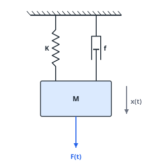
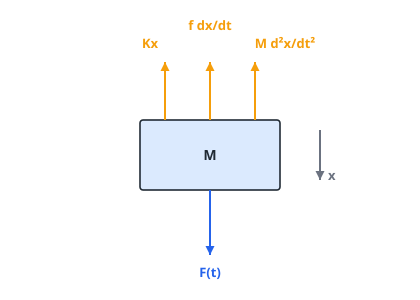
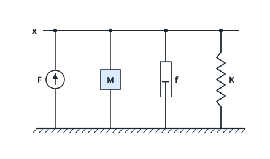
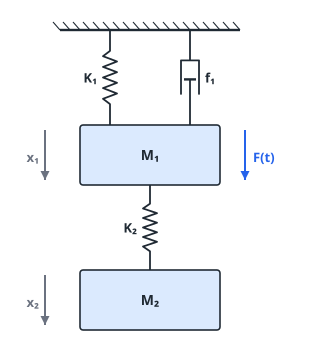
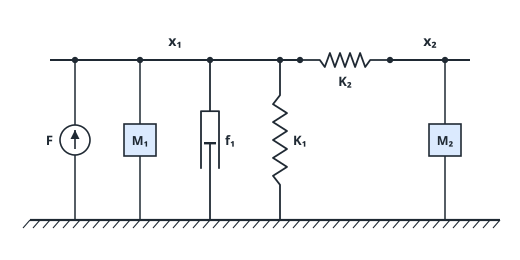

# Translational Systems: Free-Body Diagrams and Networks

**A translational system is a set of masses, springs and dampers moving in straight lines, and modelling one means drawing its free-body diagram and mechanical network, then writing one differential equation for each moving mass.**

A car on its suspension, a train of coupled wagons and a lift on its cable are all translational systems. The exam's version is usually masses hanging from a ceiling or rolling on wheels.

## Before you start
<!-- bite: 794305c8-6f28-4474-a5c3-1f59df5529b3 -->

You should know the mass, spring and damper equations ([[mechatronics/08-mechanical-system-elements|Mechanical System Elements]]).

After this lesson you will be able to:

1. draw the free-body diagram of a mass and write its equation of motion;
2. draw the mechanical network of a system with one or more masses;
3. write the differential equations of a multi-mass system straight from its network.

## What we are building
<!-- bite: 12d39fdb-ce3b-495c-991a-c974b6db4a63 -->

In the last lesson each element had its own equation. A machine is those elements **joined together**, and the joins are what make it interesting: the spring above the mass pulls on it, the damper slows it, the force pushes it. To write the machine's equation we need a careful way to collect every force on every mass.

## Two tools: the free-body diagram and the network
<!-- bite: d03ebb57-dbc5-441e-be9f-d32f8d3bd5fc -->

The course gives two tools for this. The **free-body diagram** looks at one mass at a time and draws every force on it. The **mechanical network** draws the whole system like a circuit, so the equations can be read off almost mechanically — and so it can later be turned into a real electrical circuit.

The running example is the notes' **translational mass–spring–damper**: a mass M hanging from a fixed ceiling by a spring K and a damper f side by side, with a force F(t) on the mass.

## The kid version
<!-- bite: 1823921a-5e80-4aa3-b03c-68c8c49904fc -->

Imagine you are the mass, hanging from the ceiling. To find out how you will move, you list everyone pulling on you: someone below pulling you down (the force F), a spring above pulling you back up the further you go, and a honey-pot damper above fighting you the faster you go. Whatever is left over after all those pulls is what makes you speed up. Writing down that list, with arrows, is the free-body diagram.

**Where the analogy stops working.** A person can feel the pulls; the equation has to *assume* a direction for every movement first. If you choose "down is positive", every force must be measured with that same sign rule — get one sign wrong and the model describes a machine that does not exist.

## The running example
<!-- bite: 1c7aac18-9539-48c5-9d76-f6d1769ed525 -->

Here is the system. We measure x(t) downward from the rest position. Gravity is balanced by the spring's static stretch at rest, so it drops out of the equation.

## Step 1: the free-body diagram
<!-- bite: 60c7f672-2742-4769-a8db-10cffe90b770 -->

Cut the mass free from everything and draw every force on it. Pulling the mass down x and moving it at dx/dt, the spring pulls back up with Kx, the damper with f dx/dt, and — writing Newton's law the D'Alembert way — the mass's own **inertia force** M d²x/dt² also opposes the motion:

## Step 2: the equation of motion
<!-- bite: c5f976b8-726e-45be-9a9c-4fc4f010a08b -->

Now balance the forces. The notes write Newton's law first — the net force equals mass times acceleration:

$$F - f\frac{dx}{dt} - Kx = M\frac{d^2x}{dt^2}$$

Rearranged, with the input on one side:

$$F = M\frac{d^2x}{dt^2} + f\frac{dx}{dt} + Kx$$

In words: the applied force is used up three ways — accelerating the mass, pushing the damper and stretching the spring. In velocity form (v = dx/dt), the same equation is F = M dv/dt + f v + K∫v dt, which is the form we will need for the electrical analogies.

## Step 3: the mechanical network
<!-- bite: 10736ac3-3c2d-48ab-8df7-51962c784043 -->

A **mechanical network** draws the system the way a circuit diagram would. Each different displacement (each mass) becomes a **node** — a line at the top. The fixed ground becomes the **reference** line at the bottom. Each element is drawn between the two points it connects.

Our system has one displacement, x, so one node:

The spring and damper go from node x to the reference, because their other end is on the fixed ceiling. The mass always goes from its node to the reference, because its acceleration is measured against the ground. The force source feeds into the node.

## Reading equations off a network
<!-- bite: 8fe2fa91-b9d8-434f-9a6b-5605f5281c39 -->

The network gives a rule that writes the equation for you:

> **At each node, the sum of the forces through every element attached to it equals the applied force at that node.** An element between the node and the reference uses that node's displacement. An element between two nodes uses the difference: this node's displacement minus the other's.

For our one node: M d²x/dt² + f dx/dt + Kx = F. The same answer as the free-body diagram, without drawing a single arrow. The rule really pays off when there are several masses.

## A three-mass system
<!-- bite: 05631010-3e17-4994-a09b-174a6b4fe6b3 -->

The 2025/26 exam (and quiz 2) gives three masses hanging in a chain, with two applied forces. Find the free-body diagrams and network, and write the equations:

There are three displacements, so three nodes. K₁ and f₁ join x₁ to the ceiling (reference). K₂ joins x₁ to x₂. K₃ and f₃ join x₂ to x₃. Each mass goes from its own node to the reference.

## The three-mass network
<!-- bite: c3b1ea6d-f3b8-497d-8f4a-3d79bfda7bf8 -->

Here is the network drawn from that description:

Check it against the system: every element in the picture appears exactly once, and every element touching the ceiling goes to the reference.

## The three-mass equations
<!-- bite: 786ee284-e0d0-4d7c-b227-8b62c451b386 -->

Now apply the node rule at each node in turn.

**Node x₁** (M₁, f₁, K₁ to reference; K₂ to x₂; source F₁):

$$M_1\ddot{x}_1 + f_1\dot{x}_1 + K_1x_1 + K_2(x_1 - x_2) = F_1$$

**Node x₂** (M₂ to reference; K₂ to x₁; K₃ and f₃ to x₃; source F₂):

$$M_2\ddot{x}_2 + K_2(x_2 - x_1) + f_3(\dot{x}_2 - \dot{x}_3) + K_3(x_2 - x_3) = F_2$$

**Node x₃** (M₃ to reference; K₃ and f₃ to x₂; no source):

$$M_3\ddot{x}_3 + f_3(\dot{x}_3 - \dot{x}_2) + K_3(x_3 - x_2) = 0$$

The dots are shorthand: ẋ = dx/dt and ẍ = d²x/dt².

## Checking the equations
<!-- bite: e2d18a57-e857-4775-91b4-c0e0b7f88ee1 -->

Two quick checks catch most mistakes:

1. **Every coupling element appears twice, with opposite signs.** K₂ appears as K₂(x₁ − x₂) at node 1 and K₂(x₂ − x₁) at node 2. If you push node 1, K₂ pushes node 2 the other way — Newton's third law.
2. **The coefficients form a symmetric pattern.** Written as a table of what multiplies x₁, x₂ and x₃ in each equation, the off-diagonal entries match: −K₂ appears in row 1, column 2 and in row 2, column 1.

The equations are **coupled**: x₂ appears in the equation for x₁, so you cannot solve one mass without the others. That coupling is the whole reason a train or a suspension behaves the way it does.

## Terms used in translational modelling
<!-- bite: 4fe35d91-816b-4c5c-93c4-e2142de19678 -->

1. **Free-body diagram**: this is a drawing of one body cut free from its surroundings, showing every force that acts on it.
2. **Inertia force**: this is the term M d²x/dt² written as a force opposing the motion. Treating it that way (D'Alembert's principle) lets you write "sum of forces = 0".
3. **Mechanical network**: this is a circuit-like drawing of a mechanical system, with a node for each displacement, a reference for the fixed ground, and each element between the points it connects.
4. **Node**: in a mechanical network, this is a point that moves with one displacement. Every element attached to the same moving part shares that node.
5. **Coupled equations**: these are differential equations in which each unknown appears in the others' equations, so they must be solved together.

## Common pitfalls and traps
<!-- bite: a21d74f1-a9ed-4b4f-a8e3-fd6c414614e4 -->

- **Sign errors on coupling elements.** At node 1 the spring force is K₂(x₁ − x₂); at node 2 it is K₂(x₂ − x₁). Writing the same order at both nodes is the most common mistake.
- **Drawing a mass between two nodes.** A mass always goes from its node to the reference.
- **Forgetting an element that touches the ceiling or wall.** It goes from the node to the reference, not nowhere.
- **Leaving gravity in.** Measure displacements from the rest position, and the static weight is already balanced by the springs.
- **Inventing a mass at a joint.** A point between a spring and a damper with no mass is a massless node: its equation has no M d²x/dt² term, but it still needs an equation.

## Check your understanding
<!-- bite: 990e9593-6fc0-4ef5-b03f-4cc8d8b1d5b4 -->

Try each one before you open the answer.

1. <!-- q: exact id="58d80438" answer="2.4" tolerance="0.01" -->
   A hanging mass–spring–damper obeys F = M d²x/dt² + f dx/dt + Kx, with M = 2 kg, f = 3 N·s/m and K = 8 N/m. At one instant x = 0.1 m, dx/dt = 0.2 m/s and d²x/dt² = 0.5 m/s². What applied force F, in newtons, is acting?

   

Answer

   F = 2 × 0.5 + 3 × 0.2 + 8 × 0.1 = 1 + 0.6 + 0.8 = 2.4 N.

   

2. <!-- q: mcq id="e05eac98" -->
   Spring K₁ joins a ceiling to mass M₁ (displacement x₁, down). Damper f₁ joins M₁ to mass M₂ below (displacement x₂, down). Spring K₂ joins the ceiling directly to M₂, and a downward force F₂ acts on M₂. Which is the equation for M₂?

   - [ ] M₂ẍ₂ + K₂x₂ + f₁ẋ₂ = F₂
   - [x] M₂ẍ₂ + K₂x₂ + f₁(ẋ₂ − ẋ₁) = F₂
   - [ ] M₂ẍ₂ + K₂(x₂ − x₁) + f₁(ẋ₂ − ẋ₁) = F₂
   - [ ] M₂ẍ₂ + K₂x₂ + f₁(ẋ₁ − ẋ₂) = F₂

   

Answer

   K₂ goes to the ceiling (reference), so it uses x₂ alone. f₁ joins the two masses, so at node x₂ it uses ẋ₂ − ẋ₁. The equation for M₁ is M₁ẍ₁ + K₁x₁ + f₁(ẋ₁ − ẋ₂) = 0.

   

3. <!-- q: gap id="fab36af2" answers="reference|ground|the reference;difference" -->
   In a mechanical network, a mass is always drawn from its node to the ___, and an element joining two nodes uses the ___ of their displacements.

   

Answer

   The reference (fixed ground), and the difference of the displacements.

   

4. <!-- q: open id="29aafad9" -->
   On a frictionless floor, a wall is joined by spring K to a massless point P (displacement y₂). A damper f₂ joins P to a mass M (displacement y₁). A force F pushes M away from the wall. Write the two differential equations.

   

Answer

   Mass node y₁: M ÿ₁ + f₂(ẏ₁ − ẏ₂) = F.
   Massless node y₂: f₂(ẏ₂ − ẏ₁) + K y₂ = 0.
   The second equation has no inertia term because P has no mass, but it is still needed: it says the spring force and the damper force at P must balance.

   

5. <!-- q: mcq id="dcf49fd2" -->
   In a mechanical network, the input displacement node xᵢ joins node xₒ through spring K₁ and damper f₁ in parallel; damper f₂ joins xₒ to node y; spring K₂ joins y to the reference. Which is the equation at node y?

   - [x] f₂(ẏ − ẋₒ) + K₂y = 0
   - [ ] f₂ẏ + K₂(y − xₒ) = 0
   - [ ] K₁(y − xᵢ) + K₂y = 0
   - [ ] f₂(ẋₒ − ẏ) + K₂y = 0

   

Answer

   Node y touches only f₂ (to xₒ) and K₂ (to the reference), so f₂(ẏ − ẋₒ) + K₂y = 0. Node xₒ gives K₁(xₒ − xᵢ) + f₁(ẋₒ − ẋᵢ) + f₂(ẋₒ − ẏ) = 0.

   

6. <!-- q: open id="37c78133" -->
   Why does the coupling spring K₂ in the three-mass system appear with opposite signs in the equations for x₁ and x₂? What physical law is that?

   

Answer

   A spring between two masses pushes them equally and oppositely: if it is stretched by x₁ − x₂, it pulls M₁ back with K₂(x₁ − x₂) and pulls M₂ forward with the same force, which at node 2 reads K₂(x₂ − x₁). That is Newton's third law — action and reaction are equal and opposite.

   

## Check your understanding: worked problems
<!-- bite: 44211feb-1caa-4b40-bde8-9e8f4e8ea2fc -->

1. <!-- q: sketch id="b62225c9" -->
   Draw the mechanical network for this system, then write its two differential equations.

   

   

Answer

   

   What to check:
   - Two nodes, x₁ and x₂, plus the reference.
   - F, M₁, f₁ and K₁ all between node x₁ and the reference.
   - K₂ between the two nodes, and M₂ from x₂ to the reference.
   - Equations: M₁ẍ₁ + f₁ẋ₁ + K₁x₁ + K₂(x₁ − x₂) = F and M₂ẍ₂ + K₂(x₂ − x₁) = 0.

   

## Practice — independent task
<!-- bite: 7fb2ec9a-5b82-4033-aebc-1821e7400a17 -->

Quiz 2 Question 2 gives a mass M (displacement x₁) hung from a ceiling by spring K₂; a damper f₁ hangs from the ceiling to a massless point (displacement x₂), and a spring joins that point to M. Call that spring K₁ and put a downward force F on M.

1. Draw the mechanical network (two nodes).
2. Write the two equations, remembering the massless node.

**Done when** your node-x₂ equation has no mass term and your two equations share the K₁ term with opposite signs.

## Before moving on
<!-- bite: bbcd4346-4cb1-4fbd-8bd3-28ddcdc29f33 -->

You are done when you can draw the free-body diagram and network for a hanging or rolling system with up to three masses, and write its coupled equations with correct signs.

Recap: list the forces on each mass (free-body diagram) or draw the network (node per displacement, masses to the reference); at each node, the sum of element forces equals the applied force, using differences for elements between nodes.

Next, [[mechatronics/10-transfer-functions|Transfer Functions]] turns these differential equations into simple fractions in s, which is what the exam's "find X(s)/F(s)" questions are asking for.

## Related
<!-- bite: 44f4f4aa-fa0b-41b4-830f-8ca47bf9def7 -->

- [[mechatronics/13-two-mass-coupled-systems|Two-Mass Coupled Systems and Analogies]]: the two-train-car system, done end to end.
- [[control-theory/04-modelling-2|Control Theory: Modelling 2]]: more modelling practice from the control side.

## About this lesson
<!-- bite: 7ec81a3d-004b-4c16-b33b-bae5b37f746f -->

**Level:** first-year calculus and Newton's laws. It covers free-body diagrams, the equation of motion of a mass–spring–damper, mechanical networks, the node rule, and a three-mass system. It is lesson 9, in section C.

**Source:** University of Lagos SSG 415 "Mathematical Models of Physical Systems" whiteboard notes (translational mass–spring–damper, Example 3 two-mass system), SSG 415 Quiz 2 (Questions 1–5 and 7), and the 2025/26 exam Question 6 (three-mass system).
