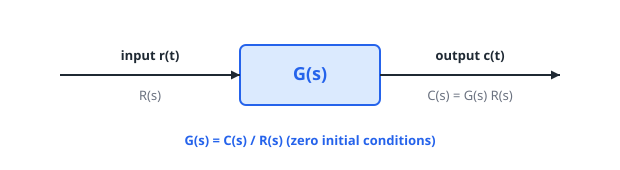
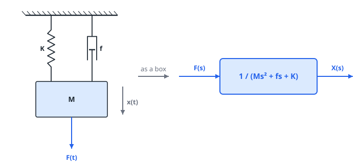
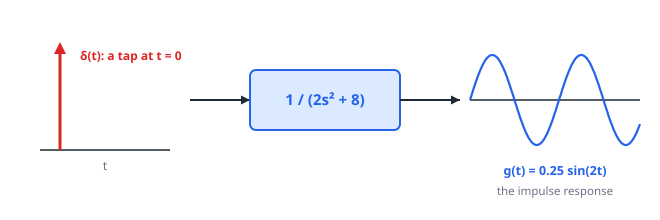
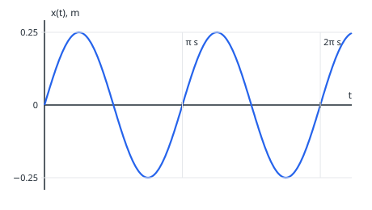
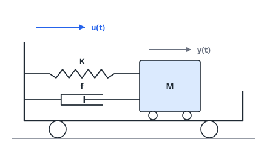
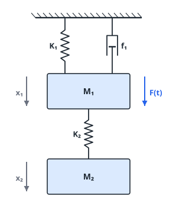

# Transfer Functions

**A transfer function is the ratio of a system's output to its input after both have been Laplace-transformed with zero initial conditions — one fraction in s that captures how the system responds to any input.**

A hi-fi's tone controls are a transfer function you can hear: whatever music goes in, the amplifier boosts some frequencies and cuts others in a fixed way. The transfer function is that fixed way, written down.

## Before you start
<!-- bite: eafb6142-60a7-49a0-97c0-98deef7e1f79 -->

You should be able to write the differential equation of a mass–spring–damper ([[mechatronics/09-translational-systems|Translational Systems]]). You need to know that the Laplace transform turns a function of time t into a function of s; the few rules you need are given here.

After this lesson you will be able to:

1. define the transfer function and the impulse response, and say how they are related;
2. derive a transfer function from a differential equation, following the step-by-step procedure;
3. say whether a transfer function is strictly proper, proper or improper, and write its characteristic equation.

## What a transfer function is
<!-- bite: bf12a243-004f-4e58-95e1-e047f650a438 -->

At the end of the last lesson we had equations like M d²x/dt² + f dx/dt + Kx = F. That is correct, but awkward: to know how x responds you must solve a differential equation for every new F. The transfer function swaps the calculus for algebra. Laplace-transform both sides and the derivatives become powers of s; then the output divided by the input is a fraction that **does not depend on the input at all**. It belongs to the system.

The notes' definition, for a **linear time-invariant (LTI)** system with input r(t) and output c(t):

$$G(s) = \frac{C(s)}{R(s)}\quad\text{(with zero initial conditions)}$$

The running example is the mass–spring–damper from lesson 9.

## Seeing a transfer function
<!-- bite: 8ff5c3e2-35fc-4590-9024-eaa39ad25d8e -->

Think of the transfer function as a box. The input goes in on the left, the output comes out on the right, and $G(s)$ is whatever the box does to it:

## The kid version
<!-- bite: e660a688-2ecb-4222-bfd5-030a4454506b -->

Think of a machine that bakes bread. You do not describe it by listing every loaf it has ever made. You describe the *recipe* — what it does to whatever flour you put in. Put in more flour, get more bread, in a predictable way. A transfer function is the recipe of a system: tell me the input, and the recipe tells me the output.

**Where the analogy stops working.** The recipe only works this neatly for linear systems, where twice the input gives twice the output. A real spring that stiffens as it stretches, or friction that sticks, breaks the recipe — those systems need other tools.

## The few Laplace rules you need
<!-- bite: 21781a68-f42c-45ec-a13a-7fa5a74ec078 -->

The Laplace transform turns a time function x(t) into X(s). With **zero initial conditions** — the system at rest before the input arrives — the rules that matter are short:

1. A derivative becomes multiplication by s: dx/dt → sX(s), and d²x/dt² → s²X(s).
2. An integral becomes division by s: ∫x dt → X(s)/s.
3. Constants pass straight through: K x(t) → K X(s).
4. The unit impulse δ(t), a very sharp tap of total size 1, becomes 1.

So the D operator from lesson 8 simply becomes s. That is the whole trick.

## The running example: X(s)/F(s)
<!-- bite: 735dc9c6-8a81-4fcb-ba4d-73b034ab6c55 -->

Take the equation of motion and transform each term:

$$F = M\frac{d^2x}{dt^2} + f\frac{dx}{dt} + Kx \;\;\longrightarrow\;\; F(s) = Ms^2X(s) + fsX(s) + KX(s)$$

Factor out X(s), then divide:

$$F(s) = (Ms^2 + fs + K)X(s) \qquad\Longrightarrow\qquad \frac{X(s)}{F(s)} = \frac{1}{Ms^2 + fs + K}$$

That fraction is the transfer function. It is the notes' Example 1 answer, and it appears in nearly every exam. Notice that F(s) has disappeared from the right-hand side: the fraction describes the system, whatever the force.

## Seeing the running example as a box
<!-- bite: 3eaabf83-6587-468f-b69b-6a4870111507 -->

Here is the mass–spring–damper next to its transfer function. Everything about the springs, mass and damper is now packed inside one box: the force goes in, the displacement comes out.

## The impulse response
<!-- bite: 3a6d7201-de49-4222-810e-013f3c3c388b -->

Why is it called "G"? Because of the impulse. Give a system a unit impulse — a sharp tap, δ(t) — and record what it does: that output is its **impulse response**, g(t). Since δ(t) transforms to 1, C(s) = G(s) × 1, so

$$G(s) = \mathcal{L}[g(t)]$$

In words: **the transfer function is the Laplace transform of the impulse response.** Knowing how a system rings after one sharp tap tells you how it responds to anything, because any input can be built out of taps.

## Seeing the impulse response
<!-- bite: 6ba855bb-2fe3-4145-9ff8-84bd9c1fe99c -->

Give the system one sharp tap, the impulse $\delta(t)$, and watch what comes out. That output is the impulse response $g(t)$, and its Laplace transform is the transfer function. Here it is for a 2 kg mass on an 8 N/m spring:

## Worked example: tapping a mass on a spring
<!-- bite: b1a370f5-ba19-48ef-9284-d5dbb3c37b89 -->

From the notes' home exercises: a mass M on a spring K, at rest, is given a unit impulse force δ(t). Find the motion.

The equation is M d²x/dt² + Kx = δ(t). Transforming, (Ms² + K)X(s) = 1, so

$$X(s) = \frac{1}{Ms^2 + K} = \frac{1}{M}\cdot\frac{1}{s^2 + K/M}$$

Using the table pair 1/(s² + ω²) ↔ sin(ωt)/ω with ωₙ = √(K/M):

$$x(t) = \frac{1}{\sqrt{MK}}\,\sin\!\left(\sqrt{K/M}\;t\right)$$

## Seeing the oscillation
<!-- bite: 87790374-7fc9-41aa-afc0-923b608ce6c1 -->

With M = 2 kg and K = 8 N/m: ωₙ = √(8/2) = 2 rad/s and the amplitude is 1/√16 = 0.25 m, so x(t) = 0.25 sin 2t.

Predict before you look: with no damper, does it ever stop? It does not — nothing dissipates the energy the tap put in. Add a damper and the wave would shrink each cycle.

## The general nth-order system
<!-- bite: 63fc4a1f-5121-4eb3-8c8a-751a3eca3ff2 -->

Any LTI system can be written as an nth-order differential equation in the output c and the input r:

$$a_0\frac{d^nc}{dt^n} + a_1\frac{d^{n-1}c}{dt^{n-1}} + \cdots + a_nc = b_0\frac{d^mr}{dt^m} + b_1\frac{d^{m-1}r}{dt^{m-1}} + \cdots + b_mr$$

Transforming term by term gives the general transfer function — a ratio of two polynomials in s:

$$G(s) = \frac{C(s)}{R(s)} = \frac{b_0s^m + b_1s^{m-1} + \cdots + b_m}{a_0s^n + a_1s^{n-1} + \cdots + a_n}$$

The highest power of s in the denominator, n, is the **order** of the system. The mass–spring–damper is second order.

## Proper, improper and the characteristic equation
<!-- bite: ff2d4a31-5ed8-476d-be40-67c6c83972cd -->

The notes classify a transfer function by comparing the denominator's degree n with the numerator's degree m:

1. **Strictly proper**: n > m. Example: 1/(Ms² + fs + K). Real physical systems are almost always this.
2. **Proper**: m = n. Example: (s + 2)/(s + 5).
3. **Improper**: m > n. It would respond infinitely to a sudden change, so it cannot be built.

The **characteristic equation** is the denominator set to zero:

$$a_0s^n + a_1s^{n-1} + \cdots + a_n = 0$$

Its roots are the **poles**, and they decide how the system behaves: how fast it settles, whether it oscillates, whether it is stable. For the mass–spring–damper, Ms² + fs + K = 0.

## Systems with several inputs and outputs
<!-- bite: d9a7787c-b215-4fde-82ab-cac170679a80 -->

A system with p inputs and q outputs is **multivariable**. Its transfer function becomes a q × p **transfer-function matrix**:

$$\mathbf{C}(s) = \mathbf{G}(s)\,\mathbf{R}(s)$$

Each entry is one input-to-output transfer function, found with every other input set to zero:

$$G_{ij}(s) = \frac{C_i(s)}{R_j(s)}\quad\text{(all other inputs zero)}$$

The three-mass system of lesson 9, with forces F₁ and F₂ and outputs x₁, x₂, x₃, is a 3 × 2 example.

## Seeing several inputs and outputs
<!-- bite: 4a670c1c-0223-4d30-a780-c537590aec8b -->

With two inputs and two outputs there are four paths, one for each input–output pair, and each has its own transfer function $G_{ij}$: from input $j$ to output $i$. At each output, the paths add up.

## The procedure for deriving a transfer function
<!-- bite: 87fd890d-35ae-4ce4-a8a6-d81fdd17e472 -->

The lecture slides give nine steps. Follow them in order every time:

1. **Define the system** — its elements and how they connect.
2. **State the assumptions** — linear elements, zero initial conditions, gravity balanced.
3. **Write the differential equations** — free-body diagram or network.
4. **Transform to the Laplace domain.**
5. **Apply the initial conditions** — zero, so every derivative is just a power of s.
6. **Express output and input in the Laplace domain** — collect each unknown's terms.
7. **Derive the transfer function** — eliminate the other unknowns, then divide output by input.
8. **Simplify and standardise** — highest power of s first, no fractions inside fractions.
9. **Interpret physically** — check the units, the order, and that the poles make sense.

(The whiteboard notes give the same method in seven steps, ending with "verify units, poles, zeros and physical intuition".)

## Worked example: the cart
<!-- bite: fb8557ec-231e-4468-88c3-b95074d2f328 -->

Here is the tutorial's cart (practice Question 1). The cart moves u(t), the input; the mass inside moves y(t), the output. Everything is at rest for t < 0.

**Steps 1–3.** The spring and damper join M to the cart wall, so they respond to the difference y − u:

$$M\ddot{y} = -K(y - u) - f(\dot{y} - \dot{u}) \;\;\Longrightarrow\;\; M\ddot{y} + f\dot{y} + Ky = f\dot{u} + Ku$$

## Worked example: the cart's transfer function
<!-- bite: beb76d21-de08-414e-a295-ec739b09bf23 -->

**Steps 4–7.** Transform with zero initial conditions and divide:

$$(Ms^2 + fs + K)\,Y(s) = (fs + K)\,U(s) \;\;\Longrightarrow\;\; \frac{Y(s)}{U(s)} = \frac{fs + K}{Ms^2 + fs + K}$$

**Step 9.** Second order and strictly proper. Check: for a very slow push (s → 0) it gives 1, so the mass simply travels with the cart — which is right.

## The two-mass system
<!-- bite: 81f777db-009f-4b47-93cc-36ff6a73e2f9 -->

The next worked example uses two hanging masses: spring $K_1$ and damper $f_1$ hold $M_1$ from the ceiling, the force $F$ pulls on $M_1$, and spring $K_2$ hangs $M_2$ below it.

## Worked example: two masses, eliminating a variable
<!-- bite: e59718ee-fa1d-43d9-b917-beab3cb36968 -->

Quiz 2 Question 5 has two masses: spring K₁ and damper f₁ hold M₁ (force F, displacement x₁), and spring K₂ joins M₁ to M₂ (x₂). From lesson 9's node rule, transformed:

$$(M_1s^2 + f_1s + K_1 + K_2)X_1 - K_2X_2 = F, \qquad -K_2X_1 + (M_2s^2 + K_2)X_2 = 0$$

**Step 7 — eliminate X₂.** The second equation gives X₂ = K₂X₁ / (M₂s² + K₂). Substitute into the first and multiply through by (M₂s² + K₂):

$$\frac{X_1(s)}{F(s)} = \frac{M_2s^2 + K_2}{(M_1s^2 + f_1s + K_1 + K_2)(M_2s^2 + K_2) - K_2^2}$$

The denominator is fourth order: two masses, so two second-order motions, coupled.

## Using the transfer function
<!-- bite: e30ba523-8021-49f0-bde5-db4e0efc4932 -->

The 2024/25 exam asks how the transfer function helps analyse the response and design control. In short:

1. **Response to any input** — multiply by the input's transform and invert: step, ramp, sine or impulse.
2. **Stability and speed** — the poles (roots of the characteristic equation) tell you whether it settles and how fast; the damping f moves them.
3. **Frequency response** — put s = jω to see which frequencies it amplifies, so you know which vibrations to avoid.
4. **Control design** — a controller is just another transfer function placed in series or feedback; its job is to move the poles to where you want them. That is what block diagrams, two lessons on, are for.

## Terms used with transfer functions
<!-- bite: 19c27cf0-498d-4896-9bcb-7c89f1ce6011 -->

1. **LTI (linear time-invariant) system**: this is a system where doubling the input doubles the output, and the behaviour does not change with time. Only LTI systems have transfer functions.
2. **Transfer function**: this is the ratio of the Laplace-transformed output to the Laplace-transformed input, with zero initial conditions.
3. **Impulse response**: this is a system's output when its input is a unit impulse δ(t). Its Laplace transform is the transfer function.
4. **Order**: this is the highest power of s in the denominator of the transfer function.
5. **Characteristic equation**: this is the denominator of the transfer function set equal to zero.
6. **Pole**: this is a root of the characteristic equation. Poles decide whether, and how fast, the system settles.
7. **Proper / strictly proper / improper**: these compare the degree of the numerator m with that of the denominator n: strictly proper n > m, proper n = m, improper m > n.

## Common pitfalls and traps
<!-- bite: e56a0570-7b74-4030-af7d-25d4c4b8d832 -->

- **Forgetting the zero initial conditions.** The transfer function assumes the system starts at rest; otherwise extra initial-condition terms appear.
- **Writing input over output.** It is output over input: X(s)/F(s), not F(s)/X(s).
- **Stopping before eliminating.** For two masses, the answer must contain only X₁ and F — eliminate X₂ completely.
- **Confusing the characteristic equation with the transfer function.** It is just the denominator, set to zero.
- **Using the cart's u as a force.** In the cart, u is a displacement, so the input appears through the spring and damper, not as a force.

## Check your understanding
<!-- bite: 88dabff2-3d15-4465-8c02-1472ac29a76d -->

Try each one before you open the answer.

1. <!-- q: mcq id="fe1311f6" -->
   A mass–spring–damper has M = 2 kg, f = 6 N·s/m and K = 10 N/m. What is its transfer function X(s)/F(s)?

   - [x] 1 / (2s² + 6s + 10)
   - [ ] 2s² + 6s + 10
   - [ ] 1 / (10s² + 6s + 2)
   - [ ] (6s + 10) / (2s² + 6s + 10)

   

Answer

   X(s)/F(s) = 1/(Ms² + fs + K) = 1/(2s² + 6s + 10). The fourth option is a cart-type transfer function, where the input is a displacement.

   

2. <!-- q: mcq id="ade860f2" -->
   A system's characteristic equation is s² + 4s + 3 = 0. What are its poles?

   - [ ] s = 1 and s = 3
   - [x] s = −1 and s = −3
   - [ ] s = −4 and s = −3
   - [ ] s = 0 and s = −4

   

Answer

   s² + 4s + 3 = (s + 1)(s + 3), so the poles are s = −1 and s = −3. Both are negative, so the system settles.

   

3. <!-- q: mcq id="34f468c6" -->
   G(s) = (3s + 2) / (s³ + 5s² + 4s + 1). How is it classified?

   - [x] Strictly proper
   - [ ] Proper
   - [ ] Improper

   

Answer

   Numerator degree m = 1, denominator degree n = 3, and n > m, so it is strictly proper. It is a third-order system.

   

4. <!-- q: exact id="185c302d" answer="0.2" tolerance="0.001" -->
   A mass–spring–damper has X(s)/F(s) = 1/(Ms² + fs + K) with K = 50 N/m. A constant force of 10 N is applied and held. Once the motion has died away, what is the displacement in metres? (Hint: steady state is the limit s → 0.)

   

Answer

   At steady state s → 0 and the transfer function becomes 1/K, so x = F/K = 10/50 = 0.2 m. Only the spring holds a steady load; the mass and damper only act while things are moving.

   

5. <!-- q: exact id="930d1f43" answer="0.125" tolerance="0.001" -->
   A mass M = 4 kg on a spring K = 16 N/m, initially at rest, is struck by a unit impulse. Its motion is x(t) = (1/√(M·K)) sin(√(K/M) t). What is the amplitude of the oscillation, in metres?

   

Answer

   1/√(M·K) = 1/√64 = 1/8 = 0.125 m. It oscillates at √(16/4) = 2 rad/s.

   

6. <!-- q: open id="8a5971f7" -->
   State, in words, how the transfer function and the impulse response of a system are related, and why that makes the impulse response so useful.

   

Answer

   The transfer function is the Laplace transform of the impulse response: G(s) = L[g(t)], because an impulse transforms to 1, so the output's transform is just G(s). It is useful because any input can be thought of as a string of scaled impulses; once you know how the system answers one tap, you can work out its answer to any input.

   

## Check your understanding: worked problems
<!-- bite: b865b828-df27-4a40-8932-f7b4c4295311 -->

1. <!-- q: open id="700a76a4" -->
   A damper f joins an input point (displacement xᵢ) to an output point (displacement xₒ). At the output point, a mass M and a spring K are both connected to the fixed ground. Find Xₒ(s)/Xᵢ(s).

   

Answer

   At the output node, the damper force equals the forces in M and K:
   f(ẋᵢ − ẋₒ) = Mẍₒ + Kxₒ, so Mẍₒ + fẋₒ + Kxₒ = fẋᵢ.
   Transforming: (Ms² + fs + K)Xₒ = fsXᵢ, so

   Xₒ(s)/Xᵢ(s) = fs / (Ms² + fs + K).

   It is zero at s = 0: a slow, steady push just slides the damper without moving the output.

   

2. <!-- q: mcq id="263e2b74" -->
   Spring K₁ and damper f₁ hold mass M₁ (force F, displacement x₁); spring K₂ joins M₁ to M₂ (displacement x₂). The transformed equations are (M₁s² + f₁s + K₁ + K₂)X₁ − K₂X₂ = F and −K₂X₁ + (M₂s² + K₂)X₂ = 0. What is X₂(s)/F(s)?

   - [x] K₂ / [(M₁s² + f₁s + K₁ + K₂)(M₂s² + K₂) − K₂²]
   - [ ] (M₂s² + K₂) / [(M₁s² + f₁s + K₁ + K₂)(M₂s² + K₂) − K₂²]
   - [ ] K₂ / (M₂s² + K₂)
   - [ ] 1 / (M₁s² + f₁s + K₁ + K₂)

   

Answer

   X₂ = K₂X₁/(M₂s² + K₂), so X₂/F = [K₂/(M₂s² + K₂)] × X₁/F. Multiplying by X₁/F = (M₂s² + K₂)/Δ cancels (M₂s² + K₂), leaving K₂/Δ with Δ = (M₁s² + f₁s + K₁ + K₂)(M₂s² + K₂) − K₂². The second option is X₁/F.

   

## Before moving on
<!-- bite: df011c18-6815-41b8-8b4e-f91aba3e7b9a -->

You are done when you can turn a mass–spring–damper equation into its transfer function, eliminate a second mass, classify properness, and explain how the transfer function, the impulse response and the poles are connected.

Recap: G(s) = C(s)/R(s) with zero initial conditions, and G(s) = L[g(t)]; d/dt → s; X/F = 1/(Ms² + fs + K); the characteristic equation is the denominator set to zero, and its roots are the poles; follow the nine steps.

Next, [[mechatronics/11-rotational-systems|Rotational Systems]] does all of this for discs and shafts — the exam's torque equations and θ(s)/T(s) questions.

## Related
<!-- bite: 838b4161-44dc-4372-b7d5-60fde2802167 -->

- [[control-theory/index|Control Theory]]: poles, step responses and stability in depth.
- [[mechatronics/16-block-diagram-reduction|Block Diagram Reduction]]: combining transfer functions into one.

## About this lesson
<!-- bite: e67262a8-6490-4217-9841-7588fda6153a -->

**Level:** calculus plus the basic Laplace transform. It covers the transfer function, the impulse response, the general nth-order system, properness, the characteristic equation, multivariable systems, the nine-step procedure, and worked derivations for the mass–spring–damper, a struck spring, the tutorial cart and a two-mass system. It is lesson 10, in section C. Every transfer function here is checked numerically in `scripts/diagrams/mechatronics_models.py`.

**Source:** University of Lagos SSG 415 "Mathematical Models of Physical Systems" whiteboard notes (impulse response and transfer function, derivation procedure, Example 1, home exercises a, c and d), the SSG 415 lecture slides by Dr J. Ogbemhe (properness, characteristic equation, multivariable systems, nine-step procedure), SSG 415 practice Question 1, Quiz 2 Question 5, and the 2024/25 exam Question 2d.
