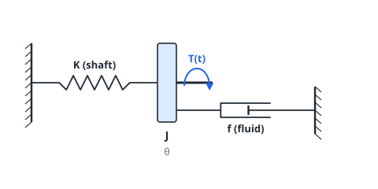
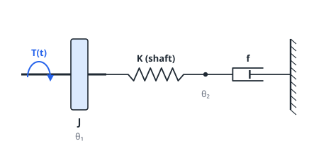
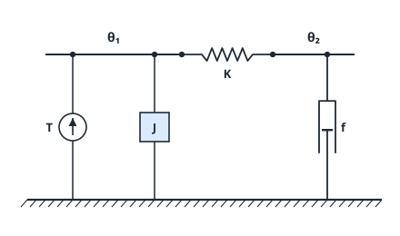
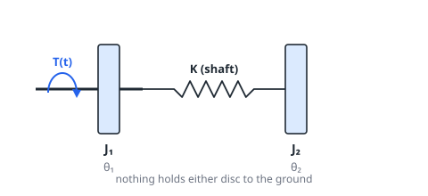
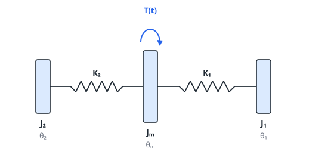

# Rotational Systems

**A rotational system is a set of inertias, torsional springs and rotational dampers turning about an axis, and it is modelled exactly like a translational one — with torque in place of force and angle in place of displacement.**

A motor driving a fan through a long shaft, a car's drivetrain, a robot joint turning its arm, and the drum of a washing machine are all rotational systems.

## Before you start
<!-- bite: ffe03cd4-af1e-4bda-903b-07887d293135 -->

You should know the rotational elements ([[mechatronics/08-mechanical-system-elements|Mechanical System Elements]]), the node rule for networks ([[mechatronics/09-translational-systems|Translational Systems]]) and how to derive a transfer function ([[mechatronics/10-transfer-functions|Transfer Functions]]).

After this lesson you will be able to:

1. write the torque equations of a rotational system from its diagram;
2. draw its rotational mechanical network;
3. derive θ(s)/T(s), including for the three-inertia class example.

## What changes, and what does not
<!-- bite: 91851fb1-4672-482b-9a4b-b6a7f46cd3bc -->

Remember the pattern from lesson 8? Inertia uses the second derivative, the damper the first, the spring the angle itself. Nothing about the method changes for rotation. You swap the words:

1. force F → torque T;
2. displacement x → angle θ;
3. mass M → moment of inertia J;
4. spring K and damper f → torsional spring K and rotational damper f.

The free-body diagram becomes a list of torques, the network has a node for each different angle, and the node rule still writes the equations. So this lesson is mostly practice — on the exact systems the exam keeps setting.

## The kid version
<!-- bite: a2152426-8f55-482b-904b-7760c21454ef -->

Twist the top of a bottle with a long, rubbery straw stuck in it. The bottle is heavy to get spinning (inertia). The straw twists before the bottom turns (a torsional spring). If the bottom of the straw sits in honey, the honey fights fast turning (a damper). Turning things are made of the same three behaviours as sliding things — just going round instead of along.

**Where the analogy stops working.** A rubbery straw also bends and stretches. A torsional spring in our model only twists — it carries torque along a perfectly straight axis and nothing else.

## The simplest case: a disc on a shaft
<!-- bite: 3a33eafe-eb48-450c-9859-0415de6feb9c -->

The notes' first rotational system is a disc of inertia J on a shaft of stiffness K, turning in a viscous fluid damper f, driven by torque T(t).

## The disc's equation
<!-- bite: 11e0240a-1759-4415-92aa-76e37ebad943 -->

Balancing torques on the disc in the picture:

$$T - f\frac{d\theta}{dt} - K\theta = J\frac{d^2\theta}{dt^2} \;\;\Longrightarrow\;\; T = J\frac{d^2\theta}{dt^2} + f\frac{d\theta}{dt} + K\theta$$

Transforming with zero initial conditions:

$$\frac{\theta(s)}{T(s)} = \frac{1}{Js^2 + fs + K}$$

Put it next to X(s)/F(s) = 1/(Ms² + fs + K). It is the same equation with new letters — which is the point.

## The exam's system: J, K and f in a line
<!-- bite: 67140011-0c25-4132-9229-2720b7451c4f -->

Every SSG 415 paper from 2020/21 onward, and quiz 2, sets this system: a torque T(t) turns an inertia J; a flexible shaft K joins J to a damper f; the damper's other side is a fixed wall.

There are **two** different angles: θ₁ at the inertia and θ₂ at the shaft's far end, where the damper is. The shaft twists by θ₁ − θ₂.

## Its rotational network
<!-- bite: 39f5f4b2-8ef5-436b-85a4-000b93b16a5e -->

Two angles means two nodes. J goes from node θ₁ to the reference (its acceleration is measured against the fixed frame). K joins the two nodes. f goes from θ₂ to the reference, because its other side is the wall. T feeds node θ₁.

## Its torque equations
<!-- bite: a93091bf-37f5-446a-bd28-2fbab2302c26 -->

Apply the node rule at each node.

**Node θ₁** (J to reference; K to θ₂; source T):

$$J\frac{d^2\theta_1}{dt^2} + K(\theta_1 - \theta_2) = T$$

**Node θ₂** (K to θ₁; f to reference; no source):

$$K(\theta_2 - \theta_1) + f\frac{d\theta_2}{dt} = 0$$

These are the exam's "torque equations". Notice node θ₂ has no inertia — it is a massless point where the shaft meets the damper.

## Its transfer function θ₁(s)/T(s)
<!-- bite: 303ced48-0297-411d-bb03-4a57cc31677b -->

Transform both equations:

$$(Js^2 + K)\,\theta_1 - K\theta_2 = T, \qquad -K\theta_1 + (fs + K)\,\theta_2 = 0$$

**Eliminate θ₂.** The second gives θ₂ = Kθ₁/(fs + K). Substitute into the first and multiply through by (fs + K):

$$\left[(Js^2 + K)(fs + K) - K^2\right]\theta_1 = (fs + K)\,T$$

Expanding, the K² terms cancel: (Js² + K)(fs + K) − K² = Jfs³ + JKs² + Kfs. So

$$\frac{\theta_1(s)}{T(s)} = \frac{fs + K}{s\,(Jfs^2 + JKs + Kf)}$$

## What the s in the denominator means
<!-- bite: a727b0c9-1cf1-4650-a09d-39d0746d4ca5 -->

That lone factor s is a **pole at s = 0**, and it has a plain physical meaning. Nothing connects θ₁ to the wall with a spring. So a constant torque does not settle at a fixed angle — the shaft winds up a little and then the whole thing keeps turning against the damper, with θ₁ growing for ever. A pole at zero is an integrator: the system adds up the input over time.

Compare the disc-on-shaft system: there K is connected to ground, so it has no pole at zero and a steady torque gives a steady angle T/K.

## Seeing the s in the denominator
<!-- bite: 05211d8e-1225-4602-9f60-49a585bae028 -->

Here are both systems given the same steady torque. The disc on a shaft (green) winds up against its spring and stops at $T/K$. The exam's system (blue) has no spring to the ground, so once the shaft has wound up a little, the whole thing just keeps turning:

## Two inertias on one shaft
<!-- bite: fdc160f3-b913-4d58-aa90-7770abe88cd3 -->

Practice Question 4: torque T(t) turns inertia J₁ (θ₁); a flexible shaft of stiffness K joins it to a second inertia J₂ (θ₂). No dampers, no walls.

## Two inertias: the equations
<!-- bite: 78ba91ab-a11b-4dd0-8e52-543870a1717d -->

Writing the torque balance on each inertia in the picture:

$$J_1\ddot{\theta}_1 + K(\theta_1 - \theta_2) = T, \qquad J_2\ddot{\theta}_2 + K(\theta_2 - \theta_1) = 0$$

From the second, θ₂ = Kθ₁/(J₂s² + K). Substituting and simplifying:

$$\frac{\theta_1(s)}{T(s)} = \frac{J_2s^2 + K}{s^2\left[J_1J_2s^2 + K(J_1 + J_2)\right]}$$

The s² says: with no friction and no ground spring, a steady torque spins the whole pair up faster and faster. The bracket gives the twisting vibration between the two inertias.

## The class example: three inertias
<!-- bite: 6722d8f1-86c5-46f6-9ded-3abcbfe8f1ed -->

Mechatronics class Example 1 (also quiz 2 Question 9) is the big one. A motor of inertia Jₘ, driven by torque T(t) through angle θₘ, sits in the middle. Torsional spring K₂ joins it to inertia J₂ (θ₂) on the left; torsional spring K₁ joins it to inertia J₁ (θ₁) on the right. Find θ₁(s)/T(s).

## Three-inertia: the equations
<!-- bite: 23299b9c-fd23-4fbe-b3f8-8fcaa03a0e69 -->

Three angles, three nodes. Each inertia goes to the reference; K₂ joins θₘ and θ₂; K₁ joins θₘ and θ₁. The node rule gives:

$$T(t) = J_m\frac{d^2\theta_m}{dt^2} + K_2(\theta_m - \theta_2) + K_1(\theta_m - \theta_1)$$

$$J_2\frac{d^2\theta_2}{dt^2} + K_2(\theta_2 - \theta_m) = 0$$

$$J_1\frac{d^2\theta_1}{dt^2} + K_1(\theta_1 - \theta_m) = 0$$

## Three-inertia: into the s-domain
<!-- bite: a702d6a0-4dc6-4592-a038-cf2aeba53f74 -->

Transform with zero initial conditions:

$$T(s) = \left[J_ms^2 + K_2 + K_1\right]\theta_m - K_2\theta_2 - K_1\theta_1 \qquad (4)$$

$$\left[J_2s^2 + K_2\right]\theta_2 = K_2\theta_m \;\;\Rightarrow\;\; \theta_m = \frac{J_2s^2 + K_2}{K_2}\,\theta_2 \qquad (5)$$

$$\left[J_1s^2 + K_1\right]\theta_1 = K_1\theta_m \;\;\Rightarrow\;\; \theta_m = \frac{J_1s^2 + K_1}{K_1}\,\theta_1 \qquad (6)$$

Equating the two expressions for θₘ in (5) and (6) gives θ₂ in terms of θ₁:

$$\theta_2 = \frac{J_1s^2 + K_1}{J_2s^2 + K_2}\cdot\frac{K_2}{K_1}\,\theta_1$$

## Three-inertia: substituting and simplifying
<!-- bite: e8298d7c-b942-4ab5-a704-7f387fdc3b18 -->

Substitute θₘ and θ₂ into (4), so everything is in θ₁:

$$T = \left[J_ms^2 + K_2 + K_1\right]\frac{J_1s^2 + K_1}{K_1}\theta_1 - K_2\frac{J_1s^2 + K_1}{J_2s^2 + K_2}\cdot\frac{K_2}{K_1}\theta_1 - K_1\theta_1$$

Multiply through by K₁(J₂s² + K₂) and expand. The constant terms K₁²K₂ cancel exactly, which is why a factor s² comes out of the whole denominator. The class answer:

$$\frac{\theta_1(s)}{T(s)} = \frac{(J_2s^2 + K_2)K_1}{s^2\left[J_1J_2J_ms^4 + (K_2J_mJ_1 + K_1J_mJ_2 + J_2J_1K_2 + J_2J_1K_1)s^2 + (J_2K_2K_1 + J_1K_1K_2 + J_mK_1K_2)\right]}$$

Read it physically: the s² is the whole assembly spinning up freely (no ground spring, no friction), and the bracket, a quadratic in s², holds the two twisting vibrations of three inertias joined by two springs.

## Terms used in rotational modelling
<!-- bite: 8f965922-c3f2-4460-b7c9-3ef5ec7fa753 -->

1. **Torque equation**: this is the rotational equation of motion — the sum of the torques at a node equals the applied torque.
2. **Torsional stiffness**: this is the torque a shaft needs per radian of twist, K in N·m/rad.
3. **Flexible shaft**: in a diagram, this is a shaft drawn as a torsional spring because it twists under load.
4. **Pole at the origin**: this is a pole at s = 0, a factor s in the denominator. It means the output keeps growing under a steady input, like a free shaft that keeps turning.
5. **Rotational network**: this is a mechanical network for a rotational system, with a node for each different angle.

## Common pitfalls and traps
<!-- bite: aedcf849-e4d1-4c66-bf61-4538b9a88113 -->

- **One angle where there are two.** Wherever a flexible shaft sits between two parts, they have different angles. Give each a node.
- **Forgetting the massless node.** In the J–K–f system, θ₂ has no inertia but still needs its own equation.
- **Mixing up K₁ and K₂ in the three-inertia system.** K₁ goes to J₁, K₂ to J₂. Swapping them still "looks right" but gives a different answer.
- **Not cancelling the constant terms.** If your three-inertia denominator has a constant K₁²K₂ term, you have made an algebra slip: it must cancel.
- **Units.** Torque in N·m, angle in rad, J in kg·m² — never degrees in the equations.

## Check your understanding
<!-- bite: 5937d780-8443-4742-a490-c902be9657f9 -->

Try each one before you open the answer.

1. <!-- q: mcq id="8a644ff1" -->
   A disc with J = 0.5 kg·m² on a shaft K = 20 N·m/rad turns in a fluid damper f = 3 N·m·s/rad. The shaft's other end is fixed. What is θ(s)/T(s)?

   - [x] 1 / (0.5s² + 3s + 20)
   - [ ] 1 / (20s² + 3s + 0.5)
   - [ ] (3s + 20) / (0.5s² + 3s + 20)
   - [ ] 1 / (0.5s² + 20)

   

Answer

   θ(s)/T(s) = 1/(Js² + fs + K) = 1/(0.5s² + 3s + 20).

   

2. <!-- q: exact id="ed7a2e06" answer="3" tolerance="0.01" -->
   A disc with J = 2 kg·m² is at rest with its shaft untwisted, so the spring and damper exert no torque yet. A torque of 6 N·m is suddenly applied. What is its angular acceleration at that instant, in rad/s²?

   

Answer

   T = J d²θ/dt² with the other terms zero, so α = T/J = 6/2 = 3 rad/s².

   

3. <!-- q: mcq id="5d949ed0" -->
   A torque T turns inertia J (angle θ₁). A shaft of stiffness K joins J to a point at angle θ₂, where a damper f connects it to a fixed wall. Which is the equation at θ₂?

   - [x] K(θ₂ − θ₁) + f dθ₂/dt = 0
   - [ ] J d²θ₂/dt² + K(θ₂ − θ₁) = 0
   - [ ] K θ₂ + f dθ₂/dt = T
   - [ ] K(θ₁ − θ₂) + f dθ₁/dt = 0

   

Answer

   Node θ₂ touches only the shaft (to θ₁) and the damper (to the wall), and has no inertia and no applied torque: K(θ₂ − θ₁) + f dθ₂/dt = 0.

   

4. <!-- q: open id="bc43e11c" -->
   The J–K–f system has θ₁(s)/T(s) = (fs + K) / [s(Jfs² + JKs + Kf)]. Explain physically why there is a factor s in the denominator, and what happens to θ₁ under a steady torque.

   

Answer

   The factor s is a pole at the origin. Nothing connects θ₁ to the fixed wall with a spring — only through the damper. So under a steady torque, the shaft twists to a fixed amount and then the whole assembly keeps rotating at a steady speed against the damper; θ₁ keeps growing with time instead of settling. A pole at s = 0 acts like an integrator.

   

5. <!-- q: mcq id="f11c2a85" -->
   Torque T turns inertia J₁ (θ₁); a flexible shaft K joins it to inertia J₂ (θ₂). There is no friction and no wall. What is θ₁(s)/T(s)?

   - [x] (J₂s² + K) / (s²[J₁J₂s² + K(J₁ + J₂)])
   - [ ] 1 / (J₁s² + K)
   - [ ] K / (s²[J₁J₂s² + K(J₁ + J₂)])
   - [ ] (J₁s² + K) / (s²[J₁J₂s² + K(J₁ + J₂)])

   

Answer

   From J₂s²θ₂ + K(θ₂ − θ₁) = 0, θ₂ = Kθ₁/(J₂s² + K). Substituting into (J₁s² + K)θ₁ − Kθ₂ = T and simplifying gives (J₂s² + K)/(s²[J₁J₂s² + K(J₁ + J₂)]). The third option is θ₂(s)/T(s).

   

6. <!-- q: gap id="8971c97f" answers="K₂(θm − θ2)|K2(θm − θ2)|K2(θm-θ2)|K₂(θₘ − θ₂);K₁(θm − θ1)|K1(θm − θ1)|K1(θm-θ1)|K₁(θₘ − θ₁)" -->
   In the three-inertia system, the motor's torque equation is T = Jₘ d²θₘ/dt² + ___ + ___, where K₂ joins the motor to J₂ and K₁ joins it to J₁. (Write the K₂ term first.)

   

Answer

   T = Jₘ d²θₘ/dt² + K₂(θₘ − θ₂) + K₁(θₘ − θ₁).

   

## Check your understanding: worked problems
<!-- bite: 223a0f88-43f8-44cf-923e-de40addd8e94 -->

1. <!-- q: open id="3ca46d5e" -->
   Quiz 2 Question 10: a motor Jₘ (torque T, angle θₘ) is joined by spring K₂ to inertia J₂ (θ₂) and by spring K₁ to inertia J₁ (θ₁). This time J₂ is also joined to a fixed left wall by a shaft of stiffness K₃, and J₁ to a fixed right wall by a shaft of stiffness K₄. Write the three torque equations.

   

Answer

   T = Jₘθ̈ₘ + K₂(θₘ − θ₂) + K₁(θₘ − θ₁)
   0 = J₂θ̈₂ + K₂(θ₂ − θₘ) + K₃θ₂
   0 = J₁θ̈₁ + K₁(θ₁ − θₘ) + K₄θ₁

   The wall shafts go from each node to the reference, so they use θ₂ and θ₁ alone. Because the assembly is now held to the walls, the transfer function no longer has a pole at s = 0.

   

## Practice — independent task
<!-- bite: 4b72f8a9-ae2c-4bc5-ba48-72ab58dcb9e7 -->

Take the three-inertia equations (4), (5) and (6) and derive θ₁(s)/T(s) yourself with the notes closed.

**Done when** your denominator has a factor s², no constant term, and matches the class answer term by term. If you have a constant K₁²K₂ left over, look again at the −K₁θ₁ term in (4).

## Before moving on
<!-- bite: 7f9f1e61-ebd6-49ec-8b23-c46fe410b1ca -->

You are done when you can write the torque equations and network of a rotational system, derive θ(s)/T(s) with an elimination step, and explain a pole at s = 0.

Recap: torque, angle and inertia replace force, displacement and mass; one node per angle; J–K–f gives θ₁/T = (fs + K)/[s(Jfs² + JKs + Kf)]; the three-inertia answer has an s² factor because nothing holds the assembly to ground.

Next, [[mechatronics/16-block-diagram-reduction|Block Diagram Reduction]] shows how a control system built from many transfer functions collapses to one — the skill tested in Quiz 1.

## Related
<!-- bite: 9e95b575-b7ab-4e03-afd6-98fa1b02b548 -->

- [[mechatronics/12-electrical-systems-and-analogies|Electrical Systems and the Two Analogies]]: the exam's "analogous electrical circuits" for these rotational systems.
- [[robotics/08-dynamics|Robotics: Dynamics]]: torques in a robot arm.

## About this lesson
<!-- bite: 37249b27-28a3-4f8a-90a0-1b9c62a072f8 -->

**Level:** calculus and Laplace transforms. It covers the rotational elements in action, the disc–shaft–damper, the exam's J–K–f system (equations, network and transfer function), two inertias on a shaft, and the three-inertia class example worked in full. It is lesson 11, in section C. Every transfer function here is checked numerically in `scripts/diagrams/mechatronics_models.py`.

**Source:** University of Lagos SSG 415 "Mathematical Models of Physical Systems" whiteboard notes (rotational disc–shaft–damper, Example 2), Mechatronics Class Example 1 (three-inertia system and its solution), SSG 415 Quiz 2 (Questions 8–10), practice Questions 2 and 4, and the exam question banks (2020/21 and 2023/24 Question 2).
