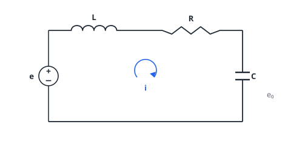
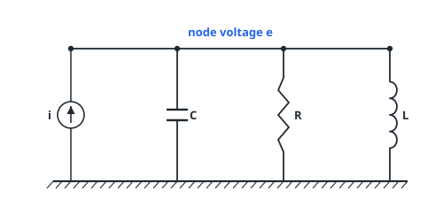
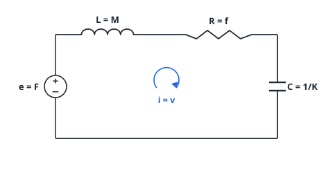
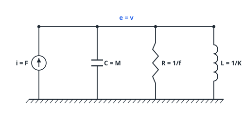
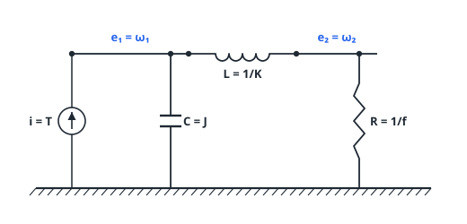
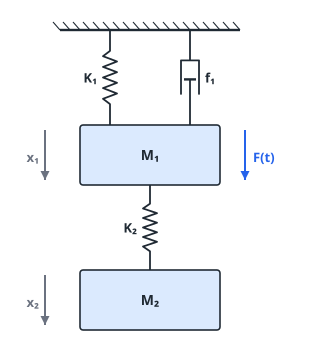
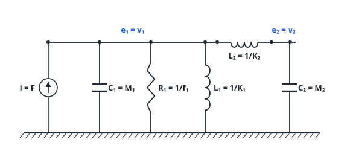

# Electrical Systems and the Two Analogies

**An electrical analogy is a circuit whose equations have exactly the same form as a mechanical system's, so the mechanical system can be studied, simulated or built as a circuit — and there are two such analogies, force–voltage and force–current.**

Before computers, engineers really did build little circuits to test car suspensions and aircraft wings, because a circuit is cheaper to change than steel. Today the same idea lets one set of tools — circuit simulators, transfer functions — serve both worlds.

## Before you start
<!-- bite: 68ee3329-9256-4d23-9a78-c7604c034940 -->

You should be able to write the equation of a mass–spring–damper and draw its mechanical network ([[mechatronics/09-translational-systems|Translational Systems]]). You need to know that a resistor, an inductor and a capacitor are circuit parts, and Kirchhoff's two laws: the voltages around a loop add to zero (KVL), and the currents into a node add to zero (KCL).

After this lesson you will be able to:

1. write the equations of a series and a parallel RLC circuit;
2. state the force–voltage and force–current analogy tables;
3. draw the analogous circuits of a mechanical system, translational or rotational, using either analogy.

## What an analogy is
<!-- bite: 9f2d5c3c-0b75-43bd-abbc-4988a78c2a09 -->

Look at the mass–spring–damper's equation again:

$$M\frac{d^2x}{dt^2} + f\frac{dx}{dt} + Kx = F$$

A second derivative, a first derivative, the variable itself, and an input. Now we will find **two** electrical circuits whose equations have exactly this shape. When two systems obey equations of the same form, they are **analogous**: whatever one does, the other does too, with the letters renamed. Remember the notes' list of the five elements of mechatronics? "Physical system analogies" was in the very first one.

The running example stays the mass–spring–damper. At the end, we do the exam's rotational system.

## The kid version
<!-- bite: 3c0e6d49-7816-459c-a1b5-d46f7a8583a2 -->

Water in pipes behaves a lot like electricity in wires: pressure pushes water like voltage pushes current, a narrow pipe resists flow like a resistor. Once you see that, you can explain a circuit by talking about plumbing. A mechanical analogy is the same trick with pushes and springs: a heavy trolley acts like a coil of wire that hates sudden changes of current, a spring acts like a capacitor storing charge. Same behaviour, different stuff.

**Where the analogy stops working.** There is not one right pairing but two. You can match force with voltage *or* with current, and both are correct — they just give differently shaped circuits.

## The three electrical elements
<!-- bite: c64c1fce-6fdb-4279-98f5-9ad3021b6ff9 -->

The notes describe the electrical elements the same way as the mechanical ones:

1. The **resistor** R is **energy dissipative**: it turns electrical energy into heat, like a damper. Voltage across it is Ri.
2. The **inductor** L stores energy in its magnetic field. Voltage across it is L di/dt.
3. The **capacitor** C stores energy in its electric field. Voltage across it is (1/C)∫i dt, which is q/C, where q = ∫i dt is the charge.

One dissipates, two store — the same split as the damper, mass and spring.

## The series RLC circuit
<!-- bite: 0cded23d-0427-4969-b000-a6495aa0abd8 -->

A voltage source e drives one current i around a loop through L, R and C:

Kirchhoff's voltage law says the voltages around the loop add up to the source:

$$L\frac{di}{dt} + Ri + \frac{1}{C}\int i\,dt = e, \qquad e_0 = \frac{1}{C}\int i\,dt$$

Written in terms of the charge q = ∫i dt, it becomes

$$L\frac{d^2q}{dt^2} + R\frac{dq}{dt} + \frac{1}{C}q = e, \qquad e_0 = \frac{q}{C}$$

Lay it beside M ẍ + f ẋ + Kx = F. Term for term: L ↔ M, R ↔ f, 1/C ↔ K, q ↔ x, e ↔ F. That is the **force–voltage analogy**.

## The parallel RLC circuit
<!-- bite: c7d6737d-d1ea-4d3f-9503-0eb5599d78f5 -->

Now a current source i feeds one node with voltage e, and C, R and L each connect that node to ground:

Kirchhoff's current law says the currents leaving the node add up to the source current:

$$C\frac{de}{dt} + \frac{e}{R} + \frac{1}{L}\int_{-\infty}^{t} e\,dt = i$$

In terms of the magnetic flux linkage φ = ∫e dt:

$$C\frac{d^2\varphi}{dt^2} + \frac{1}{R}\frac{d\varphi}{dt} + \frac{1}{L}\varphi = i$$

Term for term with the mass–spring–damper: C ↔ M, 1/R ↔ f, 1/L ↔ K, φ ↔ x, i ↔ F. That is the **force–current analogy**.

## The two analogy tables
<!-- bite: 5fb72515-44ba-4ae3-969e-58a690d394cb -->

Now that you have seen where each pairing comes from, here are both tables from the notes, for memorising. Torque and the rotational quantities follow exactly the same pattern.

| Mechanical | Force–voltage | Force–current |
| --- | --- | --- |
| Force F / torque T | Voltage e | Current i |
| Mass M / inertia J | Inductance L | Capacitance C |
| Viscous friction f | Resistance R | Reciprocal resistance 1/R |
| Stiffness K | Reciprocal capacitance 1/C | Reciprocal inductance 1/L |
| Displacement x / angle θ | Charge q | Magnetic flux φ |
| Velocity v / angular velocity ω | Current i | Voltage e |

The velocity row is the one to watch: velocity becomes **current** in force–voltage, but **voltage** in force–current.

## The mass–spring–damper as two circuits
<!-- bite: 920f2cc8-ec96-4ec1-9e27-c435c561463f -->

From the notes' Example 1. In **force–voltage**, the force becomes a voltage source, and everything that moves with the mass's single velocity carries the same current, so the elements go **in series** in one loop: L = M, R = f, C = 1/K.

## The mass–spring–damper: the force–current circuit
<!-- bite: 9d0b259c-f207-454f-a807-c03153d9648b -->

In **force–current**, the force becomes a current source, and everything sharing the mass's velocity shares one node voltage, so the elements go **in parallel**: C = M, R = 1/f, L = 1/K.

## How to draw any analogous circuit
<!-- bite: 3a552722-b712-4161-99f1-c6ec13f999d8 -->

Look again at the mass–spring–damper's mechanical network from lesson 9: one node, with F, M, f and K in parallel to the reference. The force–current circuit has **exactly that shape**. That is the general rule, and it makes force–current the easy one:

1. **Force–current: copy the mechanical network.** Each node stays a node (its velocity becomes the node voltage). Each mass becomes a capacitor to ground, each damper a resistor 1/f, each spring an inductor 1/K, each force a current source.
2. **Force–voltage: turn each node into a loop.** Each node's velocity becomes a loop (mesh) current. An element attached to one node only goes in that loop. An element joining two nodes goes in the branch **shared** by the two loops. Each force becomes a voltage source in its node's loop.

Force–voltage turns parallel into series and series into parallel — the circuit is the **dual** of the network.

## Rotational systems: the exam's circuits
<!-- bite: 72b3196f-9ae1-409b-93cd-d978ebe33c33 -->

Every SSG 415 paper asks for the analogous circuits of the J–K–f system from lesson 11: torque T on inertia J (θ₁), shaft K to a damper f (θ₂) on a wall. Its equations, in angular velocities ω = dθ/dt, are

$$J\frac{d\omega_1}{dt} + K\int(\omega_1 - \omega_2)\,dt = T, \qquad K\int(\omega_2 - \omega_1)\,dt + f\omega_2 = 0$$

## The torque–voltage circuit
<!-- bite: 18908d40-e9bf-4d7c-89de-165e83d14d34 -->

Two nodes in the network, so two loops. Loop 1 (current i₁ = ω₁) holds the source e = T and L = J, which touch only node θ₁. The spring K joins the two nodes, so C = 1/K is the **shared** branch. Loop 2 (i₂ = ω₂) holds R = f.

Its loop equations, L di₁/dt + (1/C)∫(i₁ − i₂)dt = e and (1/C)∫(i₂ − i₁)dt + Ri₂ = 0, match the torque equations letter for letter.

## The torque–current circuit
<!-- bite: 4c3a9bc8-54a9-4ecc-9dc4-49778abbdc28 -->

Copy the network: node e₁ = ω₁ holds the current source i = T and C = J to ground; L = 1/K joins the two nodes; node e₂ = ω₂ holds R = 1/f to ground.

Its node equations are C de₁/dt + (1/L)∫(e₁ − e₂)dt = i and (1/L)∫(e₂ − e₁)dt + e₂/R = 0 — again the torque equations with new letters.

## Which analogy should you use?
<!-- bite: 6612309d-2147-473b-aa16-2323d173f339 -->

The 2025/26 exam asks how the choice of analogy affects the representation. Both give the same equations, so both are correct; the difference is in the drawing:

1. **Force–current keeps the shape.** The circuit is a copy of the mechanical network, so it is quick to draw and easy to check. It is solved with node equations (KCL).
2. **Force–voltage flips the shape.** Parallel mechanical elements become series ones, so the circuit looks different from the machine. It is solved with loop equations (KVL). It feels natural because "force pushes like a voltage", and the mass becomes an inductor, which resists change just as a mass does.

## Terms used in analogies
<!-- bite: d2e23628-37ee-4207-94bf-675cbb928c2d -->

1. **Analogous systems**: these are systems, of different physical kinds, whose equations have the same form. One can be used to study the other.
2. **Force–voltage analogy**: this is also known as the **torque–voltage** analogy for rotation. It pairs force with voltage, mass with inductance, friction with resistance, stiffness with 1/C, and velocity with current.
3. **Force–current analogy**: this is also known as the **torque–current** analogy. It pairs force with current, mass with capacitance, friction with 1/R, stiffness with 1/L, and velocity with voltage.
4. **Mesh**: this is a loop in a circuit. In force–voltage, each mechanical node becomes a mesh carrying a loop current.
5. **Charge, q**: this is the integral of current, q = ∫i dt. It is the analogue of displacement in force–voltage.
6. **Flux linkage, φ**: this is the integral of voltage, φ = ∫e dt. It is the analogue of displacement in force–current.
7. **Dual circuit**: this is a circuit in which series and parallel are swapped. The force–voltage circuit is the dual of the mechanical network.

## Common pitfalls and traps
<!-- bite: 5d20ca8e-0dcf-427d-8039-176ad106f3f7 -->

- **Using K for C directly.** Stiffness maps to a *reciprocal*: C = 1/K in force–voltage, L = 1/K in force–current.
- **Using f for R in force–current.** It is R = 1/f there, because friction maps to conductance.
- **Drawing the force–voltage circuit with the network's shape.** It must be the dual: elements in parallel mechanically are in series in the loop.
- **Forgetting the shared branch.** An element between two nodes goes in the branch shared by both loops in force–voltage, and between the two nodes in force–current.
- **Velocity, not displacement, is the circuit variable you draw.** Loop currents and node voltages are velocities; charge and flux are the displacements.

## Check your understanding
<!-- bite: 51152ae3-87f7-45b8-96fc-8e138276bb1f -->

Try each one before you open the answer.

1. <!-- q: mcq id="69342bb9" -->
   In the force–voltage analogy, what does a mass M become?

   - [x] An inductance L = M
   - [ ] A capacitance C = M
   - [ ] A resistance R = M
   - [ ] A capacitance C = 1/M

   

Answer

   An inductance. In force–current, the mass becomes a capacitance instead.

   

2. <!-- q: mcq id="cc6104f0" -->
   In the force–current analogy, what does a spring of stiffness K become?

   - [ ] A capacitance C = 1/K
   - [x] An inductance L = 1/K
   - [ ] A resistance R = K
   - [ ] An inductance L = K

   

Answer

   An inductance of 1/K (reciprocal inductance 1/L ↔ K). In force–voltage it is a capacitance C = 1/K.

   

3. <!-- q: gap id="f3cbae2b" answers="charge|charge q;flux|magnetic flux|flux linkage" -->
   A displacement x corresponds to electric ___ in the force–voltage analogy, and to magnetic ___ in the force–current analogy.

   

Answer

   Charge q in force–voltage; magnetic flux (linkage) φ in force–current.

   

4. <!-- q: exact id="5185a1c6" answer="0.25" tolerance="0.001" -->
   A mass–spring–damper has M = 3 kg, f = 4 N·s/m and K = 50 N/m. In its force–current analogous circuit, what is the resistance, in ohms?

   

Answer

   In force–current, friction maps to conductance: R = 1/f = 1/4 = 0.25 Ω. (The capacitance is C = 3 F and the inductance L = 1/50 = 0.02 H.)

   

5. <!-- q: mcq id="3dc81988" -->
   Which equation is the series RLC circuit written in terms of charge q?

   - [x] L d²q/dt² + R dq/dt + q/C = e
   - [ ] C d²q/dt² + (1/R) dq/dt + q/L = e
   - [ ] L dq/dt + Rq + C∫q dt = e
   - [ ] R d²q/dt² + L dq/dt + Cq = e

   

Answer

   L d²q/dt² + R dq/dt + q/C = e. The second option is the parallel circuit's form, but in flux φ and current i.

   

6. <!-- q: open id="281b9655" -->
   Explain why the force–current analogous circuit has the same shape as the mechanical network, while the force–voltage circuit does not.

   

Answer

   In force–current, velocity becomes node voltage, so every element attached to a moving part shares that node, exactly as in the mechanical network — elements in parallel stay in parallel. In force–voltage, velocity becomes loop current, so everything attached to one moving part must carry that one current and goes in series in its loop, while an element between two parts becomes a branch shared by two loops. Series and parallel swap, so the force–voltage circuit is the dual of the network.

   

## Check your understanding: worked problems
<!-- bite: be335b58-a90a-48e4-9d01-d7933c88160d -->

1. <!-- q: sketch id="3dfcb682" -->
   Two masses hang from a ceiling: spring K₁ and damper f₁ in parallel hold M₁, which carries a downward force F and moves x₁; spring K₂ joins M₁ to M₂ below, which moves x₂. Draw the force–current analogous circuit and label every element.

   

   

Answer

   

   What to check:
   - Two nodes, e₁ = v₁ and e₂ = v₂, plus ground.
   - At e₁: the current source F, and C₁ = M₁, R₁ = 1/f₁, L₁ = 1/K₁ each to ground.
   - L₂ = 1/K₂ between the two nodes.
   - At e₂: C₂ = M₂ to ground.

   

## Before moving on
<!-- bite: afa1b3ed-f824-4132-9f0d-999a552d9c16 -->

You are done when you can write both RLC equations, reproduce both analogy tables from the equations rather than from memory, and draw either analogous circuit for a one- or two-node system.

Recap: series RLC ↔ force–voltage (L = M, R = f, C = 1/K, velocity ↔ current); parallel RLC ↔ force–current (C = M, R = 1/f, L = 1/K, velocity ↔ voltage); force–current copies the network, force–voltage is its dual.

Next, [[mechatronics/13-two-mass-coupled-systems|Two-Mass Coupled Systems and Analogies]] puts all of section C and D together on the exam's two-train-car system.

## Related
<!-- bite: 3bf28500-ccb4-4cf5-9e10-6ffa470db59e -->

- [[mechatronics/11-rotational-systems|Rotational Systems]]: the J–K–f system's torque equations.
- [[control-theory/05-modelling-3|Control Theory: Modelling 3]]: electrical modelling from the control side.

## About this lesson
<!-- bite: e59168d9-eb31-49f1-904e-def01281c6ec -->

**Level:** calculus and basic circuit laws. It covers the R, L and C elements, the series and parallel RLC equations, the force–voltage and force–current analogies and how each is derived, the drawing rules, and the exam's torque–voltage and torque–current circuits. It is lesson 12, the first of section D (electrical analogies). The analogy mappings are checked numerically in `scripts/diagrams/mechatronics_models.py`.

**Source:** University of Lagos SSG 415 "Mathematical Models of Physical Systems" whiteboard notes (electrical systems, analogous systems table, Examples 1 and 2), Dr J. Ogbemhe's handwritten lecture slides (electrical, analogous and mechanical systems), SSG 415 Quiz 2, and the exam question banks (2020/21 and 2023/24 Question 2iii; 2025/26 Question 2b–c).
