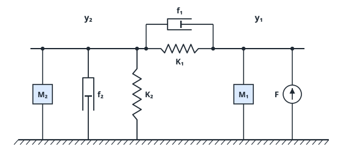
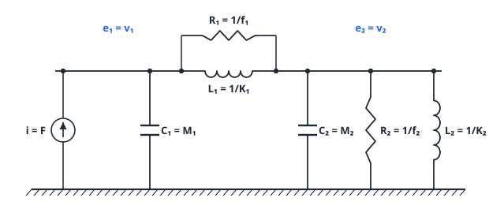
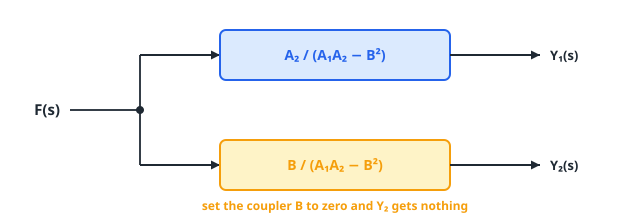

# Two-Mass Coupled Systems and Analogies

**A two-mass coupled system is two masses joined by springs and dampers so that each one's motion drives the other, and the exam's two-train-car system is the standard example — modelled end to end with equations, both electrical analogies and a transfer function.**

Two railway wagons joined by a buffer-and-coupling, a car body on a wheel on a tyre, or two floors of a building in an earthquake all move like this: push one, and the other answers a moment later.

## Before you start
<!-- bite: 85363c36-48cb-48ab-97d3-4759de138e70 -->

You need everything from section C and lesson 12: the node rule ([[mechatronics/09-translational-systems|Translational Systems]]), elimination to a transfer function ([[mechatronics/10-transfer-functions|Transfer Functions]]) and the two analogies ([[mechatronics/12-electrical-systems-and-analogies|Electrical Systems and the Two Analogies]]).

After this lesson you will be able to:

1. write the differential equations of the two-train-car system and explain the coupling;
2. derive its force–voltage and force–current equations and draw both circuits;
3. derive Y₁(s)/F(s), state its order, and explain what it means for control.

## What makes it "coupled"
<!-- bite: 9eabc039-4557-472a-a86e-da8527699115 -->

In lesson 9 the masses were coupled too, but here the coupling is the whole question. This system is set every year — 30 marks in 2024/25, 20 in 2025/26 — and the parts are always the same: equations, both analogies, the networks, the transfer function and what it means. So this lesson is one long worked example, done the way the exam wants it.

## The two-train-car system
<!-- bite: 05a9271d-f921-4e8a-859b-37bf3ccc7dd0 -->

The system: car M₂ is joined to a fixed wall by a spring K₂ and damper f₂; car M₁ is joined to M₂ by a spring K₁ and damper f₁ (the coupling); a force F pulls M₁. Both roll on frictionless wheels.

## The kid version
<!-- bite: 64557526-d3ba-46e0-9a4b-414c3e657ea7 -->

Two friends on roller skates hold the two ends of a stretchy rope, and one of them is also tied to a wall. Pull the free skater, and the rope stretches; a moment later the other skater gets dragged along too, and then the wall rope pulls them back, and the rope tugs the first skater back in turn. Neither can move without the other feeling it. That back-and-forth is coupling.

**Where the analogy stops working.** A rope only pulls. The couplers between train cars push *and* pull, and the damper part fights relative speed in both directions, so the motion can swing either way.

## Step 1: the mechanical network
<!-- bite: 0480c952-2207-4b47-89a0-c8249009ca48 -->

Two displacements, y₁ and y₂, so two nodes. Everything attached to the wall (K₂, f₂) goes from node y₂ to the reference. The coupling K₁ and f₁ goes between the nodes. Each mass goes to the reference, and F feeds node y₁.

## Step 2: the differential equations
<!-- bite: 5565e95a-106d-4552-9e23-d57f767b704f -->

Apply the node rule at each node.

**Car M₁:**

$$M_1\ddot{y}_1 + f_1(\dot{y}_1 - \dot{y}_2) + K_1(y_1 - y_2) = F$$

**Car M₂:**

$$M_2\ddot{y}_2 + f_2\dot{y}_2 + K_2y_2 + f_1(\dot{y}_2 - \dot{y}_1) + K_1(y_2 - y_1) = 0$$

In velocities (v = ẏ), which is the form the analogies use:

$$M_1\frac{dv_1}{dt} + f_1(v_1 - v_2) + K_1\int(v_1 - v_2)\,dt = F$$

$$M_2\frac{dv_2}{dt} + f_2v_2 + K_2\int v_2\,dt + f_1(v_2 - v_1) + K_1\int(v_2 - v_1)\,dt = 0$$

## How the interaction forces couple the cars
<!-- bite: 4eb8f844-0438-4a42-8a4e-3970db3e1c52 -->

The exam asks you to explain how these equations describe the interaction (2024/25 Q2a) and how the interaction forces influence the dynamics (2025/26 Q2a). The answer lives in the f₁ and K₁ terms:

1. **They appear in both equations, with opposite signs.** The coupler pushes M₁ back exactly as hard as it pushes M₂ forward — Newton's third law.
2. **They depend on the difference of motion.** If both cars move together (y₁ = y₂), the coupler carries no force. It only acts when the cars move *relative* to each other.
3. **They make the equations inseparable.** y₂ appears in M₁'s equation, so you cannot find one car's motion without the other's. Set K₁ = f₁ = 0 and the equations split apart: M₁ becomes a free mass, M₂ a simple mass on a wall spring.

## Seeing the coupling forces
<!-- bite: 8737f213-63d1-4394-b490-5fbc7fc97947 -->

Draw each car on its own with the forces on it. The coupler's force (orange) appears on both cars, the same size, pointing opposite ways. That shared force is what ties the two equations together.

## Step 3: the force–voltage analogy
<!-- bite: 182d04f1-7ef3-4732-bad6-14a969c8b3ef -->

Replace M → L, f → R, K → 1/C, F → e and v → i. The two velocity equations become two **loop** equations, with i₁ = v₁ and i₂ = v₂:

$$L_1\frac{di_1}{dt} + R_1(i_1 - i_2) + \frac{1}{C_1}\int(i_1 - i_2)\,dt = e$$

$$L_2\frac{di_2}{dt} + R_2i_2 + \frac{1}{C_2}\int i_2\,dt + R_1(i_2 - i_1) + \frac{1}{C_1}\int(i_2 - i_1)\,dt = 0$$

with L₁ = M₁, L₂ = M₂, R₁ = f₁, R₂ = f₂, C₁ = 1/K₁, C₂ = 1/K₂ and e = F.

## The force–voltage circuit
<!-- bite: e272baac-adb2-425d-8ad8-7c16ef5d4c2e -->

Two nodes became two loops. The coupling elements R₁ and C₁ carry i₁ − i₂, so they sit in the branch **shared** by the loops. Everything else belongs to one loop only.

Notice f₁ and K₁ were *in parallel* in the machine, but R₁ and C₁ are *in series* in the shared branch. That is the force–voltage flip.

## Step 4: the force–current analogy
<!-- bite: e05293d7-528c-4ac2-85bc-cc8f09c3a0d2 -->

Replace M → C, f → 1/R, K → 1/L, F → i and v → e. The velocity equations become two **node** equations, with e₁ = v₁ and e₂ = v₂:

$$C_1\frac{de_1}{dt} + \frac{1}{R_1}(e_1 - e_2) + \frac{1}{L_1}\int(e_1 - e_2)\,dt = i$$

$$C_2\frac{de_2}{dt} + \frac{e_2}{R_2} + \frac{1}{L_2}\int e_2\,dt + \frac{1}{R_1}(e_2 - e_1) + \frac{1}{L_1}\int(e_2 - e_1)\,dt = 0$$

with C₁ = M₁, C₂ = M₂, R₁ = 1/f₁, R₂ = 1/f₂, L₁ = 1/K₁, L₂ = 1/K₂ and i = F.

## The force–current circuit
<!-- bite: 1aa5bca9-5b3d-4d18-a91b-23bdb3fd5b1b -->

Copy the mechanical network: same two nodes, same connections.

## Comparing the two circuits
<!-- bite: 10e42b3c-5f40-4627-8499-8fd620018223 -->

The exam asks you to compare the models and evaluate their structural differences (2025/26 Q2b–c):

1. **Same equations.** Both circuits obey exactly the mechanical equations, so both predict the same motion. Neither is "more right".
2. **Different structure.** The force–current circuit has the network's shape — two nodes, the coupling between them, parallel stays parallel. The force–voltage circuit is its dual — two loops, the coupling in a shared branch, parallel becomes series.
3. **Different analysis.** Force–current is solved by node analysis (KCL); force–voltage by mesh analysis (KVL).
4. **Practical choice.** Force–current is quicker to draw and check against the machine. Force–voltage reads more intuitively for a force-driven system ("force is the push, like a voltage"), and the masses appear as inductors, which, like masses, resist sudden changes.

## Step 5: the transfer function
<!-- bite: 92c84768-6ac8-4432-a8b7-4bc78f210861 -->

Transform the displacement equations with zero initial conditions and give the brackets short names:

$$A_1 = M_1s^2 + f_1s + K_1, \quad B = f_1s + K_1, \quad A_2 = M_2s^2 + (f_1 + f_2)s + K_1 + K_2$$

$$A_1Y_1 - BY_2 = F, \qquad -BY_1 + A_2Y_2 = 0$$

**Eliminate Y₂.** From the second, Y₂ = BY₁/A₂. Substitute into the first and multiply through by A₂:

$$\frac{Y_1(s)}{F(s)} = \frac{A_2}{A_1A_2 - B^2}, \qquad \frac{Y_2(s)}{F(s)} = \frac{B}{A_1A_2 - B^2}$$

Written out in full,

$$\frac{Y_1(s)}{F(s)} = \frac{M_2s^2 + (f_1 + f_2)s + K_1 + K_2}{(M_1s^2 + f_1s + K_1)\left[M_2s^2 + (f_1 + f_2)s + K_1 + K_2\right] - (f_1s + K_1)^2}$$

## Seeing the two transfer functions
<!-- bite: 72e296e2-58f6-4f0a-b47b-d49e99ae8e1c -->

One input, two outputs. The force $F$ reaches car 1 through one transfer function and car 2 through another. The coupler term $B$ sits on top of the second one: without the coupler, no force reaches car 2.

## Step 6: what the transfer function says
<!-- bite: ac86c1f8-17b7-4016-a896-c3d6fc3c3c78 -->

The 2025/26 exam asks for its order, coupling effects and dynamic response, and how they influence control design.

1. **Order.** The denominator A₁A₂ − B² is a polynomial of degree **four**. Two masses, each a second-order motion, so a fourth-order system with two natural frequencies (two modes: the cars swinging together, and against each other).
2. **Coupling.** The −B² term is the coupling. With f₁ = K₁ = 0, B = 0 and Y₁/F collapses to 1/(M₁s²): M₁ alone. B also appears on top of Y₂/F: force reaches M₂ *only* through the coupler.
3. **Dynamic response.** The four poles decide how the cars ring and settle. Light damping means a slow, wobbly approach; the two modes can make the response beat.
4. **Control design.** A controller that measures only y₁ sees one car and can push the other into oscillation. Good designs measure both cars, add damping in the coupler (bigger f₁), or place the controller's poles away from the two natural frequencies so it does not excite them.

## Terms used for coupled systems
<!-- bite: 05910932-f320-4f39-af03-c63875f52e0f -->

1. **Coupling element**: this is an element joining two moving parts, such as K₁ and f₁ between the cars. It transmits force only when the parts move relative to each other.
2. **Coupled system**: this is a system whose equations cannot be solved one at a time, because each unknown appears in the others' equations.
3. **Mode**: this is one natural pattern of motion of a multi-mass system, with its own natural frequency — here, cars moving together or moving against each other.
4. **Shared branch**: in a force–voltage circuit, this is the branch belonging to two loops, holding the elements that join two mechanical nodes.

## Common pitfalls and traps
<!-- bite: c41429c0-fe1c-4871-b9e7-dfd07c99d4cb -->

- **Putting f₁ and K₁ in parallel in the force–voltage circuit.** They carry the same relative velocity, so in force–voltage they are in series in the shared branch.
- **Writing f₂ and K₂ between the cars.** They join M₂ to the wall: node y₂ to the reference.
- **Forgetting (f₁ + f₂) and (K₁ + K₂) in A₂.** Car M₂ feels both its wall connections and the coupler.
- **Leaving Y₂ in the answer.** The transfer function contains only Y₁, F and the constants.
- **Calling it second order.** Two masses give fourth order.

## Check your understanding
<!-- bite: e9a6c9d4-9dec-4fdb-bd45-91f4fdc24ea0 -->

Try each one before you open the answer.

1. <!-- q: mcq id="c36acbe5" -->
   In the two-train-car system, car M₂ is joined to the wall by K₂ and f₂, and to car M₁ by K₁ and f₁. Which is the equation of motion of M₂?

   - [x] M₂ÿ₂ + f₂ẏ₂ + K₂y₂ + f₁(ẏ₂ − ẏ₁) + K₁(y₂ − y₁) = 0
   - [ ] M₂ÿ₂ + f₂ẏ₂ + K₂y₂ = F
   - [ ] M₂ÿ₂ + (f₁ + f₂)ẏ₂ + (K₁ + K₂)y₂ = 0
   - [ ] M₂ÿ₂ + f₁(ẏ₁ − ẏ₂) + K₁(y₁ − y₂) = 0

   

Answer

   The first: the wall elements use y₂ alone, and the coupler uses y₂ − y₁. There is no applied force on M₂. The third option drops the coupling to M₁.

   

2. <!-- q: mcq id="4a514278" -->
   In the force–voltage circuit of the two-train-car system, where do the coupling elements R₁ = f₁ and C₁ = 1/K₁ go?

   - [ ] In parallel with each other, across the voltage source.
   - [x] In series, in the branch shared by the two loops.
   - [ ] In the first loop only.
   - [ ] In parallel with L₂.

   

Answer

   They carry the relative velocity i₁ − i₂, so they sit in the branch shared by both loops, and in force–voltage parallel mechanical elements become series ones.

   

3. <!-- q: exact id="6a378f48" answer="4" -->
   What is the order of the two-train-car system's transfer function Y₁(s)/F(s)?

   

Answer

   Four. The denominator (M₁s² + f₁s + K₁)(M₂s² + …) − (f₁s + K₁)² has highest power s⁴: two masses, two second-order motions.

   

4. <!-- q: exact id="b84e6257" answer="0.618034" sigfigs="3" -->
   A two-train-car system has M₁ = M₂ = 1 kg, K₁ = K₂ = 1 N/m and no dampers, so its characteristic equation is s⁴ + 3s² + 1 = 0. Its natural frequencies are the values ω with s² = −ω². What is the lower natural frequency, in rad/s?

   

Answer

   Put s² = −ω²: ω⁴ − 3ω² + 1 = 0, so ω² = (3 ∓ √5)/2 = 0.382 or 2.618. The lower is ω = √0.382 = 0.618 rad/s (the higher is 1.618 rad/s — the golden ratio pair). In the slow mode the cars swing together; in the fast mode they move against each other.

   

5. <!-- q: mcq id="169e0e86" -->
   If the coupling is removed (K₁ = 0 and f₁ = 0), what does Y₁(s)/F(s) become?

   - [x] 1/(M₁s²) — car M₁ is just a free mass.
   - [ ] 1/(M₂s² + f₂s + K₂)
   - [ ] 0 — car M₁ no longer moves.
   - [ ] It is unchanged.

   

Answer

   With B = f₁s + K₁ = 0, Y₁/F = A₂/(A₁A₂) = 1/A₁ = 1/(M₁s²). A free mass on frictionless wheels just accelerates under F.

   

6. <!-- q: open id="3da9b54e" -->
   Explain, in a few sentences, how the force–current and force–voltage models of the two-train-car system differ in structure, and why both are still correct.

   

Answer

   The force–current circuit has the same shape as the mechanical network: two nodes for the two cars, the coupler as R₁ = 1/f₁ and L₁ = 1/K₁ between the nodes, and the wall elements and masses to ground. The force–voltage circuit is the dual: each car becomes a loop, the coupler's R₁ = f₁ and C₁ = 1/K₁ go in series in the branch shared by both loops, and parallel elements become series ones. Both are correct because each circuit's equations (node equations for one, loop equations for the other) are the mechanical equations with the letters renamed.

   

## Check your understanding: worked problems
<!-- bite: ff39b689-71eb-429d-9cb8-1de7d0835f43 -->

1. <!-- q: open id="ef3bfaa6" -->
   Starting from (M₁s² + f₁s + K₁)Y₁ − (f₁s + K₁)Y₂ = F and −(f₁s + K₁)Y₁ + [M₂s² + (f₁ + f₂)s + K₁ + K₂]Y₂ = 0, derive Y₂(s)/F(s), and explain why the coupling term appears in its numerator.

   

Answer

   From the second equation, Y₁ = A₂Y₂/B, where B = f₁s + K₁ and A₂ = M₂s² + (f₁ + f₂)s + K₁ + K₂. Substituting into the first, (A₁A₂/B − B)Y₂ = F, so

   Y₂(s)/F(s) = B / (A₁A₂ − B²) = (f₁s + K₁) / [(M₁s² + f₁s + K₁)A₂ − (f₁s + K₁)²].

   B is on top because the force acts on M₁ and can only reach M₂ through the coupler. If B were zero, M₂ would never move.

   

## Before moving on
<!-- bite: 6e943a06-d3d1-4d69-8c47-cb103ef9d194 -->

You are done when you can do the whole question unaided: network, both pairs of equations, both circuits, Y₁/F, its order, and what the coupling means for control.

Recap: two nodes; the coupler acts on relative motion and appears in both equations with opposite signs; force–current copies the network, force–voltage puts the coupler in the shared branch; Y₁/F = A₂/(A₁A₂ − B²) is fourth order with two modes.

That closes section D. Next, section E switches from analogue to digital: [[mechatronics/14-karnaugh-maps|Karnaugh Maps and Boolean Minimisation]] simplifies the logic a mechatronic controller runs.

## Related
<!-- bite: 65212fea-31e0-4ddc-ab09-a32c6703f8ec -->

- [[mechatronics/09-translational-systems|Translational Systems]]: the node rule used here.
- [[mechatronics/12-electrical-systems-and-analogies|Electrical Systems and the Two Analogies]]: the analogy tables.

## About this lesson
<!-- bite: a846f7cb-d14e-4428-af6b-dee386a72a81 -->

**Level:** calculus, Laplace transforms and circuit laws. It covers the two-train-car system end to end: network, equations, how the coupling works, both analogies with their equations and circuits, a structural comparison, and the transfer function with its order and meaning for control. It is lesson 13, the last of section D. Every equation and transfer function here is checked numerically in `scripts/diagrams/mechatronics_models.py`, including that both circuits reproduce the cars' velocities.

**Source:** SSG 415 exam question banks (2024/25 Question 2 and 2025/26 Question 2, the two-train-car system), SSG 415 Quiz 2 Question 6, and the "Mathematical Models of Physical Systems" whiteboard notes (Example 3, two-mass coupled system).
