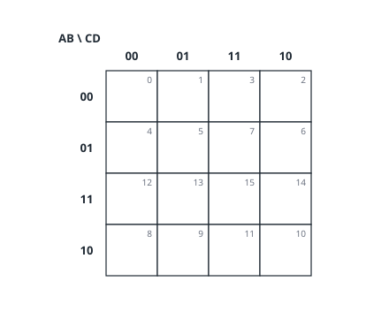
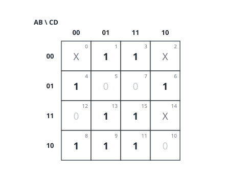
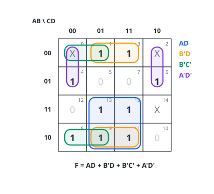
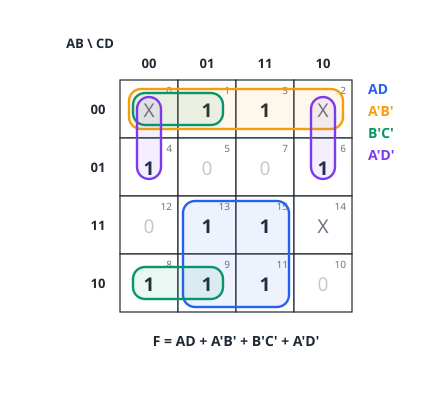
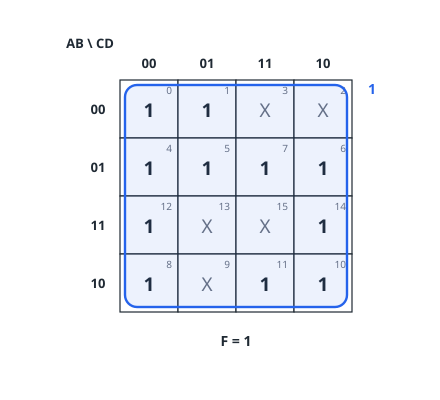
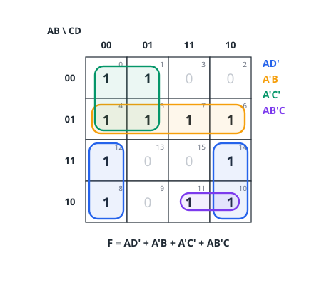
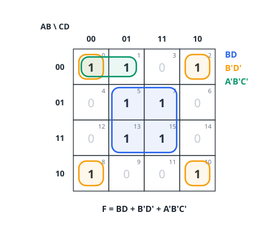

# Karnaugh Maps and Boolean Minimisation

**A Karnaugh map is a grid of all the input combinations of a logic function, laid out so that neighbouring cells differ in only one input, which lets you simplify the function by circling groups of 1s.**

A robot arm's controller often makes yes/no decisions from yes/no sensors: gripper closed? part present? guard shut? arm at home? The rule that turns those four answers into "move" or "stop" is a Boolean function, and the simpler it is, the fewer gates, the faster and the more reliable the controller.

## Before you start
<!-- bite: 24c60726-b3ec-44f3-85d8-432e3259fead -->

You should know that a Boolean variable is 0 or 1, that AND is written as a product ($AB$), OR as a sum (A + B), and NOT with a prime (A′). You will meet the computers-and-logic element from [[mechatronics/02-the-five-elements-of-mechatronics|The Five Elements of Mechatronics]] in action.

After this lesson you will be able to:

1. write a function given as Σm(…) + Σd(…) in its canonical form and explain don't-care conditions;
2. set up a four-variable Karnaugh map and group it correctly, including wrap-around groups;
3. read off the minimal expression, and judge the gate count, delay and reliability of the result.

## What minimisation is for
<!-- bite: 814103e9-7832-4245-b545-30968bb02229 -->

Every SSG 415 paper sets one question like this: "a robotic arm with four sensors A, B, C, D… minimise the Boolean function using the Karnaugh map principle." The function arrives in a compressed form, like

$$F(A,B,C,D) = \sum m(1,3,4,6,8,9,11,13,15) + \sum d(0,2,14)$$

and the job is to find the **simplest** sum-of-products expression that gives the same output. Simplest means fewest terms, then fewest literals (variables in the terms) — because each term is an AND gate and each literal is a gate input.

The running example is that function, from the 2020/21 and 2023/24 papers. Later we do the robotic-arm function from 2024/25 and 2025/26, which has a surprise in it.

## The kid version
<!-- bite: 1e685090-7f72-4870-bdf0-ef380ede91c3 -->

Imagine a big table of every possible answer to four yes/no questions — 16 rows. Many rows say "go". Writing out all 16 rules separately is long. But if you notice "whenever questions A and D are both yes, it's always go, whatever B and C say", you can replace four rows with one short rule. A Karnaugh map is a clever way of laying out the table so those patterns jump out as blocks you can circle.

**Where the analogy stops working.** Spotting patterns by eye can miss the best answer; a Karnaugh map has strict rules (blocks of 1, 2, 4, 8 or 16, rectangles only) that guarantee the circles really are valid shortcuts.

## Minterms and the canonical form
<!-- bite: ffdcd42c-348a-495a-b1c4-a4db43c81d00 -->

Number the 16 input combinations 0 to 15 by reading $ABCD$ as a binary number: A = 1, B = 0, C = 1, D = 1 is 1011 = **11**. A **minterm** is the AND of all four variables, each plain or primed, that is 1 for exactly one combination: minterm 11 is $AB'CD$.

So Σm(1, 3, 4, …) means: F is 1 for combinations 1, 3, 4, … and the **canonical sum of products** is the OR of those minterms:

$$F = A'B'C'D + A'B'CD + A'BC'D' + \cdots$$

Nine minterms, each needing a four-input AND gate. That is the unminimised controller.

## Don't-care conditions
<!-- bite: bbb91d1f-3e25-4b51-8a43-248d1596e7e2 -->

The Σd(0, 2, 14) part lists **don't-care** combinations. These are inputs that can never happen — say, sensor states that are physically impossible together — or whose output does not matter. We mark them X.

They are a gift: when grouping, you may treat each X as a 1 if it helps make a bigger group, or as a 0 if it does not. You never have to cover an X. This **grouping flexibility** is how don't-cares shrink the answer — we will measure exactly how much.

## The four-variable Karnaugh map
<!-- bite: cd6028fb-0404-474c-80c3-f7b14834d540 -->

The map has the 16 combinations in a 4 × 4 grid: rows are $AB$, columns are $CD$. The trick is the order: **00, 01, 11, 10** — Gray code, where each step changes only one bit. The small number in each cell is its minterm:

Because of the Gray order, **any two side-by-side cells differ in exactly one variable**. And the map wraps round: the left column is next to the right column, and the top row is next to the bottom row (00 and 10 differ in one bit). The four corners are all neighbours.

## Step 1: fill the map
<!-- bite: 8c0b3ba4-c041-426d-abad-508df8de1b64 -->

Put a 1 in each minterm's cell, an X in each don't-care cell, and 0 everywhere else. For our function:

Predict before reading on: can you see a 2 × 2 block of 1s?

## Step 2: the grouping rules
<!-- bite: 976d0676-6cd1-4128-9d7e-5980bd5ce249 -->

Circle groups of 1s (and helpful Xs) following these rules:

1. A group is a **rectangle** of 1, 2, 4, 8 or 16 cells — always a power of two.
2. Groups may **wrap** round the edges and the corners.
3. Make each group **as large as possible**: a bigger group means a shorter term.
4. Use **as few groups as possible**, but every 1 must be in at least one group.
5. Groups may overlap. Xs may be included only when they make a group bigger.

Start with 1s that can only go in one possible largest group — these give the **essential** terms — then cover what is left as cheaply as you can.

## Step 3: group the example
<!-- bite: 1fef2db0-80d9-4fc0-b5d8-3086bf2ffc21 -->

Here is a minimal grouping, four groups of four:

The blue block is the one you predicted. The orange and green groups wrap from the top row to the bottom row; the purple group wraps from the left column to the right. Every 1 is covered. The X at 0 and the X at 2 were used as 1s because they made groups of four possible; the X at 14 was not needed, so it stays a 0.

## Step 4: read off each group
<!-- bite: 0eb830c2-e7c2-466e-8235-02cc3b2e54aa -->

For each group, keep only the variables that **do not change** inside it; drop the ones that do.

Take the blue group: rows 11 and 10, so A = 1 throughout but B changes; columns 01 and 11, so D = 1 throughout but C changes. Keep A and D: the term is **$AD$**. A group of 4 in a four-variable map always leaves 2 variables; a group of 8 leaves 1; a group of 2 leaves 3.

Doing the same for every group:

$$F = AD + B'D + B'C' + A'D'$$

Four two-input ANDs and one OR, instead of nine four-input ANDs.

## Alternative minimal expressions
<!-- bite: 9ac070dc-6b41-473a-9e33-0a26a8c7f23b -->

Is that the only answer? No. The top row (cells 0, 1, 3, 2) is all 1s and Xs, so $A'B'$ is also a group of four, and it can take over the job of $B'D$:

$$F = AD + A'B' + B'C' + A'D'$$

Both have four terms and eight literals, so both are minimal. They differ only in how the don't-cares were assigned: the first treats minterm 2 as needed only for $A'D'$; the second uses 0 and 2 twice. On the real inputs (everything except 0, 2 and 14) the two expressions give identical outputs.

## How much the don't-cares saved
<!-- bite: 000e2e1b-dae6-4435-807c-477bda265790 -->

If the don't-cares were forced to 0, the best you can do is

$$F = B'D + AD + A'BD' + AB'C'$$

— still four terms, but now two of them need three-input ANDs: 10 literals instead of 8. The don't-cares let groups of two grow into groups of four, and each doubling removes a literal.

## The robotic-arm function: a surprise
<!-- bite: e5b86bdd-8670-4a81-b88b-e25fca9b18b7 -->

The 2024/25 and 2025/26 papers give the robotic arm's control function as

$$F(A,B,C,D) = \sum m(0,1,4,5,6,7,8,10,11,12,14) + \sum d(2,3,9,13,15)$$

Count: 11 ones and 5 don't-cares — that is all 16 cells. Fill the map:

Treat every X as a 1 and the whole map is one group of 16. It keeps no variables at all:

$$F = 1$$

## What F = 1 means for the controller
<!-- bite: b6be3d0d-859a-4fd2-8285-2fadd4a26ae8 -->

This is the correct minimal answer, and it answers the exam's "alternative minimal expressions (if any)": there are none — one group, no choice.

**In implementation**, F = 1 needs **no gates**: the output is tied permanently to logic 1. Gate count zero, propagation delay zero.

## Is it safe to use the don't-cares?
<!-- bite: 28a84a1a-b14c-4f04-90e8-ea6e35f62bae -->

**But read it as an engineer.** It says: on every input combination that can actually occur, the arm should act. That is only safe if the five don't-care combinations truly never happen. If a faulty sensor could produce one of them, the controller would act when perhaps it should not. A careful designer either confirms the don't-cares are impossible, or forces them to 0 for safety — which gives:

$$F = AD' + A'B + A'C' + AB'C$$

## Gate count and propagation delay
<!-- bite: c5d8341e-36d5-40be-a716-a6b044d4845f -->

A sum of products is built as **two levels** of logic: AND gates for the terms, then one OR gate, plus inverters (NOT gates) for the primed variables. So:

1. **Gate count** = number of AND gates (terms with two or more literals) + 1 OR + one inverter per variable that appears primed. For $AD$ + $B'D$ + $B'C'$ + $A'D'$: 4 AND + 1 OR + 4 NOT (A′, B′, C′, D′) = 9 gates, with 12 gate inputs.
2. **Propagation delay** is the time for a change at an input to reach the output along the slowest path: NOT → AND → OR. With delays of 5, 10 and 12 ns, that is 27 ns. Two-level logic keeps this short and predictable.
3. **Alternative minimal expressions** with the same number of terms and literals have the same gate count and delay; you choose between them on other grounds — sharing a term with another output, or avoiding glitches.

## What minimisation does for the whole system
<!-- bite: e64d1a74-3df3-4c72-a6d7-232372b5d212 -->

The exam also asks for the system-level impact (2024/25 Q4c, 2025/26 Q4d). The canonical form of the running example needs nine four-input ANDs plus inverters and a nine-input OR; the minimal form needs four two-input ANDs. So:

1. **Response time**: fewer, smaller gates switch faster, and the arm reacts sooner to its sensors.
2. **Hardware efficiency**: fewer gates means a smaller, cheaper board and less power — or, in a PLC, a shorter ladder program and scan time.
3. **Reliability**: every gate and connection can fail; fewer of them means fewer failure points and easier fault-finding.
4. **Maintainability**: a short expression like $AD$ + $B'D$ + … is easy to read, test and change.

## Terms used with Karnaugh maps
<!-- bite: 57fbe315-5cba-4e5e-a701-fa5d5c7cd498 -->

1. **Minterm**: this is the AND of all the variables, each plain or primed, that is 1 for exactly one input combination. Minterm 11 of $ABCD$ is $AB'CD$.
2. **Canonical sum of products**: this is a function written as the OR of all its minterms. It is correct but not simplified.
3. **Don't-care condition**: this is an input combination whose output does not matter, usually because it can never occur. It is marked X and may be treated as 0 or 1.
4. **Gray code**: this is an ordering of binary numbers in which each step changes exactly one bit: 00, 01, 11, 10.
5. **Prime implicant**: this is a group that cannot be made any bigger. Every group in a minimal answer is a prime implicant.
6. **Essential prime implicant**: this is a prime implicant that is the only one covering some 1. It must be in every minimal answer.
7. **Literal**: this is one appearance of a variable, plain or primed, in an expression. $AB'C$ has three literals.
8. **Propagation delay**: this is the time a logic circuit takes to change its output after an input changes.

## Common pitfalls and traps
<!-- bite: e614a559-055d-4ef2-a18e-a6e312cd71ad -->

- **Writing the rows or columns in binary order (00, 01, 10, 11).** It must be Gray order, or neighbouring cells stop differing by one bit and the groups become wrong.
- **Missing wrap-around groups.** The edges join, and so do the four corners.
- **Groups of 3 or 6, or L-shapes.** Only rectangles of 1, 2, 4, 8 or 16 cells.
- **Covering a don't-care for its own sake.** Use an X only when it makes a group bigger.
- **Keeping a variable that changes inside the group.** Only the variables that stay fixed across the whole group survive.
- **Stopping at "F = 1" without comment.** Say what it means for the hardware, and whether the don't-cares are safe to use.

## Check your understanding
<!-- bite: 4dfcbef2-7b51-4226-a676-849b343eef81 -->

Try each one before you open the answer.

1. <!-- q: mcq id="bf7876af" -->
   In what order are the rows ($AB$) and columns ($CD$) of a four-variable Karnaugh map labelled?

   - [ ] 00, 01, 10, 11
   - [x] 00, 01, 11, 10
   - [ ] 00, 10, 01, 11
   - [ ] 11, 10, 01, 00

   

Answer

   00, 01, 11, 10 — Gray code, so each step changes exactly one bit and neighbouring cells differ in one variable.

   

2. <!-- q: exact id="2ae36288" answer="2" -->
   In a four-variable Karnaugh map, how many literals are in the term read from a group of four cells?

   

Answer

   Two. Each doubling of the group removes one variable: a single cell has 4 literals, a pair 3, a group of four 2, a group of eight 1.

   

3. <!-- q: mcq id="c9a3996f" -->
   A group covers minterms 5, 7, 13 and 15 of F(A, B, C, D). What term does it give?

   - [x] $BD$
   - [ ] $AD$
   - [ ] $BC$
   - [ ] $A'BD$

   

Answer

   5 = 0101, 7 = 0111, 13 = 1101, 15 = 1111. B = 1 and D = 1 in all four; A and C change. So the term is $BD$.

   

4. <!-- q: mcq id="0eb71e1c" -->
   F(A, B, C, D) = Σm(1, 3, 4, 6, 8, 9, 11, 13, 15) + Σd(0, 2, 14). Which of these is a minimal expression? (choose all that apply)

   - [x] $AD$ + $B'D$ + $B'C'$ + $A'D'$
   - [x] $AD$ + $A'B'$ + $B'C'$ + $A'D'$
   - [ ] $B'D$ + $AD$ + $A'BD'$ + $AB'C'$
   - [ ] $AD$ + $B'D$ + $A'D'$

   

Answer

   The first two are both minimal (4 terms, 8 literals). The third is correct but uses 10 literals — it is the answer without the don't-cares. The fourth leaves minterm 8 ($AB'C'D'$) uncovered.

   

5. <!-- q: exact id="0f79cc92" answer="27" tolerance="0.01" -->
   A minimal sum-of-products is built as inverters, then AND gates, then one OR gate. The inverter delay is 5 ns, the AND delay 10 ns and the OR delay 12 ns. What is the worst-case propagation delay, in ns?

   

Answer

   The slowest path goes through all three levels: 5 + 10 + 12 = 27 ns.

   

6. <!-- q: open id="7cd7ec96" -->
   The robotic-arm function Σm(0, 1, 4, 5, 6, 7, 8, 10, 11, 12, 14) + Σd(2, 3, 9, 13, 15) minimises to F = 1. Explain why, what this means for the hardware, and what a careful engineer should check.

   

Answer

   The 11 minterms and 5 don't-cares cover all 16 combinations, so if every don't-care is treated as 1 the whole map is one group of 16, which keeps no variables: F = 1. In hardware the output is simply tied to logic 1 — no gates and no delay. But it means the arm acts on every input that can occur, so the engineer must check that the five don't-care combinations really are impossible (for example, that no sensor fault can produce them). If they could occur and acting would be unsafe, the don't-cares should be set to 0, giving F = $AD'$ + $A'B$ + $A'C'$ + $AB'C$.

   

## Check your understanding: worked problems
<!-- bite: 8acd20a0-2cce-41dc-95c7-145974cefe6f -->

1. <!-- q: sketch id="8868b29a" -->
   Draw the Karnaugh map of F(A, B, C, D) = Σm(0, 1, 2, 5, 7, 8, 10, 13, 15), group it, and write a minimal expression.

   

Answer

   

   What to check:
   - Rows $AB$ and columns $CD$ in Gray order 00, 01, 11, 10.
   - $BD$: the centre 2 × 2 block (5, 7, 13, 15).
   - $B'D'$: the four corners (0, 2, 8, 10) — one group, through the wrap-around.
   - Minterm 1 covered by a pair: $A'B'C'$ (0, 1) or $A'C'D$ (1, 5). Both are minimal.
   - F = $BD$ + $B'D'$ + $A'B'C'$ (or $BD$ + $B'D'$ + $A'C'D$).

   

2. <!-- q: exact id="e9d12b8f" answer="9" -->
   With the don't-cares forced to 0, the robotic-arm function becomes F = $AD'$ + $A'B$ + $A'C'$ + $AB'C$. How many literals does this expression have?

   

Answer

   $AD'$ (2) + $A'B$ (2) + $A'C'$ (2) + $AB'C$ (3) = 9 literals — against 0 for F = 1. That is the price of not using the don't-cares.

   

## Before moving on
<!-- bite: 2d72fd4c-2b01-4d73-a718-41320e89b489 -->

You are done when you can fill and group a four-variable map with wrap-arounds and don't-cares, read off a minimal expression, spot an alternative one, and explain the gate count, delay and reliability benefits.

Recap: Gray-coded map; group 1s in rectangles of powers of two, as big and as few as possible, wrapping round; use Xs only when they help; keep the variables that do not change.

That closes section E and the SSG 415 core. Section F is the robotics follow-on course: [[mechatronics/17-serial-and-parallel-manipulators|Serial and Parallel Manipulators]].

## Related
<!-- bite: 4dc46cc3-e9e1-4912-aba9-52b907035ea8 -->

- [[how-computers-work/index|How Computers Work]]: logic gates from the ground up.
- [[mechatronics/02-the-five-elements-of-mechatronics|The Five Elements of Mechatronics]]: computers and logic systems, the element this lesson belongs to.

## About this lesson
<!-- bite: 1b41f560-d070-4f99-849d-6a04ba7f0c1e -->

**Level:** basic Boolean algebra. It covers minterms, the canonical sum of products, don't-care conditions, the four-variable Karnaugh map, the grouping rules, alternative minimal expressions, and the gate-count, delay and system-level effects of minimisation. It is lesson 14, section E. Every minimal expression here is found and checked by a Quine–McCluskey solver in `scripts/diagrams/mechatronics_logic.py`.

**Source:** SSG 415 exam question banks (2020/21 and 2023/24 Question 5; 2024/25 and 2025/26 Question 4, the robotic-arm function) and the SSG 415 practice questions (Questions 3 and 5).
