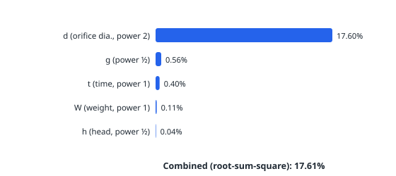

# Measurement Uncertainty and Error Propagation

**Error propagation is the method for working out how much uncertainty a calculated result carries, from the uncertainties in the measurements it was calculated from.**

If your tape measure is a little off and you use it to work out the area of a room, the area is off too — and by more than you might think, because the error goes in twice. This lesson shows how to put a number on that.

## Before you start
<!-- bite: a361e598-3ced-4bb9-b59b-a038243cc45b -->

You should know what accuracy and error mean ([[mechatronics/06-sensor-performance-characteristics|Sensor Performance Characteristics]]). You need powers, square roots and, for the general formula, partial derivatives (differentiating with respect to one variable while holding the others fixed).

After this lesson you will be able to:

1. state the error-propagation rule in words, then as a formula;
2. use the power rule to find the uncertainty in a product or quotient of measurements;
3. find which measurement contributes most to the uncertainty (the "component error").

## What error propagation is
<!-- bite: eaa7ad1a-a015-419e-b096-dd61c9b842ce -->

No measurement is exact. A mass is "200 ± 0.01 g": the true value is probably within 0.01 g of 200. When you feed several such measurements into a formula, each one's uncertainty flows through the formula into the answer. **Error propagation** is the bookkeeping for that flow.

The running example is the exam's **mobile-robot speed controller**, where the rotational speed is worked out from a force, a mass and a radius:

$$\omega = \sqrt{\frac{F}{m\,r}}$$

Each of F, m and r has an uncertainty. How sure can we be of ω?

## The kid version
<!-- bite: 7b43ea7d-8494-4882-8d84-c0a27f251f5a -->

You are baking, and the recipe has three cups — flour, sugar, milk — each measured a bit roughly. If the flour cup is a bit wrong, the cake is a bit wrong. If all three are a bit wrong, the cake is more wrong — but usually not as wrong as if every mistake went the same way, because some mistakes cancel others out. And a mistake in the ingredient you use *lots* of matters more than one in a pinch of salt.

**Where the analogy stops working.** In the formula, "using lots" is not about quantity but about the **power** a variable is raised to: a variable that is squared doubles its share of the error, even if it is a small number.

## The rule, in words and in symbols
<!-- bite: f8dcd8f6-421c-41df-91cc-1ce9ec54b638 -->

Each measurement contributes an amount to the result's uncertainty equal to **how sensitive the result is to that measurement** (the partial derivative) **times that measurement's uncertainty**. Because the separate errors are independent and partly cancel, the contributions are combined by **squaring, adding and taking the square root** — the root-sum-square.

For a result R calculated from measurements x₁, x₂, …, xₙ with uncertainties δx₁, δx₂, …, δxₙ:

$$\delta R = \sqrt{\left(\frac{\partial R}{\partial x_1}\delta x_1\right)^2 + \left(\frac{\partial R}{\partial x_2}\delta x_2\right)^2 + \cdots + \left(\frac{\partial R}{\partial x_n}\delta x_n\right)^2}$$

This is often called the Kline–McClintock equation.

## The power rule shortcut
<!-- bite: d632c455-8812-4d0d-a6af-916e3238c62b -->

Most mechatronics formulas are products and quotients of powers, like ω = F^½ m^-½ r^-½. For those, the partial derivatives simplify to a neat rule: **the relative uncertainty of the result is the root-sum-square of each measurement's relative uncertainty, multiplied by its power.**

If R = k · x^a · y^b · z^c, then

$$\frac{\delta R}{R} = \sqrt{\left(a\frac{\delta x}{x}\right)^2 + \left(b\frac{\delta y}{y}\right)^2 + \left(c\frac{\delta z}{z}\right)^2}$$

The sign of a power does not matter (it is squared), and a constant k carries no uncertainty. Relative uncertainty means uncertainty divided by the value, often written as a percentage.

## Worked example 1: the robot's speed — the values
<!-- bite: 19c49b67-5e5c-46be-b22a-62ecf2d224b1 -->

From the exam: m = 200 ± 0.01 g, r = 25 ± 0.01 mm, F = 500 N ± 0.1 %. Find the uncertainty in ω.

**Step 1 — the value of ω, in SI units.** m = 0.200 kg, r = 0.025 m:

$$\omega = \sqrt{\frac{500}{0.200 \times 0.025}} = \sqrt{100\,000} = 316.23\ \text{rad/s}$$

**Step 2 — relative uncertainty of each measurement.**

1. Force: δF/F = 0.1 % = 0.001.
2. Mass: δm/m = 0.01 / 200 = 0.00005.
3. Radius: δr/r = 0.01 / 25 = 0.0004.

Notice the units cancel inside each ratio, so you can use grams and millimetres there.

## Worked example 1: combining the terms
<!-- bite: 58eb3cb0-4fe7-4369-9a6d-df39ad1d7224 -->

**Step 3 — multiply by the powers.** ω = F^½ m^-½ r^-½, so each power is ½:

1. Force: ½ × 0.001 = 0.0005
2. Mass: ½ × 0.00005 = 0.000025
3. Radius: ½ × 0.0004 = 0.0002

**Step 4 — root-sum-square.**

$$\frac{\delta\omega}{\omega} = \sqrt{0.0005^2 + 0.000025^2 + 0.0002^2} = 5.39\times10^{-4} = 0.054\ \%$$

**Step 5 — absolute uncertainty.** δω = 316.23 × 5.39 × 10⁻⁴ = 0.17 rad/s.

So **ω = 316.23 ± 0.17 rad/s**. The force's uncertainty is the biggest contributor; the mass hardly matters.

*A note on the worst case.* Some lecturers add the terms directly instead of root-sum-square: 0.0005 + 0.000025 + 0.0002 = 0.0725 %, giving ±0.23 rad/s. That assumes every error pushes the same way. State which method you use; root-sum-square is the standard for independent errors.

## Worked example 2: the dosing valve — setting up
<!-- bite: 568213b1-022f-4246-bf78-1b6247be790a -->

From the 2024/25 exam: a team finds the discharge coefficient of a valve's orifice experimentally from

$$C_q = \frac{W}{t\,\rho\,A\sqrt{2gh}}, \qquad A = \frac{\pi d^2}{4}$$

with W = 200 ± 0.23 kg, t = 500 ± 2 s, ρ = 1000 kg/m³ (exact), d = 1.25 ± 0.11 m, g = 9.81 ± 0.11 m/s², h = 3.66 ± 0.003 m. Find C_q and its component errors.

**The value.** A = π(1.25)²/4 = 1.2272 m² and √(2 × 9.81 × 3.66) = 8.474 m/s, so

$$C_q = \frac{200}{500 \times 1000 \times 1.2272 \times 8.474} = 3.85\times10^{-5}$$

**The powers.** Substituting A, C_q ∝ W¹ t⁻¹ ρ⁻¹ d⁻² g^-½ h^-½. The diameter is **squared**, because area goes as d².

## Worked example 2: the component errors
<!-- bite: 3f3de8df-fe84-4395-8b74-2a42ca6b7935 -->

Each **component error** is a measurement's relative uncertainty times its power:

1. Diameter: 2 × 0.11/1.25 = 0.176 (17.6 %)
2. Gravity: ½ × 0.11/9.81 = 0.0056 (0.56 %)
3. Time: 1 × 2/500 = 0.0040 (0.40 %)
4. Weight: 1 × 0.23/200 = 0.00115 (0.11 %)
5. Head: ½ × 0.003/3.66 = 0.00041 (0.04 %)

Root-sum-square: δC_q/C_q = √(0.176² + 0.0056² + 0.0040² + 0.00115² + 0.00041²) = 0.176 = 17.6 %, so δC_q = 3.85 × 10⁻⁵ × 0.176 = 6.8 × 10⁻⁶.

**C_q = (3.85 ± 0.68) × 10⁻⁵.**

## Seeing which measurement matters
<!-- bite: 178bcc34-e479-447a-9c47-7b400281178f -->

The chart shows the component errors side by side:

The diameter swamps everything: its own uncertainty is large (8.8 %) *and* it is squared. The practical lesson is the real point of the exercise — to improve C_q, measure the diameter better. Spending money on a better stopwatch or scale changes almost nothing.

## When the formula is not a product of powers
<!-- bite: 5c013229-1bed-4370-b008-673e399fe221 -->

The power rule only works for products and quotients. The 2023/24 exam's RLC impedance has a **sum** inside a root:

$$Z = \sqrt{R^2 + (X_L - X_C)^2}, \qquad X_L = \omega L,\quad X_C = \frac{1}{\omega C}$$

with R = 2 kΩ, L = 0.8 H, C = 5 µF, each ± 5 %. The question gives no frequency, so assume 50 Hz mains (ω = 314.16 rad/s) and say so. Then X_L = 251.3 Ω and X_C = 636.6 Ω, so X_L − X_C = −385.3 Ω and Z = 2036.8 Ω.

## The impedance by partial derivatives
<!-- bite: 4328ec2f-a2b8-4379-9986-780056548a23 -->

Use the general formula. With D = X_L − X_C, the sensitivities are ∂Z/∂R = R/Z = 0.982 and ∂Z/∂X_L = −∂Z/∂X_C = D/Z = −0.189. Five per cent of each gives δR = 100 Ω, δX_L = 12.57 Ω, δX_C = 31.83 Ω:

$$\delta Z = \sqrt{(0.982 \times 100)^2 + (0.189 \times 12.57)^2 + (0.189 \times 31.83)^2} = 98.4\ \Omega$$

So **Z = 2037 ± 98 Ω**, about 4.8 %. The resistance dominates, because R is far bigger than the net reactance.

## Terms used in error propagation
<!-- bite: b462a05a-8034-47e5-bad2-3265ae01e724 -->

1. **Uncertainty**: this is the range around a measured value within which the true value probably lies, written "value ± uncertainty".
2. **Relative uncertainty**: this is the uncertainty divided by the value, often given as a percentage. It lets you compare uncertainties of things with different units.
3. **Error propagation**: this is working out the uncertainty in a calculated result from the uncertainties of its inputs.
4. **Root-sum-square**: this is combining independent contributions by squaring each, adding them and taking the square root. It allows for errors partly cancelling.
5. **Component error**: this is the share of the result's uncertainty that comes from one particular measurement.

## Common pitfalls and traps
<!-- bite: 8d75beec-de0f-4282-911e-a9a657e779bb -->

- **Forgetting the power.** A squared diameter contributes twice its relative uncertainty; a square root contributes half.
- **Adding absolute uncertainties of different units.** Grams and newtons cannot be added. Use relative uncertainties, or the partial-derivative formula.
- **Using the power rule on a sum.** It only works for products and quotients — use partial derivatives for Z.
- **Forgetting to convert the final answer back.** The power rule gives δR/R; multiply by R to get δR.
- **Not stating assumptions.** If the question leaves out a value (the frequency), assume a sensible one and say so.

## Check your understanding
<!-- bite: b75ac614-ead0-43de-8304-b00621c5f181 -->

Try each one before you open the answer.

1. <!-- q: exact id="b13cc2a5" answer="0.056001" sigfigs="2" -->
   A mobile robot's speed is ω = √(F/(m r)), with m = 150 ± 0.01 g, r = 20 ± 0.01 mm and F = 350 N ± 0.1 %. What is the relative uncertainty in ω, as a percentage?

   

Answer

   Relative uncertainties: F 0.001, m 0.01/150 = 6.67 × 10⁻⁵, r 0.01/20 = 5 × 10⁻⁴. Times the power ½: 5 × 10⁻⁴, 3.33 × 10⁻⁵, 2.5 × 10⁻⁴. Root-sum-square: √(2.5 × 10⁻⁷ + 1.1 × 10⁻⁹ + 6.25 × 10⁻⁸) = 5.60 × 10⁻⁴ = 0.056 %.

   

2. <!-- q: exact id="ac5bb34f" answer="0.19128" sigfigs="2" -->
   For the same robot (m = 150 ± 0.01 g, r = 20 ± 0.01 mm, F = 350 N ± 0.1 %, ω = √(F/(m r))), the relative uncertainty in ω is 5.60 × 10⁻⁴. What is the absolute uncertainty in ω, in rad/s?

   

Answer

   ω = √(350 / (0.150 × 0.020)) = √116 667 = 341.57 rad/s. δω = 341.57 × 5.60 × 10⁻⁴ = 0.19 rad/s.

   

3. <!-- q: exact id="2084262b" answer="3.60555" sigfigs="2" -->
   A result is q = x³ / y. The relative uncertainty of x is 1 % and of y is 2 %. What is the relative uncertainty of q, in percent?

   

Answer

   Power rule: √((3 × 1)² + (1 × 2)²) = √(9 + 4) = √13 = 3.6 %.

   

4. <!-- q: mcq id="204a8f79" -->
   Power is calculated as P = V² / R. The voltage is known to ± 2 % and the resistance to ± 3 %. Which measurement contributes more to the uncertainty in P?

   - [x] The voltage, contributing 4 %
   - [ ] The resistance, contributing 3 %
   - [ ] They contribute equally
   - [ ] The resistance, contributing 6 %

   

Answer

   The voltage is squared, so its component is 2 × 2 % = 4 %; the resistance's is 1 × 3 % = 3 %. Total √(16 + 9) = 5 %.

   

5. <!-- q: gap id="febac09e" answers="partial derivative|sensitivity|derivative;square root|root" -->
   In the general rule, each measurement's contribution is its ___ times its uncertainty, and the contributions are combined by squaring, adding and taking the ___.

   

Answer

   The partial derivative (sensitivity of the result to that measurement), then the square root — the root-sum-square.

   

6. <!-- q: open id="4a9da46b" -->
   An orifice's discharge coefficient is C_q = W / (t ρ A √(2gh)) with A = πd²/4. The relative uncertainties are: W 0.1 %, t 0.4 %, d 5 %, g 1 %, h 0.2 % (ρ exact). Which measurement dominates the uncertainty of C_q, and what would you tell the experimenters to improve?

   

Answer

   Component errors: W 0.1 %, t 0.4 %, d 2 × 5 = 10 %, g ½ × 1 = 0.5 %, h ½ × 0.2 = 0.1 %. The diameter dominates at 10 % (total ≈ √(100 + 0.16 + 0.25 + …) ≈ 10.0 %), because it has the largest relative uncertainty and it is squared. Tell them to measure the orifice diameter more precisely; improving the timer or scale would barely change the result.

   

## Check your understanding: worked problems
<!-- bite: 3df3e8ee-3ea9-43de-b4b1-d5cc7e2e851a -->

Two longer ones, in the exam's style.

1. <!-- q: exact id="5da3208c" answer="10" tolerance="0.01" -->
   An RLC circuit's impedance is Z = √(R² + (X_L − X_C)²). At the operating frequency, R = 1000 Ω and X_L − X_C = 0 Ω (resonance). R has an uncertainty of ± 1 %, and the reactances' uncertainties may be ignored. What is the uncertainty in Z, in ohms?

   

Answer

   At resonance Z = R = 1000 Ω, and ∂Z/∂R = R/Z = 1. So δZ = 1 × 0.01 × 1000 = 10 Ω.

   

2. <!-- q: open id="683020d0" -->
   A torque is measured as T = F × L, with F = 40 ± 0.4 N and L = 0.50 ± 0.005 m. Find T and its uncertainty using the power rule, showing each component error.

   

Answer

   T = 40 × 0.50 = 20 N·m. Relative uncertainties: F 0.4/40 = 1 %, L 0.005/0.50 = 1 %, each with power 1. δT/T = √(1² + 1²) = 1.41 %. δT = 20 × 0.0141 = 0.28 N·m. So T = 20.0 ± 0.28 N·m, with force and length contributing equally.

   

## Before moving on
<!-- bite: 7d0a67b7-7474-4fd5-a685-6e8a7a553b6d -->

You are done when you can state the propagation rule in words, apply the power rule to a product of powers, use partial derivatives for a sum, and say which measurement dominates.

Recap: δR = √Σ(∂R/∂xᵢ · δxᵢ)²; for R = k x^a y^b z^c, δR/R = √((a δx/x)² + (b δy/y)² + (c δz/z)²); powers multiply a measurement's share, so squared quantities dominate.

This closes section B. Next, section C starts modelling the machines themselves: [[mechatronics/08-mechanical-system-elements|Mechanical System Elements]] introduces the mass, spring and damper that every mechanical model is built from.

## Related
<!-- bite: b0cf99ba-50cf-4e83-89e1-25662ab49414 -->

- [[mechatronics/06-sensor-performance-characteristics|Sensor Performance Characteristics]]: where each measurement's uncertainty comes from.
- [[mechatronics/07-choosing-and-classifying-sensors|Choosing and Classifying Sensors]]: picking sensors precise enough for the result you need.

## About this lesson
<!-- bite: e94cd797-0785-4f5f-a167-9b3c7ca9fc1b -->

**Level:** intermediate; uses powers, roots and partial derivatives. It covers the error-propagation rule, the power-rule shortcut, component errors, and partial derivatives for a formula with a sum. Worked examples are the exam's robot-speed and discharge-coefficient problems, and the RLC impedance with an assumed 50 Hz. It is lesson 15, the last of section B (it is numbered 15 because it was added after the modelling lessons, but it belongs with the sensors). All numbers are checked in `scripts/diagrams/mechatronics.py`.

**Source:** University of Lagos SSG 415 exam question banks (2025/26 and 2020/21 Question 3 on rotational-speed uncertainty; 2023/24 Question 3 on RLC impedance; 2024/25 Question 3 on the discharge coefficient) and the SSG 415 tutorial practice questions (Question 6).
