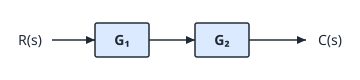
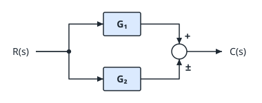
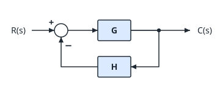
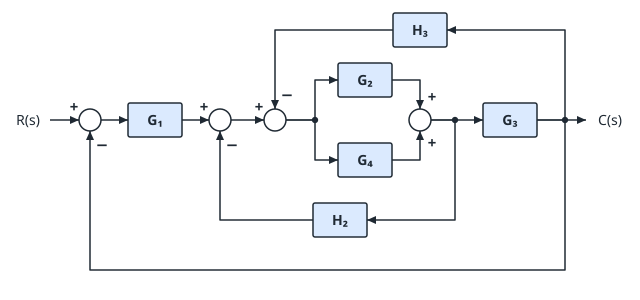
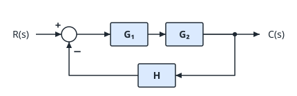
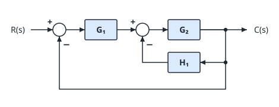

# Block Diagram Reduction

**Block diagram reduction is the method of collapsing a diagram of transfer-function blocks, summing junctions and feedback loops into a single transfer function C(s)/R(s) for the whole system.**

A thermostat, a car's cruise control and a robot joint controller are each drawn as a block diagram: the controller, the motor and the sensor are boxes, and arrows carry signals between them. Reduction answers one question about the whole drawing — what comes out for what goes in?

## Before you start
<!-- bite: afea4751-d1f8-4b41-8c8f-a0c2cf1b43c7 -->

You should know what a transfer function is and how to eliminate a variable between two equations ([[mechatronics/10-transfer-functions|Transfer Functions]]).

After this lesson you will be able to:

1. reduce blocks in series, blocks in parallel and a feedback loop;
2. reduce any block diagram by naming its signals and eliminating them;
3. find C(s)/R(s) for the Quiz 1 diagrams.

## What a block diagram is
<!-- bite: c0963734-67c4-4503-ae6c-04e2f1f211cf -->

In the last two lessons, each system gave one transfer function. A real control system is several of them joined up: a controller feeds a motor, the motor drives a load, a sensor measures the load and feeds the reading back. A **block diagram** draws each transfer function as a box and each signal as an arrow.

## The three parts of a block diagram
<!-- bite: cfe01305-53cd-4220-a26a-c23a20c0fbb4 -->

It has only three kinds of part:

1. A **block** multiplies the signal going in by its transfer function: out = G × in.
2. A **summing junction** (a circle) adds or subtracts the signals coming in, each marked + or −.
3. A **pick-off point** (a dot), also called a take-off point, copies a signal to two places without changing it.

Reduction is just algebra on those three parts, and the running examples are the five diagrams from SSG 415 Quiz 1.

## The kid version
<!-- bite: 56b45c64-c6df-49ec-a7dd-77a647ac726b -->

Imagine passing a message along a line of friends. Each friend changes it a bit in their own way — one doubles every number, one halves it. Two friends in a row act like one friend who does both changes. Now suppose the last friend shouts the result back to the first, who uses it to correct what they say next. Reduction is working out the single "super-friend" who would produce the same final message straight from the first.

**Where the analogy stops working.** A message is passed once. In a feedback loop the output keeps going round and round at the same time as the input arrives, which is why the loop's answer is a fraction, not a simple product.

## Rule 1: blocks in series multiply
<!-- bite: 69fe40ff-b19f-4624-8084-73954c77eb30 -->

When one block feeds straight into the next, the signal is multiplied by each in turn, so the two blocks act as one block that is their **product**:

$$\frac{C}{R} = G_1G_2$$

## Rule 2: blocks in parallel add
<!-- bite: 0152aa29-9295-461e-ab6a-9c71f107b2db -->

When a signal splits, goes through two blocks side by side, and the results meet at a summing junction, the blocks act as one block that is their **sum** (or difference, if one input is marked −):

$$\frac{C}{R} = G_1 \pm G_2$$

## Rule 3: a feedback loop gives a fraction
<!-- bite: 70f7ece8-2dd6-4199-b9ec-6475c979a58b -->

This is the one that matters most. The output C is fed back through H and subtracted from the input:

Name the junction's output E (the **error**). Then E = R − H·C and C = G·E. Substitute: C = G(R − H·C), so C + G·H·C = G·R, and

$$\frac{C}{R} = \frac{G}{1 + GH}$$

In words: **forward gain over one plus loop gain.** For positive feedback (a + at the junction) the denominator is 1 − G·H.

## The signal method for any diagram
<!-- bite: 1c05e221-e0f5-46c0-8158-c4b4df5783af -->

Rules 1–3 reduce simple diagrams, and textbooks add more rules for moving junctions and pick-offs past blocks. But the Quiz 1 diagrams have loops tangled inside loops, and there is a method that never gets lost:

1. **Name the output of every summing junction** (E₁, E₂, …). C and R already have names.
2. **Write one equation per junction**: its output = the sum of its inputs, each written as (block × named signal).
3. **Write C** in terms of the named signals.
4. **Eliminate** every named signal except C and R, exactly as you eliminated X₂ in a two-mass system.
5. **Divide** to get C/R and tidy it up.

It is the same elimination we used for transfer functions. Let us use it on the quiz.

## Quiz 1, figures 1 and 2: the diagram
<!-- bite: a04e7e3e-c533-4e9c-bf38-386eadf6c71c -->

Here is the diagram, drawn from the quiz's figure. Trace it with your finger first: R goes through a junction, then G₁, then splits into G₃ (subtracted) and G₂ (added) to give C. C comes back through H₁ to a second junction, where G₄R is subtracted; the result goes through H₂ and is subtracted at the first junction.

## Quiz 1, figures 1 and 2: the reduction
<!-- bite: f7f7d855-2bf9-4c67-af5c-7cd5aa9f0b55 -->

**Name the junction outputs.** E is the first junction's output; Z is the lower junction's output.

**One equation per junction, and one for C:**

$$E = R - H_2Z, \qquad Z = H_1C - G_4R, \qquad C = G_1(G_2 - G_3)\,E$$

The last equation uses rules 1 and 2: G₁ in series with the parallel pair (G₂ − G₃).

**Eliminate.** Put Z into E: E = R − H₂H₁C + H₂G₄R = R(1 + G₄H₂) − H₁H₂C. Put that into C:

$$C = G_1(G_2 - G_3)\left[(1 + G_4H_2)R - H_1H_2C\right]$$

**Collect C and divide:**

$$\frac{C}{R} = \frac{G_1(G_2 - G_3)(1 + G_4H_2)}{1 + G_1H_1H_2(G_2 - G_3)}$$

Check: if G₄ = 0, it is just rule 3 with forward gain G₁(G₂ − G₃) and loop gain G₁(G₂ − G₃)H₁H₂. The G₄ path adds a little of R straight into the loop, which is why (1 + G₄H₂) appears on top.

## Quiz 1, figure 3: the diagram
<!-- bite: 0ae3b0c9-bce4-4446-bd50-cf1fc5e55a5f -->

Figure 3 has three loops: unity feedback from C to the first junction, H₂ from the point after the parallel pair, and H₃ from C.

## Quiz 1, figure 3: the reduction
<!-- bite: bc4bbfa9-8393-4d7a-bbe2-2f55c3e0519e -->

Name the outputs of the junctions E₁, E₂, E₃, and the signal after the parallel pair P. Write G for the parallel pair, G = G₂ + G₄.

$$E_1 = R - C,\quad E_2 = G_1E_1 - H_2P,\quad E_3 = E_2 - H_3C,\quad P = G\,E_3,\quad C = G_3P$$

From the last, P = C/G₃. Substitute everything into P = G·E₃:

$$\frac{C}{G_3} = G\left[G_1(R - C) - H_2\frac{C}{G_3} - H_3C\right]$$

Multiply by G₃ and collect C:

$$\frac{C}{R} = \frac{G_1G_3(G_2 + G_4)}{1 + (G_2 + G_4)(H_2 + G_1G_3 + G_3H_3)}$$

Each term in the bracket is one loop: H₂ around the parallel pair, G₁G₃ for the unity loop through everything, and G₃H₃ for the H₃ loop.

## Terms used in block diagrams
<!-- bite: 36685345-da0d-4439-a28b-3f401d9acfe6 -->

1. **Block**: this is a box holding a transfer function. Its output is the transfer function times its input.
2. **Summing junction**: this is a circle where signals are added or subtracted, each marked + or −.
3. **Pick-off point**: this is also known as a **take-off point**. It is a dot where a signal is copied to more than one place, unchanged.
4. **Forward path**: this is the route from R to C following the arrows forward. Its gain is the product of the blocks on it.
5. **Loop gain**: this is the product of all the blocks around a closed loop, such as G·H.
6. **Negative feedback**: this is feedback that is subtracted at the junction. It gives the denominator 1 + G·H and is what makes systems settle.

## Common pitfalls and traps
<!-- bite: f60bcd2d-3938-4d37-8f0b-37a00dba61ff -->

- **The sign in the denominator.** Negative feedback gives 1 **+** G·H. The minus at the junction becomes a plus in the formula.
- **Losing a feed-forward path.** A block like G₄ that carries R around the loop adds a term; it does not disappear when you reduce the loop.
- **Treating a pick-off point as a junction.** A pick-off point copies; it never adds.
- **Moving a pick-off point past a block without compensating.** If you move it, you must add a block (G or 1/G) on the branch. The signal method avoids this trap entirely.
- **Not checking a special case.** Set one block to zero and see if the answer reduces to something you know.

## Check your understanding
<!-- bite: 37c4f287-3dba-4346-926d-cf08c82236d4 -->

Try each one before you open the answer.

1. <!-- q: exact id="ec3632a3" answer="1.333333" sigfigs="3" -->
   In this single-loop diagram, G₁ = 2, G₂ = 2 and H = 0.5 (all constant gains). What is C/R?

   

   

Answer

   Forward gain G₁G₂ = 4; loop gain G₁G₂H = 2. C/R = 4/(1 + 2) = 1.33.

   

2. <!-- q: exact id="30eedde0" answer="0.6" tolerance="0.001" -->
   In this two-loop diagram, G₁ = 2, G₂ = 3 and H₁ = 1. What is C/R?

   

   

Answer

   Name the second junction's output E₂: E₂ = G₁(R − C) − H₁C and C = G₂E₂. So C = G₂G₁R − G₂G₁C − G₂H₁C, giving C/R = G₁G₂/(1 + G₂H₁ + G₁G₂) = 6/(1 + 3 + 6) = 0.6.

   

3. <!-- q: mcq id="2ae852a0" -->
   A negative feedback loop has forward block G and feedback block H. What is C/R?

   - [x] G / (1 + G·H)
   - [ ] G / (1 − G·H)
   - [ ] G·H / (1 + G)
   - [ ] 1 / (1 + G·H)

   

Answer

   G / (1 + G·H): forward gain over one plus the loop gain. The minus sign at the junction becomes a plus in the denominator; 1 − G·H is positive feedback.

   

4. <!-- q: mcq id="11068844" -->
   A signal splits and passes through G₁ = 5/(s + 1) and G₂ = 2/(s + 1) in parallel, and the two outputs are subtracted (G₁ − G₂) at a summing junction. What single block replaces them?

   - [x] 3/(s + 1)
   - [ ] 7/(s + 1)
   - [ ] 10/(s + 1)²
   - [ ] 5/2

   

Answer

   Parallel blocks add or subtract: 5/(s + 1) − 2/(s + 1) = 3/(s + 1). Multiplying (the third option) is the rule for series.

   

5. <!-- q: mcq id="715996f0" -->
   A unity negative feedback loop has forward block G = 10/(s(s + 2)). What is the closed-loop transfer function C/R?

   - [x] 10 / (s² + 2s + 10)
   - [ ] 10 / (s² + 2s)
   - [ ] 10 / (s² + 2s − 10)
   - [ ] s(s + 2) / 10

   

Answer

   With H = 1, C/R = G/(1 + G) = [10/(s(s + 2))] / [1 + 10/(s(s + 2))] = 10/(s² + 2s + 10).

   

6. <!-- q: open id="09bfca6d" -->
   Derive the negative feedback formula C/R = G/(1 + G·H) from the two equations of the loop. Say what each equation means.

   

Answer

   The junction gives the error: E = R − H·C (the input minus the fed-back output). The forward block gives C = G·E. Substituting, C = G(R − H·C) = G·R − G·H·C, so C(1 + G·H) = G·R and C/R = G/(1 + G·H).

   

## Practice — independent task
<!-- bite: 0b4b8ee4-8459-4122-b537-eae01bb68eaf -->

Quiz 1 figure 4, as transcribed from the quiz, is below. Use the signal method: name the outputs of the two junctions, call the signal between G₂ and G₃ q, and remember the output junction **subtracts** G₃q and **adds** G₄R.

**Done when** you have C/R with only G's and H's, and setting G₄ = 0 gives you minus a two-junction loop answer.

Answer (open after your attempt)

With E₁ = R − H₁q, E₂ = G₁E₁ − H₁q − H₂G₃q, q = G₂E₂ and C = G₄R − G₃q:

$$\frac{C}{R} = \frac{G_4\left(1 + G_1G_2H_1 + G_2H_1 + G_2G_3H_2\right) - G_1G_2G_3}{1 + G_1G_2H_1 + G_2H_1 + G_2G_3H_2}$$

If your copy of figure 4 has the output junction's signs the other way round, swap the sign of the G₁G₂G₃ term. Quiz 1 figure 5 is solved the same way: one named signal per junction, then eliminate.

## Before moving on
<!-- bite: 642f6b50-24e0-4d11-9e53-aaf240e7c2a8 -->

You are done when you can reduce series, parallel and feedback blocks on sight, and reduce a tangled diagram by naming its signals and eliminating them.

Recap: series multiply; parallel add; negative feedback gives G/(1 + G·H); for anything harder, name each junction's output, write one equation per junction, and eliminate.

That closes section C. Next, section D: [[mechatronics/12-electrical-systems-and-analogies|Electrical Systems and the Two Analogies]] shows that every mechanical system you have modelled has an electrical twin.

## Related
<!-- bite: fd0c0b59-bb91-476f-8e83-12e717ef7bce -->

- [[control-theory/08-block-diagrams-1|Control Theory: Block Diagrams 1]]: block-diagram algebra in more depth.
- [[mechatronics/10-transfer-functions|Transfer Functions]]: what goes inside each block.

## About this lesson
<!-- bite: 3ff7ecbe-a3d8-47a6-84d9-86cd18d33c48 -->

**Level:** algebra with transfer functions. It covers blocks, summing junctions and pick-off points; the series, parallel and feedback rules; the signal method; and the reduction of Quiz 1 figures 1–4. It is lesson 16, the last of section C (numbered 16 because it was added after section D, but it belongs with the transfer-function lessons). Every reduction here is checked by solving the signal equations numerically in `scripts/diagrams/mechatronics_models.py`.

**Source:** SSG 415 Class Quiz 1 (14/01/2020), figures 1–5. The figures were drawn from the quiz's written descriptions; check the signs against your original figure, especially in figures 4 and 5, whose descriptions are the least clear.
