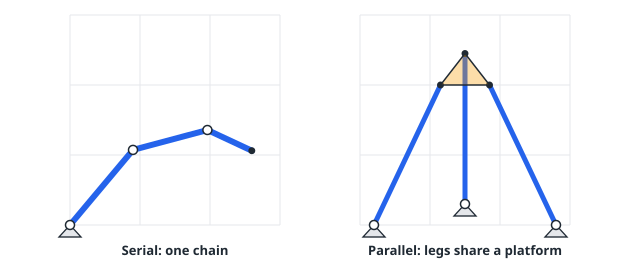

# Serial and Parallel Manipulators

**A robotic manipulator is a mechanical system designed to interact with its environment through its end-effector, and it comes in two basic builds: serial, one chain of links from base to hand, and parallel, several legs sharing one moving platform.**

The orange arm welding a car body is serial. The spider-like robot that picks chocolates off a conveyor faster than you can see, and the platform that tilts a flight simulator, are parallel.

## Before you start
<!-- bite: b65341bc-9597-4fda-a7ba-8b55caf156aa -->

You should know what a mechatronic system and its five elements are ([[mechatronics/02-the-five-elements-of-mechatronics|The Five Elements of Mechatronics]]). No maths beyond multiplying.

After this lesson you will be able to:

1. define a robotic manipulator, a serial manipulator and a parallel manipulator, with examples;
2. list the advantages and challenges of each;
3. explain why errors add up along a serial chain, and choose a build for a given job.

## What a manipulator is
<!-- bite: ba9053a1-1f6b-484b-9257-8475a333abd9 -->

This section is the second robotics course, SSG 515/519 (Mechanics and Robotic Systems II), and it starts where every robotics course starts: what the machine *is*. A **manipulator** is the arm part of a robot — the links and joints that move a tool, the **end-effector** (a gripper, a welding torch, a suction cup), to where the job is.

Every manipulator is built from **links** (the rigid pieces) joined by **joints** (the parts that turn or slide). Each joint a motor can drive adds a **degree of freedom (DOF)** — one independent way the arm can move. How the links and joints are arranged is the big design choice, and there are two families.

## The kid version
<!-- bite: 23f9c162-c0e1-4ac0-b2c4-2ae7eb7ff63e -->

Think of your own arm: shoulder, elbow, wrist, one after the other. Each joint carries all the joints after it. That is **serial**: a chain. Now think of a table with three legs, where the tabletop moves when you change the length or angle of the legs. Every leg holds the top at the same time. That is **parallel**: many supports sharing the work.

**Where the analogy stops working.** A table's legs are fixed; a parallel robot's legs are each driven by a motor, and the top can tilt and slide in ways that need careful maths to predict — far harder than working out where your hand is from your shoulder and elbow.

## The two builds side by side
<!-- bite: 38cdc742-ca65-49ec-a359-672fbdbf7265 -->

A **serial manipulator** is a single kinematic chain of rigid links connected by joints from the base to the end-effector. Each joint contributes to the overall DOF. Industrial arms such as the Universal Robots UR5 and KUKA arms are serial.

A **parallel manipulator** has multiple independent kinematic chains — called **legs** — connecting the base to the end-effector platform. The Stewart platform (used in flight simulators) and the Delta robot (used for fast pick-and-place) are parallel.

## Serial manipulators: strengths
<!-- bite: 7d000497-3aed-4092-af4e-3edb2dea3d99 -->

The notes list four advantages:

1. **Wide workspace.** A chain can reach far and around things, like your arm reaching behind a box.
2. **Simpler control.** The kinematic and dynamic models are easier to write: each joint's effect simply adds to the ones before it.
3. **Versatility.** The same arm can weld, paint, assemble or pick, just by changing its tool and program.
4. **Ease of design.** Serial arms are modular and scalable — add a link, add a joint.

## Serial manipulators: challenges
<!-- bite: c2ac0d8f-2454-4740-9239-54fc0fae3c3e -->

And four challenges:

1. **Vulnerability to singularities.** At certain poses (for example, fully stretched) the arm loses the ability to move in some direction. Lesson 20 is about these.
2. **Lower stiffness.** Each joint carries everything after it, so the arm deflects under load, like a fishing rod.
3. **Complex dynamics with many joints.** Every joint's motion pushes on every other.
4. **Cumulative errors.** Precision decreases with each added joint, because a small error at the base is carried — and magnified — all the way to the tip.

## Why serial errors add up
<!-- bite: 2863bace-0dac-4c73-958c-fcddb5edec1f -->

Here is the cumulative-error idea with numbers. A two-link arm is stretched straight out: link 1 is 0.6 m, link 2 is 0.4 m. Each joint's encoder can be off by 0.01 rad.

1. An error of 0.01 rad at the **shoulder** swings the whole arm, so the tip, 1.0 m away, moves 1.0 × 0.01 = 0.010 m.
2. An error of 0.01 rad at the **elbow** swings only link 2, so the tip moves 0.4 × 0.01 = 0.004 m.

In the worst case both errors push the same way: 0.010 + 0.004 = **0.014 m = 14 mm**. The joint nearest the base matters most, because its error is multiplied by the longest lever. Add more joints and the errors keep piling up.

## Parallel manipulators: strengths
<!-- bite: 789370ab-3e61-463e-b91b-f5718f4e8746 -->

Because several legs share the load and each leg is short, parallel manipulators have the opposite profile. The notes' advantages:

1. **High stiffness and precision.** The legs brace each other, like a tripod, so there is little deflection.
2. **High load-bearing capacity.** The load is shared across the legs.
3. **Dynamic performance.** The motors usually sit on the base, so the moving parts are light and the platform can move faster and more precisely.
4. **Compact design.**

And notice: the errors **do not** pile up along a chain. Each leg's error affects the platform directly, and the legs partly average each other out.

## Parallel manipulators: challenges
<!-- bite: 27b5ce56-ad57-4fbc-a0a0-2037e3a1afd3 -->

1. **Limited workspace.** The platform can only go where every leg can reach at once.
2. **Complex control algorithms.** The kinematics and dynamics are intricate — finding where the platform is from the leg angles is the *hard* direction for a parallel robot.
3. **Manufacturing precision required.** If the legs or anchor points are slightly off, the platform is forced and binds.
4. **Maintenance difficulties.** More legs and connections mean more to inspect and fix.

## Choosing between them
<!-- bite: 7d8ee42b-459d-4156-a6ba-e9c5cfc2f4c5 -->

Put the two lists together and the choice usually makes itself:

1. Need **reach, flexibility and a big workspace** — welding a car body, painting, tending several machines? **Serial.**
2. Need **speed, stiffness, precision or heavy loads in a small space** — sorting sweets at 200 picks a minute, a flight simulator, a precision positioning stage? **Parallel.**

## Terms used for manipulators
<!-- bite: 75f66d5b-7599-4c80-a6ca-77ce71b5b854 -->

1. **Manipulator**: this is the arm of a robot — links and joints that move an end-effector to where the job is.
2. **End-effector**: this is the tool at the end of a manipulator, such as a gripper, torch or suction cup.
3. **Link**: this is a rigid piece of a manipulator between two joints.
4. **Joint**: this is the part that lets two links move relative to each other. A **revolute** joint turns; a **prismatic** joint slides.
5. **DOF (degrees of freedom)**: this is the number of independent ways a system can move. A planar arm with three revolute joints has 3 DOF.
6. **Kinematic chain**: this is a sequence of links connected by joints. A serial manipulator is one open chain; a parallel manipulator is several chains closed at a platform.
7. **Stiffness**: this is how little a structure deflects under load. A stiff robot holds its position when pushed.

## Common pitfalls and traps
<!-- bite: 5703e70b-781a-442c-835b-4ba8e03dac31 -->

- **Thinking "parallel" means the legs are geometrically parallel.** It means the legs act *in parallel*, side by side, rather than one after another.
- **Assuming more joints always means better.** Each extra joint adds reach and flexibility, but also error, flexibility and complexity.
- **Saying parallel robots are easier because they are stiffer.** They are stiffer, but their kinematics and control are harder.
- **Forgetting that serial error grows with distance from the joint.** A base-joint error is multiplied by the whole arm's length.

## Check your understanding
<!-- bite: 697094da-cf8c-429c-8c01-e07a259df6dc -->

Try each one before you open the answer.

1. <!-- q: mcq id="2154fc89" -->
   Which of these are parallel manipulators? (choose all that apply)

   - [x] A Stewart platform
   - [x] A Delta robot
   - [ ] A UR5 arm
   - [ ] A KUKA welding arm

   

Answer

   The Stewart platform and the Delta robot are parallel: several legs share one platform. UR5 and KUKA arms are serial chains.

   

2. <!-- q: mcq id="53112afd" -->
   Which is an advantage of a parallel manipulator over a serial one?

   - [ ] A wider workspace
   - [x] Higher stiffness and load-bearing capacity
   - [ ] Simpler kinematic modelling
   - [ ] Easier maintenance

   

Answer

   The legs share the load and brace each other, so parallel manipulators are stiffer and carry more. Wider workspace and simpler modelling belong to serial arms; maintenance is harder for parallel ones.

   

3. <!-- q: exact id="f29214d8" answer="14" tolerance="0.01" -->
   A two-link serial arm is stretched straight: link 1 is 0.6 m and link 2 is 0.4 m. Each joint may be wrong by 0.01 rad. In the worst case, how far (in mm) can the tip be from where it should be?

   

Answer

   Shoulder error: (0.6 + 0.4) × 0.01 = 0.010 m. Elbow error: 0.4 × 0.01 = 0.004 m. Worst case both add: 0.014 m = 14 mm.

   

4. <!-- q: exact id="1538f17d" answer="3" -->
   A planar robot arm has three revolute joints in a chain, each driven by its own motor. How many degrees of freedom does it have?

   

Answer

   Three: each driven joint in a serial chain adds one degree of freedom.

   

5. <!-- q: gap id="e1f95154" answers="serial;parallel" -->
   A robot that must weld all round a large car body needs a big workspace, so a ___ manipulator suits it; a robot that must place tiny parts very precisely at high speed suits a ___ manipulator.

   

Answer

   Serial for the big workspace; parallel for stiffness, speed and precision.

   

6. <!-- q: open id="cd8d6b33" -->
   Explain why a serial manipulator becomes less precise as joints are added, while a parallel manipulator does not suffer the same way.

   

Answer

   In a serial chain, each joint carries every joint after it, so an angle error at one joint swings everything beyond it; the tip error is that joint's error times its distance to the tip, and the errors of all the joints add up along the chain. In a parallel manipulator, each leg connects the base directly to the platform, so a leg's error affects the platform once, without being carried through other joints, and the legs brace each other, which also keeps deflection small.

   

## Before moving on
<!-- bite: bffe1d12-3d96-4e8c-a7ee-c307460ce5b0 -->

You are done when you can define both builds with an example each, list four advantages and four challenges of each, and work out the worst-case tip error of a simple chain.

Recap: serial = one chain, wide workspace and easy modelling, but singularities, low stiffness and cumulative error; parallel = several legs sharing a platform, stiff, precise and fast, but small workspace and complex control.

Next, [[mechatronics/18-forward-and-inverse-kinematics|Forward and Inverse Kinematics]] starts the maths: how to work out where a serial arm's hand is from its joint angles — and the much harder reverse.

## Related
<!-- bite: 8dcbbe87-3427-4314-8bd8-54d5d9c565b5 -->

- [[robotics/01-what-robotics-actually-is|What Robotics Actually Is]]: the wider picture of robots.
- [[mechatronics/21-parallel-manipulators|Parallel Manipulators]]: the parallel build analysed.

## About this lesson
<!-- bite: 5cd7bef1-8257-40aa-8290-1902809c20e5 -->

**Level:** introductory, simple arithmetic. It covers robotic manipulators, serial and parallel builds with their advantages and challenges, cumulative error, and choosing a build. It is lesson 17, the first of section F (robotic systems), which follows the SSG 515/519 course.

**Source:** University of Lagos SSG 515 Week 3 lecture, "Robotic Manipulators II" by Dr John Ogbemhe (slides 2–7: parallel versus serial manipulators).
