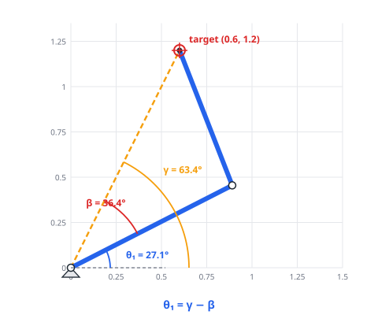
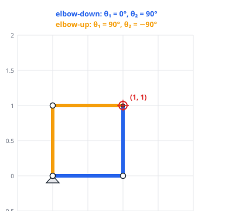

# Forward and Inverse Kinematics

**Kinematics is the study of motion without considering the forces that cause it; forward kinematics finds where a robot's end-effector is from its joint angles, and inverse kinematics finds the joint angles that put the end-effector where you want it.**

When you reach for a cup, your brain does inverse kinematics without asking you: it knows where the cup is and works out how to bend your shoulder, elbow and wrist. A robot has to be told how.

## Before you start
<!-- bite: 8a2b4e39-ba13-4e11-bbc1-76727d34a38d -->

You should know what a serial manipulator, a link and a joint are ([[mechatronics/17-serial-and-parallel-manipulators|Serial and Parallel Manipulators]]). You need sine, cosine, the cosine rule, and atan2 (the two-argument arctangent that gives an angle in the right quadrant).

After this lesson you will be able to:

1. write the forward kinematics of a planar arm with any number of links;
2. explain the four challenges of inverse kinematics and check whether a target is reachable;
3. solve the inverse kinematics of a two-link arm analytically, finding both solutions.

## What kinematics is for
<!-- bite: 8850a4ad-00ae-43f7-8faa-342d66c04e5b -->

In the last lesson we said a serial arm is "easier to model". This lesson shows what that model is. It answers two questions, one in each direction:

1. **Forward kinematics (FK):** "My joints are at these angles. Where is the hand?" Direct substitution into a formula — easy, and always exactly one answer.
2. **Inverse kinematics (IK):** "I want the hand *there*. What joint angles do that?" Nonlinear equations to solve — hard, and there may be no answer, one, two, or infinitely many.

A robot needs both. FK to know where it is, IK to know how to get where it is told to go. The running example is a **two-link planar arm** — an arm that moves in a flat plane, like a desk lamp.

## The kid version
<!-- bite: 055cef8e-275e-4938-9e9c-0d4326712713 -->

Imagine a desk lamp with two hinges. If someone tells you how far each hinge is bent, you can easily say where the bulb ends up: just follow the arm along. That is forward. But if someone points at a spot and says "put the bulb there", you have to think: maybe bend the elbow up, maybe down, and if the spot is too far away, you simply can't. That is inverse.

**Where the analogy stops working.** You solve the lamp by feel, trying and adjusting. A robot needs either an exact formula, which only exists for simple arms, or a numerical method that does the "trying and adjusting" systematically — that is the next lesson.

## Forward kinematics in general
<!-- bite: e8970262-2005-4487-8719-6102fb02639a -->

For a general robot, each joint's position and orientation is described by a 4 × 4 homogeneous transformation matrix Aᵢ, and the end-effector's pose is the product of all of them, from base to tip:

$$T = A_1A_2\cdots A_n$$

Each Aᵢ says "turn by this joint's angle, then move along this link". Multiplying them chains the moves together. For an arm that moves in a plane, this collapses to simple trigonometry, which is what the course uses.


## Seeing the chain of frames
<!-- bite: 88895626-7242-481e-917a-e12c109e59e7 -->

Picture a small set of axes stuck to the base, another to the elbow, another to the hand. Each $A_i$ carries one frame to the next; multiplying them all together carries the base frame straight to the hand.


## Forward kinematics of a two-link arm
<!-- bite: 8976f505-08c8-4f60-9565-744800738b43 -->

Link 1 has length l₁ and joint angle θ₁, measured from the x-axis. Link 2 has length l₂ and joint angle θ₂, measured from link 1. So link 2 points at the **absolute** angle θ₁ + θ₂. Following the arm from the base:

$$x = l_1\cos\theta_1 + l_2\cos(\theta_1 + \theta_2)$$

$$y = l_1\sin\theta_1 + l_2\sin(\theta_1 + \theta_2)$$

and the hand's orientation is φ = θ₁ + θ₂. With l₁ = l₂ = 1, θ₁ = 0 and θ₂ = 90°: x = 1 + cos 90° = 1 and y = 0 + sin 90° = 1. The hand is at (1, 1).


## Seeing the two-link formula
<!-- bite: a3815c7e-a277-4a4a-90f6-c8f1d7790f3b -->

Here is the formula for an arm with $l_1 = 1.0$, $\theta_1 = 30°$, $l_2 = 0.8$, $\theta_2 = 45°$. Each link adds a step across (green, its cosine part) and a step up (orange, its sine part). Notice that $\theta_2$ is measured from the line of link 1, so link 2's direction is $\theta_1 + \theta_2$.


## Forward kinematics of an n-link arm
<!-- bite: a54d679f-ce4e-4e34-94b7-6013e40ebde5 -->

The same pattern works for any number of links in a plane. Define the **cumulative angles** — each link's absolute direction is the sum of the joint angles up to it:

$$\varphi_1 = q_1,\quad \varphi_2 = q_1 + q_2,\quad \ldots,\quad \varphi_n = q_1 + q_2 + \cdots + q_n$$

Then the hand is at

$$x = \sum_{i=1}^{n} l_i\cos\varphi_i, \qquad y = \sum_{i=1}^{n} l_i\sin\varphi_i$$

In words: add up each link as a little arrow pointing at its absolute angle. The notes write joint angles as q in the numerical lessons and θ in the analytical ones; they mean the same thing.


## Seeing the cumulative angles
<!-- bite: 6a73232d-26af-43ee-8bf7-b4c3522eb560 -->

Each joint angle $q_i$ is measured from the link before it, so to get a link's direction from the x-axis you add up every joint angle so far. The arcs show $\varphi_1$, $\varphi_2$ and $\varphi_3$, each measured from a horizontal line at its joint:


## The four challenges of inverse kinematics
<!-- bite: 10bbe6ab-7dde-4f30-b227-ce67b9caa4fd -->

FK maps $\theta \to x$: direct substitution, a unique answer. IK maps the desired position $x_d \to \theta$, and the notes give four reasons it is hard:

1. **Nonlinear trigonometric equations.** The unknowns sit inside sines and cosines, so you cannot just rearrange.
2. **Multiple solutions.** The classic case is **elbow-up** versus **elbow-down**: two different arm shapes put the hand in the same place.
3. **Joint limits.** A mathematical solution may need a joint to bend further than it physically can.
4. **Singularities.** At some poses the arm loses a direction of motion and the equations break down (the Jacobian loses rank — lesson 20).

There may also be **no solution**: the target is out of reach. So always check reachability first.

## Checking reachability
<!-- bite: c8aaf531-315c-46ce-b285-22f2524aafca -->

A two-link arm can reach every point whose distance d = √(x² + y²) from the base lies between the arm folded back and the arm stretched out:

$$|l_1 - l_2| \le d \le l_1 + l_2$$

For any planar arm, $R_{\max} = l_1 + l_2 + \dots + l_n$ is the furthest it can reach. If $d > R_{\max}$, stop: there is no solution, and no amount of iterating will find one.


## Seeing the reachable ring
<!-- bite: ea29b681-86ea-422e-84b3-107d3b223a88 -->

Fully stretched, the arm reaches $l_1 + l_2$; fully folded back, it still reaches $|l_1 - l_2|$. Everything in between is reachable, so the workspace is a ring:


## Solving the two-link arm: the elbow angle
<!-- bite: 09a1d4b9-cfb4-4020-96e1-1e4c5bbad5bf -->

For two links there is an exact formula. Square and add the two FK equations; the cross terms combine by the cosine rule into

$$x^2 + y^2 = l_1^2 + l_2^2 + 2l_1l_2\cos\theta_2$$

which gives the elbow angle directly:

$$\theta_2 = \cos^{-1}\!\left(\frac{x^2 + y^2 - l_1^2 - l_2^2}{2l_1l_2}\right)$$

Since cos θ₂ = cos(−θ₂), both **+θ₂ and −θ₂** work: those are the two solutions, elbow-down and elbow-up. If the bracket is bigger than 1 or smaller than −1, the target is out of reach.


## Seeing the elbow triangle
<!-- bite: 4a4bfead-e6b2-4f06-897f-24c9c64fcce6 -->

The base, the elbow and the target make a triangle with sides $l_1$, $l_2$ and $d$. Knowing all three sides fixes the angle at the elbow, which is what the law of cosines gives. Here for $l_1 = 1.0$, $l_2 = 0.8$ and the target $(0.6, 1.2)$:


## Solving the two-link arm: the shoulder angle
<!-- bite: e9087c0a-d571-4977-9c6f-7fbf87183de8 -->

With θ₂ known, the shoulder angle is the direction to the target minus the angle the bent arm makes with its first link:

$$\theta_1 = \tan^{-1}\!\left(\frac{y}{x}\right) - \tan^{-1}\!\left(\frac{l_2\sin\theta_2}{l_1 + l_2\cos\theta_2}\right)$$

Compute both arctangents with **atan2**, which takes the numerator and denominator separately and so gets the quadrant right. A plain tan⁻¹(y/x) cannot tell (1, 1) from (−1, −1).


## Seeing the shoulder angle
<!-- bite: 60e2ceb2-7359-4b9e-8251-4b2f46925c85 -->

The first $\tan^{-1}$ is $\gamma$, the direction from the base to the target. The second is $\beta$, how far link 1 sits below that line, fixed by the triangle. The shoulder angle is the difference:



## Worked example: two links reaching (1, 1)
<!-- bite: 8ab471ec-b2ab-45d6-93d4-30524b251981 -->

The interactive example from the slides: $l_1 = l_2 = 1$, target $(x_d, y_d) = (1, 1)$.

1. **Reachable?** d = √2 = 1.414, and 0 ≤ 1.414 ≤ 2. Yes.
2. **Elbow:** cos θ₂ = (1 + 1 − 1 − 1)/(2 × 1 × 1) = 0, so θ₂ = +90° or −90°.
3. **Shoulder for θ₂ = +90°:** atan2(1, 1) − atan2(1, 1 + 0) = 45° − 45° = 0°.
4. **Shoulder for θ₂ = −90°:** atan2(1, 1) − atan2(−1, 1) = 45° + 45° = 90°.

Check the first with FK: x = cos 0° + cos 90° = 1, y = sin 0° + sin 90° = 1. ✓

## Seeing both solutions
<!-- bite: 81003cee-f641-4ea5-b34d-fb99f01edfad -->



Two arm shapes, same hand position. A real controller picks one — usually the one closer to the current pose, or the one that respects the joint limits.

## The same thing in MATLAB
<!-- bite: d34dfc70-fa2e-41f9-9bf6-7ef97145158a -->

The course appendix gives these as MATLAB fragments (not full programs):

```matlab
% forward kinematics, 2-DOF
x   = l1*cos(theta1) + l2*cos(theta1 + theta2);
y   = l1*sin(theta1) + l2*sin(theta1 + theta2);
phi = theta1 + theta2;

% analytical inverse kinematics, 2-DOF
cos_theta2 = (x^2 + y^2 - l1^2 - l2^2) / (2*l1*l2);
theta2 = acos(cos_theta2);          % use -acos(...) for the other elbow
k1 = l1 + l2*cos(theta2);
k2 = l2*sin(theta2);
theta1 = atan2(y, x) - atan2(k2, k1);
```

Every number in this lesson is checked in `scripts/diagrams/mechatronics_robotics.py`, which implements the same formulas in Python.

## Why we model at all
<!-- bite: ac3b1920-357e-426d-b9aa-d14cee4fa9e1 -->

The slides end the topic by asking why all this modelling is worth it. Four reasons:

1. **Precision control** — the controller can only command what it can calculate.
2. **Simulation and testing** — try a motion on the model before risking the real robot.
3. **Design optimisation** — choose link lengths and joint ranges that suit the task.
4. **Fault diagnosis** — when the real arm and the model disagree, something is wrong.

## Terms used in kinematics
<!-- bite: c42172c6-bb53-4091-b150-1813f6bf6a13 -->

1. **Kinematics**: this is the study of motion — positions, velocities, angles — without considering the forces that cause it.
2. **Forward kinematics (FK)**: this is finding the end-effector's position and orientation from the joint angles.
3. **Inverse kinematics (IK)**: this is finding the joint angles that put the end-effector at a desired position.
4. **Cumulative angle**: this is the absolute direction of a link in a planar arm, the sum of the joint angles up to and including it.
5. **Workspace**: this is the set of all points the end-effector can reach.
6. **Elbow-up / elbow-down**: these are the two mirror-image solutions of a two-link arm, with the elbow bent one way or the other.
7. **atan2(y, x)**: this is the arctangent that takes y and x separately and so returns the angle in the correct quadrant, from −180° to 180°.

## Common pitfalls and traps
<!-- bite: 7350a498-f825-4cec-9c0f-460732d2a169 -->

- **Using θ₂ as an absolute angle.** θ₂ is measured from link 1; link 2's absolute angle is θ₁ + θ₂.
- **Reporting one IK solution.** There are usually two (±θ₂); say so and give both.
- **Using tan⁻¹(y/x) instead of atan2.** It puts the arm in the wrong quadrant for targets with negative x.
- **Skipping the reachability check.** If |cos θ₂| > 1 the target is unreachable — no answer exists.
- **Mixing degrees and radians.** Calculators and MATLAB's cos use radians unless told otherwise.

## Check your understanding
<!-- bite: 2a1accc0-bae4-4529-88ae-f6c50d5f4024 -->

Try each one before you open the answer.

1. <!-- q: exact id="1faf99d3" answer="0.5" tolerance="0.001" -->
   A two-link arm has l₁ = 1.0 m and l₂ = 0.5 m. The joints are at θ₁ = 90° and θ₂ = −90°. What is the x-coordinate of the hand, in metres?

   <details><summary>Answer</summary>

   x = 1.0 cos 90° + 0.5 cos(90° − 90°) = 0 + 0.5 = 0.5 m. (And y = 1.0 sin 90° + 0.5 sin 0° = 1.0 m.)

   </details>

2. <!-- q: exact id="1b2ca559" answer="1.36603" sigfigs="3" -->
   A planar arm has three links, each 1 m long, and every joint is at 30°. Using cumulative angles, what is the x-coordinate of the hand, in metres?

   <details><summary>Answer</summary>

   The cumulative angles are 30°, 60° and 90°. x = cos 30° + cos 60° + cos 90° = 0.866 + 0.5 + 0 = 1.37 m. (y = 0.5 + 0.866 + 1 = 2.37 m.)

   </details>

3. <!-- q: exact id="27161e1c" answer="90" accept="-90|±90" tolerance="0.01" -->
   A two-link arm has l₁ = 3 m and l₂ = 4 m and must reach (5, 0). What is the size of the elbow angle θ₂, in degrees?

   <details><summary>Answer</summary>

   cos θ₂ = (25 + 0 − 9 − 16)/(2 × 3 × 4) = 0, so θ₂ = ±90°. The 3-4-5 triangle has its right angle at the elbow.

   </details>

4. <!-- q: mcq id="e5a6cbac" -->
   A two-link arm has l₁ = 2 m and l₂ = 1 m. Which of these targets can it reach? (choose all that apply)

   - [x] (2.0, 1.0)
   - [x] (0.0, 1.5)
   - [ ] (0.5, 0.5)
   - [ ] (2.5, 2.0)

   <details><summary>Answer</summary>

   It reaches distances from |2 − 1| = 1 to 3 m. (2, 1): 2.24 ✓. (0, 1.5): 1.5 ✓. (0.5, 0.5): 0.71, too close. (2.5, 2.0): 3.20, too far.

   </details>

5. <!-- q: gap id="502b80ae" answers="unique|one|exactly one;nonlinear|non-linear" -->
   Forward kinematics always gives a ___ answer by direct substitution, while inverse kinematics needs ___ trigonometric equations to be solved and may have none, one or many answers.

   <details><summary>Answer</summary>

   A unique answer; nonlinear equations.

   </details>

6. <!-- q: open id="e1090b8a" -->
   State the four challenges of inverse kinematics and give a one-line example of each.

   <details><summary>Answer</summary>

   (1) Nonlinear trigonometric equations — the unknown angles sit inside sines and cosines, so they cannot be isolated by simple algebra. (2) Multiple solutions — a two-link arm can reach the same point elbow-up or elbow-down. (3) Joint limits — a solution may need a joint to turn further than its range, so it is unusable. (4) Singularities — when a two-link arm is fully stretched, det J = 0 and it cannot move in some directions, so numerical methods break down.

   </details>

## Practice — independent task
<!-- bite: 412a7584-96b9-4597-a2e4-6ec89ec324de -->

A two-link arm has l₁ = l₂ = 1 m. Find **both** sets of joint angles that put the hand at (1.2, 0.8), then check each one with forward kinematics.

**Done when** both of your solutions give x = 1.2 and y = 0.8 to three decimal places.

<details><summary>Answer (open after your attempt)</summary>

cos θ₂ = (1.44 + 0.64 − 1 − 1)/2 = 0.04, so θ₂ = ±87.71°.
For θ₂ = +87.71°: θ₁ = atan2(0.8, 1.2) − atan2(sin 87.71°, 1 + cos 87.71°) = 33.69° − 43.85° = −10.16°.
For θ₂ = −87.71°: θ₁ = 33.69° + 43.85° = 77.54°.

</details>

## Before moving on
<!-- bite: f79b7413-ba79-47bb-867e-5ca7a4e2751a -->

You are done when you can write planar FK for any number of links, check reachability, and solve two-link IK for both elbows, checking each answer with FK.

Recap: FK x = Σ lᵢ cos φᵢ, y = Σ lᵢ sin φᵢ with cumulative angles; IK for two links: cos θ₂ = (x² + y² − l₁² − l₂²)/(2l₁l₂), θ₁ = atan2(y, x) − atan2(l₂ sin θ₂, l₁ + l₂ cos θ₂); two solutions, and none outside |l₁ − l₂| ≤ d ≤ l₁ + l₂.

Next, [[mechatronics/19-numerical-inverse-kinematics|Numerical Methods for Inverse Kinematics]] handles arms with three or more links, where no neat formula exists — the four iterative methods the exam tests.

## Related
<!-- bite: 74050962-bde4-455f-8498-7c51b7db8ac3 -->

- [[robotics/05-forward-kinematics-and-dh-parameters|Forward Kinematics]] and [[robotics/06-inverse-kinematics|Inverse Kinematics]]: the same ideas in 3D, with Denavit–Hartenberg parameters.

## About this lesson
<!-- bite: d9662abc-92c9-4fb9-a224-08da5c787b9c -->

**Level:** trigonometry. It covers kinematics, forward kinematics for two and n links, the four challenges of inverse kinematics, reachability, the analytical two-link solution with both elbows, the course's MATLAB fragments, and why robots are modelled. It is lesson 18, in section F. Every number here is checked in `scripts/diagrams/mechatronics_robotics.py`.

**Source:** University of Lagos SSG 515 Week 3 lecture, "Robotic Manipulators II" (slides 8–13 on kinematic analysis, slides 19–25 on the advantages of modelling, and the MATLAB appendix), and the SSG 515/519 Topic 1 deep dive (Part 1, inverse-kinematics fundamentals).
